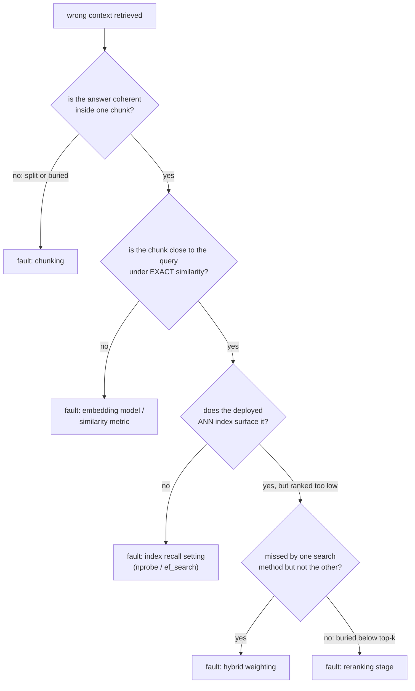

# 检索评估

度量检索质量并诊断失败。便于在评估或调试流水线时查阅。

## Recall@k 和 MRR

| 指标 | 问的是 | 对确切排名敏感吗？ |
|---|---|---|
| Recall@k | 在测试查询中，有多大比例的查询，其某个相关文档出现在前 k 名的某处 | 不敏感：排第 1 和排第 k 都算命中 |
| MRR（平均倒数排名） | 对所有查询，第一个相关结果的 `1/rank` 的平均值 | 敏感：排第 1 贡献 1.0，排第 10 贡献 0.1 |

Recall@k 随 k 增大而增大；它是一个预算问题（如果下游只看前 k 名，recall@k 说明它有多常得到了找到答案的机会）。MRR 奖励的是把正确答案排得尽可能靠前，这正是 recall@k 所丢掉的信息。

**算例**，四个查询，第一个相关结果的排名是 1、3、1、8：

```text
recall@1: ranks <= 1 are queries 1 and 3 -> 2/4 = 0.50
recall@5: ranks <= 5 are queries 1, 2, 3 (ranks 1, 3, 1); query 4 (rank 8) misses -> 3/4 = 0.75
MRR: (1/1 + 1/3 + 1/1 + 1/8) / 4 = (1.000 + 0.333 + 1.000 + 0.125) / 4 ~= 0.615
```

recall@5 说明，四个查询中有三个能在前 5 名内找到答案。MRR 的 0.615 则反映出，大多数命中落在第 1 位，还有一个较弱的命中和一次未命中把平均值拉了下来。

## 选择 k，以及在两个指标之间选择

recall@k 中合适的 k，是下游系统实际使用的那个数：如果只有前 5 个文本块会进入生成，那么 recall@100 度量的是流水线从未利用的东西。当只有最靠前的那个结果非常重要时，MRR 最有参考价值；当预算之内的好几个结果都可用时，recall@k 更有参考价值。在流水线实际使用的 k 上同时报告两者，比单看任何一个都更完整。

## 诊断流水线：先隔离，再调优

“检索到了错误的上下文”是症状，不是诊断。按顺序检查各个阶段，这样前面阶段的问题，就不会让你白白去调整后面的阶段：



| 检查 | 隔离出什么 |
|---|---|
| 把本该回答某个已知失败查询的文本块调出来看 | [分块](chunking-and-embeddings.md)是否让答案得到了连贯的表示；后面任何阶段都修复不了被切开或被埋起来的答案 |
| 精确相似度（绕过 ANN 索引） | 嵌入模型或相似度度量是否把正确的文本块放在了查询附近，与索引调优无关 |
| 在确认嵌入接近之后，查已部署的 ANN 索引 | [索引的召回率设置](vector-search-and-indexing.md)（`nprobe` / `ef_search`）是否被调得过于偏向速度 |
| 比较仅向量、仅 BM25 与混合检索 | [混合比例](hybrid-search.md)是否低估了本来能把它浮现出来的那种方法 |
| 检查融合之后最终的前 k 名 | 如果被检索到但排得太靠后，是否缺少[重排序](reranking.md)或调优不足 |

## 要在一组查询上诊断，而不是靠一个孤例

单个失败的查询可能因为偶发的原因（不寻常的措辞）而失败，而不是系统性的问题。在一小批已知的、有代表性的失败案例上，于每个阶段（初始检索、混合融合之后、重排序之后）测量 recall@k 和 MRR，就能看出总体上最大的下降出现在哪里。

## 相关内容

- [第 10 课](../lessons/0010-recall-at-k-and-mrr.md)、[第 11 课](../lessons/0011-diagnosing-the-pipeline.md)
- [分块与嵌入](chunking-and-embeddings.md)、[向量搜索与索引](vector-search-and-indexing.md)、[混合检索](hybrid-search.md)、[重排序](reranking.md)：本速查表的诊断流程所要在其间做隔离的各个阶段
