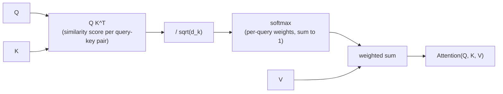

# Lección 1. Scaled Dot-Product Attention

**Vínculo con la misión:** "Construir la atención desde cero" empieza por la ecuación única alrededor de la cual se envuelve cada pieza posterior (multi-head attention, el bloque transformer). Nada de lo que viene después de esta lección tiene sentido hasta que lo tiene esta operación.
**Fuente principal:** [Paper: "Attention Is All You Need", Vaswani et al., 2017](https://arxiv.org/abs/1706.03762)
**Requisitos previos:** ninguno

## Qué debes saber

### La atención como una búsqueda blanda

La atención toma tres entradas: un vector **query**, un conjunto de vectores **key** y un conjunto de vectores **value**, con una key emparejada con cada value. Compara la query con cada key para obtener una puntuación por key, convierte esas puntuaciones en pesos que suman 1 y devuelve la suma ponderada de los values usando esos pesos.

Esa es toda la idea: una tabla de búsqueda en la que, en lugar de encontrar una key que coincida exactamente y devolver su value, mezclas todos los values, ponderados por lo bien que cada key coincidió con la query. Una búsqueda dura devuelve un solo value. La atención devuelve una mezcla, y es diferenciable, que es lo que le permite estar dentro de una red entrenada por descenso de gradiente.

### La ecuación

Para un conjunto de queries, keys y values empaquetados en las matrices `Q`, `K`, `V` (una fila por query, key o value), la scaled dot-product attention es:

`Attention(Q, K, V) = softmax(QK^T / sqrt(d_k)) V`

Leyéndola de izquierda a derecha:

- `QK^T` calcula el producto escalar de cada query contra cada key. Un producto escalar es grande cuando dos vectores apuntan en una dirección parecida, así que este paso produce una puntuación de similitud por cada par query-key.
- `/ sqrt(d_k)` reduce esas puntuaciones, donde `d_k` es la dimensión de cada vector key. Este paso existe por una razón concreta y comprobable (más abajo), no como una elección de estilo.
- `softmax(...)` convierte la fila de puntuaciones de cada query en una distribución de probabilidad: no negativa y con suma 1.
- Multiplicar por `V` usa esas distribuciones de pesos por query para calcular una suma ponderada de los vectores value. Esa suma ponderada es la salida para cada query.

### Por qué importa el factor de escala

Supón que las entradas de `Q` y `K` son aproximadamente independientes y con varianza 1. Cada producto escalar `q · k` suma `d_k` productos de ese tipo, así que su varianza crece con `d_k`, lo que significa que las puntuaciones en bruto aumentan de magnitud a medida que crece la dimensión de las keys.

Las puntuaciones de gran magnitud empujan al softmax hacia una salida casi one-hot: un peso cercano a 1 y el resto cercanos a 0. Eso suena inofensivo, pero coloca al softmax en una región donde su gradiente es casi plano, así que la red recibe casi ninguna señal de aprendizaje de ese paso de atención. Dividir por `sqrt(d_k)` contrarresta el crecimiento de la varianza y mantiene las puntuaciones en un rango donde el gradiente del softmax es realmente utilizable, sin importar lo grande que sea `d_k`.

### Por qué aquí se llama específicamente "self"-attention

En esta lección, `Q`, `K` y `V` son simplemente entradas dadas; de dónde vienen todavía no es lo importante, eso son las proyecciones lineales de la próxima lección. Cuando vienen de la misma secuencia (cada posición atiende a todas las posiciones de la misma entrada, incluida ella misma), el mecanismo se llama **self-attention**. Ese es el caso que este espacio de trabajo construye primero.

## Práctica

1. ▢ En una frase, ¿qué logra el paso de softmax en la scaled dot-product attention?

Comprobación

Convierte las puntuaciones de similitud en bruto de cada query contra cada key en una distribución de probabilidad (no negativa y con suma 1), que es lo que permite que la salida sea una mezcla ponderada de los values y no una suma sin cota.

2. ▢ Una sola query `q = [1, 0]` atiende a dos keys `k1 = [1, 0]` y `k2 = [0, 1]`, emparejadas con los values `v1 = [10, 0]` y `v2 = [0, 20]`. `d_k = 2`. Predice hacia qué value se inclina la salida antes de calcular nada, y luego calcula las puntuaciones escaladas, los pesos del softmax y la salida final.

Pista

Calcula primero `q · k1` y `q · k2`, y luego divide ambos entre `sqrt(2)` antes de aplicar el softmax.

Comprobación

`q · k1 = 1`, `q · k2 = 0`. Escaladas: `1 / sqrt(2) ≈ 0.71` y `0`.

Softmax([0.71, 0]) ≈ [0.67, 0.33].

Salida ≈ `0.67 × [10, 0] + 0.33 × [0, 20] ≈ [6.70, 6.60]`.

La query se alinea más con `k1` (producto escalar 1 frente a 0), así que la salida se inclina hacia `v1`, pero no de forma abrumadora: las puntuaciones estaban lo bastante cerca como para que ambos values aporten una parte significativa.

3. ▢ Un colega implementa la atención sin el escalado `/ sqrt(d_k)` y entrena bien con `d_k = 8`, pero se estanca y apenas se actualiza cuando escala el modelo a `d_k = 512`. Explica por qué, usando lo que cubrió esta lección.

Comprobación

Sin escalado, la varianza de las puntuaciones de producto escalar crece con `d_k`. Con `d_k = 512` las puntuaciones son lo bastante grandes como para que el softmax se sature hacia salidas casi one-hot, y caiga en una región donde su gradiente es casi plano. La red recibe casi ninguna señal de aprendizaje a través de ese paso de atención, lo que se ve como un entrenamiento estancado. Escalar por `sqrt(d_k)` mantiene las puntuaciones en un rango donde esto no ocurre, sea cual sea la dimensión.

4. ▢ ¿Cuál describe mejor la salida de la scaled dot-product attention para una query?

    - a) El único vector value emparejado con la key de mayor puntuación
    - b) Una suma ponderada de todos los vectores value, ponderada por el softmax de las puntuaciones query-key
    - c) El promedio de los vectores query y key, escalado por los vectores value
    - d) El vector value de mayor magnitud, sin ponderar

Comprobación

**b)** Una suma ponderada de todos los vectores value, ponderada por el softmax de las puntuaciones query-key. (a) describe una búsqueda dura, que es justo lo que la atención no es. (c) y (d) no coinciden en absoluto con la ecuación.

## Prácticas en el mundo real

- [ ] Implementa `Attention(Q, K, V)` a partir de operaciones de tensores en bruto (multiplicación de matrices, escalado, softmax, otra multiplicación de matrices), sin ninguna función de biblioteca específica de atención, para unas `Q`, `K`, `V` pequeñas elegidas a mano. Confirma que tu salida coincide con el estilo aritmético del ejemplo resuelto, calculado a mano para un caso que elijas.
- [ ] Quita el escalado `/ sqrt(d_k)` de tu implementación y compara la dispersión de la salida del softmax (qué tan cerca llega a ser one-hot) con una `d_k` pequeña frente a una grande, usando las mismas `Q` y `K` ampliadas.
- [ ] Mañana: lee completa la sección "Scaled Dot-Product Attention" del paper de la fuente principal, y comprueba que cada símbolo de su ecuación coincide con algo que puedas nombrar en tu propia implementación.

## Para profundizar

- [Article: "The Illustrated Transformer", Jay Alammar](https://jalammar.github.io/illustrated-transformer/)
- [Article: "The Annotated Transformer", Harvard NLP](http://nlp.seas.harvard.edu/annotated-transformer/)
- [Recursos](../RESOURCES.md)

---

¿No termina de quedar claro? Vuelve a leer la fuente primaria de arriba, ya que esta lección la comprime y en la compresión es donde se escapa la comprensión. Consulta el [glosario](../GLOSSARY.md) por si algún término te resultó resbaladizo.

Si lo poco claro es la propia lección y no el material, eso es un defecto: [abre un issue](https://github.com/TokenCemetery/teach/issues).
