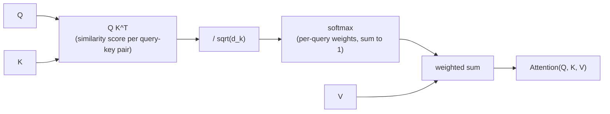

# Leçon 1. Scaled dot-product attention

**Lien avec la mission :** « Construire l'attention à partir de zéro » commence par l'équation unique autour de laquelle chaque pièce suivante (multi-head attention, bloc transformer) vient s'enrouler. Rien de ce qui suit cette leçon n'a de sens tant que cette opération n'en a pas.
**Source primaire :** [Article : "Attention Is All You Need", Vaswani et al., 2017](https://arxiv.org/abs/1706.03762)
**Prérequis :** aucun

## À savoir

### L'attention comme recherche douce

L'attention prend trois entrées : un vecteur **requête** (query), un ensemble de vecteurs **clés** (keys) et un ensemble de vecteurs **valeurs** (values), chaque clé étant associée à une valeur. Elle compare la requête à chaque clé pour obtenir un score par clé, transforme ces scores en poids dont la somme vaut 1, puis renvoie la somme pondérée des valeurs avec ces poids.

C'est toute l'idée : une table de recherche où, au lieu de trouver une seule clé qui correspond exactement et de renvoyer sa valeur, on mélange toutes les valeurs, pondérées par la qualité de la correspondance de chaque clé avec la requête. Une recherche dure renvoie une seule valeur. L'attention renvoie un mélange, et elle est différentiable, ce qui lui permet de s'intégrer dans un réseau entraîné par descente de gradient.

### L'équation

Pour un ensemble de requêtes, de clés et de valeurs regroupées dans des matrices `Q`, `K`, `V` (une ligne par requête, clé ou valeur), la scaled dot-product attention est :

`Attention(Q, K, V) = softmax(QK^T / sqrt(d_k)) V`

Lecture de gauche à droite :

- `QK^T` calcule le produit scalaire de chaque requête avec chaque clé. Un produit scalaire est grand quand deux vecteurs pointent dans une direction voisine, donc cette étape produit un score de similarité par paire requête-clé.
- `/ sqrt(d_k)` réduit ces scores, où `d_k` est la dimension de chaque vecteur clé. Cette étape existe pour une raison précise et vérifiable (plus bas), pas par choix de style.
- `softmax(...)` transforme la ligne de scores de chaque requête en distribution de probabilité : non négative, de somme 1.
- La multiplication par `V` utilise ces distributions de poids propres à chaque requête pour calculer une somme pondérée des vecteurs valeurs. Cette somme pondérée est la sortie pour chaque requête.

### Pourquoi le facteur d'échelle compte

Supposons que les entrées de `Q` et de `K` soient à peu près indépendantes, de variance 1. Chaque produit scalaire `q · k` additionne `d_k` produits de ce genre, donc sa variance croît avec `d_k`, ce qui veut dire que les scores bruts grandissent en amplitude à mesure que la dimension des clés augmente.

Des scores de grande amplitude poussent le softmax vers une sortie presque one-hot : un poids proche de 1 et tous les autres proches de 0. Cela paraît inoffensif, mais cela place le softmax dans une région où son gradient est quasiment plat, si bien que le réseau ne reçoit presque aucun signal d'apprentissage à travers cette étape d'attention. Diviser par `sqrt(d_k)` compense la croissance de la variance et garde les scores dans une plage où le gradient du softmax reste réellement exploitable, quelle que soit la taille de `d_k`.

### Pourquoi on parle précisément de « self »-attention ici

Dans cette leçon, `Q`, `K` et `V` sont simplement des entrées données ; leur provenance n'est pas encore le sujet, c'est celui des projections linéaires de la leçon suivante. Quand elles viennent de la même séquence (chaque position porte son attention sur toutes les positions de la même entrée, elle-même comprise), le mécanisme s'appelle **self-attention**. C'est le cas que cet espace de travail construit en premier.

## Pratique

1. ▢ En une phrase, qu'accomplit l'étape softmax dans la scaled dot-product attention ?

Vérifier

Elle convertit les scores de similarité bruts de chaque requête avec toutes les clés en distribution de probabilité (non négative, de somme 1), ce qui permet à la sortie d'être un mélange pondéré des valeurs plutôt qu'une somme sans borne.

2. ▢ Une seule requête `q = [1, 0]` porte son attention sur deux clés `k1 = [1, 0]` et `k2 = [0, 1]`, associées aux valeurs `v1 = [10, 0]` et `v2 = [0, 20]`. `d_k = 2`. Prédisez vers quelle valeur la sortie penche avant de calculer quoi que ce soit, puis calculez les scores normalisés, les poids du softmax et la sortie finale.

Indice

Calculez d'abord `q · k1` et `q · k2`, puis divisez les deux par `sqrt(2)` avant d'appliquer le softmax.

Vérifier

`q · k1 = 1`, `q · k2 = 0`. Après normalisation : `1 / sqrt(2) ≈ 0.71` et `0`.

Softmax([0.71, 0]) ≈ [0.67, 0.33].

Sortie ≈ `0.67 × [10, 0] + 0.33 × [0, 20] ≈ [6.70, 6.60]`.

La requête s'aligne davantage avec `k1` (produit scalaire 1 contre 0), donc la sortie penche vers `v1`, mais pas de façon écrasante : les scores étaient assez proches pour que les deux valeurs contribuent pour une part significative.

3. ▢ Un collègue implémente l'attention sans la normalisation `/ sqrt(d_k)` ; elle s'entraîne bien à `d_k = 8`, mais cale et ne se met presque plus à jour quand il agrandit le modèle jusqu'à `d_k = 512`. Expliquez pourquoi, avec ce que cette leçon a couvert.

Vérifier

Sans normalisation, la variance des scores de produit scalaire croît avec `d_k`. À `d_k = 512`, les scores sont assez grands pour que le softmax sature vers des sorties presque one-hot, dans une région où son gradient est quasiment plat. Le réseau ne reçoit presque aucun signal d'apprentissage à travers cette étape d'attention, ce qui ressemble à un entraînement qui cale. La division par `sqrt(d_k)` garde les scores dans une plage où cela n'arrive pas, quelle que soit la dimension.

4. ▢ Laquelle de ces propositions décrit le mieux la sortie de la scaled dot-product attention pour une requête ?

    - a) Le seul vecteur valeur associé à la clé de plus haut score
    - b) Une somme pondérée de tous les vecteurs valeurs, pondérée par le softmax des scores requête-clé
    - c) La moyenne des vecteurs requête et clé, mise à l'échelle par les vecteurs valeurs
    - d) Le vecteur valeur de plus grande norme, sans pondération

Vérifier

**b)** Une somme pondérée de tous les vecteurs valeurs, pondérée par le softmax des scores requête-clé. (a) décrit une recherche dure, ce que l'attention n'est précisément pas. (c) et (d) ne correspondent pas du tout à l'équation.

## Exercices en situation réelle

- [ ] Implémentez `Attention(Q, K, V)` à partir d'opérations brutes sur les tenseurs (produit matriciel, mise à l'échelle, softmax, nouveau produit matriciel), sans fonction de bibliothèque propre à l'attention, pour de petites matrices `Q`, `K`, `V` choisies à la main. Vérifiez que votre sortie correspond au style de calcul de l'exemple travaillé, calculé à la main pour un cas de votre choix.
- [ ] Retirez la mise à l'échelle `/ sqrt(d_k)` de votre implémentation et comparez la dispersion de la sortie du softmax (à quel point elle se rapproche d'un one-hot) pour un petit `d_k` puis un grand, avec les mêmes `Q` et `K` agrandis.
- [ ] Demain : lisez en entier la section « Scaled Dot-Product Attention » de l'article de la source primaire, et vérifiez que chaque symbole de son équation correspond à quelque chose que vous savez nommer dans votre propre implémentation.

## Pour aller plus loin

- [Billet : "The Illustrated Transformer", Jay Alammar](https://jalammar.github.io/illustrated-transformer/)
- [Billet : "The Annotated Transformer", Harvard NLP](http://nlp.seas.harvard.edu/annotated-transformer/)
- [Ressources](../RESOURCES.md)

---

Ça ne passe pas ? Relisez la source primaire en haut de page, car cette leçon la condense et c'est dans la condensation que la compréhension s'échappe. Consultez le [glossaire](../GLOSSARY.md) pour tout terme qui vous a paru glissant.

Si c'est la leçon elle-même qui n'est pas claire plutôt que la matière, c'est un défaut : [ouvrez une issue](https://github.com/TokenCemetery/teach/issues).
