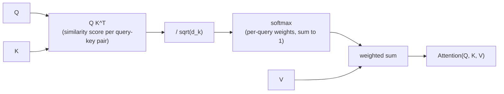

# पाठ 1. Scaled Dot-Product Attention

**मिशन से संबंध:** "Attention को शुरू से बनाएँ" उस एक समीकरण से शुरू होता है जिसके इर्द-गिर्द आगे का हर हिस्सा (multi-head attention, transformer block) लिपटा है। इस ऑपरेशन के समझ में आए बिना इस पाठ के आगे कुछ भी समझ नहीं आएगा।
**मुख्य स्रोत:** [पेपर: "Attention Is All You Need", Vaswani et al., 2017](https://arxiv.org/abs/1706.03762)
**पूर्व-आवश्यकताएँ:** कोई नहीं

## यह जानें

### Attention एक नरम लुकअप की तरह

Attention तीन inputs लेता है: एक **query** vector, **key** vectors का एक सेट, और **value** vectors का एक सेट, जिनमें हर key के साथ एक value जुड़ी होती है। वह query की हर key से तुलना करके हर key का एक score निकालता है, उन scores को ऐसे weights में बदलता है जिनका योग 1 हो, और फिर उन्हीं weights से values का भारित योग लौटाता है।

पूरा विचार बस इतना है: एक ऐसी लुकअप टेबल जिसमें एक सटीक मेल खाती key ढूँढकर उसकी value लौटाने के बजाय, आप हर value को आपस में मिला देते हैं, इस आधार पर भारित करके कि हर key query से कितनी मेल खाई। हार्ड लुकअप एक value लौटाता है। Attention एक मिश्रण लौटाता है, और वह differentiable है, जिसकी वजह से वह gradient descent से train होने वाले network के अंदर बैठ सकता है।

### समीकरण

`Q`, `K`, `V` matrices में पैक की गई queries, keys और values के सेट के लिए (हर query, key या value के लिए एक पंक्ति), scaled dot-product attention यह है:

`Attention(Q, K, V) = softmax(QK^T / sqrt(d_k)) V`

इसे बाएँ से दाएँ पढ़ें:

- `QK^T` हर query का हर key के साथ dot product निकालता है। Dot product तब बड़ा होता है जब दो vectors लगभग एक ही दिशा में इशारा करें, इसलिए यह चरण हर query-key जोड़ी के लिए एक similarity score देता है।
- `/ sqrt(d_k)` उन scores को घटाता है, जहाँ `d_k` हर key vector का आयाम है। यह चरण एक ख़ास, जाँचा जा सकने वाला कारण (नीचे) से है, शैली का कोई चुनाव नहीं।
- `softmax(...)` हर query की scores की पंक्ति को probability distribution में बदलता है: ग़ैर-ऋणात्मक, और योग 1।
- `V` से गुणा करने पर वे प्रति-query weight distributions value vectors का भारित योग निकालने में काम आते हैं। वही भारित योग हर query का output है।

### Scaling factor क्यों मायने रखता है

मान लें `Q` और `K` की प्रविष्टियाँ लगभग स्वतंत्र हैं और उनका variance 1 है। हर dot product `q · k` ऐसे `d_k` गुणनफलों को जोड़ता है, इसलिए उसका variance `d_k` के साथ बढ़ता है, यानी key का आयाम बढ़ने पर कच्चे scores का परिमाण बड़ा होता जाता है।

बड़े परिमाण वाले scores softmax को लगभग one-hot output की ओर धकेलते हैं: एक weight 1 के क़रीब और बाक़ी 0 के क़रीब। यह हानिरहित लगता है, पर इससे softmax ऐसे क्षेत्र में पहुँच जाता है जहाँ उसका gradient लगभग सपाट होता है, इसलिए network को उस attention step से लगभग कोई learning signal नहीं मिलता। `sqrt(d_k)` से भाग देने पर variance की यह बढ़त कट जाती है, और scores उस दायरे में रहते हैं जहाँ softmax का gradient सचमुच काम का होता है, चाहे `d_k` कितना भी बड़ा हो।

### यहाँ इसे ख़ास तौर पर "self"-attention क्यों कहते हैं

इस पाठ में `Q`, `K` और `V` बस दिए हुए inputs हैं; वे कहाँ से आते हैं यह अभी मुद्दा नहीं है, वह अगले पाठ के linear projections हैं। जब वे एक ही sequence से आते हैं (हर position उसी input की हर position पर, ख़ुद पर भी, attend करती है), तो इस तंत्र को **self-attention** कहते हैं। यह workspace सबसे पहले यही मामला बनाता है।

## अभ्यास

1. ▢ एक वाक्य में बताएँ कि scaled dot-product attention में softmax चरण क्या हासिल करता है?

जाँचें

वह हर query के, हर key के विरुद्ध, कच्चे similarity scores को probability distribution (ग़ैर-ऋणात्मक, योग 1) में बदल देता है, और इसी से output values का भारित मिश्रण बन पाता है, बिना किसी सीमा वाले योग की जगह।

2. ▢ एक अकेली query `q = [1, 0]` दो keys `k1 = [1, 0]` और `k2 = [0, 1]` पर attend करती है, जिनकी values `v1 = [10, 0]` और `v2 = [0, 20]` हैं। `d_k = 2`। कुछ भी compute करने से पहले अनुमान लगाएँ कि output किस value की ओर झुकेगा, फिर scaled scores, softmax weights और अंतिम output निकालें।

संकेत

पहले `q · k1` और `q · k2` निकालें, फिर softmax लगाने से पहले दोनों को `sqrt(2)` से भाग दें।

जाँचें

`q · k1 = 1`, `q · k2 = 0`। Scaled: `1 / sqrt(2) ≈ 0.71` और `0`।

Softmax([0.71, 0]) ≈ [0.67, 0.33]।

Output ≈ `0.67 × [10, 0] + 0.33 × [0, 20] ≈ [6.70, 6.60]`।

Query `k1` से ज़्यादा मेल खाती है (dot product 1 बनाम 0), इसलिए output `v1` की ओर झुकता है, पर बहुत ज़्यादा नहीं: scores इतने पास थे कि दोनों values का हिस्सा मायने रखता है।

3. ▢ एक सहकर्मी बिना `/ sqrt(d_k)` scaling के attention लागू करता है और वह `d_k = 8` पर ठीक train होता है, पर model को `d_k = 512` तक बढ़ाते ही अटक जाता है और मुश्किल से update होता है। इस पाठ में जो कवर हुआ उसके आधार पर बताएँ कि ऐसा क्यों।

जाँचें

Scaling के बिना dot-product scores का variance `d_k` के साथ बढ़ता है। `d_k = 512` पर scores इतने बड़े हो जाते हैं कि softmax लगभग one-hot outputs की ओर saturate हो जाता है, और ऐसे क्षेत्र में पहुँच जाता है जहाँ उसका gradient लगभग सपाट है। Network को उस attention step से लगभग कोई learning signal नहीं मिलता, जो अटकी हुई training जैसा दिखता है। `sqrt(d_k)` से scaling scores को ऐसे दायरे में रखती है जहाँ यह नहीं होता, आयाम चाहे जो हो।

4. ▢ एक query के लिए scaled dot-product attention का output इनमें से किसका सबसे अच्छा वर्णन करता है?

    - a) सबसे ज़्यादा score वाली key से जुड़ा अकेला value vector
    - b) सभी value vectors का भारित योग, जिसमें weights query-key scores पर softmax से आते हैं
    - c) query और key vectors का औसत, जिसे value vectors से scale किया गया हो
    - d) सबसे बड़े परिमाण वाला value vector, बिना weights के

जाँचें

**b)** सभी value vectors का भारित योग, जिसमें weights query-key scores पर softmax से आते हैं। (a) हार्ड लुकअप का वर्णन है, जो attention ख़ास तौर पर नहीं है। (c) और (d) समीकरण से बिल्कुल मेल नहीं खाते।

## असली दुनिया का अभ्यास

- [ ] `Attention(Q, K, V)` को raw tensor operations (matrix multiply, scale, softmax, फिर matrix multiply) से लागू करें, किसी attention-विशेष library function के बिना, हाथ से चुने छोटे `Q`, `K`, `V` के लिए। पक्का करें कि आपका output worked example के arithmetic के ढंग से मेल खाता है, जिसे आप अपनी चुनी हुई स्थिति के लिए हाथ से निकालें।
- [ ] अपने implementation से `/ sqrt(d_k)` scaling हटाएँ और softmax output का फैलाव (वह one-hot के कितना क़रीब पहुँचता है) छोटे `d_k` और बड़े `d_k` पर तुलना करें, उन्हीं `Q` और `K` को बड़ा करके इस्तेमाल करते हुए।
- [ ] कल: मुख्य स्रोत पेपर का "Scaled Dot-Product Attention" खंड पूरा पढ़ें, और जाँचें कि उसके समीकरण का हर symbol आपके अपने implementation की किसी चीज़ से मेल खाता है जिसका आप नाम ले सकें।

## आगे बढ़ने के लिए

- [लेख: "The Illustrated Transformer", Jay Alammar](https://jalammar.github.io/illustrated-transformer/)
- [लेख: "The Annotated Transformer", Harvard NLP](http://nlp.seas.harvard.edu/annotated-transformer/)
- [संसाधन](../RESOURCES.md)

---

बात नहीं बन रही? ऊपर दिए मुख्य स्रोत को दोबारा पढ़ें, क्योंकि यह पाठ उसे संक्षिप्त करता है और समझ संक्षेप में ही रिसती है। जो शब्द फिसलन भरा लगे, उसके लिए [शब्दावली](../GLOSSARY.md) देखें।

अगर दिक़्क़त सामग्री की नहीं बल्कि पाठ की ही है, तो वह एक खोट है: [issue खोलें](https://github.com/TokenCemetery/teach/issues)।
