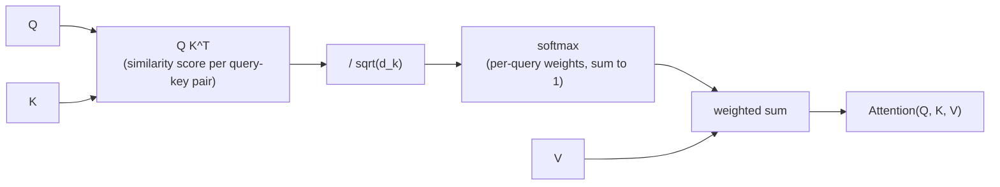

# Lição 1. Scaled Dot-Product Attention

**Ligação com a missão:** "Construir a atenção do zero" começa com a equação única em torno da qual toda peça posterior (multi-head attention, o bloco transformer) se envolve. Nada depois desta lição faz sentido até que esta operação faça.
**Fonte principal:** [Artigo científico: "Attention Is All You Need", Vaswani et al., 2017](https://arxiv.org/abs/1706.03762)
**Pré-requisitos:** nenhum

## Saiba isto

### A atenção como uma busca suave

A atenção recebe três entradas: um vetor de **query**, um conjunto de vetores de **key** e um conjunto de vetores de **value**, com uma key pareada a cada value. Ela compara a query com cada key para obter um score por key, transforma esses scores em pesos que somam 1 e então devolve a soma ponderada dos values usando esses pesos.

Essa é a ideia inteira: uma tabela de busca em que, em vez de encontrar uma única key que combine exatamente e devolver o seu value, você mistura todos os values, ponderados pelo quão bem cada key combinou com a query. Uma busca rígida devolve um value. A atenção devolve uma mistura, e ela é diferenciável, o que permite que fique dentro de uma rede treinada por gradient descent.

### A equação

Para um conjunto de queries, keys e values empacotados nas matrizes `Q`, `K`, `V` (uma linha por query, key ou value), a scaled dot-product attention é:

`Attention(Q, K, V) = softmax(QK^T / sqrt(d_k)) V`

Lendo da esquerda para a direita:

- `QK^T` calcula o produto escalar de cada query com cada key. Um produto escalar é grande quando dois vetores apontam em direções parecidas, então essa etapa produz um score de similaridade por par query-key.
- `/ sqrt(d_k)` reduz esses scores, onde `d_k` é a dimensão de cada vetor de key. Essa etapa existe por uma razão específica e verificável (abaixo), e não por escolha estilística.
- `softmax(...)` transforma a linha de scores de cada query em uma distribuição de probabilidade: não negativa, somando 1.
- Multiplicar por `V` usa essas distribuições de pesos por query para calcular uma soma ponderada dos vetores de value. Essa soma ponderada é a saída para cada query.

### Por que o fator de escala importa

Suponha que as entradas de `Q` e `K` sejam aproximadamente independentes, com variância 1. Cada produto escalar `q · k` soma `d_k` produtos desse tipo, então a sua variância cresce com `d_k`, o que significa que os scores brutos ficam maiores em magnitude à medida que a dimensão da key cresce.

Scores de grande magnitude empurram o softmax para uma saída quase one-hot: um peso próximo de 1 e o resto próximo de 0. Isso parece inofensivo, mas coloca o softmax em uma região em que o seu gradiente é quase plano, de modo que a rede recebe quase nenhum sinal de aprendizado dessa etapa de atenção. Dividir por `sqrt(d_k)` compensa o crescimento da variância, mantendo os scores em uma faixa em que o gradiente do softmax é de fato utilizável, não importa o tamanho de `d_k`.

### Por que aqui ela se chama especificamente "self"-attention

Nesta lição, `Q`, `K` e `V` são apenas entradas dadas; de onde elas vêm ainda não é o ponto, isso fica para as projeções lineares da próxima lição. Quando elas vêm da mesma sequência (cada posição atendendo a todas as posições da mesma entrada, incluindo ela mesma), o mecanismo se chama **self-attention**. Esse é o caso que este workspace constrói primeiro.

## Prática

1. ▢ Em uma frase, o que a etapa de softmax realiza na scaled dot-product attention?

Verificação

Ela converte os scores brutos de similaridade de cada query com todas as keys em uma distribuição de probabilidade (não negativa, somando 1), e é isso que permite que a saída seja uma mistura ponderada dos values e não uma soma sem limite.

2. ▢ Uma única query `q = [1, 0]` atende a duas keys `k1 = [1, 0]` e `k2 = [0, 1]`, pareadas com os values `v1 = [10, 0]` e `v2 = [0, 20]`. `d_k = 2`. Preveja para qual value a saída tende antes de calcular qualquer coisa e então calcule os scores escalados, os pesos do softmax e a saída final.

Dica

Calcule primeiro `q · k1` e `q · k2`, depois divida ambos por `sqrt(2)` antes de aplicar o softmax.

Verificação

`q · k1 = 1`, `q · k2 = 0`. Escalados: `1 / sqrt(2) ≈ 0.71` e `0`.

Softmax([0.71, 0]) ≈ [0.67, 0.33].

Saída ≈ `0.67 × [10, 0] + 0.33 × [0, 20] ≈ [6.70, 6.60]`.

A query se alinha mais com `k1` (produto escalar 1 contra 0), então a saída tende a `v1`, mas não de forma esmagadora: os scores estavam próximos o bastante para que ambos os values contribuam com uma parcela significativa.

3. ▢ Um colega implementa a atenção sem o escalonamento `/ sqrt(d_k)` e ela treina bem com `d_k = 8`, mas emperra e quase não atualiza quando ele aumenta o modelo para `d_k = 512`. Explique por quê, usando o que esta lição cobriu.

Verificação

Sem o escalonamento, a variância dos scores do produto escalar cresce com `d_k`. Com `d_k = 512`, os scores são grandes o bastante para que o softmax sature em direção a saídas quase one-hot, caindo em uma região em que o seu gradiente é quase plano. A rede recebe quase nenhum sinal de aprendizado através dessa etapa de atenção, o que se parece com um treinamento travado. Escalar por `sqrt(d_k)` mantém os scores em uma faixa em que isso não acontece, seja qual for a dimensão.

4. ▢ Qual alternativa melhor descreve a saída da scaled dot-product attention para uma query?

    - a) O único vetor de value pareado com a key de maior score
    - b) Uma soma ponderada de todos os vetores de value, ponderada pelo softmax sobre os scores query-key
    - c) A média dos vetores de query e key, escalada pelos vetores de value
    - d) O vetor de value de maior magnitude, sem ponderação

Verificação

**b)** Uma soma ponderada de todos os vetores de value, ponderada pelo softmax sobre os scores query-key. (a) descreve uma busca rígida, que a atenção especificamente não é. (c) e (d) não correspondem à equação de forma alguma.

## Prática no mundo real

- [ ] Implemente `Attention(Q, K, V)` a partir de operações com tensores brutos (multiplicação de matrizes, escala, softmax, multiplicação de matrizes de novo), sem nenhuma função de biblioteca específica de atenção, para `Q`, `K`, `V` pequenos escolhidos à mão. Confirme que a sua saída bate com o estilo de aritmética do exemplo resolvido, calculada à mão para um caso que você escolher.
- [ ] Remova o escalonamento `/ sqrt(d_k)` da sua implementação e compare a dispersão da saída do softmax (o quanto ela se aproxima de one-hot) com um `d_k` pequeno e com um grande, usando os mesmos `Q` e `K` ampliados.
- [ ] Amanhã: leia por inteiro a seção "Scaled Dot-Product Attention" do artigo científico da fonte principal e confira se cada símbolo da sua equação corresponde a algo que você consegue nomear na sua própria implementação.

## Para ir além

- [Artigo: "The Illustrated Transformer", Jay Alammar](https://jalammar.github.io/illustrated-transformer/)
- [Artigo: "The Annotated Transformer", Harvard NLP](http://nlp.seas.harvard.edu/annotated-transformer/)
- [Recursos](../RESOURCES.md)

---

Não ficou claro? Releia a fonte principal no topo, já que esta lição a comprime e é na compressão que o entendimento escapa. Consulte o [glossário](../GLOSSARY.md) para qualquer termo que pareceu escorregadio.

Se o problema é a lição em si, e não o material, isso é um defeito: [abra uma issue](https://github.com/TokenCemetery/teach/issues).
