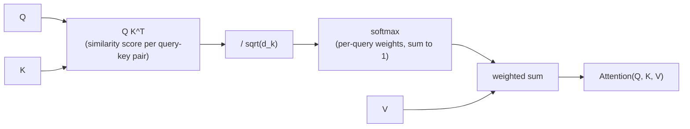

# Урок 1. Масштабированное скалярное внимание

**Связь с целью курса:** Цель «построить внимание с нуля» начинается с единственного уравнения, вокруг которого строится каждая следующая часть (многоголовое внимание, блок трансформера). Пока эта операция не понятна, всё дальше не имеет смысла.
**Первоисточник:** [Научная статья: "Attention Is All You Need", Vaswani et al., 2017](https://arxiv.org/abs/1706.03762)
**Предварительные требования:** нет

## Что нужно знать

### Внимание как мягкий поиск

Внимание принимает три входа: вектор **запроса** (query), набор векторов **ключей** (key) и набор векторов **значений** (value), причём каждому значению соответствует один ключ. Оно сравнивает запрос с каждым ключом и получает оценку для каждого ключа, превращает эти оценки в веса, которые в сумме дают 1, а затем возвращает взвешенную сумму значений с этими весами.

В этом вся идея: таблица поиска, где вместо того, чтобы найти один точно подходящий ключ и вернуть его значение, вы смешиваете все значения с весами, зависящими от того, насколько хорошо каждый ключ совпал с запросом. Жёсткий поиск возвращает одно значение. Внимание возвращает смесь, и она дифференцируема, а именно это позволяет встроить её в сеть, обучаемую градиентным спуском.

### Уравнение

Для набора запросов, ключей и значений, упакованных в матрицы `Q`, `K`, `V` (по одной строке на запрос, ключ или значение), масштабированное скалярное внимание выглядит так:

`Attention(Q, K, V) = softmax(QK^T / sqrt(d_k)) V`

Читаем слева направо:

- `QK^T` вычисляет скалярное произведение каждого запроса с каждым ключом. Скалярное произведение велико, когда два вектора направлены в похожую сторону, поэтому этот шаг даёт одну оценку сходства на каждую пару запрос-ключ.
- `/ sqrt(d_k)` уменьшает эти оценки, где `d_k` это размерность каждого вектора ключа. Этот шаг нужен по конкретной, проверяемой причине (ниже), а не из соображений стиля.
- `softmax(...)` превращает строку оценок каждого запроса в распределение вероятностей: неотрицательное, с суммой 1.
- Умножение на `V` использует эти распределения весов для каждого запроса, чтобы вычислить взвешенную сумму векторов значений. Эта взвешенная сумма и есть выход для каждого запроса.

### Зачем нужен масштабирующий множитель

Предположим, что элементы `Q` и `K` примерно независимы и имеют дисперсию 1. Каждое скалярное произведение `q · k` суммирует `d_k` таких произведений, поэтому его дисперсия растёт вместе с `d_k`, то есть «сырые» оценки по модулю становятся больше по мере роста размерности ключа.

Оценки с большим модулем толкают softmax к почти one-hot выходу: один вес близок к 1, остальные близки к 0. Это звучит безобидно, но загоняет softmax в область, где его градиент почти плоский, и сеть почти не получает обучающего сигнала с этого шага внимания. Деление на `sqrt(d_k)` компенсирует рост дисперсии и удерживает оценки в диапазоне, где градиент softmax действительно пригоден, как бы велико ни было `d_k`.

### Почему здесь это называется именно «само»-вниманием

В этом уроке `Q`, `K` и `V` это просто заданные входы; откуда они берутся, пока не важно, это тема линейных проекций следующего урока. Когда они берутся из одной и той же последовательности (каждая позиция обращает внимание на все позиции того же входа, включая себя), механизм называется **самовниманием** (self-attention). Именно этот случай это рабочее пространство строит первым.

## Практика

1. ▢ Одним предложением: что делает шаг softmax в масштабированном скалярном внимании?

Проверка

Он превращает «сырые» оценки сходства каждого запроса со всеми ключами в распределение вероятностей (неотрицательное, с суммой 1), и именно поэтому выход оказывается взвешенной смесью значений, а не неограниченной суммой.

2. ▢ Один запрос `q = [1, 0]` обращает внимание на два ключа `k1 = [1, 0]` и `k2 = [0, 1]` со значениями `v1 = [10, 0]` и `v2 = [0, 20]`. `d_k = 2`. Предскажите, к какому значению склонится выход, до всяких вычислений, а затем найдите масштабированные оценки, веса softmax и итоговый выход.

Подсказка

Сначала вычислите `q · k1` и `q · k2`, затем разделите обе величины на `sqrt(2)` перед применением softmax.

Проверка

`q · k1 = 1`, `q · k2 = 0`. После масштабирования: `1 / sqrt(2) ≈ 0.71` и `0`.

Softmax([0.71, 0]) ≈ [0.67, 0.33].

Выход ≈ `0.67 × [10, 0] + 0.33 × [0, 20] ≈ [6.70, 6.60]`.

Запрос больше совпадает с `k1` (скалярное произведение 1 против 0), поэтому выход склоняется к `v1`, но не подавляюще: оценки были достаточно близки, чтобы оба значения внесли заметный вклад.

3. ▢ Коллега реализует внимание без масштабирования `/ sqrt(d_k)`, и оно хорошо обучается при `d_k = 8`, но застревает и почти не обновляется, когда модель увеличивают до `d_k = 512`. Объясните почему, используя то, что разобрано в этом уроке.

Проверка

Без масштабирования дисперсия скалярных произведений растёт вместе с `d_k`. При `d_k = 512` оценки достаточно велики, чтобы softmax насыщался до почти one-hot выходов и попадал в область, где его градиент почти плоский. Сеть почти не получает обучающего сигнала через этот шаг внимания, и со стороны это выглядит как застывшее обучение. Масштабирование на `sqrt(d_k)` удерживает оценки в диапазоне, где этого не происходит, независимо от размерности.

4. ▢ Что лучше всего описывает выход масштабированного скалярного внимания для одного запроса?

    - a) Единственный вектор значения, соответствующий ключу с наибольшей оценкой
    - b) Взвешенная сумма всех векторов значений с весами, полученными softmax по оценкам запрос-ключ
    - c) Среднее векторов запроса и ключа, масштабированное векторами значений
    - d) Вектор значения с наибольшей длиной, без весов

Проверка

**b)** Взвешенная сумма всех векторов значений с весами, полученными softmax по оценкам запрос-ключ. Вариант (a) описывает жёсткий поиск, которым внимание как раз не является. Варианты (c) и (d) вообще не соответствуют уравнению.

## Практика в реальной работе

- [ ] Реализуйте `Attention(Q, K, V)` из «сырых» тензорных операций (умножение матриц, масштабирование, softmax, ещё одно умножение матриц), без специальной библиотечной функции внимания, для небольших `Q`, `K`, `V`, выбранных вручную. Убедитесь, что ваш результат совпадает со стилем арифметики разобранного примера, посчитанного вручную для случая, который вы выберете.
- [ ] Уберите из своей реализации масштабирование `/ sqrt(d_k)` и сравните разброс на выходе softmax (насколько он близок к one-hot) при малом и при большом `d_k`, взяв те же `Q` и `K`, увеличенные в масштабе.
- [ ] Завтра: прочитайте целиком раздел «Scaled Dot-Product Attention» в статье-первоисточнике и проверьте, что каждый символ её уравнения соответствует чему-то, что вы можете назвать в своей реализации.

## Что почитать дальше

- [Статья: "The Illustrated Transformer", Jay Alammar](https://jalammar.github.io/illustrated-transformer/)
- [Статья: "The Annotated Transformer", Harvard NLP](http://nlp.seas.harvard.edu/annotated-transformer/)
- [Ресурсы](../RESOURCES.md)

---

Не доходит? Перечитайте первоисточник в начале: этот урок его сжимает, а при сжатии понимание как раз и теряется. Загляните в [глоссарий](../GLOSSARY.md), если какой-то термин показался скользким.

Если неясен сам урок, а не материал, это дефект: [откройте issue](https://github.com/TokenCemetery/teach/issues).
