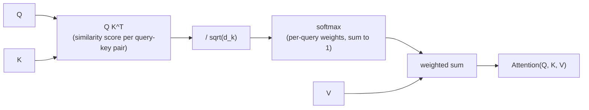

# 第 1 课：缩放点积注意力

**使命关联:** “从零搭建注意力”要从这个方程讲起，后面每一个部分（多头注意力、Transformer 块）都是围绕这一个方程搭起来的。不先弄懂这个运算，本课之后的内容都无从理解。
**主要来源:** [论文：“Attention Is All You Need”，Vaswani 等，2017](https://arxiv.org/abs/1706.03762)
**前置知识:** 无

## 要点

### 把注意力看作软查找

注意力有三个输入：一个**查询**向量，一组**键**向量，以及一组**值**向量，每个键都与一个值配对。它把查询与每个键比较，为每个键得到一个分数，再把这些分数变成总和为 1 的权重，最后用这些权重对值做加权求和并返回。

这就是全部的思路：它像一张查找表，只不过不是找到某一个完全匹配的键并返回它的值，而是把所有的值混合在一起，每个值的权重取决于对应的键与查询匹配得有多好。硬查找只返回一个值，注意力返回的是一个混合结果，而且它是可微的，这正是它能放进用梯度下降训练的网络里的原因。

### 方程

把一组查询、键和值打包成矩阵 `Q`、`K`、`V`（每个查询、键或值占一行），缩放点积注意力就是：

`Attention(Q, K, V) = softmax(QK^T / sqrt(d_k)) V`

从左往右读：

- `QK^T` 计算每个查询与每个键的点积。两个向量方向相近时点积就大，所以这一步为每一对查询和键产生一个相似度分数。
- `/ sqrt(d_k)` 把这些分数缩小，其中 `d_k` 是每个键向量的维度。这一步的存在有一个具体且可以检验的理由（见下文），并不是出于风格上的选择。
- `softmax(...)` 把每个查询的那一行分数变成概率分布：非负，总和为 1。
- 乘以 `V`，就是用每个查询各自的权重分布对值向量做加权求和。这个加权和就是每个查询的输出。

### 为什么缩放因子很重要

假设 `Q` 和 `K` 的各个元素大致相互独立，方差为 1。每个点积 `q · k` 是 `d_k` 个这样的乘积之和，所以它的方差会随 `d_k` 增大，也就是说，键的维度越大，原始分数的量级就越大。

量级很大的分数会把 softmax 推向近乎 one-hot 的输出：一个权重接近 1，其余接近 0。这听起来无害，但它让 softmax 落进梯度几乎为零的区域，于是网络从这一步注意力里几乎得不到学习信号。除以 `sqrt(d_k)` 抵消了方差的增长，不论 `d_k` 多大，都能让分数保持在 softmax 梯度真正可用的范围内。

### 为什么这里特别叫“自”注意力

在本课里，`Q`、`K` 和 `V` 只是给定的输入；它们从哪里来暂时还不是重点，那是下一课线性投影要讲的事。当它们来自同一个序列时（每个位置都对同一个输入中的每个位置做注意力，包括它自己），这种机制就叫**自注意力**。这正是本工作区最先搭建的情形。

## 练习

1. ▢ 用一句话说明，在缩放点积注意力中，softmax 这一步完成了什么？

检查

它把每个查询与所有键的原始相似度分数转换成一个概率分布（非负，总和为 1），这才使输出成为各个值的加权混合，而不是一个没有上界的求和。

2. ▢ 单个查询 `q = [1, 0]` 对两个键 `k1 = [1, 0]` 和 `k2 = [0, 1]` 做注意力，它们配对的值分别是 `v1 = [10, 0]` 和 `v2 = [0, 20]`，`d_k = 2`。先别急着计算，预测输出会偏向哪个值，然后算出缩放后的分数、softmax 权重和最终输出。

提示

先算 `q · k1` 和 `q · k2`，再把两者都除以 `sqrt(2)`，然后应用 softmax。

检查

`q · k1 = 1`，`q · k2 = 0`。缩放后：`1 / sqrt(2) ≈ 0.71` 和 `0`。

Softmax([0.71, 0]) ≈ [0.67, 0.33]。

输出 ≈ `0.67 × [10, 0] + 0.33 × [0, 20] ≈ [6.70, 6.60]`。

查询与 `k1` 更一致（点积是 1，对比 0），所以输出偏向 `v1`，但并不是压倒性的：两个分数相差不大，两个值都占了相当可观的份额。

3. ▢ 一位同事实现注意力时没有做 `/ sqrt(d_k)` 缩放，在 `d_k = 8` 时训练正常，可当他们把模型放大到 `d_k = 512` 之后，训练停滞，几乎不再更新。请用本课讲过的内容解释原因。

检查

没有缩放时，点积分数的方差随 `d_k` 增大。到了 `d_k = 512`，分数大到让 softmax 饱和，趋向近乎 one-hot 的输出，落进梯度几乎为零的区域。网络从这一步注意力里几乎得不到学习信号，表现出来就是训练停滞。按 `sqrt(d_k)` 缩放能让分数保持在不会出现这种情况的范围内，与维度无关。

4. ▢ 对于一个查询，下面哪一项最准确地描述了缩放点积注意力的输出？

    - a) 与得分最高的键配对的那个值向量
    - b) 所有值向量的加权和，权重由查询与键的分数经 softmax 得到
    - c) 查询向量与键向量的平均，再用值向量缩放
    - d) 幅值最大的值向量，不加权

检查

**b)** 所有值向量的加权和，权重由查询与键的分数经 softmax 得到。(a) 描述的是硬查找，而注意力恰恰不是。(c) 和 (d) 与方程根本不符。

## 实战练习

- [ ] 只用原始张量运算（矩阵乘法、缩放、softmax、再一次矩阵乘法）实现 `Attention(Q, K, V)`，不使用任何注意力专用的库函数，输入是你手选的一组小的 `Q`、`K`、`V`。确认你的输出与例题中的算术方式一致，并对你自己挑的一个例子手算一遍。
- [ ] 从你的实现里去掉 `/ sqrt(d_k)` 缩放，用同样的 `Q` 和 `K`（放大到更大的维度），比较 softmax 输出在较小的 `d_k` 与较大的 `d_k` 下的分散程度（它有多接近 one-hot）。
- [ ] 明天：完整阅读主要来源论文里“Scaled Dot-Product Attention”一节，并检查它的方程里每一个符号，是否都能对应到你自己实现里某个说得出名字的东西。

## 延伸阅读

- [文章：“The Illustrated Transformer”，Jay Alammar](https://jalammar.github.io/illustrated-transformer/)
- [文章：“The Annotated Transformer”，Harvard NLP](http://nlp.seas.harvard.edu/annotated-transformer/)
- [资源](../RESOURCES.md)

---

没学明白？请重读顶部的主要来源，因为本课是对它的压缩，而理解正是在压缩中流失的。如果有哪个术语觉得含糊，可以查看[术语表](../GLOSSARY.md)。

如果问题出在课程本身，而不是学习材料，那就是一个缺陷：[提交 issue](https://github.com/TokenCemetery/teach/issues)。
