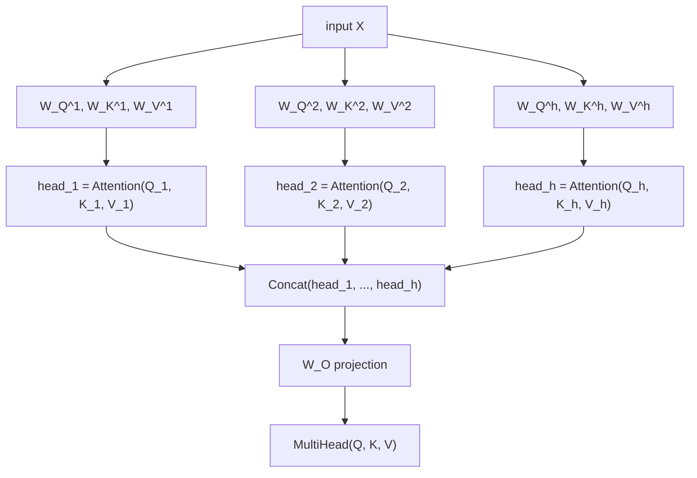

# Lección 2. Multi-Head Attention

**Vínculo con la misión:** La ecuación de la lección 1 es la operación; esta lección es cómo la usa realmente el transformer, ejecutándola varias veces en paralelo sobre distintas proyecciones aprendidas de la misma entrada, en lugar de una sola vez a dimensión completa.
**Fuente principal:** [Paper: "Attention Is All You Need", Vaswani et al., 2017](https://arxiv.org/abs/1706.03762)
**Requisitos previos:** [Lección 1](0001-scaled-dot-product-attention.md), [Scaled dot-product attention](../GLOSSARY.md)

## Calentamiento

1. ▢ Escribe de memoria la ecuación de la scaled dot-product attention.

<details markdown="1"><summary>Comprobación</summary>

`Attention(Q, K, V) = softmax(QK^T / sqrt(d_k)) V`.

</details>

2. ▢ ¿Por qué importa el escalado `/ sqrt(d_k)` a medida que crece `d_k`?

<details markdown="1"><summary>Comprobación</summary>

La varianza de las puntuaciones de producto escalar en bruto crece con `d_k`, lo que empuja al softmax hacia una salida casi one-hot donde su gradiente es casi plano. Dividir por `sqrt(d_k)` contrarresta ese crecimiento y mantiene las puntuaciones en un rango donde el gradiente del softmax sigue siendo utilizable.

</details>

## Qué debes saber

### Una operación de atención da una sola vista

La scaled dot-product attention, calculada una sola vez sobre toda la entrada, produce exactamente una mezcla ponderada por query, una "vista" de cómo se relaciona cada posición con todas las demás. Eso es una limitación real: la estructura de una frase lleva a la vez varias clases distintas de relaciones (a qué palabra se refiere un pronombre, qué palabras están ligadas sintácticamente, qué palabras simplemente están cerca), y forzar todo eso en un único patrón de atención por posición significa promediar relaciones que quizá sería mejor mantener separadas.

### Proyectar en varios subespacios más pequeños, atender en cada uno por separado

La **multi-head attention** lo arregla ejecutando la atención varias veces en paralelo, cada vez sobre su propia proyección de la entrada, aprendida por separado. Para `h` heads, cada head `i` recibe sus propias matrices de pesos aprendidas `W_Q^i`, `W_K^i`, `W_V^i`, que proyectan la entrada a una dimensión menor `d_k = d_model / h`:

```text
Q_i = X W_Q^i,   K_i = X W_K^i,   V_i = X W_V^i
head_i = Attention(Q_i, K_i, V_i)
```

Cada head aplica la ecuación exacta de la lección 1, solo que dentro de su propio subespacio de menor dimensión. Como las matrices de proyección de cada head se aprenden de forma independiente, los distintos heads son libres de especializarse, uno puede acabar siguiendo las relaciones entre palabras cercanas, otro algo más sintáctico, sin que nada los fuerce a ponerse de acuerdo en un único patrón de atención compartido.

### Concatenar los heads y proyectar una vez más

Las salidas de los heads se concatenan de nuevo y pasan por una última proyección aprendida, `W_O`, de vuelta a la dimensión completa del modelo:

```text
MultiHead(Q, K, V) = Concat(head_1, ..., head_h) W_O
```

La proyección final no es un adorno opcional: la concatenación por sí sola solo coloca la salida de cada head una junto a otra en un vector mayor, sin ninguna manera de que la información de un head se combine con la de otro. `W_O` es lo que permite al modelo aprender a mezclar las vistas separadas de los distintos heads en una única representación unificada para lo que venga después en la red.



### La dimensión por head es la que usa realmente la fórmula de escalado

Como cada head opera con `d_k = d_model / h`, y no con el `d_model` completo, el escalado `/ sqrt(d_k)` de la lección 1 usa esa dimensión menor, por head. Esto importa porque es fácil suponer que el escalado debería seguir el tamaño global del modelo; no lo hace, sigue la dimensión sobre la que realmente se suman los productos escalares dentro de ese cálculo de atención concreto, que es la dimensión por head una vez que la atención se reparte entre heads.

## Práctica

1. ▢ Un modelo tiene `d_model = 512` y usa 8 heads de atención. ¿Cuál es `d_k`, la dimensión en la que opera cada head?

<details markdown="1"><summary>Comprobación</summary>

`d_k = 512 / 8 = 64`.

</details>

2. ▢ ¿Por qué se aplica una proyección lineal final (`W_O`) después de concatenar las salidas de los heads, en lugar de usar directamente el vector concatenado?

<details markdown="1"><summary>Comprobación</summary>

La concatenación por sí sola coloca la salida de cada head una junto a otra sin ninguna interacción entre ellas. `W_O` permite al modelo aprender a combinar la información de los distintos heads en una representación unificada, en lugar de dejar las salidas de los heads como trozos desconectados de un vector mayor.

</details>

3. ▢ ¿Por qué pueden acabar los distintos heads especializándose en distintas clases de relaciones entre posiciones, si todos aplican exactamente la misma ecuación de atención?

<details markdown="1"><summary>Comprobación</summary>

Cada head tiene sus propias matrices de proyección (`W_Q^i`, `W_K^i`, `W_V^i`), aprendidas de forma independiente. Dos heads que aplican la misma ecuación a versiones proyectadas de forma distinta de la misma entrada pueden atender a aspectos totalmente distintos de ella, ya que las propias proyecciones moldean lo que representan realmente las queries y las keys de cada head.

</details>

4. ▢ Un modelo reparte la atención entre `h` heads, cada uno operando con `d_k = d_model / h`. Al calcular el escalado `/ sqrt(d_k)` dentro del cálculo de atención de un head, ¿`d_k` debe ser la dimensión por head o el `d_model` completo? ¿Por qué?

<details markdown="1"><summary>Pista</summary>

Pregúntate sobre qué dimensión se suman realmente los productos escalares que se están escalando.

</details>

<details markdown="1"><summary>Comprobación</summary>

La dimensión por head. El escalado de la lección 1 existe para contrarrestar el crecimiento de la varianza de un producto escalar sumado sobre `d_k` términos; dentro de un head, ese producto escalar se suma sobre la propia dimensión del head, `d_model / h`, no sobre la dimensión completa del modelo. Usar la dimensión equivocada (la completa) escalaría poco las puntuaciones respecto de lo que realmente necesitan los productos escalares de ese head.

</details>

5. ▢ ¿Qué afirmación es cierta de la multi-head attention en comparación con calcular la atención una sola vez a la dimensión completa del modelo?

    - a) La multi-head attention ejecuta la atención una vez y luego parte artificialmente la salida única en trozos
    - b) Cada head tiene sus propias proyecciones aprendidas y calcula la atención de forma independiente en un subespacio menor, antes de que todos los heads se concatenen y se proyecten de vuelta
    - c) Todos los heads comparten las mismas matrices de proyección de query, key y value, y solo difieren en a qué posiciones atienden
    - d) La proyección final `W_O` es opcional y puede omitirse sin cambiar lo que el modelo puede representar

<details markdown="1"><summary>Comprobación</summary>

**b)** Ese es exactamente el mecanismo que describe esta lección. (a) es falsa: cada head calcula por su cuenta su propia operación de atención completa, sobre sus propias entradas proyectadas, y no es una partición posterior de un único cálculo compartido. (c) es falsa: las matrices de proyección de cada head se aprenden de forma independiente, que es lo que permite a los heads especializarse. (d) es falsa: sin `W_O`, los heads concatenados no tienen manera de combinar información entre sí.

</details>

## Prácticas en el mundo real

- [ ] Implementa la multi-head attention a partir de operaciones de tensores en bruto: proyecciones lineales por head, la ecuación de atención de la lección 1 aplicada de forma independiente en cada head, la concatenación y la proyección final `W_O`. Confirma que el shape de la salida coincide con `d_model` sin importar cuántos heads elijas.
- [ ] Para un `d_model` pequeño y dos números de heads distintos (por ejemplo 2 y 8), calcula `d_k` en cada caso y observa cómo se reduce a medida que crece el número de heads.
- [ ] Mañana: lee completa la sección "Multi-Head Attention" del paper de la fuente principal, y comprueba que cada matriz de sus ecuaciones coincide con algo que nombraste en tu propia implementación.

## Para profundizar

- [Paper: "Attention Is All You Need", Vaswani et al., 2017](https://arxiv.org/abs/1706.03762)
- [Article: "The Illustrated Transformer", Jay Alammar](https://jalammar.github.io/illustrated-transformer/)
- [Recursos](../RESOURCES.md)

---

¿No termina de quedar claro? Vuelve a leer la fuente primaria de arriba, ya que esta lección la comprime y en la compresión es donde se escapa la comprensión. Consulta el [glosario](../GLOSSARY.md) por si algún término te resultó resbaladizo.

Si lo poco claro es la propia lección y no el material, eso es un defecto: [abre un issue](https://github.com/TokenCemetery/teach/issues).
