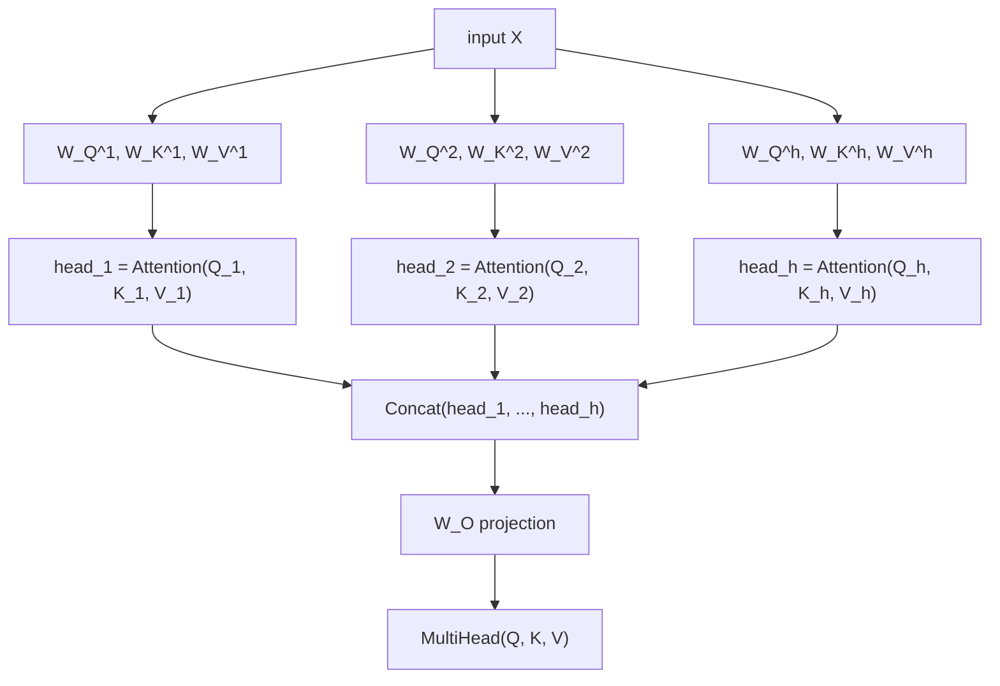

# Leçon 2. Multi-head attention

**Lien avec la mission :** L'équation de la leçon 1 est l'opération ; cette leçon montre comment le transformer l'utilise réellement, en l'exécutant plusieurs fois en parallèle sur différentes projections apprises de la même entrée, plutôt qu'une seule fois à pleine dimension.
**Source primaire :** [Article : "Attention Is All You Need", Vaswani et al., 2017](https://arxiv.org/abs/1706.03762)
**Prérequis :** [Leçon 1](0001-scaled-dot-product-attention.md), [Scaled dot-product attention](../GLOSSARY.md)

## Échauffement

1. ▢ Écrivez de mémoire l'équation de la scaled dot-product attention.

<details markdown="1"><summary>Vérifier</summary>

`Attention(Q, K, V) = softmax(QK^T / sqrt(d_k)) V`.

</details>

2. ▢ Pourquoi la mise à l'échelle `/ sqrt(d_k)` compte-t-elle quand `d_k` grandit ?

<details markdown="1"><summary>Vérifier</summary>

La variance des scores bruts de produit scalaire croît avec `d_k`, ce qui pousse le softmax vers une sortie presque one-hot où son gradient est quasiment plat. Diviser par `sqrt(d_k)` compense cette croissance et garde les scores dans une plage où le gradient du softmax reste exploitable.

</details>

## À savoir

### Une seule opération d'attention donne une seule vue

La scaled dot-product attention, calculée une fois sur toute l'entrée, produit exactement un mélange pondéré par requête, une seule « vue » de la façon dont chaque position est liée à toutes les autres. C'est une vraie limite : la structure d'une phrase porte en même temps plusieurs types de relations différents (à quel mot renvoie un pronom, quels mots sont liés syntaxiquement, quels mots sont simplement voisins), et forcer tout cela dans un seul motif d'attention par position revient à moyenner des relations qu'il vaudrait peut-être mieux garder séparées.

### Projeter dans plusieurs sous-espaces plus petits, porter l'attention dans chacun séparément

La **multi-head attention** règle ce problème en exécutant l'attention plusieurs fois en parallèle, chaque fois sur sa propre projection de l'entrée, apprise séparément. Pour `h` têtes, chaque tête `i` a ses propres matrices de poids apprises `W_Q^i`, `W_K^i`, `W_V^i`, qui projettent l'entrée vers une dimension plus petite `d_k = d_model / h` :

```text
Q_i = X W_Q^i,   K_i = X W_K^i,   V_i = X W_V^i
head_i = Attention(Q_i, K_i, V_i)
```

Chaque tête applique exactement l'équation de la leçon 1, mais à l'intérieur de son propre sous-espace de plus faible dimension. Comme les matrices de projection de chaque tête sont apprises indépendamment, les différentes têtes sont libres de se spécialiser : l'une peut finir par suivre les relations entre mots voisins, une autre quelque chose de plus syntaxique, sans que rien les oblige à s'accorder sur un seul motif d'attention partagé.

### Concaténer les têtes, puis projeter une dernière fois

Les sorties des têtes sont concaténées, puis passent par une dernière projection apprise, `W_O`, qui les ramène à la pleine dimension du modèle :

```text
MultiHead(Q, K, V) = Concat(head_1, ..., head_h) W_O
```

Cette projection finale n'est pas une décoration facultative : la concaténation seule place simplement la sortie de chaque tête côte à côte dans un vecteur plus grand, sans aucun moyen pour que l'information d'une tête se combine avec celle d'une autre. `W_O` permet au modèle d'apprendre à fondre les vues séparées des différentes têtes en une représentation unique et unifiée pour la suite du réseau.



### La dimension par tête est celle qu'utilise réellement la formule de mise à l'échelle

Comme chaque tête opère à `d_k = d_model / h` et non à la pleine dimension `d_model`, la mise à l'échelle `/ sqrt(d_k)` de la leçon 1 utilise cette dimension par tête, plus petite. Cela compte, car il est facile de supposer que la mise à l'échelle devrait suivre la taille globale du modèle ; ce n'est pas le cas, elle suit la dimension sur laquelle les produits scalaires de ce calcul d'attention précis sont réellement sommés, c'est-à-dire la dimension par tête dès que l'attention est répartie entre plusieurs têtes.

## Pratique

1. ▢ Un modèle a `d_model = 512` et utilise 8 têtes d'attention. Quel est `d_k`, la dimension dans laquelle opère chaque tête ?

<details markdown="1"><summary>Vérifier</summary>

`d_k = 512 / 8 = 64`.

</details>

2. ▢ Pourquoi applique-t-on une projection linéaire finale (`W_O`) après la concaténation des sorties des têtes, plutôt que d'utiliser directement le vecteur concaténé ?

<details markdown="1"><summary>Vérifier</summary>

La concaténation seule place la sortie de chaque tête côte à côte sans aucune interaction entre elles. `W_O` permet au modèle d'apprendre à combiner l'information des différentes têtes en une représentation unifiée, plutôt que de laisser les sorties des têtes comme des morceaux déconnectés d'un vecteur plus grand.

</details>

3. ▢ Pourquoi des têtes différentes peuvent-elles finir par se spécialiser dans différents types de relations entre positions, alors que toutes appliquent exactement la même équation d'attention ?

<details markdown="1"><summary>Vérifier</summary>

Chaque tête a ses propres matrices de projection, apprises indépendamment (`W_Q^i`, `W_K^i`, `W_V^i`). Deux têtes qui appliquent la même équation à des versions projetées différemment de la même entrée peuvent porter leur attention sur des aspects entièrement différents de cette entrée, puisque ce sont les projections elles-mêmes qui déterminent ce que représentent réellement les requêtes et les clés de chaque tête.

</details>

4. ▢ Un modèle répartit l'attention entre `h` têtes, chacune opérant à `d_k = d_model / h`. Pour la mise à l'échelle `/ sqrt(d_k)` dans le calcul d'attention d'une tête, `d_k` doit-il être la dimension par tête ou la pleine dimension `d_model` ? Pourquoi ?

<details markdown="1"><summary>Indice</summary>

Demandez-vous sur quelle dimension les produits scalaires qu'on met à l'échelle sont réellement sommés.

</details>

<details markdown="1"><summary>Vérifier</summary>

La dimension par tête. La mise à l'échelle de la leçon 1 existe pour compenser la croissance de la variance d'un produit scalaire sommé sur `d_k` termes ; à l'intérieur d'une tête, ce produit scalaire est sommé sur la dimension propre à la tête, `d_model / h`, et non sur la dimension complète du modèle. Utiliser la mauvaise dimension (la pleine) sous-échelonnerait les scores par rapport à ce dont les produits scalaires de cette tête ont réellement besoin.

</details>

5. ▢ Quelle affirmation est vraie de la multi-head attention, comparée à un calcul d'attention unique à la pleine dimension du modèle ?

    - a) La multi-head attention exécute l'attention une seule fois, puis découpe artificiellement l'unique sortie en morceaux
    - b) Chaque tête a ses propres projections apprises et calcule l'attention indépendamment dans un sous-espace plus petit, avant que toutes les têtes soient concaténées puis reprojetées
    - c) Toutes les têtes partagent les mêmes matrices de projection des requêtes, des clés et des valeurs, et ne diffèrent que par les positions sur lesquelles elles portent leur attention
    - d) La projection finale `W_O` est facultative et peut être supprimée sans changer ce que le modèle peut représenter

<details markdown="1"><summary>Vérifier</summary>

**b)** C'est exactement le mécanisme que décrit cette leçon. (a) est faux : chaque tête calcule sa propre opération d'attention complète, indépendamment, sur ses propres entrées projetées, et non un découpage a posteriori d'un calcul partagé. (c) est faux : les matrices de projection de chaque tête sont apprises indépendamment, c'est ce qui permet aux têtes de se spécialiser. (d) est faux : sans `W_O`, les têtes concaténées n'ont aucun moyen de combiner leur information.

</details>

## Exercices en situation réelle

- [ ] Implémentez la multi-head attention à partir d'opérations brutes sur les tenseurs : projections linéaires par tête, équation d'attention de la leçon 1 appliquée indépendamment à chaque tête, concaténation et projection finale `W_O`. Vérifiez que la forme de la sortie correspond à `d_model`, quel que soit le nombre de têtes que vous choisissez.
- [ ] Pour un petit `d_model` et deux nombres de têtes différents (par exemple 2 et 8), calculez `d_k` pour chacun et notez comment il diminue quand le nombre de têtes augmente.
- [ ] Demain : lisez en entier la section « Multi-Head Attention » de l'article de la source primaire, et vérifiez que chaque matrice de ses équations correspond à quelque chose que vous avez nommé dans votre propre implémentation.

## Pour aller plus loin

- [Article : "Attention Is All You Need", Vaswani et al., 2017](https://arxiv.org/abs/1706.03762)
- [Billet : "The Illustrated Transformer", Jay Alammar](https://jalammar.github.io/illustrated-transformer/)
- [Ressources](../RESOURCES.md)

---

Ça ne passe pas ? Relisez la source primaire en haut de page, car cette leçon la condense et c'est dans la condensation que la compréhension s'échappe. Consultez le [glossaire](../GLOSSARY.md) pour tout terme qui vous a paru glissant.

Si c'est la leçon elle-même qui n'est pas claire plutôt que la matière, c'est un défaut : [ouvrez une issue](https://github.com/TokenCemetery/teach/issues).
