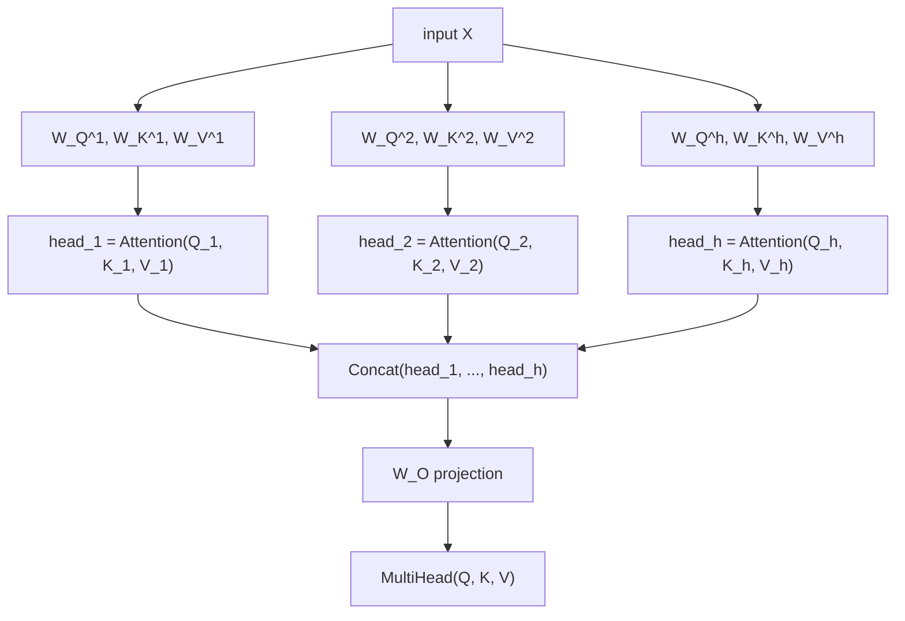

# पाठ 2. Multi-Head Attention

**मिशन से संबंध:** पाठ 1 का समीकरण ऑपरेशन है; यह पाठ बताता है कि transformer असल में उसे कैसे इस्तेमाल करता है: एक ही input के अलग-अलग सीखे हुए projections पर उसे कई बार parallel में चलाकर, बजाय इसके कि वह एक बार पूरे आयाम में चले।
**मुख्य स्रोत:** [पेपर: "Attention Is All You Need", Vaswani et al., 2017](https://arxiv.org/abs/1706.03762)
**पूर्व-आवश्यकताएँ:** [पाठ 1](0001-scaled-dot-product-attention.md), [Scaled dot-product attention](../GLOSSARY.md)

## वार्म-अप

1. ▢ Scaled dot-product attention का समीकरण याददाश्त से लिखें।

<details markdown="1"><summary>जाँचें</summary>

`Attention(Q, K, V) = softmax(QK^T / sqrt(d_k)) V`।

</details>

2. ▢ `d_k` बढ़ने पर `/ sqrt(d_k)` scaling क्यों मायने रखती है?

<details markdown="1"><summary>जाँचें</summary>

कच्चे dot-product scores का variance `d_k` के साथ बढ़ता है, जो softmax को लगभग one-hot output की ओर धकेलता है जहाँ उसका gradient लगभग सपाट होता है। `sqrt(d_k)` से भाग देने पर वह बढ़त कट जाती है, और scores उस दायरे में रहते हैं जहाँ softmax का gradient अब भी काम का होता है।

</details>

## यह जानें

### एक attention ऑपरेशन एक ही नज़रिया देता है

पूरे input पर एक बार compute किया गया scaled dot-product attention हर query के लिए ठीक एक भारित मिश्रण बनाता है, यानी इस बात का एक "नज़रिया" कि हर position बाक़ी हर position से कैसे जुड़ी है। यह एक असली सीमा है: किसी वाक्य की बनावट में एक साथ कई अलग-अलग तरह के संबंध होते हैं (कोई सर्वनाम किस शब्द की ओर इशारा करता है, कौन-से शब्द व्याकरण से जुड़े हैं, कौन-से शब्द बस पास-पास हैं), और इन सबको हर position के लिए एक ही attention pattern में ठूँसने का मतलब ऐसे संबंधों का औसत निकालना है जिन्हें अलग रखना शायद बेहतर होता।

### कई छोटे subspaces में project करें, हर एक में अलग से attend करें

**Multi-head attention** इसे ठीक करता है: attention को कई बार parallel में चलाकर, हर बार input के अपने अलग, सीखे हुए projection पर। `h` heads के लिए हर head `i` को अपने सीखे हुए weight matrices `W_Q^i`, `W_K^i`, `W_V^i` मिलते हैं, जो input को छोटे आयाम `d_k = d_model / h` तक project करते हैं:

```text
Q_i = X W_Q^i,   K_i = X W_K^i,   V_i = X W_V^i
head_i = Attention(Q_i, K_i, V_i)
```

हर head पाठ 1 का वही समीकरण लगाता है, बस अपने कम आयाम वाले subspace के अंदर। चूँकि हर head के projection matrices स्वतंत्र रूप से सीखे जाते हैं, अलग-अलग heads को विशेषज्ञ बनने की छूट मिलती है: कोई पास के शब्दों के संबंध पकड़ने लगे, कोई कुछ ज़्यादा व्याकरण वाला, और उन्हें एक साझा attention pattern पर सहमत होने को कोई मजबूर नहीं करता।

### Heads को जोड़ें, फिर एक बार और project करें

Heads के outputs को वापस एक साथ concatenate किया जाता है और एक अंतिम सीखे हुए projection `W_O` से गुज़ारा जाता है, जो उन्हें model के पूरे आयाम तक वापस ले आता है:

```text
MultiHead(Q, K, V) = Concat(head_1, ..., head_h) W_O
```

अंतिम projection कोई वैकल्पिक सजावट नहीं है: अकेला concatenation हर head के output को बस एक बड़े vector में अगल-बगल रख देता है, और एक head की जानकारी के दूसरे से मिलने का कोई रास्ता नहीं रहता। `W_O` ही model को यह सीखने देता है कि अलग-अलग heads के अलग नज़रियों को कैसे मिलाकर एक एकीकृत representation बनाया जाए, network में आगे जो भी आए उसके लिए।



### Scaling formula असल में प्रति-head आयाम इस्तेमाल करता है

चूँकि हर head `d_k = d_model / h` पर काम करता है, पूरे `d_model` पर नहीं, पाठ 1 की `/ sqrt(d_k)` scaling उसी छोटे, प्रति-head आयाम का इस्तेमाल करती है। यह इसलिए मायने रखता है कि यह मान लेना आसान है कि scaling को model के कुल आकार के साथ चलना चाहिए; ऐसा नहीं है, वह उस आयाम के साथ चलती है जिस पर उस ख़ास attention computation के अंदर के dot products असल में जोड़े जाते हैं, और attention को heads में बाँटने के बाद वह प्रति-head आयाम होता है।

## अभ्यास

1. ▢ एक model में `d_model = 512` है और वह 8 attention heads इस्तेमाल करता है। `d_k`, यानी हर head जिस आयाम में काम करता है, क्या है?

<details markdown="1"><summary>जाँचें</summary>

`d_k = 512 / 8 = 64`।

</details>

2. ▢ Heads के outputs को concatenate करने के बाद अंतिम linear projection (`W_O`) क्यों लगाया जाता है, concatenated vector को सीधे इस्तेमाल करने के बजाय?

<details markdown="1"><summary>जाँचें</summary>

अकेला concatenation हर head के output को अगल-बगल रख देता है, और उनके बीच कोई आपसी क्रिया नहीं होती। `W_O` model को यह सीखने देता है कि अलग-अलग heads की जानकारी को कैसे मिलाकर एक एकीकृत representation बनाया जाए, बजाय इसके कि heads के outputs एक बड़े vector के कटे हुए टुकड़े बने रहें।

</details>

3. ▢ अलग-अलग heads positions के बीच के अलग-अलग तरह के संबंधों में विशेषज्ञ क्यों बन सकते हैं, जबकि वे सब ठीक वही attention समीकरण लगाते हैं?

<details markdown="1"><summary>जाँचें</summary>

हर head के अपने, स्वतंत्र रूप से सीखे हुए projection matrices (`W_Q^i`, `W_K^i`, `W_V^i`) होते हैं। एक ही input के अलग-अलग projected रूपों पर वही समीकरण लगाने वाले दो heads input के बिल्कुल अलग पहलुओं पर attend कर सकते हैं, क्योंकि projections ही तय करते हैं कि हर head की queries और keys असल में क्या दर्शाती हैं।

</details>

4. ▢ एक model attention को `h` heads में बाँटता है, हर एक `d_k = d_model / h` पर। एक head की attention computation के अंदर `/ sqrt(d_k)` scaling निकालते समय `d_k` प्रति-head आयाम होना चाहिए या पूरा `d_model`? क्यों?

<details markdown="1"><summary>संकेत</summary>

पूछें कि जिन dot products को scale किया जा रहा है वे असल में किस आयाम पर जोड़े जाते हैं।

</details>

<details markdown="1"><summary>जाँचें</summary>

प्रति-head आयाम। पाठ 1 की scaling `d_k` पदों पर जोड़े गए dot product के variance की बढ़त को काटने के लिए है; एक head के अंदर वह dot product head के अपने आयाम `d_model / h` पर जोड़ा जाता है, model के पूरे आयाम पर नहीं। ग़लत (पूरा) आयाम इस्तेमाल करने पर scores उतने scale नहीं होते जितनी उस head के अपने dot products को ज़रूरत है।

</details>

5. ▢ पूरे model आयाम पर attention एक बार compute करने की तुलना में multi-head attention के बारे में कौन-सा दावा सही है?

    - a) Multi-head attention एक बार attention चलाता है, फिर अकेले output को बाद में नक़ली तौर पर टुकड़ों में बाँट देता है
    - b) हर head के अपने सीखे हुए projections होते हैं और वह छोटे subspace में स्वतंत्र रूप से attention compute करता है, फिर सभी heads को concatenate करके वापस project किया जाता है
    - c) सभी heads एक ही query, key और value projection matrices साझा करते हैं, और फ़र्क़ सिर्फ़ इतना है कि वे किन positions पर attend करते हैं
    - d) अंतिम projection `W_O` वैकल्पिक है और उसे हटाने से model जो कुछ represent कर सकता है वह नहीं बदलता

<details markdown="1"><summary>जाँचें</summary>

**b)** यह ठीक वही तंत्र है जो यह पाठ बताता है। (a) ग़लत है: हर head अपना पूरा attention ऑपरेशन अपने projected inputs पर स्वतंत्र रूप से compute करता है, किसी एक साझा computation का बाद में किया हुआ बँटवारा नहीं। (c) ग़लत है: हर head के projection matrices स्वतंत्र रूप से सीखे जाते हैं, जिससे heads विशेषज्ञ बन पाते हैं। (d) ग़लत है: `W_O` के बिना concatenated heads के पास एक-दूसरे की जानकारी मिलाने का कोई रास्ता नहीं रहता।

</details>

## असली दुनिया का अभ्यास

- [ ] Multi-head attention को raw tensor operations से लागू करें: प्रति-head linear projections, हर head पर स्वतंत्र रूप से लगाया गया पाठ 1 का attention समीकरण, concatenation, और अंतिम `W_O` projection। पक्का करें कि output का shape `d_model` से मेल खाता है, चाहे आप कितने भी heads चुनें।
- [ ] एक छोटे `d_model` और heads की दो अलग संख्याओं (मान लें 2 और 8) के लिए हर एक का `d_k` निकालें और देखें कि heads की संख्या बढ़ने पर वह कैसे घटता है।
- [ ] कल: मुख्य स्रोत पेपर का "Multi-Head Attention" खंड पूरा पढ़ें, और जाँचें कि उसके समीकरणों का हर matrix आपके अपने implementation में नाम दी गई किसी चीज़ से मेल खाता है।

## आगे बढ़ने के लिए

- [पेपर: "Attention Is All You Need", Vaswani et al., 2017](https://arxiv.org/abs/1706.03762)
- [लेख: "The Illustrated Transformer", Jay Alammar](https://jalammar.github.io/illustrated-transformer/)
- [संसाधन](../RESOURCES.md)

---

बात नहीं बन रही? ऊपर दिए मुख्य स्रोत को दोबारा पढ़ें, क्योंकि यह पाठ उसे संक्षिप्त करता है और समझ संक्षेप में ही रिसती है। जो शब्द फिसलन भरा लगे, उसके लिए [शब्दावली](../GLOSSARY.md) देखें।

अगर दिक़्क़त सामग्री की नहीं बल्कि पाठ की ही है, तो वह एक खोट है: [issue खोलें](https://github.com/TokenCemetery/teach/issues)।
