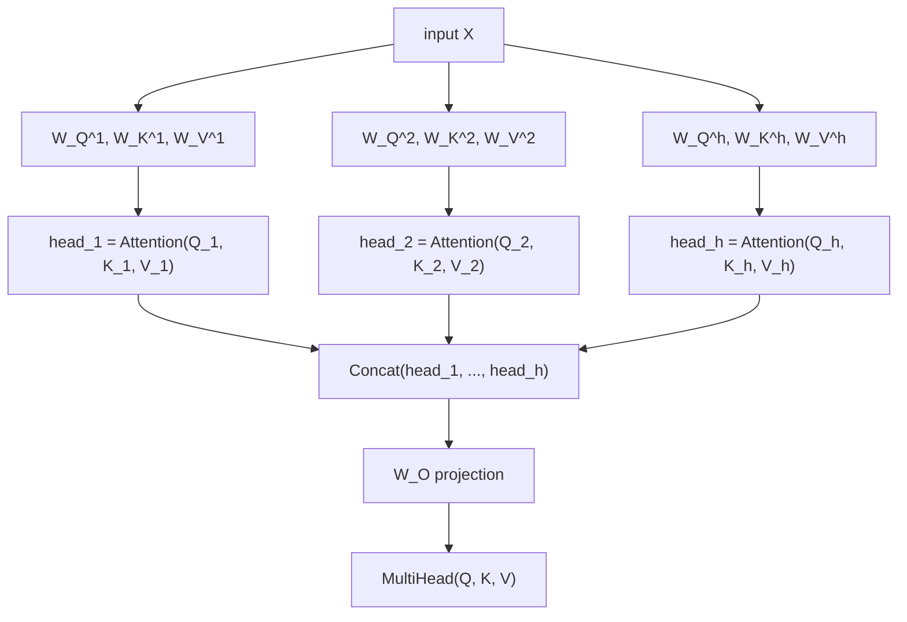

# Lição 2. Multi-Head Attention

**Ligação com a missão:** A equação da lição 1 é a operação; esta lição é como o transformer realmente a usa, rodando-a várias vezes em paralelo sobre diferentes projeções aprendidas da mesma entrada, em vez de uma só vez com a dimensão completa.
**Fonte principal:** [Artigo científico: "Attention Is All You Need", Vaswani et al., 2017](https://arxiv.org/abs/1706.03762)
**Pré-requisitos:** [Lição 1](0001-scaled-dot-product-attention.md), [Scaled dot-product attention](../GLOSSARY.md)

## Aquecimento

1. ▢ Escreva de memória a equação da scaled dot-product attention.

<details markdown="1"><summary>Verificação</summary>

`Attention(Q, K, V) = softmax(QK^T / sqrt(d_k)) V`.

</details>

2. ▢ Por que o escalonamento `/ sqrt(d_k)` importa à medida que `d_k` cresce?

<details markdown="1"><summary>Verificação</summary>

A variância dos scores brutos do produto escalar cresce com `d_k`, o que empurra o softmax para uma saída quase one-hot, em que o seu gradiente é quase plano. Dividir por `sqrt(d_k)` compensa esse crescimento, mantendo os scores em uma faixa em que o gradiente do softmax ainda é utilizável.

</details>

## Saiba isto

### Uma operação de atenção dá uma visão

A scaled dot-product attention, calculada uma vez sobre a entrada completa, produz exatamente uma mistura ponderada por query, uma "visão" de como cada posição se relaciona com todas as outras. Isso é uma limitação real: a estrutura de uma frase carrega vários tipos diferentes de relações ao mesmo tempo (a que palavra um pronome se refere, quais palavras estão ligadas sintaticamente, quais palavras estão simplesmente próximas), e forçar tudo isso em um único padrão de atenção por posição significa tirar a média de relações que talvez fosse melhor manter separadas.

### Projetar em vários subespaços menores e atender em cada um separadamente

A **multi-head attention** resolve isso rodando a atenção várias vezes em paralelo, cada vez sobre a sua própria projeção da entrada, aprendida separadamente. Para `h` heads, cada head `i` recebe as suas próprias matrizes de pesos aprendidas `W_Q^i`, `W_K^i`, `W_V^i`, que projetam a entrada para uma dimensão menor `d_k = d_model / h`:

```text
Q_i = X W_Q^i,   K_i = X W_K^i,   V_i = X W_V^i
head_i = Attention(Q_i, K_i, V_i)
```

Cada head aplica a equação exata da lição 1, só que dentro do seu próprio subespaço de dimensão menor. Como as matrizes de projeção de cada head são aprendidas de forma independente, heads diferentes ficam livres para se especializar, um pode acabar acompanhando relações entre palavras vizinhas, outro algo mais sintático, sem que nada os force a concordar em um único padrão de atenção compartilhado.

### Concatenar os heads e depois projetar mais uma vez

As saídas dos heads são concatenadas de volta e passam por uma última projeção aprendida, `W_O`, de volta à dimensão completa do modelo:

```text
MultiHead(Q, K, V) = Concat(head_1, ..., head_h) W_O
```

A projeção final não é um enfeite opcional: a concatenação sozinha apenas coloca a saída de cada head lado a lado em um vetor maior, sem nenhuma forma de a informação de um head se combinar com a de outro. A `W_O` é o que permite ao modelo aprender como misturar as visões separadas dos diferentes heads de volta em uma única representação unificada para o que vier a seguir na rede.



### A dimensão por head é o que a fórmula de escalonamento realmente usa

Como cada head opera com `d_k = d_model / h`, e não com o `d_model` completo, o escalonamento `/ sqrt(d_k)` da lição 1 usa essa dimensão menor, por head. Isso importa porque é fácil supor que o escalonamento deveria acompanhar o tamanho geral do modelo; não acompanha, ele acompanha a dimensão sobre a qual os produtos escalares dentro daquele cálculo de atenção específico são de fato somados, que é a dimensão por head quando a atenção é dividida entre heads.

## Prática

1. ▢ Um modelo tem `d_model = 512` e usa 8 heads de atenção. Qual é `d_k`, a dimensão em que cada head opera?

<details markdown="1"><summary>Verificação</summary>

`d_k = 512 / 8 = 64`.

</details>

2. ▢ Por que uma projeção linear final (`W_O`) é aplicada depois de concatenar as saídas dos heads, em vez de simplesmente usar direto o vetor concatenado?

<details markdown="1"><summary>Verificação</summary>

A concatenação sozinha coloca a saída de cada head lado a lado, sem interação entre elas. A `W_O` permite que o modelo aprenda a combinar a informação dos heads separados em uma única representação unificada, em vez de deixar as saídas dos heads como pedaços desconectados de um vetor maior.

</details>

3. ▢ Por que heads diferentes podem acabar se especializando em tipos diferentes de relações entre posições, quando todos aplicam exatamente a mesma equação de atenção?

<details markdown="1"><summary>Verificação</summary>

Cada head tem as suas próprias matrizes de projeção, aprendidas de forma independente (`W_Q^i`, `W_K^i`, `W_V^i`). Dois heads que aplicam a equação idêntica a versões projetadas de maneira diferente da mesma entrada podem atender a aspectos inteiramente diferentes dessa entrada, já que as próprias projeções moldam o que as queries e keys de cada head realmente representam.

</details>

4. ▢ Um modelo divide a atenção entre `h` heads, cada um operando com `d_k = d_model / h`. Ao calcular o escalonamento `/ sqrt(d_k)` dentro do cálculo de atenção de um head, `d_k` deve ser a dimensão por head ou o `d_model` completo? Por quê?

<details markdown="1"><summary>Dica</summary>

Pergunte-se sobre qual dimensão os produtos escalares que estão sendo escalados são de fato somados.

</details>

<details markdown="1"><summary>Verificação</summary>

A dimensão por head. O escalonamento da lição 1 existe para compensar o crescimento da variância de um produto escalar somado sobre `d_k` termos; dentro de um head, esse produto escalar é somado sobre a dimensão do próprio head, `d_model / h`, e não sobre a dimensão completa do modelo. Usar a dimensão errada (a completa) escalaria os scores de menos em relação ao que os produtos escalares daquele head de fato precisam.

</details>

5. ▢ Qual afirmação é verdadeira sobre a multi-head attention em comparação com calcular a atenção uma só vez na dimensão completa do modelo?

    - a) A multi-head attention roda a atenção uma vez e depois divide artificialmente a saída única em pedaços
    - b) Cada head tem as suas próprias projeções aprendidas e calcula a atenção de forma independente em um subespaço menor, antes de todos os heads serem concatenados e projetados de volta
    - c) Todos os heads compartilham as mesmas matrizes de projeção de query, key e value, diferindo apenas em quais posições atendem
    - d) A projeção final `W_O` é opcional e pode ser omitida sem mudar o que o modelo consegue representar

<details markdown="1"><summary>Verificação</summary>

**b)** É exatamente o mecanismo que esta lição descreve. (a) é falsa: cada head calcula a sua própria operação de atenção completa de forma independente, sobre as suas próprias entradas projetadas, e não uma divisão posterior de um cálculo compartilhado. (c) é falsa: as matrizes de projeção de cada head são aprendidas de forma independente, e é isso que permite que os heads se especializem. (d) é falsa: sem a `W_O`, os heads concatenados não têm como combinar informação entre si.

</details>

## Prática no mundo real

- [ ] Implemente a multi-head attention a partir de operações com tensores brutos: projeções lineares por head, a equação de atenção da lição 1 aplicada de forma independente por head, a concatenação e a projeção final `W_O`. Confirme que o formato da saída bate com `d_model`, não importa quantos heads você escolha.
- [ ] Para um `d_model` pequeno e duas quantidades diferentes de heads (digamos 2 e 8), calcule `d_k` para cada uma e observe como ele encolhe à medida que a quantidade de heads cresce.
- [ ] Amanhã: leia por inteiro a seção "Multi-Head Attention" do artigo científico da fonte principal e confira se cada matriz das suas equações corresponde a algo que você nomeou na sua própria implementação.

## Para ir além

- [Artigo científico: "Attention Is All You Need", Vaswani et al., 2017](https://arxiv.org/abs/1706.03762)
- [Artigo: "The Illustrated Transformer", Jay Alammar](https://jalammar.github.io/illustrated-transformer/)
- [Recursos](../RESOURCES.md)

---

Não ficou claro? Releia a fonte principal no topo, já que esta lição a comprime e é na compressão que o entendimento escapa. Consulte o [glossário](../GLOSSARY.md) para qualquer termo que pareceu escorregadio.

Se o problema é a lição em si, e não o material, isso é um defeito: [abra uma issue](https://github.com/TokenCemetery/teach/issues).
