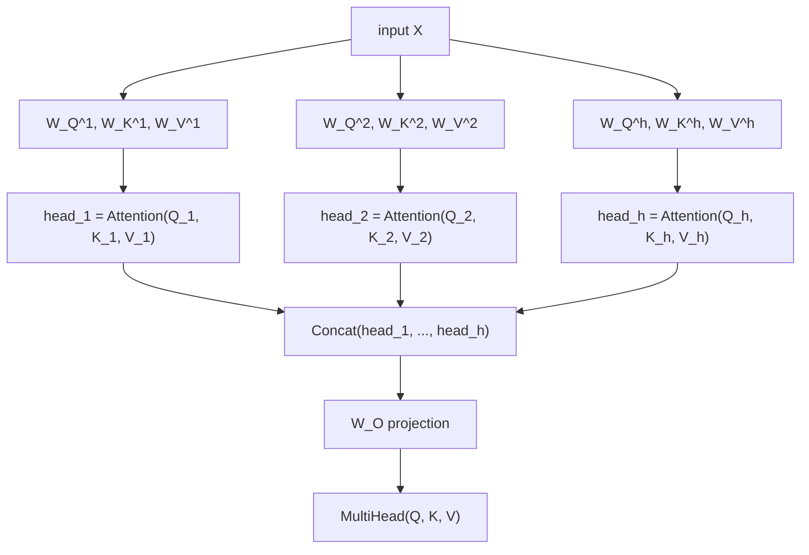

# Урок 2. Многоголовое внимание

**Связь с целью курса:** Уравнение из урока 1 это операция; этот урок о том, как трансформер на самом деле её использует: запускает её несколько раз параллельно на разных обученных проекциях одного и того же входа, а не один раз в полной размерности.
**Первоисточник:** [Научная статья: "Attention Is All You Need", Vaswani et al., 2017](https://arxiv.org/abs/1706.03762)
**Предварительные требования:** [Урок 1](0001-scaled-dot-product-attention.md), [Масштабированное скалярное внимание](../GLOSSARY.md)

## Разминка

1. ▢ Запишите по памяти уравнение масштабированного скалярного внимания.

<details markdown="1"><summary>Проверка</summary>

`Attention(Q, K, V) = softmax(QK^T / sqrt(d_k)) V`.

</details>

2. ▢ Почему масштабирование `/ sqrt(d_k)` важно по мере роста `d_k`?

<details markdown="1"><summary>Проверка</summary>

Дисперсия «сырых» скалярных произведений растёт вместе с `d_k`, что толкает softmax к почти one-hot выходу, где его градиент почти плоский. Деление на `sqrt(d_k)` компенсирует этот рост и удерживает оценки в диапазоне, где градиент softmax ещё пригоден.

</details>

## Что нужно знать

### Одна операция внимания даёт один взгляд

Масштабированное скалярное внимание, вычисленное один раз по всему входу, даёт ровно одну взвешенную смесь на запрос, один «взгляд» на то, как каждая позиция связана с каждой другой. Это реальное ограничение: структура предложения несёт сразу несколько разных видов связей (на какое слово указывает местоимение, какие слова связаны синтаксически, какие слова просто стоят рядом), и если заставить всё это уложиться в один паттерн внимания на позицию, получится усреднение связей, которые лучше было бы держать раздельно.

### Спроецировать в несколько меньших подпространств и применять внимание в каждом отдельно

**Многоголовое внимание** (multi-head attention) решает это, запуская внимание несколько раз параллельно, каждый раз на своей, отдельно обученной проекции входа. Для `h` голов каждая голова `i` получает свои обучаемые матрицы весов `W_Q^i`, `W_K^i`, `W_V^i`, которые проецируют вход в меньшую размерность `d_k = d_model / h`:

```text
Q_i = X W_Q^i,   K_i = X W_K^i,   V_i = X W_V^i
head_i = Attention(Q_i, K_i, V_i)
```

Каждая голова применяет в точности уравнение из урока 1, только внутри своего подпространства меньшей размерности. Поскольку матрицы проекций каждой головы обучаются независимо, разные головы могут свободно специализироваться: одна может отслеживать связи между соседними словами, другая что-то более синтаксическое, и ничто не заставляет их соглашаться на один общий паттерн внимания.

### Склеить головы и спроецировать ещё раз

Выходы голов склеиваются (конкатенируются) обратно и пропускаются через одну финальную обучаемую проекцию `W_O` обратно в полную размерность модели:

```text
MultiHead(Q, K, V) = Concat(head_1, ..., head_h) W_O
```

Финальная проекция это не необязательное украшение: одна конкатенация лишь кладёт выход каждой головы рядом в более крупный вектор, и информации из одной головы нечем объединиться с другой. Именно `W_O` позволяет модели научиться смешивать раздельные взгляды разных голов обратно в единое представление для всего, что идёт дальше в сети.



### Размерность головы это то, что на самом деле использует формула масштабирования

Поскольку каждая голова работает с `d_k = d_model / h`, а не с полной `d_model`, масштабирование `/ sqrt(d_k)` из урока 1 использует эту меньшую размерность головы. Это важно, потому что легко решить, будто масштабирование должно следовать общему размеру модели; это не так: оно следует той размерности, по которой на самом деле суммируются скалярные произведения внутри данного вычисления внимания, а после разделения внимания по головам это размерность головы.

## Практика

1. ▢ У модели `d_model = 512` и 8 голов внимания. Чему равна `d_k`, размерность, в которой работает каждая голова?

<details markdown="1"><summary>Проверка</summary>

`d_k = 512 / 8 = 64`.

</details>

2. ▢ Почему после конкатенации выходов голов применяется финальная линейная проекция (`W_O`), а не используется сразу склеенный вектор?

<details markdown="1"><summary>Проверка</summary>

Одна конкатенация кладёт выходы голов рядом без какого-либо взаимодействия между ними. `W_O` позволяет модели научиться объединять информацию из разных голов в единое представление, а не оставлять выходы голов несвязанными кусками более крупного вектора.

</details>

3. ▢ Почему разные головы могут специализироваться на разных видах связей между позициями, хотя все они применяют одно и то же уравнение внимания?

<details markdown="1"><summary>Проверка</summary>

У каждой головы свои, независимо обученные матрицы проекций (`W_Q^i`, `W_K^i`, `W_V^i`). Две головы, применяющие одно и то же уравнение к по-разному спроецированным версиям одного входа, могут обращать внимание на совершенно разные аспекты входа, потому что сами проекции определяют, что на самом деле представляют запросы и ключи каждой головы.

</details>

4. ▢ Модель делит внимание на `h` голов, каждая работает с `d_k = d_model / h`. При вычислении масштабирования `/ sqrt(d_k)` внутри вычисления внимания одной головы `d_k` должна быть размерностью головы или полной `d_model`? Почему?

<details markdown="1"><summary>Подсказка</summary>

Спросите себя, по какой размерности на самом деле суммируются масштабируемые скалярные произведения.

</details>

<details markdown="1"><summary>Проверка</summary>

Размерностью головы. Масштабирование из урока 1 нужно, чтобы компенсировать рост дисперсии скалярного произведения, суммируемого по `d_k` слагаемым; внутри одной головы это скалярное произведение суммируется по собственной размерности головы, `d_model / h`, а не по полной размерности модели. Использование неверной (полной) размерности недомасштабировало бы оценки относительно того, что нужно скалярным произведениям этой головы.

</details>

5. ▢ Какое утверждение верно для многоголового внимания по сравнению с однократным вычислением внимания в полной размерности модели?

    - a) Многоголовое внимание выполняет внимание один раз, а затем искусственно режет единственный выход на части
    - b) У каждой головы свои обучаемые проекции, и она вычисляет внимание независимо в меньшем подпространстве, после чего все головы склеиваются и проецируются обратно
    - c) Все головы делят одни и те же матрицы проекций запроса, ключа и значения и отличаются лишь тем, на какие позиции обращают внимание
    - d) Финальная проекция `W_O` необязательна, и её можно пропустить, не изменив того, что модель способна представить

<details markdown="1"><summary>Проверка</summary>

**b)** Это в точности механизм, который описывает урок. Вариант (a) неверен: каждая голова вычисляет собственную полную операцию внимания независимо, на своих спроецированных входах, а не разделяет постфактум одно общее вычисление. Вариант (c) неверен: матрицы проекций каждой головы обучаются независимо, и именно это позволяет головам специализироваться. Вариант (d) неверен: без `W_O` склеенным головам нечем объединить информацию друг с другом.

</details>

## Практика в реальной работе

- [ ] Реализуйте многоголовое внимание из «сырых» тензорных операций: поголовные линейные проекции, уравнение внимания из урока 1, применённое независимо к каждой голове, конкатенацию и финальную проекцию `W_O`. Убедитесь, что форма выхода совпадает с `d_model` при любом выбранном числе голов.
- [ ] Для небольшой `d_model` и двух разных чисел голов (скажем, 2 и 8) вычислите `d_k` для каждого и отметьте, как она уменьшается с ростом числа голов.
- [ ] Завтра: прочитайте целиком раздел «Multi-Head Attention» в статье-первоисточнике и проверьте, что каждая матрица в её уравнениях соответствует чему-то, что вы назвали в своей реализации.

## Что почитать дальше

- [Научная статья: "Attention Is All You Need", Vaswani et al., 2017](https://arxiv.org/abs/1706.03762)
- [Статья: "The Illustrated Transformer", Jay Alammar](https://jalammar.github.io/illustrated-transformer/)
- [Ресурсы](../RESOURCES.md)

---

Не доходит? Перечитайте первоисточник в начале: этот урок его сжимает, а при сжатии понимание как раз и теряется. Загляните в [глоссарий](../GLOSSARY.md), если какой-то термин показался скользким.

Если неясен сам урок, а не материал, это дефект: [откройте issue](https://github.com/TokenCemetery/teach/issues).
