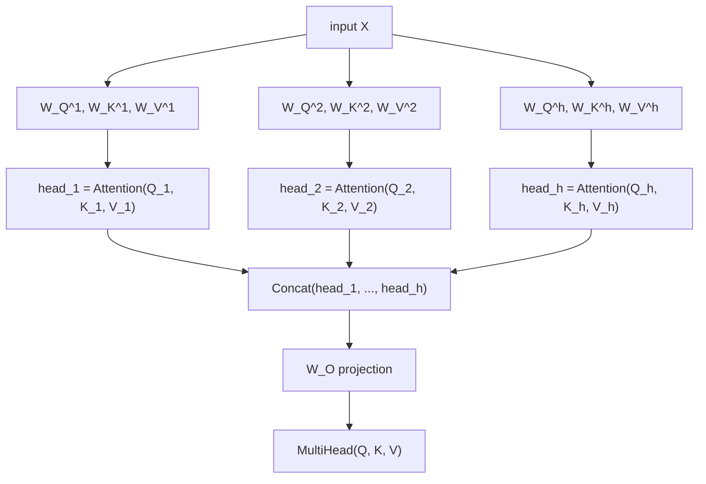

# 第 2 课：多头注意力

**使命关联:** 第 1 课的方程是运算本身，而本课讲 Transformer 实际上如何使用它：在同一个输入的不同的、学习得到的投影上并行地运行它好几次，而不是在完整维度上只运行一次。
**主要来源:** [论文：“Attention Is All You Need”，Vaswani 等，2017](https://arxiv.org/abs/1706.03762)
**前置知识:** [第 1 课](0001-scaled-dot-product-attention.md)、[缩放点积注意力](../GLOSSARY.md)

## 热身

1. ▢ 凭记忆写出缩放点积注意力的方程。

<details markdown="1"><summary>检查</summary>

`Attention(Q, K, V) = softmax(QK^T / sqrt(d_k)) V`。

</details>

2. ▢ 随着 `d_k` 增大，`/ sqrt(d_k)` 缩放为什么重要？

<details markdown="1"><summary>检查</summary>

原始点积分数的方差随 `d_k` 增大，这会把 softmax 推向近乎 one-hot 的输出，而此时它的梯度几乎为零。除以 `sqrt(d_k)` 抵消了这种增长，让分数保持在 softmax 梯度仍然可用的范围内。

</details>

## 要点

### 一次注意力运算只给出一种视角

在完整输入上只计算一次缩放点积注意力，每个查询只会得到一个加权混合，也就是关于每个位置与其他所有位置如何相关的一种“视角”。这是一个真实的局限：一句话的结构同时带有多种不同类型的关系（代词指代哪个词，哪些词在句法上相连，哪些词只是挨得近），而把这一切都塞进每个位置的单一注意力模式里，就意味着把本来最好分开保存的关系平均在了一起。

### 投影到几个较小的子空间，在每个子空间里分别做注意力

**多头注意力**用这样的办法来解决：并行地运行注意力好几次，每一次都在输入自己的、单独学习得到的投影上进行。对于 `h` 个头，每个头 `i` 都有自己学习得到的权重矩阵 `W_Q^i`、`W_K^i`、`W_V^i`，把输入投影到更小的维度 `d_k = d_model / h`：

```text
Q_i = X W_Q^i,   K_i = X W_K^i,   V_i = X W_V^i
head_i = Attention(Q_i, K_i, V_i)
```

每个头用的都是第 1 课的同一个方程，只不过是在它自己的低维子空间里。由于每个头的投影矩阵是独立学习的，不同的头可以自由地分工，比如一个头可能最终追踪相邻词之间的关系，另一个头追踪更偏句法的东西，并没有什么力量强迫它们统一到同一个共享的注意力模式上。

### 把各个头拼接起来，再投影一次

各个头的输出被拼接回一起，再经过最后一个学习得到的投影 `W_O`，回到模型的完整维度：

```text
MultiHead(Q, K, V) = Concat(head_1, ..., head_h) W_O
```

这最后一个投影并不是可有可无的装饰：单靠拼接只是把每个头的输出并排放进一个更大的向量里，一个头的信息没有任何办法与另一个头的信息结合。`W_O` 让模型能够学会如何把各个头各自不同的视角，混合成一个统一的表示，供网络后面的部分使用。



### 缩放公式实际用的是每个头的维度

由于每个头工作在 `d_k = d_model / h` 上，而不是完整的 `d_model`，第 1 课的 `/ sqrt(d_k)` 缩放用的就是这个更小的、每个头的维度。这一点之所以重要，是因为人们很容易以为缩放应该跟着模型的整体大小走；其实不是，它跟着的是这次具体的注意力计算中点积所求和的那个维度，而注意力一旦被拆分到多个头上，这个维度就是每个头的维度。

## 练习

1. ▢ 一个模型的 `d_model = 512`，使用 8 个注意力头。`d_k`，也就是每个头工作的维度，是多少？

<details markdown="1"><summary>检查</summary>

`d_k = 512 / 8 = 64`。

</details>

2. ▢ 为什么在拼接各个头的输出之后，还要再施加一个最终的线性投影（`W_O`），而不是直接使用拼接后的向量？

<details markdown="1"><summary>检查</summary>

单靠拼接，只是把每个头的输出并排放在一起，它们之间没有任何交互。`W_O` 让模型能够学会如何把各个独立的头的信息组合成一个统一的表示，而不是让各个头的输出始终是一个更大向量里互不相连的几块。

</details>

3. ▢ 所有的头应用的都是完全相同的注意力方程，为什么不同的头最终还是会专门负责位置之间不同类型的关系？

<details markdown="1"><summary>检查</summary>

每个头都有自己独立学习的投影矩阵（`W_Q^i`、`W_K^i`、`W_V^i`）。两个头把同一个方程应用在同一个输入的不同投影版本上，可以关注输入的完全不同的方面，因为投影本身决定了每个头的查询和键究竟代表什么。

</details>

4. ▢ 一个模型把注意力拆分到 `h` 个头上，每个头工作在 `d_k = d_model / h` 上。在某个头的注意力计算里做 `/ sqrt(d_k)` 缩放时，`d_k` 应该取每个头的维度，还是完整的 `d_model`？为什么？

<details markdown="1"><summary>提示</summary>

想一想被缩放的那些点积，实际上是对哪个维度求和的。

</details>

<details markdown="1"><summary>检查</summary>

取每个头的维度。第 1 课的缩放，是为了抵消对 `d_k` 项求和的点积的方差增长；在一个头里面，那个点积是对该头自己的维度 `d_model / h` 求和的，而不是对完整的模型维度。用了错误的（完整的）维度，会让分数相对于该头自己的点积实际需要的程度而言缩放不足。

</details>

5. ▢ 与只在完整模型维度上计算一次注意力相比，下面哪一项关于多头注意力的说法是对的？

    - a) 多头注意力只运行一次注意力，然后事后把单一的输出人为地拆成几块
    - b) 每个头都有自己学习得到的投影，在较小的子空间里独立计算注意力，然后把所有头拼接起来并投影回去
    - c) 所有的头共用同一组查询、键和值的投影矩阵，区别只在于它们关注哪些位置
    - d) 最终的投影 `W_O` 是可选的，跳过它不会改变模型所能表示的东西

<details markdown="1"><summary>检查</summary>

**b)** 这正是本课描述的机制。(a) 是错的：每个头都在自己投影后的输入上，独立计算出自己完整的注意力运算，而不是对一次共享计算做事后拆分。(c) 是错的：每个头的投影矩阵是独立学习的，这正是各个头能够分工的原因。(d) 是错的：没有 `W_O`，拼接起来的各个头就没有办法彼此组合信息。

</details>

## 实战练习

- [ ] 只用原始张量运算实现多头注意力：每个头各自的线性投影、对每个头独立应用第 1 课的注意力方程、拼接，以及最后的 `W_O` 投影。确认不论你选多少个头，输出的形状都与 `d_model` 一致。
- [ ] 取一个较小的 `d_model` 和两种不同的头数（比如 2 和 8），分别计算它们的 `d_k`，并注意它随着头数增多而变小。
- [ ] 明天：完整阅读主要来源论文里“Multi-Head Attention”一节，并检查它方程里的每一个矩阵，是否都对应到你自己实现里命名过的某个东西。

## 延伸阅读

- [论文：“Attention Is All You Need”，Vaswani 等，2017](https://arxiv.org/abs/1706.03762)
- [文章：“The Illustrated Transformer”，Jay Alammar](https://jalammar.github.io/illustrated-transformer/)
- [资源](../RESOURCES.md)

---

没学明白？请重读顶部的主要来源，因为本课是对它的压缩，而理解正是在压缩中流失的。如果有哪个术语觉得含糊，可以查看[术语表](../GLOSSARY.md)。

如果问题出在课程本身，而不是学习材料，那就是一个缺陷：[提交 issue](https://github.com/TokenCemetery/teach/issues)。
