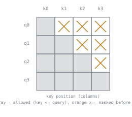

# 第 3 课：因果掩码

**使命关联:** 这是第 1 阶段的收官之课：多头注意力（第 2 课）让每个位置都能关注其他所有位置，而这对本工作区的模型最终要做的自回归生成来说恰恰是错的，本课就是对这一问题的修正。
**主要来源:** [文章：“The Annotated Transformer”，Harvard NLP](http://nlp.seas.harvard.edu/annotated-transformer/)
**前置知识:** [第 2 课](0002-multi-head-attention.md)、[缩放点积注意力](../GLOSSARY.md)

## 热身

1. ▢ 在多头注意力中，在一个头内部做 `/ sqrt(d_k)` 缩放时，`d_k` 应该取每个头的维度，还是完整的模型维度？

检查

取每个头的维度（`d_model / h`）。缩放是为了抵消对 `d_k` 项求和的点积的方差增长，而在一个头内部，那个点积是对该头自己更小的维度求和的。

2. ▢ 在缩放点积注意力中，softmax 这一步完成了什么？

检查

它把每个查询与所有键的原始相似度分数转换成一个概率分布，非负且总和为 1，这才使输出成为各个值的加权混合。

## 要点

### 为什么关注未来本身就是个问题

一个一次生成一个 token 的模型，只用 token 1 到 *N-1* 来产生 token *N*；到那一刻，token *N+1* 还不存在。如果训练期间的自注意力允许位置 *i* 去关注大于 *i* 的位置 *j*，模型就可以把它本该预测的那个 token，以及它之后的每一个 token，都用在计算这个预测的过程中。训练损失看起来会非常漂亮，因为模型实际上是在抄一个它已经看得到的答案，但模型什么有用的东西也没学到，因为到真正生成的时候，那些未来的 token 是永远得不到的。**因果掩码**正是让训练保持诚实的办法：它限定每个位置只能关注它自己和更早的位置，这与模型真正一次生成一个 token 时能得到的信息完全一致。

### 掩码作用在分数上，在 softmax 之前

修正发生在方程内部、softmax 这一步之前：给原始的 `QK^T / sqrt(d_k)` 分数加上一个掩码，把键位置晚于查询位置的每一项都设成一个很大的负数（实践中是负无穷，或数值上等价的东西，比如 -1e9）。这个被掩码的分数在 softmax 内部经过 `exp(...)` 之后，一个很大的负数就变成与零无法区分的值，所以该位置对最终的加权和基本没有贡献，剩下未被掩码的位置的权重则在它们之间重新归一化，总和仍为 1。

### 为什么不在 softmax 之后直接把权重置零

在 softmax 已经运行之后，再把未来位置的权重置零，是不对的：其他权重在计算时，是假定那个位置也是争夺概率质量的真实竞争者，事后把它置零，会让剩下的权重总和不再是 1，那就不是一个有效的概率分布了。掩码必须专门放在 softmax 之前，这样重新归一化才会作为同一次计算的一部分自动完成。

### 为什么也不能直接把原始分数设成 0

把未来位置的原始分数设成 0，而不是一个很大的负数，并不能把它排除掉：`exp(0) = 1`，这对 softmax 的分母来说是一个完全普通、不可忽略的贡献，根本不是“没有注意力”。分数为 0 读作中性的、平均的相似度，与其他每个位置的真实分数平起平坐地竞争。只有足够大的负数，才能把它的指数压到实际上为零，这才正确地把该位置从加权和里去掉。

### 掩码的形状：固定的下三角模式

对于长度为 *n* 的序列，因果掩码每次都是同一个下三角模式：查询位置 *i* 允许关注键位置 0 到 *i*（含），并被屏蔽掉 *i* 之后的每个位置。同样形状的掩码适用于每个注意力头和一个批次里的每个样本，在 softmax 运行之前，只需加到分数矩阵上一次。

## 练习

1. ▢ 考虑到模型在推理时的实际用法，为什么位置 *i* 的注意力不能包含任何大于 *i* 的位置 *j*？

检查

推理时，模型一次生成一个 token，只使用在它之前出现的 token；在预测当前位置时，它之后的 token 还不存在。如果训练时让位置 *i* 去关注更靠后的位置 *j*，模型就会学会依赖一种在真正生成时永远得不到的信息。

2. ▢ 为什么因果掩码要施加在 softmax 之前的原始分数上，而不是在 softmax 已经运行之后把注意力权重置零？

检查

Softmax 输出的权重是一起算出来的，对它拿到的所有分数而言总和为 1。事后把某个权重置零，会让剩下的权重总和小于 1，那就不再是有效的概率分布了。相反，在 softmax 之前做掩码，剩下的、未被掩码的位置之间的重新归一化，就会作为同一次计算的一部分自动发生。

3. ▢ 为什么把未来位置的原始分数设成 0（而不是一个很大的负数），并不能正确地把它从注意力中排除？

提示

想一想 `exp(0)` 的值是多少，以及这对 softmax 的分母意味着什么。

检查

`exp(0) = 1`，这是一个完全普通、不可忽略的值，它仍然在 softmax 的分母里争夺概率质量。分数为 0 读作平均的、中性的相似度，而不是“排除这个位置”。只有足够大的负数，才能把它的指数压到实际上为零，这才真正去掉了该位置的贡献。

4. ▢ 对于一个 4 个 token 的序列（位置 0 到 3），在因果掩码下，查询位置 2 能关注哪些键位置？

检查

位置 0、1 和 2。位置 3 晚于位置 2，被屏蔽掉。

5. ▢ 下面哪一项关于因果掩码如何实现的说法是对的？

    - a) 它在 softmax 算出注意力权重之后，把它们置零
    - b) 它在 softmax 之前给未来位置的原始分数加上一个很大的负数，使它们的指数可以忽略不计，剩下的权重自动重新归一化
    - c) 它只作用于第一个注意力头，因为后面的头不需要这种限制
    - d) 把未来位置的分数设成 0，等价于把它屏蔽掉

检查

**b)** 这正是这个机制，也是它必须发生在 softmax 之前的原因。(a) 是错的：在 softmax 之后置零，会让剩下的权重总和不再是 1。(c) 是错的：同一个掩码对每个头都同样适用。(d) 是错的：分数为 0 仍然通过 `exp(0) = 1` 贡献一个完整的普通权重，根本没有排除该位置。

## 实战练习

- [ ] 给你在第 2 课实现的多头注意力加上因果掩码：为选定的序列长度构建一个下三角掩码，并在 softmax 之前把它加到分数上。
- [ ] 取一个较短的序列，分别打印一个查询位置在施加掩码和不施加掩码时的 softmax 权重，并确认加了掩码的版本在未来位置上的权重基本为零。
- [ ] 明天：对照你自己的实现，阅读主要来源代码里的掩码部分，并确认掩码是在计算中的同一处施加的（在 softmax 之前，加到分数上）。

## 延伸阅读

- [文章：“The Annotated Transformer”，Harvard NLP](http://nlp.seas.harvard.edu/annotated-transformer/)
- [论文：“Attention Is All You Need”，Vaswani 等，2017](https://arxiv.org/abs/1706.03762)
- [资源](../RESOURCES.md)

---

没学明白？请重读顶部的主要来源，因为本课是对它的压缩，而理解正是在压缩中流失的。如果有哪个术语觉得含糊，可以查看[术语表](../GLOSSARY.md)。

如果问题出在课程本身，而不是学习材料，那就是一个缺陷：[提交 issue](https://github.com/TokenCemetery/teach/issues)。
