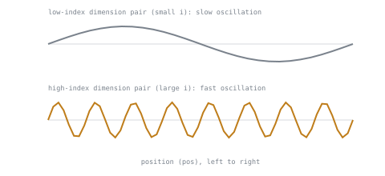

# 第 4 课：位置编码

**使命关联:** 第 2 阶段开始拆解围绕注意力（第 1 至 3 课）的那些部分，让它成为一个完整的 Transformer 块；位置编码是其中的第一个，没有它，注意力就会对语言最依赖的那件事视而不见：顺序。
**主要来源:** [论文：“Attention Is All You Need”，Vaswani 等，2017](https://arxiv.org/abs/1706.03762)
**前置知识:** [第 3 课](0003-causal-masking.md)、[缩放点积注意力](../GLOSSARY.md)

## 热身

1. ▢ 为什么因果掩码要施加在 softmax 之前的原始分数上，而不是在 softmax 已经运行之后把权重置零？

<details markdown="1"><summary>检查</summary>

Softmax 的权重是一起算出来的，总和已经是 1；事后把其中一个置零，剩下的总和就不再是 1。在 softmax 之前做掩码，剩下的、未被掩码的权重就会作为同一次计算的一部分自动重新归一化。

</details>

2. ▢ 凭记忆写出缩放点积注意力的方程。

<details markdown="1"><summary>检查</summary>

`Attention(Q, K, V) = softmax(QK^T / sqrt(d_k)) V`。

</details>

## 要点

### 注意力本身没有内置的顺序概念

缩放点积注意力根据查询与键之间的点积以及对值的加权求和来计算输出，这个计算里没有任何地方提到 token 在序列中处于什么位置。把两个输入 token 的位置对调（相应地，也把 `Q`、`K`、`V` 中来自它们的那些行对调），其他每个位置的注意力输出都完全一样，只是按对调重新标注了一下：计算所产生的、基于内容的关系和权重，丝毫没有改变。注意力把它的输入当作一个无序的向量集合，而不是序列，尽管语言显然不是与顺序无关的：“dog bites man”和“man bites dog”用的词完全相同，意思却截然不同。

### 位置必须被写进向量本身

注意力的方程只会看到 `Q`、`K` 和 `V`；没有一条旁路能告诉它“顺便说一下，这些各自来自哪个位置”。注意力要变得对位置敏感，唯一的办法是位置已经编码在产生 `Q`、`K` 和 `V` 的那些向量里面，也就是说，编码在 token 嵌入里，早在它们到达注意力计算之前。把一个**位置编码**向量加到每个 token 的嵌入上，就使得词相同而位置不同的两个 token，在数值上拥有可区分的嵌入，这就是注意力的点积最终能隐式地对位置敏感的原因。

### 正弦编码：每个位置一个独特且有结构的特征标记

原始论文的选择，是用不同频率的正弦和余弦函数来构造每个位置的编码，每个频率占一对维度：

```text
PE(pos, 2i)   = sin(pos / 10000^(2i / d_model))
PE(pos, 2i+1) = cos(pos / 10000^(2i / d_model))
```

低索引的维度对（`i` 较小）随位置变化得很慢（波长很长）；高索引的维度对变化得很快（波长很短）。每个位置在所有这些频率上都有一个独一无二的组合，而且关键在于，两个位置之间的固定偏移，可以表示成其中一个位置的编码的线性函数（因为和的 `sin` 和 `cos`，可以分解成各部分的 `sin` 和 `cos` 的线性组合）。这种结构是论文主张这一方案可以泛化到相对位置、并有可能泛化到训练时没见过的序列长度的部分原因，而不是只记住一组固定的绝对位置。



### 更简单的替代方案：学习得到的位置嵌入

不用固定的公式，位置也可以用一张普通的、学习得到的嵌入表来编码，按位置索引，就像 token 嵌入表按词表索引一样，并像其他任何参数一样用梯度下降来训练。这实现起来更简单，也不需要考虑频率，但对于超出训练时表所设定大小的位置，它没有公式可以依靠：表里没有一行对应模型从未见过的位置，而正弦编码的公式在任何位置上都仍然可以求值。

## 练习

1. ▢ 两个输入 token 的位置被对调（`Q`、`K`、`V` 中对应的行也跟着对调）。对于同时查询这两个 token 的第三个位置，它的注意力输出会发生什么？

<details markdown="1"><summary>检查</summary>

基于内容的权重和算出的输出都没有任何变化；结果只是被重新标注，以跟踪对调后的 token 现在占据哪个实际位置。这说明了注意力的置换不变性：它根据内容（点积）计算关系，完全不涉及位置。

</details>

2. ▢ 为什么位置必须编码进 token 嵌入本身，而不是作为某个单独的信号，与 `Q`、`K` 和 `V` 一起传给注意力计算？

<details markdown="1"><summary>检查</summary>

注意力的方程只对 `Q`、`K` 和 `V` 运算；没有额外的输入可供位置信息进入。计算要变得对位置敏感，唯一的办法是位置在注意力运行之前，就已经写进了产生 `Q`、`K` 和 `V` 的那些向量里。

</details>

3. ▢ 描述正弦位置编码在各个维度对之间的频率结构，以及与直接使用原始的位置整数相比，它带来了什么。

<details markdown="1"><summary>提示</summary>

想一想让各个维度对的频率各不相同，能做到一个单独的数字做不到的什么事。

</details>

<details markdown="1"><summary>检查</summary>

不同的维度对以不同的频率振荡，随位置变化从慢（低索引）到快（高索引），给每个位置一个跨所有频率的独一无二的数值组合，而不是一个原始标量。这种有结构的多频率编码，也使得固定的位置偏移可以表示成另一个位置的编码的线性函数，而单个原始整数不具备这种形式，注意力的线性运算无法如此直接地利用它。

</details>

4. ▢ 为什么正弦位置编码可以对比训练时见过的任何长度都更长的序列求值，而学习得到的位置嵌入表不行？

<details markdown="1"><summary>检查</summary>

正弦编码是一个公式，在任何位置值上都可以求值，包括训练期间从未遇到过的值。学习得到的嵌入表只有它被设定大小并训练过的那些位置的行；超出这个范围的位置，没有对应的行可以查。

</details>

5. ▢ 关于位置编码为什么存在，下面哪一项说法是对的？

    - a) 注意力的点积本来就能考虑相对位置，不需要任何额外的输入
    - b) 注意力把它的输入当作一个无序的集合，所以必须把位置注入嵌入，模型才可能对词序敏感
    - c) 位置编码只在很长的序列里才需要，短序列不需要
    - d) 学习得到的位置嵌入，比正弦编码更能泛化到没见过的序列长度

<details markdown="1"><summary>检查</summary>

**b)** 这就是位置编码存在的全部理由。(a) 是错的：注意力的方程本身根本不涉及位置。(c) 是错的：即使是短序列，意思也取决于词序，所以不论长度如何，同样的盲区都存在。(d) 是错的：恰恰相反，正弦编码的公式在任何位置上都可以求值，而学习得到的表则固定在训练时所用的范围内。

</details>

## 实战练习

- [ ] 对一个较小的 `d_model`，按公式实现正弦位置编码，并绘制或打印几个位置的编码向量，观察不同维度对上的不同振荡频率。
- [ ] 把你的位置编码加到一组 token 嵌入上，并确认同一个 token 在两个不同位置上，现在会产生数值不同的向量。
- [ ] 明天：完整阅读主要来源论文里“Positional Encoding”一节，并对照你自己的实现在训练范围之外实际会产生的结果，检验它关于泛化到更长序列的说法。

## 延伸阅读

- [论文：“Attention Is All You Need”，Vaswani 等，2017](https://arxiv.org/abs/1706.03762)
- [文章：“The Illustrated Transformer”，Jay Alammar](https://jalammar.github.io/illustrated-transformer/)
- [资源](../RESOURCES.md)

---

没学明白？请重读顶部的主要来源，因为本课是对它的压缩，而理解正是在压缩中流失的。如果有哪个术语觉得含糊，可以查看[术语表](../GLOSSARY.md)。

如果问题出在课程本身，而不是学习材料，那就是一个缺陷：[提交 issue](https://github.com/TokenCemetery/teach/issues)。
