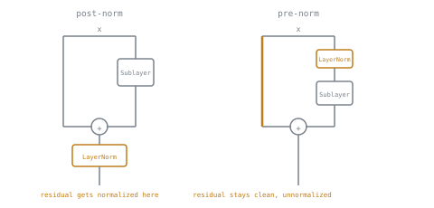

# 第 5 课：层归一化与残差连接

**使命关联:** 仅靠注意力（第 1 阶段）本身，并不能堆叠成一个深的、可训练的网络；残差连接和层归一化是让堆叠许多 Transformer 块（第 3 阶段）变得切实可行而不是不稳定的两个部件。
**主要来源:** [论文：“Layer Normalization”，Ba、Kiros 和 Hinton，2016](https://arxiv.org/abs/1607.06450)
**前置知识:** [第 4 课](0004-positional-encoding.md)、[缩放点积注意力](../GLOSSARY.md)

## 热身

1. ▢ 考虑到注意力的方程本身计算的内容，为什么还需要位置编码？

检查

注意力把它的输入当作一个无序的集合：对调两个位置，只是把输出重新标注一下，并不改变任何已计算出的关系。位置编码把位置注入 token 嵌入本身，这是注意力的点积能对顺序敏感的唯一办法。

2. ▢ 为什么把被掩码位置的原始分数设成 0，并不能正确地把它从注意力中排除？

检查

`exp(0) = 1`，这是一个完全普通的值，它仍然在 softmax 的分母里争夺概率质量。只有很大的负数，才能把它的指数压到实际上为零，这才真正去掉了该位置的贡献。

## 要点

### 残差连接给梯度一条直接的通路

Transformer 的一个子层（注意力，或下一课的前馈块）被包在一个**残差连接**里：这个块的输出是 `x + Sublayer(x)`，而不仅仅是 `Sublayer(x)` 本身。一旦堆叠起许多这样的块（第 3 阶段的主题），这一点就变得重要：没有 `+ x` 这一项，训练期间反向流动的梯度，就必须在每一层通过每个子层的变换，而在很深的堆叠里，这条路径可能缩小到趋近于零，也可能爆炸，使网络难以甚至无法训练好。有了残差这一项，梯度就多了第二条路，直接穿过每一层的恒等连接 `+ x`，不论子层自己在做什么，这都让一个可用的训练信号能够到达深层堆叠中最靠前的那些层。

### 层归一化让每一层的激活值保持在可预测的范围内

**层归一化**对单个 token 自己的激活向量做归一化，减去它的均值，再除以它的标准差，两者都是在该向量自己的特征上计算的，然后施加一个学习得到的缩放（`gamma`）和平移（`beta`），这样网络仍然可以表示有用的取值范围，而不是被卡在均值为 0、方差为 1 上。这与**批归一化**不同，后者是在批维度上做归一化，用许多样本一起计算统计量。层归一化逐样本的计算对序列模型尤其重要：不论批大小是多少，包括批大小为一，它的工作方式都完全相同，而这恰恰是自回归生成时的情形，那时在单个生成序列上算出的批统计量，要么毫无意义，要么不稳定。

实际效果是：层归一化让每个子层的输入保持在相近的、可预测的数值范围内，所以在许多块堆叠起来的很深处的子层，拿到的激活值尺度不会与靠近输入的子层相差悬殊，这样稳定了训练，就像第 1 课的缩放因子让注意力分数保持在 softmax 梯度仍然可用的范围内一样。

### 归一化放在哪里：后归一化与前归一化

原始的 Transformer 论文把层归一化放在残差相加*之后*，即 `LayerNorm(x + Sublayer(x))`，称为**后归一化（post-norm）**。后来的工作发现，把归一化放在子层*之前*，也就是放在残差分支内部，即 `x + Sublayer(LayerNorm(x))`，称为**前归一化（pre-norm）**，随着模型变得深得多，训练得更稳定。原因在于：前归一化让残差路径本身自始至终都完全干净、未经归一化，是一条端到端畅通无阻的恒等连接，而后归一化的放置，意味着残差之和本身在每一层都被归一化，弄脏了那条干净的梯度高速公路。这就是尽管原始论文选择了后归一化，当前大多数大模型仍使用前归一化的原因。

## 练习

1. ▢ 从反向传播期间梯度会发生什么的角度来说，为什么残差连接有助于训练一个很深的 Transformer 块堆叠？

检查

没有残差时，反向流动的梯度必须在每个堆叠的层里通过每个子层的变换，经过许多层之后，它可能缩小，也可能爆炸。残差的 `+ x` 这一项给了梯度第二条路，在每一层直接穿过恒等连接，不论每个子层的变换对它做了什么，都让一个可用的信号能够到达最靠前的那些层。

2. ▢ 层归一化选择在特征维度上做归一化，而不是像批归一化那样在批维度上，这为什么对做自回归生成的序列模型尤其重要？

检查

自回归生成通常以很小的批运行，常常批大小为 1。批归一化在批维度上计算统计量，用这么少的（或仅仅一个）样本来算统计量，要么毫无意义，要么不稳定。层归一化用单个样本自己的特征来计算统计量，所以不论批有多大或多小，它的工作方式都完全相同。

3. ▢ 对比后归一化与前归一化的放置方式，并解释为什么对很深的模型，通常更偏好前归一化。

提示

想一想哪种放置方式能让残差路径本身端到端完全不被归一化。

检查

后归一化在加上残差之后才做层归一化，即 `LayerNorm(x + Sublayer(x))`；前归一化在子层之前、也就是残差分支内部做层归一化，即 `x + Sublayer(LayerNorm(x))`。前归一化让残差路径本身自始至终都完全干净、未经归一化，是一条端到端畅通无阻的恒等连接，而后归一化的放置，则在每一层都对残差之和做归一化，破坏了那条干净的梯度通路。这就是随着深度增加，前归一化训练得更稳定的原因。

4. ▢ 一个长度为 4 的激活向量是 `[2, 4, 4, 6]`。计算它的均值和方差，再算出层归一化归一化后（尚未缩放、尚未平移）的输出。

提示

均值是平均数；方差是与均值的偏差平方的平均数。

检查

均值：`(2+4+4+6)/4 = 4`。与均值的偏差：`-2, 0, 0, 2`。方差：`(4+0+0+4)/4 = 2`。标准差：`sqrt(2) ≈ 1.414`。归一化后：`[-2, 0, 0, 2] / 1.414 ≈ [-1.414, 0, 0, 1.414]`，这是在施加学习得到的缩放（`gamma`）和平移（`beta`）之前。

5. ▢ 关于 Transformer 块中的残差连接和层归一化，下面哪一项说法是对的？

    - a) 残差连接完全取代了对层归一化的需要
    - b) 层归一化总是在批维度上做归一化，与批归一化的方式相同
    - c) 残差连接给梯度一条穿过深层堆叠的直接通路，层归一化让每一层的激活值保持在稳定、可预测的范围内，且与批大小无关
    - d) 前归一化和后归一化的放置，在任何深度下对训练稳定性都没有影响

检查

**c)** 每个部件解决的是不同的问题：残差处理的是跨深度的梯度流动，层归一化处理的是与批大小无关的激活值尺度。(a) 是错的：它们解决不同的问题，在标准的块里两者同时出现。(b) 是错的：这恰恰是层归一化区别于批归一化之处。(d) 是错的：前归一化相对于后归一化的优势，恰恰是在模型变得更深时才显现出来的。

## 实战练习

- [ ] 只用原始张量运算（均值、方差、归一化、学习得到的缩放和平移）为一个较小的激活向量实现层归一化，并确认它与像本课例题这样的手算结果一致。
- [ ] 把你在第 1 至 3 课实现的注意力包进一个残差连接和一个层归一化里，选择前归一化或后归一化的放置方式，并记下你选了哪一种、为什么。
- [ ] 明天：阅读“Layer Normalization”论文的摘要和引言，并记下它最初是为了解决批归一化用于序列模型时的什么问题而写的。

## 延伸阅读

- [论文：“Layer Normalization”，Ba、Kiros 和 Hinton，2016](https://arxiv.org/abs/1607.06450)
- [论文：“On Layer Normalization in the Transformer Architecture”，Xiong 等，2020](https://arxiv.org/abs/2002.04745)
- [资源](../RESOURCES.md)

---

没学明白？请重读顶部的主要来源，因为本课是对它的压缩，而理解正是在压缩中流失的。如果有哪个术语觉得含糊，可以查看[术语表](../GLOSSARY.md)。

如果问题出在课程本身，而不是学习材料，那就是一个缺陷：[提交 issue](https://github.com/TokenCemetery/teach/issues)。
