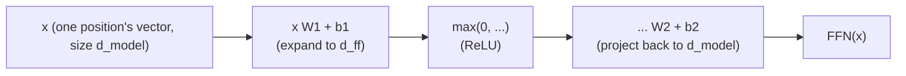

# Lección 6. El bloque feed-forward por posición

**Vínculo con la misión:** Esta es la pieza final de la etapa 2: la atención (etapa 1) y la layer norm más los residuales (lección 5) todavía dejan sin hacer un trabajo, dar a cada posición una capacidad real de cómputo no lineal propia, que es exactamente lo que hace la subcapa de esta lección.
**Fuente principal:** [Paper: "Attention Is All You Need", Vaswani et al., 2017](https://arxiv.org/abs/1706.03762)
**Requisitos previos:** [Lección 5](0005-layer-norm-and-residuals.md), [Scaled dot-product attention](../GLOSSARY.md)

## Calentamiento

1. ▢ ¿Por qué ayuda una conexión residual a entrenar una pila profunda de bloques transformer?

<details markdown="1"><summary>Comprobación</summary>

Da a los gradientes un camino directo a través de la conexión identidad `+ x` en cada capa, sin importar lo que haga la transformación de cada subcapa, lo que mantiene una señal de entrenamiento utilizable llegando incluso a las primeras capas de una pila profunda.

</details>

2. ▢ ¿Por qué normaliza la layer norm a lo largo de las features de cada ejemplo y no a lo largo del batch, y por qué importa eso para la generación autorregresiva?

<details markdown="1"><summary>Comprobación</summary>

La generación autorregresiva suele ejecutarse con un batch pequeño, a veces de batch size 1, donde las estadísticas de batch carecerían de sentido o serían inestables. La layer norm calcula sus estadísticas a partir de las features de un único ejemplo, así que funciona de forma idéntica sin importar el batch size.

</details>

## Qué debes saber

### El paso de mezcla de la atención es en realidad lineal

La atención calcula una suma de vectores value ponderada por softmax: pesos no lineales, aplicados a los values, pero la aplicación de los vectores value a la salida, dados esos pesos, es una combinación lineal. La atención decide *dónde mirar*, mezclando información entre posiciones, pero no da a la red una manera genuinamente no lineal de remodelar lo que contiene realmente la representación propia de una sola posición.

### El bloque feed-forward: qué hacer con lo que se reunió

La **red feed-forward por posición (FFN)** es la segunda subcapa del bloque transformer, y es una pequeña red de dos capas que se aplica de forma idéntica, con los mismos pesos, a cada posición por separado:

```text
FFN(x) = max(0, x W1 + b1) W2 + b2
```

(el paper original usa ReLU como no linealidad aquí; arquitecturas posteriores suelen cambiarla por variantes como GELU o SwiGLU, pero el shape, expandir, aplicar una no linealidad y proyectar de vuelta hacia abajo, se mantiene). Aquí es donde la red obtiene una capacidad real de transformación no lineal para el vector propio de una sola posición, que complementa el trabajo de la atención de mezclar entre posiciones con un trabajo distinto: refinar lo que una posición contiene ahora, después de que la atención ya haya decidido qué reunir.



### Expandir y luego contraer

La primera capa proyecta desde `d_model` hasta una dimensión oculta mayor `d_ff`, comúnmente cuatro veces `d_model` (de 512 a 2048 en el paper original), y la segunda capa proyecta de vuelta a `d_model` para que el resultado pueda seguir sumándose al residual stream. Esa expansión da a la red un espacio intermedio mucho mayor en el que calcular para cada posición, antes de comprimir de nuevo al tamaño que esperan el resto del bloque, y el siguiente bloque apilado encima.

### Por posición significa exactamente eso: nunca hay mezcla entre posiciones

Las mismas matrices de pesos `W1`, `b1`, `W2`, `b2` se aplican por separado al vector propio de cada posición; el cálculo de la posición de token 3 a través de la FFN nunca ve el vector de la posición de token 5, y viceversa. Este es el complemento preciso de la atención, que es la única subcapa del bloque que deja que la información se mueva entre posiciones. Una división del trabajo limpia en un bloque transformer: la atención decide dónde mirar y mezcla entre posiciones; el bloque feed-forward decide qué hacer con la representación reunida de una posición, de forma totalmente independiente de las demás posiciones.

## Práctica

1. ▢ Un modelo tiene `d_model = 512`. Usando la razón de expansión de 4x del paper original, ¿cuál es `d_ff`? Describe el shape de dimensiones que toman las dos capas del bloque feed-forward.

<details markdown="1"><summary>Comprobación</summary>

`d_ff = 4 × 512 = 2048`. La primera capa proyecta de 512 hasta 2048, se aplica una no linealidad y la segunda capa proyecta de vuelta de 2048 a 512, de modo que la salida pueda seguir sumándose al residual stream con el tamaño original `d_model`.

</details>

2. ▢ ¿Por qué se considera lineal el paso de mezcla de values de la atención, a pesar del softmax no lineal que se usa para calcular sus pesos, y por qué eso hace necesario el bloque feed-forward?

<details markdown="1"><summary>Comprobación</summary>

Una vez que el softmax ha producido los pesos, la salida real es una suma ponderada (una combinación lineal) de los vectores value; la no linealidad vive por completo en cómo se calcularon los pesos, no en cómo se aplican a los values. Esto significa que la atención por sí sola nunca da a la red una manera de remodelar de forma no lineal la representación propia de una posición, que es exactamente el trabajo que realiza en su lugar la no linealidad del bloque feed-forward.

</details>

3. ▢ ¿Usa alguna vez el cálculo feed-forward de la posición de token 3 información del vector de la posición de token 5? Contrástalo con lo que hace la subcapa de atención.

<details markdown="1"><summary>Comprobación</summary>

No. El bloque feed-forward aplica las mismas matrices de pesos al vector propio de cada posición de forma independiente, sin ningún mecanismo para que el cálculo de una posición vea el vector de otra. La atención es lo opuesto: todo su propósito es mezclar información entre posiciones, calculando la salida de cada query como una mezcla ponderada del vector value de todas las posiciones.

</details>

4. ▢ Supón que un bloque transformer tuviera solo subcapas de atención apiladas muchas veces, sin ningún bloque feed-forward. ¿Qué capacidad faltaría?

<details markdown="1"><summary>Pista</summary>

Considera qué clase de transformación puede y no puede aplicar la atención por sí sola a la representación propia de una sola posición.

</details>

<details markdown="1"><summary>Comprobación</summary>

La red no tendría ninguna manera genuinamente no lineal de remodelar o refinar lo que contiene la representación propia de una sola posición; solo podría recombinar vectores value de forma lineal entre posiciones, apilada una y otra vez. Le faltaría la capacidad de cómputo por posición, la extracción y transformación de features hechas con independencia de las demás posiciones, que aporta específicamente la no linealidad del bloque feed-forward.

</details>

5. ▢ ¿Qué afirmación es cierta del bloque feed-forward por posición?

    - a) Mezcla información entre posiciones, igual que la atención
    - b) Aplica la misma red de dos capas, con una no linealidad, al vector de cada posición de forma independiente, sin mezcla entre posiciones
    - c) Su dimensión oculta es siempre menor que `d_model`, para reducir el cómputo
    - d) Sustituye por completo la necesidad de la atención una vez apilado a suficiente profundidad

<details markdown="1"><summary>Comprobación</summary>

**b)** Ese es exactamente su papel y su mecanismo. (a) es falsa: la atención es la única subcapa que mezcla entre posiciones; el bloque feed-forward nunca lo hace. (c) es falsa: la dimensión oculta suele expandirse, comúnmente 4x `d_model`, no reducirse. (d) es falsa: las dos subcapas hacen trabajos distintos y complementarios, ninguna sustituye a la otra.

</details>

## Prácticas en el mundo real

- [ ] Implementa el bloque feed-forward por posición a partir de operaciones de tensores en bruto (dos capas lineales con una no linealidad entre ellas), y confirma que el shape de su salida coincide con el de su entrada (`d_model` de entrada, `d_model` de salida).
- [ ] Combina las lecciones 1 a 6 en un único bloque transformer: atención con residual y layer norm, seguida del bloque feed-forward con su propio residual y su propia layer norm.
- [ ] Mañana: lee completa la sección "Position-wise Feed-Forward Networks" del paper de la fuente principal, y contrasta el valor de `d_ff` que indica con la razón que calculaste en la pregunta de práctica 1.

## Para profundizar

- [Paper: "Attention Is All You Need", Vaswani et al., 2017](https://arxiv.org/abs/1706.03762)
- [Article: "The Illustrated Transformer", Jay Alammar](https://jalammar.github.io/illustrated-transformer/)
- [Recursos](../RESOURCES.md)

---

¿No termina de quedar claro? Vuelve a leer la fuente primaria de arriba, ya que esta lección la comprime y en la compresión es donde se escapa la comprensión. Consulta el [glosario](../GLOSSARY.md) por si algún término te resultó resbaladizo.

Si lo poco claro es la propia lección y no el material, eso es un defecto: [abre un issue](https://github.com/TokenCemetery/teach/issues).
