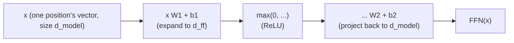

# Leçon 6. Le bloc feed-forward position par position

**Lien avec la mission :** C'est la leçon de clôture de l'étape 2 : l'attention (étapes 1) et la layer norm avec les connexions résiduelles (leçon 5) laissent encore une tâche inachevée, donner à chaque position une vraie capacité de calcul non linéaire qui lui soit propre, et c'est exactement ce que fait la sous-couche de cette leçon.
**Source primaire :** [Article : "Attention Is All You Need", Vaswani et al., 2017](https://arxiv.org/abs/1706.03762)
**Prérequis :** [Leçon 5](0005-layer-norm-and-residuals.md), [Scaled dot-product attention](../GLOSSARY.md)

## Échauffement

1. ▢ Pourquoi une connexion résiduelle aide-t-elle à entraîner une pile profonde de blocs transformer ?

<details markdown="1"><summary>Vérifier</summary>

Elle donne aux gradients un chemin direct à travers la connexion identité `+ x` à chaque couche, quoi que fasse la transformation de chaque sous-couche, ce qui garde un signal d'entraînement exploitable jusqu'aux toutes premières couches d'une pile profonde.

</details>

2. ▢ Pourquoi la layer norm normalise-t-elle sur les features propres à chaque exemple plutôt que sur le batch, et pourquoi cela compte-t-il pour la génération autorégressive ?

<details markdown="1"><summary>Vérifier</summary>

La génération autorégressive s'exécute souvent avec un petit batch, parfois de taille 1, où les statistiques de batch n'auraient aucun sens ou seraient instables. La layer norm calcule ses statistiques à partir des features d'un seul exemple, donc elle fonctionne de façon identique quelle que soit la taille du batch.

</details>

## À savoir

### L'étape de mélange de l'attention est en réalité linéaire

L'attention calcule une somme pondérée par softmax de vecteurs valeurs : des poids non linéaires, appliqués à des valeurs, mais la correspondance entre les vecteurs valeurs et la sortie, une fois ces poids donnés, est une combinaison linéaire. L'attention décide *où regarder*, en mélangeant l'information entre les positions, mais elle ne donne pas au réseau un moyen réellement non linéaire de remodeler ce que contient la représentation propre d'une seule position.

### Le bloc feed-forward : que faire de ce qui a été rassemblé

Le **réseau feed-forward position par position** (position-wise feed-forward network, FFN) est la seconde sous-couche du bloc transformer, un petit réseau à deux couches appliqué de façon identique, avec les mêmes poids, à chaque position séparément :

```text
FFN(x) = max(0, x W1 + b1) W2 + b2
```

(l'article d'origine utilise ReLU comme non-linéarité ici ; des architectures ultérieures la remplacent couramment par des variantes comme GELU ou SwiGLU, mais la forme, étendre, appliquer une non-linéarité, reprojeter vers le bas, reste la même). C'est ici que le réseau obtient une vraie capacité de transformation non linéaire pour le vecteur propre d'une seule position, ce qui complète la tâche de l'attention, mélanger entre les positions, par une tâche distincte : affiner ce qu'une position détient désormais, une fois que l'attention a décidé quoi rassembler.



### Étendre, puis contracter

La première couche projette de `d_model` vers une dimension cachée plus grande `d_ff`, couramment quatre fois `d_model` (512 vers 2048 dans l'article d'origine), et la seconde couche reprojette vers `d_model` pour que le résultat puisse encore être ajouté au flux résiduel. Cette extension donne au réseau un espace intermédiaire bien plus grand pour calculer sur chaque position, avant de comprimer de nouveau à la taille qu'attendent le reste du bloc et le bloc suivant empilé au-dessus.

### Position par position veut dire exactement cela : jamais de mélange entre positions

Les mêmes matrices de poids `W1`, `b1`, `W2`, `b2` sont appliquées séparément au vecteur propre de chaque position ; le calcul du token en position 3 à travers le FFN ne voit jamais le vecteur du token en position 5, et inversement. C'est le complément exact de l'attention, qui est la seule sous-couche du bloc à permettre à l'information de circuler entre les positions. Une répartition du travail nette dans un bloc transformer : l'attention décide où regarder et mélange entre les positions ; le bloc feed-forward décide quoi faire de la représentation rassemblée propre à une position, de façon entièrement indépendante de toutes les autres.

## Pratique

1. ▢ Un modèle a `d_model = 512`. Avec le rapport d'extension 4x de l'article d'origine, quelle est la valeur de `d_ff`, et décrivez la forme dimensionnelle que prennent les deux couches du bloc feed-forward.

<details markdown="1"><summary>Vérifier</summary>

`d_ff = 4 × 512 = 2048`. La première couche projette de 512 vers 2048, une non-linéarité est appliquée, et la seconde couche reprojette de 2048 vers 512, pour que la sortie puisse encore être ajoutée au flux résiduel à la taille d'origine `d_model`.

</details>

2. ▢ Pourquoi considère-t-on l'étape de mélange des valeurs de l'attention comme linéaire, malgré le softmax non linéaire utilisé pour calculer ses poids, et pourquoi cela rend-il le bloc feed-forward nécessaire ?

<details markdown="1"><summary>Vérifier</summary>

Une fois que le softmax a produit les poids, la sortie réelle est une somme pondérée (une combinaison linéaire) des vecteurs valeurs ; la non-linéarité réside entièrement dans la façon dont les poids ont été calculés, pas dans la façon dont ils s'appliquent aux valeurs. Cela signifie que l'attention seule ne donne jamais au réseau un moyen de remodeler de façon non linéaire la représentation propre d'une position, ce qui est précisément la tâche qu'accomplit à la place la non-linéarité du bloc feed-forward.

</details>

3. ▢ Le calcul feed-forward du token en position 3 utilise-t-il jamais l'information du vecteur du token en position 5 ? Comparez avec ce que fait la sous-couche d'attention.

<details markdown="1"><summary>Vérifier</summary>

Non. Le bloc feed-forward applique les mêmes matrices de poids au vecteur propre de chaque position indépendamment, sans aucun mécanisme permettant au calcul d'une position de voir le vecteur d'une autre. L'attention est l'inverse : tout son rôle est de mélanger l'information entre les positions, en calculant la sortie de chaque requête comme un mélange pondéré du vecteur valeur de chaque position.

</details>

4. ▢ Supposons qu'un bloc transformer n'ait que des sous-couches d'attention empilées de nombreuses fois, sans aucun bloc feed-forward. Quelle capacité manquerait ?

<details markdown="1"><summary>Indice</summary>

Réfléchissez au type de transformation que l'attention seule peut ou ne peut pas appliquer à la représentation propre d'une seule position.

</details>

<details markdown="1"><summary>Vérifier</summary>

Le réseau n'aurait aucun moyen réellement non linéaire de remodeler ou d'affiner ce que contient la représentation propre d'une seule position ; il ne pourrait jamais que recombiner linéairement des vecteurs valeurs entre les positions, empilés à répétition. Il lui manquerait la capacité de calcul par position, l'extraction et la transformation de features faites indépendamment des autres positions, que la non-linéarité du bloc feed-forward fournit précisément.

</details>

5. ▢ Quelle affirmation est vraie du bloc feed-forward position par position ?

    - a) Il mélange l'information entre les positions, comme le fait l'attention
    - b) Il applique le même réseau à deux couches, avec une non-linéarité, au vecteur de chaque position indépendamment, sans mélange entre positions
    - c) Sa dimension cachée est toujours plus petite que `d_model`, pour réduire le calcul
    - d) Il rend l'attention entièrement inutile une fois empilé assez profondément

<details markdown="1"><summary>Vérifier</summary>

**b)** C'est exactement son rôle et son mécanisme. (a) est faux : l'attention est la seule sous-couche qui mélange entre les positions ; le bloc feed-forward ne le fait jamais. (c) est faux : la dimension cachée est généralement étendue, couramment 4x `d_model`, et non réduite. (d) est faux : les deux sous-couches font des tâches différentes et complémentaires, aucune ne remplace l'autre.

</details>

## Exercices en situation réelle

- [ ] Implémentez le bloc feed-forward position par position à partir d'opérations brutes sur les tenseurs (deux couches linéaires avec une non-linéarité entre elles), et vérifiez que la forme de sa sortie correspond à celle de son entrée (`d_model` en entrée, `d_model` en sortie).
- [ ] Combinez les leçons 1 à 6 en un seul bloc transformer : l'attention avec résiduel et layer norm, suivie du bloc feed-forward avec son propre résiduel et sa propre layer norm.
- [ ] Demain : lisez en entier la section « Position-wise Feed-Forward Networks » de l'article de la source primaire, et comparez la valeur de `d_ff` qu'il indique au rapport que vous avez calculé à la question de pratique 1.

## Pour aller plus loin

- [Article : "Attention Is All You Need", Vaswani et al., 2017](https://arxiv.org/abs/1706.03762)
- [Billet : "The Illustrated Transformer", Jay Alammar](https://jalammar.github.io/illustrated-transformer/)
- [Ressources](../RESOURCES.md)

---

Ça ne passe pas ? Relisez la source primaire en haut de page, car cette leçon la condense et c'est dans la condensation que la compréhension s'échappe. Consultez le [glossaire](../GLOSSARY.md) pour tout terme qui vous a paru glissant.

Si c'est la leçon elle-même qui n'est pas claire plutôt que la matière, c'est un défaut : [ouvrez une issue](https://github.com/TokenCemetery/teach/issues).
