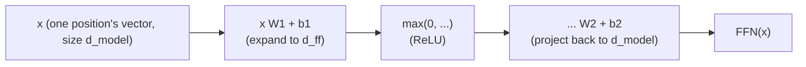

# पाठ 6. Position-Wise Feed-Forward Block

**मिशन से संबंध:** यह चरण 2 का समापन है: attention (चरण 1) और layer norm तथा residuals (पाठ 5) के बाद भी एक काम अधूरा रहता है, हर position को अपनी असली nonlinear computing क्षमता देना, और इस पाठ की sublayer ठीक यही करती है।
**मुख्य स्रोत:** [पेपर: "Attention Is All You Need", Vaswani et al., 2017](https://arxiv.org/abs/1706.03762)
**पूर्व-आवश्यकताएँ:** [पाठ 5](0005-layer-norm-and-residuals.md), [Scaled dot-product attention](../GLOSSARY.md)

## वार्म-अप

1. ▢ Residual connection transformer blocks के गहरे stack को train करने में कैसे मदद करता है?

<details markdown="1"><summary>जाँचें</summary>

वह gradients को हर layer पर identity `+ x` connection से सीधा रास्ता देता है, चाहे हर sublayer का रूपांतरण कुछ भी करे, जिससे गहरे stack की सबसे शुरुआती layers तक भी काम का training signal पहुँचता रहता है।

</details>

2. ▢ Layer norm batch के आर-पार नहीं बल्कि हर example की अपनी features पर normalize क्यों करता है, और यह autoregressive generation के लिए क्यों मायने रखता है?

<details markdown="1"><summary>जाँचें</summary>

Autoregressive generation अक्सर छोटे batch के साथ चलती है, कभी-कभी batch size 1, जहाँ batch के आँकड़े निरर्थक या अस्थिर होते। Layer norm अपने आँकड़े एक अकेले example की अपनी features से compute करता है, इसलिए वह batch size से परे एक जैसा काम करता है।

</details>

## यह जानें

### Attention का मिलाने वाला चरण असल में linear है

Attention value vectors का softmax-भारित योग compute करता है: nonlinear weights, values पर लगे हुए, पर उन weights के दिए होने पर value vectors से output तक की मैपिंग एक linear संयोजन है। Attention तय करता है कि *कहाँ देखना है*, और positions के बीच जानकारी मिलाता है, पर वह network को ऐसा सचमुच nonlinear तरीक़ा नहीं देता जिससे किसी एक position की अपनी representation में जो है उसे नया आकार दिया जा सके।

### Feed-forward block: जो जुटाया गया उसका क्या करना है

**Position-wise feed-forward network (FFN)** transformer block की दूसरी sublayer है, और यह एक छोटा दो-layer network है जो हर position पर अलग-अलग, एक ही weights के साथ, एक जैसा लगाया जाता है:

```text
FFN(x) = max(0, x W1 + b1) W2 + b2
```

(मूल पेपर यहाँ अपनी nonlinearity के रूप में ReLU इस्तेमाल करता है; बाद के architectures में आम तौर पर GELU या SwiGLU जैसे variants आ जाते हैं, पर आकार, यानी फैलाना, nonlinearity लगाना, वापस project करना, वही रहता है)। यहीं network को किसी एक position के अपने vector के लिए असली nonlinear रूपांतरण की क्षमता मिलती है, जो positions के आर-पार मिलाने के attention के काम का एक अलग काम से पूरक है: attention के यह तय कर लेने के बाद कि क्या जुटाना है, अब position के पास जो है उसे सँवारना।



### फैलाएँ, फिर समेटें

पहली layer `d_model` से बड़े hidden आयाम `d_ff` तक project करती है, जो आम तौर पर `d_model` का चार गुना होता है (मूल पेपर में 512 से 2048), और दूसरी layer वापस `d_model` तक project करती है ताकि नतीजा अब भी residual stream में जोड़ा जा सके। वह फैलाव network को हर position के लिए compute करने की कहीं बड़ी बीच की जगह देता है, उस आकार में वापस सिकोड़ने से पहले जिसकी block के बाक़ी हिस्से को, और उसके ऊपर stack हुए अगले block को, उम्मीद है।

### Position-wise का मतलब ठीक यही है: positions के बीच कभी कोई मिलावट नहीं

वही weight matrices `W1`, `b1`, `W2`, `b2` हर position के अपने vector पर अलग-अलग लगाए जाते हैं; token position 3 की FFN के ज़रिए गणना token position 5 का vector कभी नहीं देखती, और उलटा भी। यह attention का सटीक पूरक है, जो block की अकेली sublayer है जो जानकारी को positions के बीच जाने देती है। Transformer block में काम का साफ़ बँटवारा: attention तय करता है कि कहाँ देखना है और positions के आर-पार मिलाता है; feed-forward block तय करता है कि position की अपनी जुटाई हुई representation का क्या करना है, बाक़ी हर position से पूरी तरह स्वतंत्र रूप से।

## अभ्यास

1. ▢ एक model में `d_model = 512` है। मूल पेपर के 4x फैलाव अनुपात का इस्तेमाल करके `d_ff` क्या है, और feed-forward block की दो layers जो आयामी आकार लेती हैं उसका वर्णन करें।

<details markdown="1"><summary>जाँचें</summary>

`d_ff = 4 × 512 = 2048`। पहली layer 512 से 2048 तक project करती है, एक nonlinearity लगती है, और दूसरी layer 2048 से वापस 512 तक project करती है, ताकि output मूल `d_model` आकार पर residual stream में अब भी जोड़ा जा सके।

</details>

2. ▢ Attention का value मिलाने वाला चरण linear क्यों माना जाता है, जबकि उसके weights compute करने में nonlinear softmax इस्तेमाल होता है, और यह feed-forward block को ज़रूरी क्यों बनाता है?

<details markdown="1"><summary>जाँचें</summary>

Softmax के weights बना देने के बाद असली output value vectors का भारित योग (linear संयोजन) होता है; nonlinearity पूरी तरह इसमें है कि weights कैसे compute हुए, इसमें नहीं कि वे values पर कैसे लगे। इसका मतलब है कि अकेला attention network को किसी position की अपनी representation को nonlinear ढंग से नया आकार देने का कोई रास्ता कभी नहीं देता, और यही काम feed-forward block की nonlinearity करती है।

</details>

3. ▢ क्या token position 3 की feed-forward गणना कभी token position 5 के vector की जानकारी इस्तेमाल करती है? इसकी तुलना attention sublayer जो करती है उससे करें।

<details markdown="1"><summary>जाँचें</summary>

नहीं। Feed-forward block हर position के अपने vector पर वही weight matrices स्वतंत्र रूप से लगाता है, और एक position की गणना के दूसरे का vector देखने का कोई तंत्र नहीं है। Attention इसका उलटा है: उसका पूरा मक़सद positions के आर-पार जानकारी मिलाना है, हर query का output हर position के value vector के भारित मिश्रण के रूप में compute करते हुए।

</details>

4. ▢ मान लें कि एक transformer block में सिर्फ़ attention sublayers कई बार stack की गई हैं, और feed-forward block बिल्कुल नहीं है। कौन-सी क्षमता ग़ायब होगी?

<details markdown="1"><summary>संकेत</summary>

सोचें कि अकेला attention किसी position की अपनी representation पर किस तरह का रूपांतरण लगा सकता है और किस तरह का नहीं।

</details>

<details markdown="1"><summary>जाँचें</summary>

Network के पास किसी एक position की अपनी representation में जो है उसे नया आकार देने या सँवारने का कोई सचमुच nonlinear तरीक़ा नहीं होगा; वह बार-बार stack होकर भी बस value vectors को positions के आर-पार linear ढंग से ही मिला सकता था। उसमें प्रति-position computing क्षमता, यानी दूसरी positions से स्वतंत्र रूप से किया गया feature extraction और रूपांतरण, ग़ायब होती, जो feed-forward block की nonlinearity ख़ास तौर पर देती है।

</details>

5. ▢ Position-wise feed-forward block के बारे में कौन-सा दावा सही है?

    - a) वह positions के बीच जानकारी मिलाता है, attention की ही तरह
    - b) वह nonlinearity वाला वही दो-layer network हर position के vector पर स्वतंत्र रूप से लगाता है, positions के बीच कोई मिलावट नहीं
    - c) उसका hidden आयाम हमेशा `d_model` से छोटा होता है, computation घटाने के लिए
    - d) काफ़ी गहरा stack होने पर वह attention की ज़रूरत को पूरी तरह बदल देता है

<details markdown="1"><summary>जाँचें</summary>

**b)** यही उसकी भूमिका और तंत्र है। (a) ग़लत है: attention अकेली sublayer है जो positions के आर-पार मिलाती है; feed-forward block कभी नहीं मिलाता। (c) ग़लत है: hidden आयाम आम तौर पर फैलाया जाता है, अक्सर `d_model` का 4x, घटाया नहीं जाता। (d) ग़लत है: दोनों sublayers अलग, पूरक काम करती हैं, कोई भी दूसरी की जगह नहीं ले सकती।

</details>

## असली दुनिया का अभ्यास

- [ ] Position-wise feed-forward block को raw tensor operations (बीच में nonlinearity वाली दो linear layers) से लागू करें, और पक्का करें कि उसके output का shape उसके input के shape से मेल खाता है (`d_model` अंदर, `d_model` बाहर)।
- [ ] पाठ 1 से 6 को एक अकेले transformer block में मिलाएँ: residual और layer norm वाला attention, उसके बाद अपने residual और layer norm वाला feed-forward block।
- [ ] कल: मुख्य स्रोत पेपर का "Position-wise Feed-Forward Networks" खंड पूरा पढ़ें, और उसके बताए `d_ff` मान को अभ्यास के प्रश्न 1 में निकाले अपने अनुपात से मिलाकर जाँचें।

## आगे बढ़ने के लिए

- [पेपर: "Attention Is All You Need", Vaswani et al., 2017](https://arxiv.org/abs/1706.03762)
- [लेख: "The Illustrated Transformer", Jay Alammar](https://jalammar.github.io/illustrated-transformer/)
- [संसाधन](../RESOURCES.md)

---

बात नहीं बन रही? ऊपर दिए मुख्य स्रोत को दोबारा पढ़ें, क्योंकि यह पाठ उसे संक्षिप्त करता है और समझ संक्षेप में ही रिसती है। जो शब्द फिसलन भरा लगे, उसके लिए [शब्दावली](../GLOSSARY.md) देखें।

अगर दिक़्क़त सामग्री की नहीं बल्कि पाठ की ही है, तो वह एक खोट है: [issue खोलें](https://github.com/TokenCemetery/teach/issues)।
