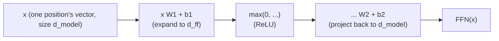

# Lição 6. O bloco feed-forward por posição

**Ligação com a missão:** Esta é a lição de fechamento da etapa 2: a atenção (etapa 1) e a layer norm mais as residuais (lição 5) ainda deixam um trabalho por fazer, dar a cada posição uma capacidade própria e real de computação não linear, que é exatamente o que a subcamada desta lição faz.
**Fonte principal:** [Artigo científico: "Attention Is All You Need", Vaswani et al., 2017](https://arxiv.org/abs/1706.03762)
**Pré-requisitos:** [Lição 5](0005-layer-norm-and-residuals.md), [Scaled dot-product attention](../GLOSSARY.md)

## Aquecimento

1. ▢ Por que uma conexão residual ajuda a treinar uma pilha profunda de blocos transformer?

<details markdown="1"><summary>Verificação</summary>

Ela dá aos gradientes um caminho direto pela conexão identidade `+ x` em cada camada, seja qual for o que a transformação de cada subcamada faça, mantendo um sinal de treinamento utilizável chegando até as primeiras camadas de uma pilha profunda.

</details>

2. ▢ Por que a layer norm normaliza ao longo das features de cada exemplo e não ao longo do batch, e por que isso importa para a geração autorregressiva?

<details markdown="1"><summary>Verificação</summary>

A geração autorregressiva muitas vezes roda com um batch pequeno, às vezes batch size 1, em que as estatísticas de batch seriam sem sentido ou instáveis. A layer norm calcula as suas estatísticas a partir das features de um único exemplo, então funciona de forma idêntica seja qual for o batch size.

</details>

## Saiba isto

### A etapa de mistura da atenção é, na verdade, linear

A atenção calcula uma soma ponderada por softmax de vetores de value: pesos não lineares, aplicados a values, mas o mapeamento dos vetores de value para a saída, dados esses pesos, é uma combinação linear. A atenção decide *para onde olhar*, misturando informação entre posições, mas não dá à rede uma forma genuinamente não linear de remodelar o que a representação de uma única posição realmente contém.

### O bloco feed-forward: o que fazer com o que foi reunido

A **rede feed-forward por posição (FFN)** é a segunda subcamada do bloco transformer, e é uma pequena rede de duas camadas aplicada de forma idêntica, com os mesmos pesos, a cada posição separadamente:

```text
FFN(x) = max(0, x W1 + b1) W2 + b2
```

(o artigo original usa a ReLU como a não linearidade aqui; arquiteturas posteriores costumam trocá-la por variantes como GELU ou SwiGLU, mas o formato, expandir, aplicar uma não linearidade e projetar de volta para baixo, permanece o mesmo). É aqui que a rede obtém capacidade real de transformação não linear para o vetor de uma única posição, complementando o trabalho da atenção de misturar entre posições com um trabalho distinto: refinar o que uma posição agora guarda, depois de a atenção já ter decidido o que reunir.



### Expandir e depois contrair

A primeira camada projeta de `d_model` para uma dimensão oculta maior `d_ff`, em geral quatro vezes `d_model` (de 512 para 2048 no artigo original), e a segunda camada projeta de volta para `d_model`, de modo que o resultado ainda possa ser somado ao residual stream. Essa expansão dá à rede um espaço intermediário muito maior para computar em cada posição, antes de comprimir de volta ao tamanho que o resto do bloco, e o próximo bloco empilhado sobre ele, espera.

### Por posição quer dizer exatamente isso: nenhuma mistura entre posições, nunca

As mesmas matrizes de pesos `W1`, `b1`, `W2`, `b2` são aplicadas separadamente ao vetor de cada posição; a computação da posição de token 3 pela FFN nunca vê o vetor da posição de token 5, e vice-versa. Esse é o complemento preciso da atenção, a única subcamada do bloco que permite que informação se mova entre posições. Uma divisão de trabalho limpa em um bloco transformer: a atenção decide para onde olhar e mistura entre posições; o bloco feed-forward decide o que fazer com a representação reunida de uma posição, de forma inteiramente independente de todas as outras posições.

## Prática

1. ▢ Um modelo tem `d_model = 512`. Usando a razão de expansão de 4x do artigo original, qual é `d_ff` e descreva o formato dimensional que as duas camadas do bloco feed-forward assumem.

<details markdown="1"><summary>Verificação</summary>

`d_ff = 4 × 512 = 2048`. A primeira camada projeta de 512 para 2048, uma não linearidade é aplicada e a segunda camada projeta de volta de 2048 para 512, de modo que a saída ainda possa ser somada ao residual stream no tamanho original `d_model`.

</details>

2. ▢ Por que a etapa de mistura de values da atenção é considerada linear, apesar do softmax não linear usado para calcular os seus pesos, e por que isso torna o bloco feed-forward necessário?

<details markdown="1"><summary>Verificação</summary>

Depois que o softmax produz os pesos, a saída de fato é uma soma ponderada (uma combinação linear) dos vetores de value; a não linearidade está inteiramente em como os pesos foram calculados, e não em como eles são aplicados aos values. Isso significa que a atenção sozinha nunca dá à rede uma forma de remodelar de maneira não linear a representação de uma posição, que é exatamente o trabalho que a não linearidade do bloco feed-forward realiza.

</details>

3. ▢ A computação feed-forward da posição de token 3 alguma vez usa informação do vetor da posição de token 5? Contraste isso com o que a subcamada de atenção faz.

<details markdown="1"><summary>Verificação</summary>

Não. O bloco feed-forward aplica as mesmas matrizes de pesos ao vetor de cada posição de forma independente, sem nenhum mecanismo para que a computação de uma posição veja o vetor de outra. A atenção é o oposto: todo o seu propósito é misturar informação entre posições, calculando a saída de cada query como uma mistura ponderada do vetor de value de todas as posições.

</details>

4. ▢ Suponha que um bloco transformer tivesse apenas subcamadas de atenção empilhadas muitas vezes, sem nenhum bloco feed-forward. Que capacidade estaria faltando?

<details markdown="1"><summary>Dica</summary>

Considere que tipo de transformação a atenção sozinha pode e não pode aplicar à representação de uma única posição.

</details>

<details markdown="1"><summary>Verificação</summary>

A rede não teria nenhuma forma genuinamente não linear de remodelar ou refinar o que a representação de uma única posição contém; ela só conseguiria recombinar vetores de value de forma linear entre posições, empilhada repetidamente. Faltaria a capacidade de computação por posição, a extração e a transformação de features feitas independentemente das outras posições, que a não linearidade do bloco feed-forward fornece especificamente.

</details>

5. ▢ Qual afirmação é verdadeira sobre o bloco feed-forward por posição?

    - a) Ele mistura informação entre posições, do mesmo modo que a atenção
    - b) Ele aplica a mesma rede de duas camadas, com uma não linearidade, ao vetor de cada posição de forma independente, sem mistura entre posições
    - c) A sua dimensão oculta é sempre menor que `d_model`, para reduzir a computação
    - d) Ele elimina a necessidade da atenção por completo quando empilhado fundo o bastante

<details markdown="1"><summary>Verificação</summary>

**b)** É exatamente o seu papel e mecanismo. (a) é falsa: a atenção é a única subcamada que mistura entre posições; o bloco feed-forward nunca o faz. (c) é falsa: a dimensão oculta costuma ser expandida, em geral 4x `d_model`, e não reduzida. (d) é falsa: as duas subcamadas fazem trabalhos diferentes e complementares, nenhuma substitui a outra.

</details>

## Prática no mundo real

- [ ] Implemente o bloco feed-forward por posição a partir de operações com tensores brutos (duas camadas lineares com uma não linearidade entre elas) e confirme que o formato da saída bate com o da entrada (`d_model` na entrada, `d_model` na saída).
- [ ] Combine as lições 1 a 6 em um único bloco transformer: atenção com residual e layer norm, seguida do bloco feed-forward com a sua própria residual e layer norm.
- [ ] Amanhã: leia por inteiro a seção "Position-wise Feed-Forward Networks" do artigo científico da fonte principal e confira o valor de `d_ff` declarado nele contra a razão que você calculou na questão de prática 1.

## Para ir além

- [Artigo científico: "Attention Is All You Need", Vaswani et al., 2017](https://arxiv.org/abs/1706.03762)
- [Artigo: "The Illustrated Transformer", Jay Alammar](https://jalammar.github.io/illustrated-transformer/)
- [Recursos](../RESOURCES.md)

---

Não ficou claro? Releia a fonte principal no topo, já que esta lição a comprime e é na compressão que o entendimento escapa. Consulte o [glossário](../GLOSSARY.md) para qualquer termo que pareceu escorregadio.

Se o problema é a lição em si, e não o material, isso é um defeito: [abra uma issue](https://github.com/TokenCemetery/teach/issues).
