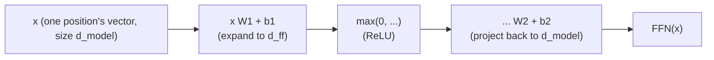

# Урок 6. Позиционный feed-forward-блок

**Связь с целью курса:** Это итог этапа 2: внимание (этап 1) и нормализация слоя с остаточными связями (урок 5) всё ещё оставляют одну работу несделанной, а именно дать каждой позиции собственную настоящую нелинейную вычислительную ёмкость, и как раз это делает подслой этого урока.
**Первоисточник:** [Научная статья: "Attention Is All You Need", Vaswani et al., 2017](https://arxiv.org/abs/1706.03762)
**Предварительные требования:** [Урок 5](0005-layer-norm-and-residuals.md), [Масштабированное скалярное внимание](../GLOSSARY.md)

## Разминка

1. ▢ Почему остаточная связь помогает обучать глубокий стек блоков трансформера?

<details markdown="1"><summary>Проверка</summary>

Она даёт градиентам прямой путь по тождественной связи `+ x` на каждом слое, независимо от того, что делает преобразование каждого подслоя, и сохраняет пригодный для обучения сигнал, доходящий даже до самых ранних слоёв глубокого стека.

</details>

2. ▢ Почему нормализация слоя нормализует по собственным признакам каждого примера, а не по батчу, и почему это важно для авторегрессивной генерации?

<details markdown="1"><summary>Проверка</summary>

Авторегрессивная генерация часто идёт с малым батчем, иногда с размером батча 1, где статистики батча были бы бессмысленными или нестабильными. Нормализация слоя вычисляет статистики по собственным признакам одного примера, поэтому работает одинаково при любом размере батча.

</details>

## Что нужно знать

### Шаг смешивания во внимании на самом деле линеен

Внимание вычисляет взвешенную по softmax сумму векторов значений: нелинейные веса, применённые к значениям, но отображение от векторов значений к выходу при заданных весах это линейная комбинация. Внимание решает, *куда смотреть*, смешивая информацию между позициями, но не даёт сети по-настоящему нелинейного способа перестроить то, что на самом деле содержит представление отдельной позиции.

### Feed-forward-блок: что делать с собранным

**Позиционная feed-forward-сеть** (position-wise feed-forward network, FFN) это второй подслой блока трансформера, небольшая двухслойная сеть, которая применяется одинаково, с теми же весами, к каждой позиции по отдельности:

```text
FFN(x) = max(0, x W1 + b1) W2 + b2
```

(в оригинальной статье здесь в качестве нелинейности используется ReLU; более поздние архитектуры обычно подставляют варианты вроде GELU или SwiGLU, но форма, расширить, применить нелинейность, спроецировать обратно вниз, остаётся прежней). Именно здесь сеть получает настоящую нелинейную способность преобразовывать вектор отдельной позиции, дополняя задачу внимания, смешивание между позициями, отдельной задачей: уточнением того, что позиция теперь держит после того, как внимание уже решило, что собрать.



### Расширить, затем сжать

Первый слой проецирует из `d_model` в большую скрытую размерность `d_ff`, обычно в четыре раза больше `d_model` (от 512 до 2048 в оригинальной статье), а второй слой проецирует обратно вниз в `d_model`, чтобы результат по-прежнему можно было прибавить в остаточный поток. Это расширение даёт сети намного большее промежуточное пространство для вычислений на каждую позицию, прежде чем сжать обратно до размера, которого ожидает остальная часть блока и следующий блок, поставленный поверх него.

### «Позиционный» значит именно это: никакого смешивания между позициями, никогда

Одни и те же матрицы весов `W1`, `b1`, `W2`, `b2` применяются отдельно к вектору каждой позиции; вычисление токена в позиции 3 через FFN никогда не видит вектор токена в позиции 5, и наоборот. Это точное дополнение к вниманию, которое остаётся единственным подслоем в блоке, позволяющим информации вообще перемещаться между позициями. Чёткое разделение труда в блоке трансформера: внимание решает, куда смотреть, и смешивает между позициями; feed-forward-блок решает, что делать с собранным представлением отдельной позиции, совершенно независимо от всех остальных позиций.

## Практика

1. ▢ У модели `d_model = 512`. Используя коэффициент расширения 4x из оригинальной статьи, чему равна `d_ff`, и опишите размерностную форму, которую принимают два слоя feed-forward-блока.

<details markdown="1"><summary>Проверка</summary>

`d_ff = 4 × 512 = 2048`. Первый слой проецирует из 512 в 2048, применяется нелинейность, а второй слой проецирует обратно из 2048 в 512, чтобы выход по-прежнему можно было прибавить в остаточный поток исходного размера `d_model`.

</details>

2. ▢ Почему шаг смешивания значений во внимании считается линейным, несмотря на нелинейный softmax, которым вычисляются его веса, и почему из-за этого необходим feed-forward-блок?

<details markdown="1"><summary>Проверка</summary>

После того как softmax выдал веса, фактический выход это взвешенная сумма (линейная комбинация) векторов значений; нелинейность целиком заключена в том, как вычислены веса, а не в том, как они применяются к значениям. Это значит, что одно внимание никогда не даёт сети способа нелинейно перестроить представление отдельной позиции, а именно эту работу вместо него выполняет нелинейность feed-forward-блока.

</details>

3. ▢ Использует ли когда-нибудь feed-forward-вычисление токена в позиции 3 информацию из вектора токена в позиции 5? Сопоставьте это с тем, что делает подслой внимания.

<details markdown="1"><summary>Проверка</summary>

Нет. Feed-forward-блок применяет одни и те же матрицы весов к вектору каждой позиции независимо, и у вычисления одной позиции нет никакого механизма, чтобы увидеть вектор другой. Внимание устроено противоположным образом: вся его цель в смешивании информации между позициями, вычислении выхода каждого запроса как взвешенной смеси векторов значений всех позиций.

</details>

4. ▢ Допустим, в блоке трансформера много раз подряд сложены только подслои внимания, а feed-forward-блока нет вовсе. Какой способности не хватит?

<details markdown="1"><summary>Подсказка</summary>

Подумайте, какое преобразование представления отдельной позиции одно внимание может применить, а какое не может.

</details>

<details markdown="1"><summary>Проверка</summary>

У сети не было бы по-настоящему нелинейного способа перестроить или уточнить то, что содержит представление отдельной позиции; она могла бы лишь снова и снова линейно перекомбинировать векторы значений между позициями. Ей не хватало бы вычислительной ёмкости на позицию, то есть извлечения и преобразования признаков независимо от других позиций, которую как раз и даёт нелинейность feed-forward-блока.

</details>

5. ▢ Какое утверждение верно о позиционном feed-forward-блоке?

    - a) Он смешивает информацию между позициями так же, как внимание
    - b) Он применяет одну и ту же двухслойную сеть с нелинейностью к вектору каждой позиции независимо, без смешивания между позициями
    - c) Его скрытая размерность всегда меньше `d_model`, чтобы сократить вычисления
    - d) Он полностью заменяет потребность во внимании, если стек достаточно глубок

<details markdown="1"><summary>Проверка</summary>

**b)** Это в точности его роль и механизм. Вариант (a) неверен: внимание единственный подслой, который смешивает информацию между позициями; feed-forward-блок никогда этого не делает. Вариант (c) неверен: скрытая размерность, как правило, расширяется, обычно в 4 раза относительно `d_model`, а не сужается. Вариант (d) неверен: эти два подслоя выполняют разные, дополняющие друг друга задачи, ни один не заменяет другой.

</details>

## Практика в реальной работе

- [ ] Реализуйте позиционный feed-forward-блок из «сырых» тензорных операций (два линейных слоя с нелинейностью между ними) и убедитесь, что форма его выхода совпадает с формой входа (на входе `d_model`, на выходе `d_model`).
- [ ] Соберите уроки 1-6 в один блок трансформера: внимание с остаточной связью и нормализацией слоя, а затем feed-forward-блок со своей остаточной связью и нормализацией слоя.
- [ ] Завтра: прочитайте целиком раздел «Position-wise Feed-Forward Networks» в статье-первоисточнике и сверьте указанное в ней значение `d_ff` с коэффициентом, который вы вычислили в вопросе 1 практики.

## Что почитать дальше

- [Научная статья: "Attention Is All You Need", Vaswani et al., 2017](https://arxiv.org/abs/1706.03762)
- [Статья: "The Illustrated Transformer", Jay Alammar](https://jalammar.github.io/illustrated-transformer/)
- [Ресурсы](../RESOURCES.md)

---

Не доходит? Перечитайте первоисточник в начале: этот урок его сжимает, а при сжатии понимание как раз и теряется. Загляните в [глоссарий](../GLOSSARY.md), если какой-то термин показался скользким.

Если неясен сам урок, а не материал, это дефект: [откройте issue](https://github.com/TokenCemetery/teach/issues).
