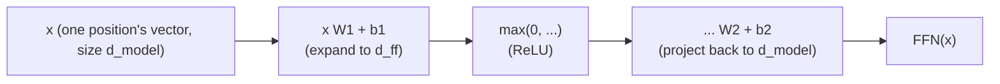

# 第 6 课：逐位置前馈块

**使命关联:** 这是第 2 阶段的收官之课：注意力（第 1 阶段）加上层归一化与残差连接（第 5 课），仍然留下一件没做的事，那就是赋予每个位置自己真正的非线性计算能力，而这正是本课这个子层所做的。
**主要来源:** [论文：“Attention Is All You Need”，Vaswani 等，2017](https://arxiv.org/abs/1706.03762)
**前置知识:** [第 5 课](0005-layer-norm-and-residuals.md)、[缩放点积注意力](../GLOSSARY.md)

## 热身

1. ▢ 为什么残差连接有助于训练一个很深的 Transformer 块堆叠？

<details markdown="1"><summary>检查</summary>

它在每一层通过恒等连接 `+ x` 给梯度一条直接的通路，不论每个子层的变换做了什么，都让一个可用的训练信号能够到达深层堆叠中最靠前的那些层。

</details>

2. ▢ 为什么层归一化是在每个样本自己的特征上、而不是在批上做归一化，这对自回归生成为什么重要？

<details markdown="1"><summary>检查</summary>

自回归生成经常以很小的批运行，有时批大小为 1，那时批统计量要么毫无意义，要么不稳定。层归一化用单个样本自己的特征来计算统计量，所以不论批大小是多少，它的工作方式都完全相同。

</details>

## 要点

### 注意力的混合步骤其实是线性的

注意力计算的是值向量的 softmax 加权和：权重是非线性的，作用在值上，但在给定这些权重的情况下，从值向量到输出的映射是一个线性组合。注意力决定*往哪里看*，在位置之间混合信息，但它并没有给网络一种真正非线性的方式，去重塑单个位置自己的表示里究竟包含什么。

### 前馈块：对收集到的东西做处理

**逐位置前馈网络**（FFN）是 Transformer 块的第二个子层，它是一个小的两层网络，以相同的方式、用相同的权重，分别作用于每一个位置：

```text
FFN(x) = max(0, x W1 + b1) W2 + b2
```

（原始论文在这里用 ReLU 作为非线性；后来的架构通常换成 GELU 或 SwiGLU 这样的变体，但形态不变：先扩张，施加非线性，再投影回去。）网络正是在这里，为单个位置自己的向量获得了真正的非线性变换能力，与注意力跨位置混合的工作互补，它承担的是另一项不同的工作：在注意力已经决定了收集什么之后，提炼这个位置现在所持有的东西。



### 先扩张，再收缩

第一层从 `d_model` 向上投影到一个更大的隐藏维度 `d_ff`，通常是 `d_model` 的四倍（原始论文中是 512 到 2048），第二层再投影回 `d_model`，这样结果仍然可以加回残差流。这种扩张让网络在每个位置上有一个大得多的中间空间可以计算，然后再压缩回块的其余部分、以及堆在它上面的下一个块所期望的大小。

### 逐位置就是字面意思：永远没有跨位置的混合

同样的权重矩阵 `W1`、`b1`、`W2`、`b2` 分别作用于每个位置自己的向量；token 位置 3 经过 FFN 的计算，永远看不到 token 位置 5 的向量，反之亦然。这恰好与注意力互补，注意力是块里唯一让信息在位置之间流动的子层。Transformer 块有一种清晰的分工：注意力决定往哪里看，并在位置之间混合；前馈块决定如何处理一个位置自己收集到的表示，完全独立于其他每一个位置。

## 练习

1. ▢ 一个模型的 `d_model = 512`。按原始论文的 4 倍扩张比例，`d_ff` 是多少？并描述前馈块的两层所呈现的维度形态。

<details markdown="1"><summary>检查</summary>

`d_ff = 4 × 512 = 2048`。第一层从 512 向上投影到 2048，施加一个非线性，第二层再从 2048 投影回 512，这样输出仍然可以按原来的 `d_model` 大小加回残差流。

</details>

2. ▢ 尽管计算权重用的是非线性的 softmax，为什么注意力的值混合步骤仍被认为是线性的？这又为什么使前馈块成为必需？

<details markdown="1"><summary>检查</summary>

softmax 产生权重之后，实际的输出是值向量的加权和（一个线性组合）；非线性完全存在于权重是怎么算出来的，而不在于它们如何作用于值。这意味着仅靠注意力，网络永远没有办法对一个位置自己的表示做非线性的重塑，而这恰恰是前馈块的非线性所承担的工作。

</details>

3. ▢ token 位置 3 的前馈计算会用到 token 位置 5 的向量里的信息吗？请与注意力子层所做的事做对比。

<details markdown="1"><summary>检查</summary>

不会。前馈块把同样的权重矩阵独立地作用于每个位置自己的向量，没有任何机制让一个位置的计算看到另一个位置的向量。注意力正相反：它的全部目的就是在位置之间混合信息，把每个查询的输出算成每个位置的值向量的加权混合。

</details>

4. ▢ 假设一个 Transformer 块只有注意力子层，堆叠许多次，完全没有前馈块。会缺少什么能力？

<details markdown="1"><summary>提示</summary>

想一想仅靠注意力，能对单个位置自己的表示施加和不能施加什么样的变换。

</details>

<details markdown="1"><summary>检查</summary>

网络将没有任何真正非线性的方式，去重塑或提炼单个位置自己的表示里包含的东西；它至多只能在位置之间对值向量做线性重组，再重复堆叠。它会缺少逐位置的计算能力，也就是独立于其他位置而进行的特征提取和变换，而这正是前馈块的非线性所专门提供的。

</details>

5. ▢ 关于逐位置前馈块，下面哪一项说法是对的？

    - a) 它像注意力一样，在位置之间混合信息
    - b) 它把同一个带非线性的两层网络独立地作用于每个位置的向量，没有跨位置的混合
    - c) 它的隐藏维度总是小于 `d_model`，以减少计算
    - d) 堆叠得足够深之后，它就完全取代了对注意力的需要

<details markdown="1"><summary>检查</summary>

**b)** 这正是它的作用和机制。(a) 是错的：注意力是唯一在位置之间混合的子层，前馈块从不这样做。(c) 是错的：隐藏维度通常是被扩张的，常见为 `d_model` 的 4 倍，而不是缩小。(d) 是错的：这两个子层做的是不同而互补的工作，谁也不能代替谁。

</details>

## 实战练习

- [ ] 只用原始张量运算（两个线性层，中间夹一个非线性）实现逐位置前馈块，并确认它的输出形状与输入形状一致（输入 `d_model`，输出 `d_model`）。
- [ ] 把第 1 至 6 课合成一个单独的 Transformer 块：带残差连接和层归一化的注意力，后面接带有它自己的残差连接和层归一化的前馈块。
- [ ] 明天：完整阅读主要来源论文里“Position-wise Feed-Forward Networks”一节，并把它给出的 `d_ff` 值与你在练习第 1 题中算出的比例做对照。

## 延伸阅读

- [论文：“Attention Is All You Need”，Vaswani 等，2017](https://arxiv.org/abs/1706.03762)
- [文章：“The Illustrated Transformer”，Jay Alammar](https://jalammar.github.io/illustrated-transformer/)
- [资源](../RESOURCES.md)

---

没学明白？请重读顶部的主要来源，因为本课是对它的压缩，而理解正是在压缩中流失的。如果有哪个术语觉得含糊，可以查看[术语表](../GLOSSARY.md)。

如果问题出在课程本身，而不是学习材料，那就是一个缺陷：[提交 issue](https://github.com/TokenCemetery/teach/issues)。
