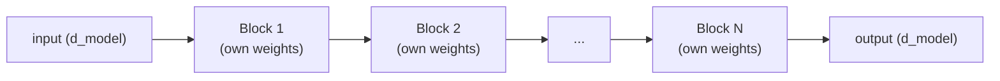

# Lección 7. Apilar bloques transformer

**Vínculo con la misión:** La etapa 3 abre el modelo completo: un único bloque transformer (etapas 1 y 2) es la unidad que se repite, y esta lección es cómo muchos de ellos se convierten en un modelo con profundidad real, en lugar de que un solo bloque sea toda la historia.
**Fuente principal:** [Paper: "Attention Is All You Need", Vaswani et al., 2017](https://arxiv.org/abs/1706.03762)
**Requisitos previos:** [Lección 6](0006-feed-forward-block.md), [Scaled dot-product attention](../GLOSSARY.md)

## Calentamiento

1. ▢ ¿Deja alguna vez el bloque feed-forward que el cálculo de una posición vea el vector de otra posición? Contrástalo con la atención.

Comprobación

No, el bloque feed-forward aplica los mismos pesos al vector de cada posición de forma independiente, sin ninguna mezcla entre posiciones. La atención es lo opuesto: mezclar información entre posiciones es todo su propósito.

2. ▢ ¿Por qué ayuda una conexión residual a entrenar una pila profunda de bloques transformer?

Comprobación

Da a los gradientes un camino directo a través de la conexión identidad `+ x` en cada capa, sin importar lo que haga la transformación de cada subcapa, lo que mantiene una señal de entrenamiento utilizable llegando incluso a las primeras capas.

## Qué debes saber

### Cada bloque conserva el mismo shape, de entrada y de salida

Un bloque transformer, la atención con su residual y su layer norm, seguida del bloque feed-forward con su propio residual y su propia layer norm, toma una entrada de dimensión `d_model` y produce una salida de exactamente la misma dimensión. Esa conservación del shape es lo que hace que apilar tenga sentido: la salida del bloque 2 puede convertirse en la entrada del bloque 3 sin ningún adaptador ni paso de remodelado, y lo mismo vale sin importar cuántos bloques se apilen. Un único vector que corre, a menudo llamado el **residual stream**, simplemente pasa de un bloque a otro, y cada uno lo lee y le devuelve sumada su propia contribución.

### La profundidad va construyendo representaciones compuestas

Cada bloque da al modelo una ronda más de "reunir información relevante mediante la atención y luego transformarla mediante el bloque feed-forward". Apilar muchos bloques deja que se vayan construyendo, capa a capa, representaciones progresivamente más compuestas y abstractas, igual que una red convolucional más profunda construye, capa a capa, features visuales de más alto nivel a partir de otras de más bajo nivel. Un solo bloque solo puede hacer una ronda de reunir y transformar; una pila profunda deja al modelo representar funciones de la entrada que un solo bloque no tiene manera de expresar por sí mismo.

### Los bloques no comparten pesos a lo largo de la profundidad

En la arquitectura estándar, cada bloque de la pila tiene sus propios parámetros, aprendidos por separado: los pesos de atención y de feed-forward del bloque 3 son totalmente distintos de los del bloque 7. Esto cuesta parámetros de forma directa, más o menos linealmente con la profundidad, ya que no se reutiliza nada. Lo que se obtiene a cambio es flexibilidad de representación: distintos bloques son libres de especializarse en distintos niveles de abstracción precisamente porque no se les obliga a compartir pesos entre sí, el mismo razonamiento que permite a los distintos heads de atención especializarse (lección 2) aplicado ahora a lo largo de la profundidad y no dentro de una sola capa.

### Por qué la maquinaria de la lección 5 importa más aquí

Un solo bloque, o dos, pueden entrenar razonablemente bien incluso sin mucha ayuda. Las conexiones residuales y la layer normalization de la lección 5 se ganan su sitio específicamente cuando la profundidad crece mucho, los modelos reales suelen apilar decenas de bloques o más, ya que ahí es exactamente donde una señal de gradiente sin ayuda se encogería o explotaría al pasar por tantas transformaciones apiladas. La profundidad es lo que hace necesaria, en primer lugar, la maquinaria residual y de normalización, no es un refinamiento opcional.

## Práctica

1. ▢ ¿Por qué debe conservar cada bloque transformer la misma dimensión de entrada y de salida (`d_model` de entrada, `d_model` de salida)? ¿Qué se rompería si un bloque en medio de la pila cambiara la dimensión?

Comprobación

Apilar bloques significa alimentar la salida de un bloque directamente a la entrada del siguiente; si un bloque cambiara la dimensión, cada bloque posterior (y el propio residual stream) tendría que construirse para un tamaño distinto, lo que rompería el apilado uniforme y enchufable que permite repetir el mismo shape de bloque cualquier número de veces sin casos especiales.

2. ▢ ¿Son los pesos del bloque 3 de una pila transformer estándar los mismos que los del bloque 7? ¿Qué cuesta la respuesta en número de parámetros y qué compra en flexibilidad de representación?

Comprobación

No, cada bloque tiene sus propios parámetros, aprendidos de forma independiente. Esto cuesta número de parámetros de forma directa, más o menos linealmente con el número de bloques apilados, ya que no se comparte ni se reutiliza nada. A cambio, deja que distintos bloques se especialicen de forma distinta a distintas profundidades, en lugar de verse obligados a calcular la misma transformación idéntica en cada capa.

3. ▢ ¿Por qué importa más la maquinaria de conexión residual y layer norm de la lección 5 cuando se apilan muchos bloques (digamos, decenas) que para solo uno o dos?

Pista

Piensa en qué le pasa a una señal de gradiente que pasa por muchas transformaciones apiladas frente a solo una o dos.

Comprobación

Un gradiente que pasa por solo una o dos transformaciones apiladas no tiene mucha distancia sobre la que encogerse o explotar. A lo largo de decenas de bloques apilados, una señal de gradiente sin ayuda se degrada severamente si no hay un camino directo de vuelta; el camino identidad de las conexiones residuales y los rangos de activación estables de la layer norm son específicamente lo que mantiene posible el entrenamiento a esa profundidad, por lo que importan mucho más a medida que crece la profundidad.

4. ▢ Describe, en una o dos frases, el forward pass de una pila completa de bloques transformer.

Comprobación

Un único vector que corre (el residual stream) pasa de forma secuencial por cada bloque de la pila, en orden; cada bloque lee el residual stream actual, calcula sus contribuciones de atención y de feed-forward y las suma de nuevo, produciendo el residual stream que lee a su vez el siguiente bloque.

5. ▢ ¿Qué afirmación es cierta sobre apilar bloques transformer?

    - a) Cada bloque debe usar dimensiones de entrada y de salida distintas para que los bloques posteriores puedan especializarse
    - b) Todos los bloques de la pila comparten exactamente los mismos pesos, como una red recurrente reutiliza un solo conjunto de pesos a lo largo de los pasos
    - c) Cada bloque conserva el mismo shape de entrada y de salida y tiene sus propios pesos aprendidos de forma independiente, de modo que los bloques se apilan de manera uniforme y aun así se especializan a distintas profundidades
    - d) Las conexiones residuales y la layer norm importan igual sin importar cuántos bloques se apilen

Comprobación

**c)** Ambas propiedades, el shape uniforme y los pesos independientes, son lo que hace que apilar en profundidad sea a la vez mecánicamente simple y representacionalmente flexible. (a) es falsa: el shape tiene que mantenerse igual entre bloques, no cambiar. (b) es falsa: los bloques transformer no comparten pesos a lo largo de la profundidad en la arquitectura estándar. (d) es falsa: su valor crece específicamente a medida que aumenta la profundidad, ya que ahí es donde una señal de gradiente sin ayuda se degradaría.

## Prácticas en el mundo real

- [ ] Implementa una pila de N bloques transformer (usando tus piezas de las lecciones 1 a 6) como un bucle simple o una lista de instancias de bloque, y confirma que el mismo código corre sin cambios tanto si N es 2 como si es 12.
- [ ] Lee la definición del modelo de nanoGPT y encuentra dónde apila sus bloques transformer, anotando cómo está escrito el bucle sobre los bloques.
- [ ] Mañana: lee cuántas capas usa el modelo base del paper original (su valor de `N`), y compara esa profundidad con el número de capas declarado de un modelo real y actual.

## Para profundizar

- [Paper: "Attention Is All You Need", Vaswani et al., 2017](https://arxiv.org/abs/1706.03762)
- [Repo: nanoGPT, Karpathy](https://github.com/karpathy/nanoGPT)
- [Recursos](../RESOURCES.md)

---

¿No termina de quedar claro? Vuelve a leer la fuente primaria de arriba, ya que esta lección la comprime y en la compresión es donde se escapa la comprensión. Consulta el [glosario](../GLOSSARY.md) por si algún término te resultó resbaladizo.

Si lo poco claro es la propia lección y no el material, eso es un defecto: [abre un issue](https://github.com/TokenCemetery/teach/issues).
