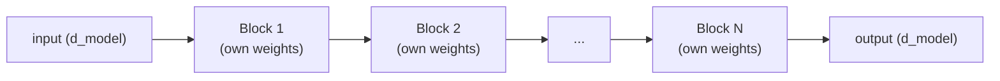

# Leçon 7. Empiler des blocs transformer

**Lien avec la mission :** L'étape 3 ouvre le modèle complet : un seul bloc transformer (étapes 1 et 2) est l'unité répétée, et cette leçon montre comment plusieurs d'entre eux forment un modèle d'une vraie profondeur, au lieu qu'un seul bloc soit toute l'histoire.
**Source primaire :** [Article : "Attention Is All You Need", Vaswani et al., 2017](https://arxiv.org/abs/1706.03762)
**Prérequis :** [Leçon 6](0006-feed-forward-block.md), [Scaled dot-product attention](../GLOSSARY.md)

## Échauffement

1. ▢ Le bloc feed-forward laisse-t-il jamais le calcul d'une position voir le vecteur d'une autre position ? Comparez avec l'attention.

Vérifier

Non, le bloc feed-forward applique les mêmes poids au vecteur de chaque position indépendamment, sans aucun mélange entre positions. L'attention est l'inverse : mélanger l'information entre les positions est tout son rôle.

2. ▢ Pourquoi une connexion résiduelle aide-t-elle à entraîner une pile profonde de blocs transformer ?

Vérifier

Elle donne aux gradients un chemin direct à travers la connexion identité `+ x` à chaque couche, quoi que fasse la transformation de chaque sous-couche, ce qui garde un signal d'entraînement exploitable jusqu'aux toutes premières couches.

## À savoir

### Chaque bloc garde la même forme, en entrée comme en sortie

Un bloc transformer, l'attention avec son résiduel et sa layer norm, suivie du bloc feed-forward avec son propre résiduel et sa propre layer norm, prend une entrée de dimension `d_model` et produit une sortie exactement de la même dimension. Cette conservation de la forme est ce qui rend l'empilement signifiant : la sortie du bloc 2 peut devenir l'entrée du bloc 3 sans adaptateur ni étape de remise en forme, et cela reste vrai quel que soit le nombre de blocs empilés. Un unique vecteur courant, souvent appelé **flux résiduel** (residual stream), traverse simplement bloc après bloc, chacun le lisant et y rajoutant sa propre contribution.

### La profondeur construit des représentations composées

Chaque bloc donne au modèle un tour de plus de « rassembler l'information pertinente grâce à l'attention, puis la transformer grâce au bloc feed-forward ». Empiler de nombreux blocs permet à des représentations de plus en plus composées et abstraites de se construire couche après couche, comme un réseau convolutif plus profond construit des features visuelles de plus haut niveau à partir de features de plus bas niveau, couche par couche. Un seul bloc ne peut faire qu'un tour de rassembler puis transformer ; une pile profonde permet au modèle de représenter des fonctions de l'entrée qu'un seul bloc n'a aucun moyen d'exprimer seul.

### Les blocs ne partagent pas leurs poids à travers la profondeur

Dans l'architecture standard, chaque bloc de la pile a ses propres paramètres, appris séparément : les poids d'attention et de feed-forward du bloc 3 sont entièrement différents de ceux du bloc 7. Cela coûte directement des paramètres, à peu près linéairement avec la profondeur, puisque rien n'est réutilisé. En échange, on obtient de la flexibilité de représentation : les différents blocs sont libres de se spécialiser à différents niveaux d'abstraction précisément parce qu'on ne les force pas à partager leurs poids, le même raisonnement qui permet aux différentes têtes d'attention de se spécialiser (leçon 2), appliqué cette fois à travers la profondeur plutôt qu'à l'intérieur d'une seule couche.

### Pourquoi le dispositif de la leçon 5 compte le plus ici

Un seul bloc, ou deux, peuvent s'entraîner raisonnablement bien même sans grande aide. Les connexions résiduelles et la layer normalization de la leçon 5 gagnent leur place précisément quand la profondeur devient grande, car les vrais modèles empilent couramment des dizaines de blocs ou plus, et c'est exactement là qu'un signal de gradient sans aide diminuerait ou exploserait en traversant autant de transformations empilées. C'est la profondeur qui rend le dispositif résiduel et de normalisation nécessaire au départ, et non un raffinement facultatif.

## Pratique

1. ▢ Pourquoi chaque bloc transformer doit-il conserver la même dimension d'entrée et de sortie (`d_model` en entrée, `d_model` en sortie) ? Qu'est-ce qui casserait si un bloc au milieu de la pile changeait la dimension ?

Vérifier

Empiler des blocs signifie alimenter directement l'entrée du bloc suivant avec la sortie d'un bloc ; si un bloc changeait la dimension, chaque bloc suivant (et le flux résiduel lui-même) devrait être construit pour une autre taille, ce qui casserait l'empilement uniforme, interchangeable, qui permet de répéter la même forme de bloc un nombre quelconque de fois sans cas particulier.

2. ▢ Les poids du bloc 3 d'une pile de transformer standard sont-ils les mêmes que ceux du bloc 7 ? Que coûte la réponse en nombre de paramètres, et qu'apporte-t-elle en flexibilité de représentation ?

Vérifier

Non, chaque bloc a ses propres paramètres, appris indépendamment. Cela coûte directement du nombre de paramètres, à peu près linéairement avec le nombre de blocs empilés, puisque rien n'est partagé ni réutilisé. En échange, les différents blocs peuvent se spécialiser différemment à différentes profondeurs, au lieu d'être forcés de calculer la même transformation à chaque couche.

3. ▢ Pourquoi le dispositif de connexions résiduelles et de layer norm de la leçon 5 compte-t-il davantage quand de nombreux blocs sont empilés (disons des dizaines) que pour seulement un ou deux blocs ?

Indice

Pensez à ce qui arrive à un signal de gradient qui traverse de nombreuses transformations empilées plutôt qu'une ou deux seulement.

Vérifier

Un gradient qui ne traverse qu'une ou deux transformations empilées n'a pas beaucoup de distance sur laquelle diminuer ou exploser. À travers des dizaines de blocs empilés, un signal de gradient sans aide se dégrade sévèrement faute de chemin direct en retour ; le chemin identité des connexions résiduelles et les plages d'activation stables de la layer norm sont précisément ce qui rend l'entraînement possible à cette profondeur, ce qui explique pourquoi ils comptent bien plus quand la profondeur augmente.

4. ▢ Décrivez, en une ou deux phrases, la passe avant d'une pile complète de blocs transformer.

Vérifier

Un unique vecteur courant (le flux résiduel) traverse séquentiellement chaque bloc de la pile, dans l'ordre ; chaque bloc lit le flux résiduel courant, calcule ses contributions d'attention et de feed-forward et les y rajoute, produisant le flux résiduel que le bloc suivant lit à son tour.

5. ▢ Quelle affirmation est vraie de l'empilement de blocs transformer ?

    - a) Chaque bloc doit utiliser des dimensions d'entrée et de sortie différentes pour que les blocs suivants puissent se spécialiser
    - b) Tous les blocs de la pile partagent exactement les mêmes poids, comme un réseau récurrent réutilise un seul jeu de poids d'un pas à l'autre
    - c) Chaque bloc conserve la même forme d'entrée et de sortie et a ses propres poids appris indépendamment, ce qui permet d'empiler les blocs uniformément tout en les laissant se spécialiser à différentes profondeurs
    - d) Les connexions résiduelles et la layer norm comptent autant, quel que soit le nombre de blocs empilés

Vérifier

**c)** Les deux propriétés, la forme uniforme et les poids indépendants, rendent l'empilement profond à la fois mécaniquement simple et flexible dans sa représentation. (a) est faux : la forme doit rester la même d'un bloc à l'autre, et non changer. (b) est faux : les blocs transformer ne partagent pas leurs poids à travers la profondeur dans l'architecture standard. (d) est faux : leur valeur croît précisément quand la profondeur augmente, car c'est là qu'un signal de gradient sans aide se dégraderait.

## Exercices en situation réelle

- [ ] Implémentez une pile de N blocs transformer (avec vos pièces des leçons 1 à 6) sous forme de simple boucle ou de liste d'instances de blocs, et vérifiez que le même code s'exécute sans changement que N vaille 2 ou 12.
- [ ] Lisez la définition du modèle de nanoGPT et trouvez où il empile ses blocs transformer, en notant comment la boucle sur les blocs est écrite.
- [ ] Demain : regardez combien de couches utilise le modèle de base de l'article d'origine (sa valeur `N`), et comparez cette profondeur au nombre de couches annoncé d'un vrai modèle actuel.

## Pour aller plus loin

- [Article : "Attention Is All You Need", Vaswani et al., 2017](https://arxiv.org/abs/1706.03762)
- [Dépôt : nanoGPT, Karpathy](https://github.com/karpathy/nanoGPT)
- [Ressources](../RESOURCES.md)

---

Ça ne passe pas ? Relisez la source primaire en haut de page, car cette leçon la condense et c'est dans la condensation que la compréhension s'échappe. Consultez le [glossaire](../GLOSSARY.md) pour tout terme qui vous a paru glissant.

Si c'est la leçon elle-même qui n'est pas claire plutôt que la matière, c'est un défaut : [ouvrez une issue](https://github.com/TokenCemetery/teach/issues).
