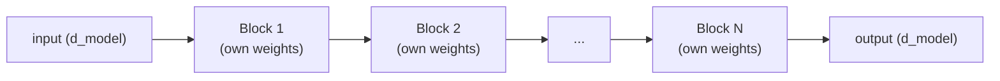

# पाठ 7. Transformer Blocks को Stack करना

**मिशन से संबंध:** चरण 3 पूरा model खोलता है: एक अकेला transformer block (चरण 1 और 2) दोहराई जाने वाली इकाई है, और यह पाठ बताता है कि उनमें से कई मिलकर असली गहराई वाला model कैसे बनते हैं, बजाय इसके कि एक block ही पूरी कहानी हो।
**मुख्य स्रोत:** [पेपर: "Attention Is All You Need", Vaswani et al., 2017](https://arxiv.org/abs/1706.03762)
**पूर्व-आवश्यकताएँ:** [पाठ 6](0006-feed-forward-block.md), [Scaled dot-product attention](../GLOSSARY.md)

## वार्म-अप

1. ▢ क्या feed-forward block कभी एक position की गणना को दूसरी position का vector देखने देता है? इसकी तुलना attention से करें।

जाँचें

नहीं, feed-forward block हर position के vector पर वही weights स्वतंत्र रूप से लगाता है, positions के बीच कोई मिलावट नहीं। Attention इसका उलटा है: positions के आर-पार जानकारी मिलाना ही उसका पूरा मक़सद है।

2. ▢ Residual connection transformer blocks के गहरे stack को train करने में कैसे मदद करता है?

जाँचें

वह gradients को हर layer पर identity `+ x` connection से सीधा रास्ता देता है, चाहे हर sublayer का रूपांतरण कुछ भी करे, जिससे सबसे शुरुआती layers तक भी काम का training signal पहुँचता रहता है।

## यह जानें

### हर block अंदर और बाहर एक ही shape रखता है

Transformer block, यानी attention और उसका residual तथा layer norm, उसके बाद feed-forward block और उसका अपना residual तथा layer norm, आयाम `d_model` का input लेता है और ठीक उसी आयाम का output बनाता है। यही shape का बने रहना stacking को अर्थपूर्ण बनाता है: block 2 का output बिना किसी adapter या reshape चरण के block 3 का input बन सकता है, और कितने भी blocks stack हों यही बात सही रहती है। एक अकेला चलता हुआ vector, जिसे अक्सर **residual stream** कहते हैं, एक के बाद एक block से बस गुज़रता रहता है, हर block उसे पढ़ता है और उसमें अपना योगदान वापस जोड़ देता है।

### गहराई संयोजित representations बनाती है

हर block model को "attention से काम की जानकारी जुटाओ, फिर feed-forward block से उसे रूपांतरित करो" का एक और दौर देता है। कई blocks stack करने से layer-दर-layer धीरे-धीरे ज़्यादा संयोजित, अमूर्त representations बनती जाती हैं, ठीक उसी तरह जैसे गहरा convolutional network layer-दर-layer निचले स्तर की visual features से ऊँचे स्तर की features बनाता है। एक अकेला block जुटाने-फिर-रूपांतरित करने का बस एक दौर कर सकता है; गहरा stack model को input के ऐसे functions represent करने देता है जिन्हें एक अकेला block अपने-आप व्यक्त करने का कोई तरीक़ा नहीं रखता।

### Blocks में गहराई के आर-पार weights साझा नहीं होते

मानक architecture में stack के हर block के अपने, अलग से सीखे हुए parameters होते हैं: block 3 की attention और feed-forward weights block 7 की weights से बिल्कुल अलग हैं। इसकी सीधी क़ीमत parameters में चुकानी पड़ती है, गहराई के साथ लगभग linearly, क्योंकि कुछ भी दोबारा इस्तेमाल नहीं हो रहा। बदले में जो मिलता है वह representational लचीलापन है: अलग-अलग blocks अमूर्तता के अलग-अलग स्तरों पर विशेषज्ञ बन सकते हैं, ठीक इसलिए कि उन्हें एक-दूसरे के साथ weights साझा करने को मजबूर नहीं किया जाता, वही तर्क जो अलग-अलग attention heads को विशेषज्ञ बनने देता है (पाठ 2), बस अब एक अकेली layer के भीतर नहीं बल्कि गहराई के आर-पार लगा हुआ।

### यहाँ पाठ 5 की व्यवस्था सबसे ज़्यादा क्यों मायने रखती है

एक block, या दो, ज़्यादा मदद के बिना भी ठीक-ठाक train हो सकते हैं। पाठ 5 के residual connections और layer normalization अपनी जगह ख़ास तौर पर तब बनाते हैं जब गहराई बड़ी हो जाती है, असली models आम तौर पर दर्जनों blocks या उससे ज़्यादा stack करते हैं, क्योंकि ठीक वहीं बिना सहारे का gradient signal इतने सारे stack हुए रूपांतरणों से गुज़रते हुए सिकुड़ जाता या फट जाता। गहराई ही residual और normalization की व्यवस्था को पहली जगह ज़रूरी बनाती है, यह कोई वैकल्पिक सुधार नहीं है।

## अभ्यास

1. ▢ हर transformer block को एक ही input और output आयाम (`d_model` अंदर, `d_model` बाहर) क्यों बनाए रखना चाहिए? अगर stack के बीच का कोई block आयाम बदल दे तो क्या टूटेगा?

जाँचें

Blocks stack करने का मतलब एक block का output सीधे अगले block के input में देना है; अगर कोई block आयाम बदल दे, तो उसके बाद का हर block (और residual stream ख़ुद) एक अलग आकार के लिए बनाना पड़ता, और वह एकसमान, सीधा जोड़ा जाने वाला stacking टूट जाता जो एक ही block shape को बिना किसी विशेष मामले के कितनी भी बार दोहराने देता है।

2. ▢ क्या मानक transformer stack के block 3 की weights block 7 की weights जैसी ही होती हैं? इस जवाब की parameter count में क्या क़ीमत है, और representational लचीलेपन में यह क्या देता है?

जाँचें

नहीं, हर block के अपने, स्वतंत्र रूप से सीखे हुए parameters होते हैं। इसकी सीधी क़ीमत parameter count में है, stack किए blocks की संख्या के साथ लगभग linearly, क्योंकि कुछ भी साझा या दोबारा इस्तेमाल नहीं होता। बदले में यह अलग-अलग blocks को अलग-अलग गहराई पर अलग तरह से विशेषज्ञ बनने देता है, बजाय इसके कि वे हर layer पर एक ही रूपांतरण compute करने को मजबूर हों।

3. ▢ पाठ 5 की residual-connection-और-layer-norm की व्यवस्था तब ज़्यादा क्यों मायने रखती है जब कई blocks (मान लें दर्जनों) stack हों, बजाय सिर्फ़ एक या दो blocks के?

संकेत

सोचें कि कई stack किए रूपांतरणों से गुज़रते gradient signal के साथ क्या होता है, बनाम सिर्फ़ एक या दो से गुज़रते हुए।

जाँचें

सिर्फ़ एक या दो stack किए रूपांतरणों से गुज़रते gradient के पास सिकुड़ने या फटने के लिए ज़्यादा दूरी नहीं होती। दर्जनों stack किए blocks में, बिना सहारे का gradient signal सीधे रास्ते के बिना बुरी तरह बिगड़ जाता है; residual connections का identity path और layer norm के स्थिर activation ranges ही उस गहराई पर training को संभव रखते हैं, इसीलिए गहराई बढ़ने पर वे कहीं ज़्यादा मायने रखते हैं।

4. ▢ एक-दो वाक्यों में transformer blocks के पूरे stack के forward pass का वर्णन करें।

जाँचें

एक अकेला चलता हुआ vector (residual stream) stack के हर block से क्रम से गुज़ारा जाता है; हर block मौजूदा residual stream पढ़ता है, अपने attention और feed-forward योगदान compute करता है, और उन्हें वापस जोड़ देता है, जिससे वह residual stream बनता है जिसे अगला block पढ़ता है।

5. ▢ Transformer blocks को stack करने के बारे में कौन-सा दावा सही है?

    - a) हर block को अलग input और output आयाम इस्तेमाल करने चाहिए ताकि बाद के blocks विशेषज्ञ बन सकें
    - b) Stack के सभी blocks बिल्कुल एक ही weights साझा करते हैं, जैसे recurrent network steps के आर-पार weights का एक ही सेट दोबारा इस्तेमाल करता है
    - c) हर block एक ही input/output shape बनाए रखता है और उसकी अपनी स्वतंत्र रूप से सीखी हुई weights होती हैं, जिससे blocks एकसमान रूप से stack हो पाते हैं और फिर भी अलग-अलग गहराई पर विशेषज्ञ बन सकते हैं
    - d) कितने भी blocks stack हों, residual connections और layer norm बराबर मायने रखते हैं

जाँचें

**c)** दोनों गुण, एकसमान shape और स्वतंत्र weights, गहरे stacking को यांत्रिक रूप से सरल और representational रूप से लचीला बनाते हैं। (a) ग़लत है: shape blocks के आर-पार वही रहना चाहिए, बदलना नहीं। (b) ग़लत है: मानक architecture में transformer blocks गहराई के आर-पार weight-tied नहीं होते। (d) ग़लत है: उनका मूल्य ख़ास तौर पर गहराई बढ़ने पर बढ़ता है, क्योंकि वहीं बिना सहारे का gradient signal बिगड़ता।

## असली दुनिया का अभ्यास

- [ ] N transformer blocks का stack (पाठ 1 से 6 के अपने हिस्सों से) सादे loop या block instances की list के रूप में लागू करें, और पक्का करें कि N चाहे 2 हो या 12, वही code बिना बदले चलता है।
- [ ] nanoGPT की model definition पढ़ें और ढूँढें कि वह अपने transformer blocks कहाँ stack करता है, और ध्यान दें कि blocks पर loop कैसे लिखा गया है।
- [ ] कल: पढ़ें कि मूल पेपर का base model कितनी layers इस्तेमाल करता है (उसका `N` मान), और उस गहराई की तुलना किसी असली, मौजूदा model की बताई layer count से करें।

## आगे बढ़ने के लिए

- [पेपर: "Attention Is All You Need", Vaswani et al., 2017](https://arxiv.org/abs/1706.03762)
- [Repo: nanoGPT, Karpathy](https://github.com/karpathy/nanoGPT)
- [संसाधन](../RESOURCES.md)

---

बात नहीं बन रही? ऊपर दिए मुख्य स्रोत को दोबारा पढ़ें, क्योंकि यह पाठ उसे संक्षिप्त करता है और समझ संक्षेप में ही रिसती है। जो शब्द फिसलन भरा लगे, उसके लिए [शब्दावली](../GLOSSARY.md) देखें।

अगर दिक़्क़त सामग्री की नहीं बल्कि पाठ की ही है, तो वह एक खोट है: [issue खोलें](https://github.com/TokenCemetery/teach/issues)।
