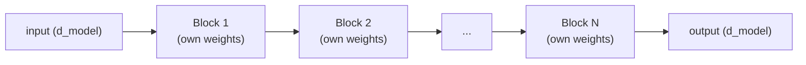

# Lição 7. Empilhando blocos transformer

**Ligação com a missão:** A etapa 3 abre o modelo completo: um único bloco transformer (etapas 1 e 2) é a unidade que se repete, e esta lição é como muitos deles se tornam um modelo com profundidade de verdade, em vez de um bloco ser a história inteira.
**Fonte principal:** [Artigo científico: "Attention Is All You Need", Vaswani et al., 2017](https://arxiv.org/abs/1706.03762)
**Pré-requisitos:** [Lição 6](0006-feed-forward-block.md), [Scaled dot-product attention](../GLOSSARY.md)

## Aquecimento

1. ▢ O bloco feed-forward alguma vez deixa a computação de uma posição ver o vetor de outra posição? Contraste com a atenção.

Verificação

Não, o bloco feed-forward aplica os mesmos pesos ao vetor de cada posição de forma independente, sem nenhuma mistura entre posições. A atenção é o oposto: misturar informação entre posições é todo o seu propósito.

2. ▢ Por que uma conexão residual ajuda a treinar uma pilha profunda de blocos transformer?

Verificação

Ela dá aos gradientes um caminho direto pela conexão identidade `+ x` em cada camada, seja qual for o que a transformação de cada subcamada faça, mantendo um sinal de treinamento utilizável chegando até as primeiras camadas.

## Saiba isto

### Todo bloco mantém o mesmo formato, na entrada e na saída

Um bloco transformer, atenção mais a sua residual e layer norm, seguida do bloco feed-forward mais a sua própria residual e layer norm, recebe uma entrada de dimensão `d_model` e produz uma saída da dimensão exatamente igual. Essa preservação de formato é o que torna a pilha significativa: a saída do bloco 2 pode virar a entrada do bloco 3 sem nenhum adaptador ou etapa de reshape, e o mesmo vale não importa quantos blocos sejam empilhados. Um único vetor em andamento, muitas vezes chamado de **residual stream**, simplesmente passa de bloco em bloco, cada um lendo-o e somando de volta a sua própria contribuição.

### A profundidade constrói representações compostas

Cada bloco dá ao modelo mais uma rodada de "reunir informação relevante via atenção e depois transformá-la via bloco feed-forward". Empilhar muitos blocos permite que representações progressivamente mais compostas e abstratas se construam camada por camada, do mesmo modo que uma rede convolucional mais profunda constrói features visuais de nível mais alto a partir das de nível mais baixo, camada por camada. Um único bloco só consegue uma rodada de reunir e transformar; uma pilha profunda permite que o modelo represente funções da entrada que um único bloco não tem como expressar por conta própria.

### Os blocos não compartilham pesos ao longo da profundidade

Na arquitetura padrão, cada bloco da pilha tem os seus próprios parâmetros, aprendidos separadamente: os pesos de atenção e feed-forward do bloco 3 são inteiramente diferentes dos do bloco 7. Isso custa parâmetros diretamente, de forma aproximadamente linear com a profundidade, já que nada é reaproveitado. O que isso compra em troca é flexibilidade representacional: blocos diferentes ficam livres para se especializar em níveis diferentes de abstração justamente porque não são forçados a compartilhar pesos entre si, o mesmo raciocínio que permite que heads de atenção diferentes se especializem (lição 2), aplicado agora ao longo da profundidade e não dentro de uma única camada.

### Por que o mecanismo da lição 5 importa mais aqui

Um único bloco, ou dois, conseguem treinar razoavelmente bem mesmo sem muita ajuda. As conexões residuais e a layer normalization da lição 5 justificam o seu custo especificamente quando a profundidade cresce muito, modelos reais costumam empilhar dezenas de blocos ou mais, já que é exatamente aí que um sinal de gradiente sem ajuda encolheria ou explodiria ao passar por tantas transformações empilhadas. A profundidade é o que torna necessário, antes de mais nada, o mecanismo de residuais e normalização, e não um refinamento opcional.

## Prática

1. ▢ Por que todo bloco transformer precisa preservar a mesma dimensão de entrada e de saída (`d_model` na entrada, `d_model` na saída)? O que quebraria se um bloco no meio da pilha mudasse a dimensão?

Verificação

Empilhar blocos significa alimentar a saída de um bloco diretamente na entrada do seguinte; se um bloco mudasse a dimensão, todo bloco posterior (e o próprio residual stream) precisaria ser construído para um tamanho diferente, quebrando o empilhamento uniforme e plug-and-play que permite que o mesmo formato de bloco se repita qualquer número de vezes sem tratamento especial.

2. ▢ Os pesos do bloco 3 de uma pilha transformer padrão são os mesmos do bloco 7? O que a resposta custa em contagem de parâmetros e o que ela compra em flexibilidade representacional?

Verificação

Não, cada bloco tem os seus próprios parâmetros, aprendidos de forma independente. Isso custa contagem de parâmetros diretamente, de forma aproximadamente linear com o número de blocos empilhados, já que nada é compartilhado ou reaproveitado. Em troca, permite que blocos diferentes se especializem de modo diferente em profundidades diferentes, em vez de serem forçados a calcular a transformação idêntica em todas as camadas.

3. ▢ Por que o mecanismo de conexão residual e layer norm da lição 5 importa mais quando muitos blocos são empilhados (digamos, dezenas) do que para apenas um ou dois blocos?

Dica

Pense no que acontece com um sinal de gradiente que passa por muitas transformações empilhadas em comparação com apenas uma ou duas.

Verificação

Um gradiente que passa por apenas uma ou duas transformações empilhadas não tem muita distância para encolher ou explodir. Ao longo de dezenas de blocos empilhados, um sinal de gradiente sem ajuda se degrada severamente sem um caminho direto de volta; o caminho identidade das conexões residuais e as faixas de ativação estáveis da layer norm são especificamente o que mantém o treinamento possível nessa profundidade, e por isso importam muito mais à medida que a profundidade cresce.

4. ▢ Descreva, em uma ou duas frases, o forward pass de uma pilha completa de blocos transformer.

Verificação

Um único vetor em andamento (o residual stream) é passado em sequência por cada bloco da pilha, em ordem; cada bloco lê o residual stream atual, calcula as suas contribuições de atenção e feed-forward e as soma de volta, produzindo o residual stream que o bloco seguinte lê por sua vez.

5. ▢ Qual afirmação é verdadeira sobre empilhar blocos transformer?

    - a) Cada bloco precisa usar dimensões de entrada e de saída diferentes para que os blocos seguintes possam se especializar
    - b) Todos os blocos da pilha compartilham exatamente os mesmos pesos, do mesmo modo que uma rede recorrente reutiliza um só conjunto de pesos ao longo dos passos
    - c) Todo bloco preserva o mesmo formato de entrada e saída e tem os seus próprios pesos aprendidos de forma independente, permitindo que os blocos se empilhem de modo uniforme e ainda se especializem em profundidades diferentes
    - d) As conexões residuais e a layer norm importam igualmente, não importa quantos blocos sejam empilhados

Verificação

**c)** As duas propriedades, formato uniforme e pesos independentes, são o que torna o empilhamento profundo ao mesmo tempo mecanicamente simples e representacionalmente flexível. (a) é falsa: o formato precisa permanecer o mesmo entre os blocos, e não mudar. (b) é falsa: os blocos transformer não têm pesos amarrados ao longo da profundidade na arquitetura padrão. (d) é falsa: o seu valor cresce especificamente à medida que a profundidade aumenta, já que é aí que um sinal de gradiente sem ajuda se degradaria.

## Prática no mundo real

- [ ] Implemente uma pilha de N blocos transformer (usando as suas peças das lições 1 a 6) como um simples loop ou lista de instâncias de bloco e confirme que o mesmo código roda sem alterações, seja N igual a 2 ou a 12.
- [ ] Leia a definição do modelo do nanoGPT e encontre onde ele empilha os seus blocos transformer, observando como o loop sobre os blocos é escrito.
- [ ] Amanhã: leia quantas camadas o modelo base do artigo original usa (o seu valor de `N`) e compare essa profundidade com a contagem de camadas declarada de um modelo real e atual.

## Para ir além

- [Artigo científico: "Attention Is All You Need", Vaswani et al., 2017](https://arxiv.org/abs/1706.03762)
- [Repositório: nanoGPT, Karpathy](https://github.com/karpathy/nanoGPT)
- [Recursos](../RESOURCES.md)

---

Não ficou claro? Releia a fonte principal no topo, já que esta lição a comprime e é na compressão que o entendimento escapa. Consulte o [glossário](../GLOSSARY.md) para qualquer termo que pareceu escorregadio.

Se o problema é a lição em si, e não o material, isso é um defeito: [abra uma issue](https://github.com/TokenCemetery/teach/issues).
