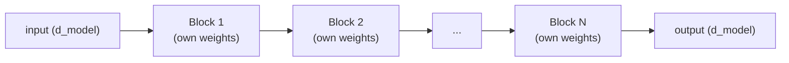

# Урок 7. Стек блоков трансформера

**Связь с целью курса:** Этап 3 открывает полную модель: один блок трансформера (этапы 1 и 2) это повторяющаяся единица, а этот урок о том, как много таких блоков превращаются в модель с настоящей глубиной, а не один блок оказывается всей историей.
**Первоисточник:** [Научная статья: "Attention Is All You Need", Vaswani et al., 2017](https://arxiv.org/abs/1706.03762)
**Предварительные требования:** [Урок 6](0006-feed-forward-block.md), [Масштабированное скалярное внимание](../GLOSSARY.md)

## Разминка

1. ▢ Позволяет ли feed-forward-блок вычислению одной позиции увидеть вектор другой позиции? Сопоставьте это с вниманием.

Проверка

Нет, feed-forward-блок применяет одни и те же веса к вектору каждой позиции независимо, вообще без смешивания между позициями. Внимание устроено противоположным образом: смешивание информации между позициями это вся его цель.

2. ▢ Почему остаточная связь помогает обучать глубокий стек блоков трансформера?

Проверка

Она даёт градиентам прямой путь по тождественной связи `+ x` на каждом слое, независимо от того, что делает преобразование каждого подслоя, и сохраняет пригодный для обучения сигнал, доходящий даже до самых ранних слоёв.

## Что нужно знать

### Каждый блок сохраняет одну и ту же форму на входе и на выходе

Блок трансформера, то есть внимание с его остаточной связью и нормализацией слоя, а затем feed-forward-блок со своей остаточной связью и нормализацией слоя, принимает вход размерности `d_model` и выдаёт выход в точности той же размерности. Именно это сохранение формы и делает стек осмысленным: выход блока 2 может стать входом блока 3 без адаптера и без шага изменения формы, и это остаётся верным при любом числе сложенных блоков. Единый «бегущий» вектор, которого часто называют **остаточным потоком** (residual stream), просто проходит блок за блоком, и каждый из них читает его и прибавляет в него свой вклад.

### Глубина наращивает составные представления

Каждый блок даёт модели ещё один раунд «собрать нужную информацию вниманием, затем преобразовать её feed-forward-блоком». Стек из многих блоков позволяет слой за слоем накапливать всё более составные, абстрактные представления, так же как более глубокая свёрточная сеть слой за слоем строит визуальные признаки более высокого уровня из признаков более низкого. Один блок способен только на один раунд «собрать, затем преобразовать»; глубокий стек позволяет модели представлять функции входа, которые один блок не в состоянии выразить сам по себе.

### Блоки не делят веса по глубине

В стандартной архитектуре у каждого блока в стеке свои, отдельно обученные параметры: веса внимания и feed-forward-блока в блоке 3 полностью отличаются от весов блока 7. Это напрямую стоит параметров, примерно линейно по глубине, поскольку ничего не используется повторно. Взамен это покупает гибкость представлений: разные блоки могут свободно специализироваться на разных уровнях абстракции именно потому, что их не заставляют делить веса друг с другом; то же рассуждение, которое позволяет разным головам внимания специализироваться (урок 2), только теперь применённое по глубине, а не внутри одного слоя.

### Почему механика из урока 5 важнее всего здесь

Один блок или два могут обучаться вполне прилично даже без особой помощи. Остаточные связи и нормализация слоя из урока 5 окупаются именно тогда, когда глубина становится большой, а реальные модели обычно складывают десятки блоков и больше, потому что как раз тут не получающий помощи сигнал градиента иначе сжимался бы или взрывался, проходя через столько сложенных преобразований. Именно глубина делает механику остаточных связей и нормализации необходимой, а не необязательным усовершенствованием.

## Практика

1. ▢ Почему каждый блок трансформера должен сохранять одну и ту же размерность на входе и на выходе (на входе `d_model`, на выходе `d_model`)? Что сломалось бы, если бы один блок в середине стека менял размерность?

Проверка

Стек блоков означает подачу выхода одного блока прямо на вход следующего; если бы блок менял размерность, каждый последующий блок (и сам остаточный поток) пришлось бы строить под другой размер, и это сломало бы единообразное, подключаемое без доработок наращивание стека, которое позволяет повторять одну и ту же форму блока любое число раз без особых случаев.

2. ▢ Совпадают ли веса в блоке 3 стандартного стека трансформера с весами в блоке 7? Чего этот ответ стоит в числе параметров и что покупает в гибкости представлений?

Проверка

Нет, у каждого блока свои, независимо обученные параметры. Это напрямую стоит числа параметров, примерно линейно по числу сложенных блоков, потому что ничего не делится и не используется повторно. Взамен это позволяет разным блокам по-разному специализироваться на разных глубинах, а не вынуждает вычислять одно и то же преобразование на каждом слое.

3. ▢ Почему механика остаточных связей и нормализации слоя из урока 5 важнее, когда сложено много блоков (скажем, десятки), чем для одного или двух?

Подсказка

Подумайте, что происходит с сигналом градиента, проходящим через много сложенных преобразований, по сравнению с одним или двумя.

Проверка

У градиента, проходящего лишь через одно или два сложенных преобразования, не так много расстояния, чтобы сжаться или взорваться. На десятках сложенных блоков не получающий помощи сигнал градиента сильно деградирует без прямого пути назад; тождественный путь остаточных связей и стабильные диапазоны активаций от нормализации слоя как раз и сохраняют возможность обучения на такой глубине, поэтому они гораздо важнее по мере роста глубины.

4. ▢ Опишите одним-двумя предложениями прямой проход полного стека блоков трансформера.

Проверка

Единый «бегущий» вектор (остаточный поток) последовательно проходит каждый блок стека по порядку; каждый блок читает текущий остаточный поток, вычисляет свои вклады внимания и feed-forward-блока и прибавляет их обратно, получая остаточный поток, который в свою очередь читает следующий блок.

5. ▢ Какое утверждение верно о стеке блоков трансформера?

    - a) Каждый блок должен использовать разные размерности входа и выхода, чтобы последующие блоки могли специализироваться
    - b) Все блоки в стеке делят одни и те же веса, подобно тому как рекуррентная сеть повторно использует один набор весов на разных шагах
    - c) Каждый блок сохраняет одну и ту же форму входа и выхода и имеет свои независимо обученные веса, благодаря чему блоки складываются единообразно, но всё же специализируются на разных глубинах
    - d) Остаточные связи и нормализация слоя одинаково важны независимо от числа сложенных блоков

Проверка

**c)** Оба свойства, единая форма и независимые веса, делают глубокий стек одновременно механически простым и гибким с точки зрения представлений. Вариант (a) неверен: форма должна оставаться одной и той же во всех блоках, а не меняться. Вариант (b) неверен: блоки трансформера в стандартной архитектуре не имеют связанных весов по глубине. Вариант (d) неверен: их ценность растёт именно с ростом глубины, потому что как раз тут не получающий помощи сигнал градиента иначе деградировал бы.

## Практика в реальной работе

- [ ] Реализуйте стек из N блоков трансформера (на деталях из уроков 1-6) как простой цикл или список экземпляров блока и убедитесь, что один и тот же код работает без изменений и при N равном 2, и при N равном 12.
- [ ] Прочитайте определение модели в nanoGPT и найдите, где она складывает свои блоки трансформера, отметив, как написан цикл по блокам.
- [ ] Завтра: прочитайте, сколько слоёв использует базовая модель оригинальной статьи (её значение `N`), и сравните эту глубину с заявленным числом слоёв реальной современной модели.

## Что почитать дальше

- [Научная статья: "Attention Is All You Need", Vaswani et al., 2017](https://arxiv.org/abs/1706.03762)
- [Репозиторий: nanoGPT, Karpathy](https://github.com/karpathy/nanoGPT)
- [Ресурсы](../RESOURCES.md)

---

Не доходит? Перечитайте первоисточник в начале: этот урок его сжимает, а при сжатии понимание как раз и теряется. Загляните в [глоссарий](../GLOSSARY.md), если какой-то термин показался скользким.

Если неясен сам урок, а не материал, это дефект: [откройте issue](https://github.com/TokenCemetery/teach/issues).
