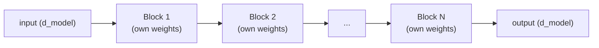

# 第 7 课：堆叠 Transformer 块

**使命关联:** 第 3 阶段开始搭建完整的模型：单个 Transformer 块（第 1 和第 2 阶段）是重复出现的基本单元，本课讲的就是许多个这样的块如何变成一个有真正深度的模型，而不是只靠一个块撑起全部。
**主要来源:** [论文：“Attention Is All You Need”，Vaswani 等，2017](https://arxiv.org/abs/1706.03762)
**前置知识:** [第 6 课](0006-feed-forward-block.md)、[缩放点积注意力](../GLOSSARY.md)

## 热身

1. ▢ 前馈块会让一个位置的计算看到另一个位置的向量吗？请与注意力做对比。

检查

不会，前馈块把同样的权重独立地作用于每个位置的向量，完全没有跨位置的混合。注意力正相反：在位置之间混合信息就是它的全部目的。

2. ▢ 为什么残差连接有助于训练一个很深的 Transformer 块堆叠？

检查

它在每一层通过恒等连接 `+ x` 给梯度一条直接的通路，不论每个子层的变换做了什么，都让一个可用的训练信号能够到达最靠前的那些层。

## 要点

### 每个块的输入和输出都保持相同的形状

一个 Transformer 块，也就是注意力加上它的残差连接和层归一化，再接前馈块加上它自己的残差连接和层归一化，接收维度为 `d_model` 的输入，产生完全相同维度的输出。这种形状的保持，是堆叠之所以有意义的根本：块 2 的输出可以直接成为块 3 的输入，不需要任何适配器或重塑步骤，不论堆叠多少个块，这一点都同样成立。一个单一的、持续流动的向量，通常称为**残差流**，就这样一块接一块地穿过各个块，每个块读取它，并把自己的贡献加回去。

### 深度逐层构建出复合的表示

每个块都给模型多一轮“通过注意力收集相关信息，再通过前馈块变换它”。堆叠许多块，使越来越复合、越来越抽象的表示得以逐层建立起来，就像更深的卷积网络逐层用低层的视觉特征构建出更高层的视觉特征一样。单个块只能做一轮先收集再变换；深层的堆叠则让模型能够表示单个块自己无法表达的输入函数。

### 块之间不跨深度共享权重

在标准架构里，堆叠中的每个块都有自己单独学习得到的参数：块 3 的注意力和前馈权重，与块 7 的完全不同。这直接花费参数，大致与深度成线性关系，因为没有任何东西被复用。作为交换，它换来的是表示上的灵活性：不同的块可以自由地在不同的抽象层次上分工，恰恰是因为它们没有被强制彼此共享权重，这与让不同的注意力头能够分工的道理相同（第 2 课），只是现在发生在跨深度的方向上，而不是在单层之内。

### 为什么第 5 课的机制在这里最为关键

单个块，或两个块，即使没有多少帮助也可以训练得相当好。第 5 课的残差连接和层归一化，恰恰是在深度变大之后才物有所值，真实的模型通常会堆叠几十个甚至更多的块，因为正是在这种地方，没有辅助的梯度信号在穿过这么多堆叠的变换时，会缩小或爆炸。深度才是使残差和归一化机制成为必要的原因，它们并不是可有可无的改良。

## 练习

1. ▢ 为什么每个 Transformer 块都必须保持相同的输入和输出维度（输入 `d_model`，输出 `d_model`）？如果堆叠中间的某个块改变了维度，会出什么问题？

检查

堆叠块就意味着把一个块的输出直接送进下一个块的输入；如果某个块改变了维度，之后的每个块（以及残差流本身）都得按另一个大小来构建，这就破坏了那种统一的、即插即用的堆叠方式，而正是这种方式让同一种块的形状可以重复任意多次而无需特殊处理。

2. ▢ 标准 Transformer 堆叠里块 3 的权重，与块 7 的权重相同吗？这个答案在参数量上花费了什么，又在表示灵活性上换来了什么？

检查

不同，每个块都有自己独立学习得到的参数。这直接花费参数量，大致与堆叠的块数成线性关系，因为没有任何东西被共享或复用。作为交换，它让不同的块可以在不同的深度上以不同方式分工，而不是被迫在每一层都计算完全相同的变换。

3. ▢ 为什么第 5 课的残差连接加层归一化机制，在堆叠了许多块（比如几十个）之后，比只有一两个块时更重要？

提示

想一想梯度信号穿过许多个堆叠的变换，与只穿过一两个相比，会发生什么。

检查

只穿过一两个堆叠的变换的梯度，没有多少距离可以缩小或爆炸。跨越几十个堆叠的块，没有辅助的梯度信号如果没有一条直接的回传通路，就会严重退化；残差连接的恒等通路和层归一化稳定的激活值范围，正是让训练在这样的深度上仍然可行的东西，这就是为什么随着深度增加，它们变得重要得多。

4. ▢ 用一两句话描述一整个 Transformer 块堆叠的前向传播。

检查

一个单一的、持续流动的向量（残差流）按顺序依次穿过堆叠中的每个块；每个块读取当前的残差流，计算它的注意力和前馈贡献，并把它们加回去，产生供下一个块依次读取的残差流。

5. ▢ 关于堆叠 Transformer 块，下面哪一项说法是对的？

    - a) 每个块都必须使用不同的输入和输出维度，这样后面的块才能分工
    - b) 堆叠中的所有块共享完全相同的权重，就像循环网络在各个步骤之间复用同一组权重
    - c) 每个块都保持相同的输入/输出形状，并拥有自己独立学习得到的权重，让块得以均匀地堆叠，同时仍能在不同深度上分工
    - d) 不论堆叠多少个块，残差连接和层归一化都同样重要

检查

**c)** 这两个性质，统一的形状和独立的权重，使深层堆叠在机制上既简单、在表示上又灵活。(a) 是错的：各块之间的形状必须保持相同，而不是改变。(b) 是错的：在标准架构里，Transformer 块并不跨深度绑定权重。(d) 是错的：它们的价值恰恰是随着深度增加而增长的，因为正是在那种地方，没有辅助的梯度信号会退化。

## 实战练习

- [ ] 用你第 1 至 6 课的部件，把 N 个 Transformer 块的堆叠实现为一个简单的循环或块实例的列表，并确认不论 N 是 2 还是 12，同一份代码都能原封不动地运行。
- [ ] 阅读 nanoGPT 的模型定义，找出它在哪里堆叠 Transformer 块，并留意遍历各个块的循环是怎么写的。
- [ ] 明天：查一查原始论文的基础模型用了多少层（它的 `N` 值），并把这个深度与一个真实的、当前模型所标明的层数做比较。

## 延伸阅读

- [论文：“Attention Is All You Need”，Vaswani 等，2017](https://arxiv.org/abs/1706.03762)
- [仓库：nanoGPT，Karpathy](https://github.com/karpathy/nanoGPT)
- [资源](../RESOURCES.md)

---

没学明白？请重读顶部的主要来源，因为本课是对它的压缩，而理解正是在压缩中流失的。如果有哪个术语觉得含糊，可以查看[术语表](../GLOSSARY.md)。

如果问题出在课程本身，而不是学习材料，那就是一个缺陷：[提交 issue](https://github.com/TokenCemetery/teach/issues)。
