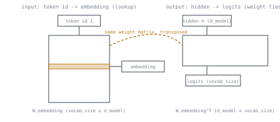

# 第 8 课：嵌入层与输出层，权重绑定

**使命关联:** 这是第 3 阶段的收官之课：堆叠起来的各个块（第 7 课）完全在 `d_model` 维的向量里运作，所以必须有东西在入口把离散的 token 转换到这个空间，又在出口把它转回词表分数，从而把从原始 token ID 到完整前向传播的回路闭合起来。
**主要来源:** [论文：“Using the Output Embedding to Improve Language Models”，Press 和 Wolf，2017](https://arxiv.org/abs/1608.05859)
**前置知识:** [第 7 课](0007-stacking-blocks.md)、[缩放点积注意力](../GLOSSARY.md)

## 热身

1. ▢ 为什么每个 Transformer 块都必须保持相同的输入和输出维度（输入 `d_model`，输出 `d_model`）？

检查

堆叠就意味着一个块的输出直接送进下一个块的输入；如果某个块改变了维度，之后的每个块以及残差流都得按另一个大小来构建，这就破坏了那种统一的堆叠方式，而正是这种方式让同一种块的形状可以重复任意多次。

2. ▢ 标准 Transformer 堆叠里一个块的权重，与另一个块的权重相同吗？这花费了什么，又换来了什么？

检查

不同，每个块都有自己独立学习得到的参数。这花费的参数量大致与深度成线性关系，因为没有任何东西被共享，但它让不同的块可以在不同的深度上以不同方式分工，而不是都计算完全相同的变换。

## 要点

### 输入嵌入：从 token ID 到向量的查找

分词器（这里只是顺带提及；进一步的推导属于 `llm/finetuning` 的范围）会产生一串整数 token ID，每个都是固定词表的一个索引。**输入嵌入层**是一个学习得到的矩阵，形状为 `vocab_size × d_model`：第 `i` 行就是 token `i` 的稠密向量表示。查找一个 token 的嵌入，就是读取它那一行。离散的、符号化的 token 就是在这里进入连续的向量空间的，而后面每一个部件，注意力、前馈块、位置编码，实际运作的都是这个空间。

### 输出层：投影回词表分数

最后一个堆叠的块产生输出之后，每个位置上的输出仍然是 `d_model` 维的，模型还需要再走一步，才能把这个向量变回对词表的预测。**输出层**是一个形状为 `d_model × vocab_size` 的线性投影，在每个位置上为每个词表 token 产生一个原始分数，称为 **logit**。这些 logits（由下一课的交叉熵损失把它们转成概率分布）就是“预测下一个 token”在数值上的真正含义：一个词表大小的分数向量，每个可能的 token 对应一个分数。

### 两个层的形状互为转置

输入嵌入矩阵是 `vocab_size × d_model`；输出投影是 `d_model × vocab_size`，恰好是转置的形状。**权重绑定**直接利用了这一点：模型不再学习一个完全独立的输出矩阵，而是把同一个嵌入矩阵转置之后，复用来计算输出 logits（`logits = h @ W_embedding^T`）。这并不只是为了方便而利用的巧合；两个层所联系的其实是同一个根本问题，输入嵌入回答“哪个向量代表 token X”，输出层回答“token X 有多大可能”，而绑定就是把这两者当作共享同一个表示，而不是学习两个独立的、互不相干的表示。

### 绑定实际节省了什么

对于 50,000 个 token 的词表和 `d_model = 768`，仅嵌入表就有 `50,000 × 768 = 38,400,000` 个参数。不做绑定的模型，需要为输出投影再准备一个同样大小的矩阵，也就是另外 3840 万个做着紧密相关工作的参数。绑定去掉了整个第二个矩阵，对于词表相对隐藏维度来说很大的模型，这意味着节省了模型总参数量中相当大的一部分，而质量基本没有损失，往往还有可测量的提升。

## 练习

1. ▢ 输入嵌入层的权重矩阵是什么形状？查找某个特定 token 的嵌入，在结构上对应什么？

检查

`vocab_size × d_model`。查找一个 token 的嵌入，就是读取矩阵中该 token 索引处的那一行，这是直接查找，而不是计算出来的变换。

2. ▢ 输出层的形状与输入嵌入层的形状是什么关系？这种关系使什么成为可能？

检查

输出层的形状（`d_model × vocab_size`）是输入嵌入形状（`vocab_size × d_model`）的转置。这种关系正是使权重绑定成为可能的原因：同一个矩阵，一种用法是当作查找表，另一种用法（转置后）是当作投影，就可以同时承担两种角色，而不需要两个分别学习的矩阵。

3. ▢ 对于 50,000 个 token 的词表和 `d_model = 768`，计算嵌入表的参数量，并解释与不做绑定的模型相比，权重绑定节省了什么。

提示

嵌入表的参数量是 `vocab_size × d_model`。不做绑定的输出层，需要一个同样大小的矩阵。

检查

嵌入表有 `50,000 × 768 = 38,400,000` 个参数。不做绑定的模型，需要为输出投影再准备一个同样大小的、单独学习的第二个矩阵；绑定去掉了整个第二个矩阵，对这个词表和隐藏维度而言，节省了大约 3840 万个参数。

4. ▢ 除了节省参数之外，把输入和输出权重矩阵绑定在一起之所以说得通，背后的道理是什么，而不只是一个方便的小技巧？

检查

两个层联系的是同一个根本的表示：输入嵌入回答“哪个向量代表这个 token”，输出层回答“在当前表示下，这个 token 有多大可能”。既然两个问题说的是同一种 token 到向量的关系，让它们共享一个学习得到的表示就是一种合理的归纳偏置，而不仅仅是削减参数的办法。

5. ▢ 关于输入嵌入层和输出层，下面哪一项说法是对的？

    - a) 它们必须始终作为两个完全独立的矩阵来学习，因为它们的用途互不相关
    - b) 它们的形状互为转置，这正是权重绑定（两者复用同一个矩阵）成为可能的原因
    - c) 权重绑定只节省参数，没有其他好处
    - d) 输出层的形状只取决于 `vocab_size`，与 `d_model` 无关

检查

**b)** 转置形状的关系，正是绑定所利用的东西。(a) 是错的：这恰恰是绑定避免了的需要。(c) 是错的：也有人主张绑定有助于质量，因为两个层都联系着同一个底层的 token 表示。(d) 是错的：输出层的形状是 `d_model × vocab_size`，两者都有关。

## 实战练习

- [ ] 先把输入嵌入查找和输出投影实现成两个独立的矩阵，再修改你的实现把它们绑定起来，并确认输出 logits 的形状没有变化。
- [ ] 对一个你熟悉的模型，查出它的词表大小和 `d_model`，并计算权重绑定与不绑定的版本相比，能节省多少参数。
- [ ] 明天：检查你能接触到的某个真实模型实现（在 `transformers` 库或别处）是否绑定了它的嵌入权重和输出权重，并找出代码里是在哪里配置的。

## 延伸阅读

- [论文：“Using the Output Embedding to Improve Language Models”，Press 和 Wolf，2017](https://arxiv.org/abs/1608.05859)
- [论文：“Attention Is All You Need”，Vaswani 等，2017](https://arxiv.org/abs/1706.03762)
- [资源](../RESOURCES.md)

---

没学明白？请重读顶部的主要来源，因为本课是对它的压缩，而理解正是在压缩中流失的。如果有哪个术语觉得含糊，可以查看[术语表](../GLOSSARY.md)。

如果问题出在课程本身，而不是学习材料，那就是一个缺陷：[提交 issue](https://github.com/TokenCemetery/teach/issues)。
