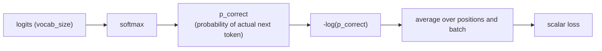

# Lección 9. Pérdida de entropía cruzada sobre el vocabulario

**Vínculo con la misión:** La etapa 4 abre el bucle de entrenamiento: el forward pass completo (etapas 1 a 3) produce logits, y esta lección convierte esos logits en el único número escalar frente al cual el entrenamiento mejora realmente el modelo.
**Fuente principal:** [Docs: "torch.nn.functional.cross_entropy", PyTorch](https://pytorch.org/docs/stable/generated/torch.nn.functional.cross_entropy.html)
**Requisitos previos:** [Lección 8](0008-embedding-output-and-weight-tying.md), [Scaled dot-product attention](../GLOSSARY.md)

## Calentamiento

1. ▢ ¿Por qué pueden las capas de embedding de entrada y de salida compartir una única matriz de pesos (weight tying), en lugar de necesitar dos separadas?

Comprobación

Sus shapes son transpuestos uno del otro (`vocab_size × d_model` frente a `d_model × vocab_size`), y ambas capas relacionan un token con la misma representación subyacente, una como búsqueda y la otra como proyección, que es lo que hace de reutilizar una matriz para ambas una elección sensata, y no solo una coincidencia de shapes.

2. ▢ ¿Cómo restringe la máscara causal a qué puede atender una posición de query?

Comprobación

Una query en la posición *i* solo puede atender a las posiciones de key de 0 a *i*; las posiciones posteriores a *i* se enmascaran con una puntuación negativa grande antes del softmax, lo que lleva su contribución a un valor efectivamente nulo.

## Qué debes saber

### De logits a una probabilidad, de una probabilidad a una pérdida

La capa de salida de la lección 8 produce un vector de logits de longitud `vocab_size` en cada posición, una puntuación en bruto por cada siguiente token posible. El softmax convierte esos logits en una distribución de probabilidad propiamente dicha. El entrenamiento necesita entonces un único número que mida cuán equivocada estaba esa distribución, dado cuál resultó ser el siguiente token real en los datos de entrenamiento: la **pérdida de entropía cruzada** es ese número, calculado como el logaritmo negativo de la probabilidad que el modelo asignó al token correcto real: `loss = -log(p_correct)`.

### Por qué específicamente el logaritmo negativo de la probabilidad

Una predicción perfecta, con probabilidad 1 para el token correcto, da una pérdida de exactamente 0. A medida que la probabilidad asignada al token correcto se encoge hacia 0, `-log(p)` crece sin cota, una penalización que aumenta sin límite para una predicción equivocada con seguridad. Compara `p = 0.8` para el token correcto, que da `-log(0.8) ≈ 0.223`, con `p = 0.1`, que da `-log(0.1) ≈ 2.303`: la pérdida crece bruscamente, y no solo de forma lineal, a medida que la confianza del modelo se aleja de la verdad. Una alternativa de aspecto más simple como `1 - p` no tiene esta propiedad: se satura en 1 sin importar con cuánta seguridad se equivoque el modelo, y no da ninguna señal extra para distinguir "algo equivocado" de "catastróficamente equivocado con seguridad". La entropía cruzada también tiene un gradiente limpio respecto de los logits, `softmax_output - one_hot_true_label`, una expresión simple y numéricamente bien comportada que la retropropagación (próxima lección) puede usar directamente, lo que es parte de por qué el softmax y la entropía cruzada casi siempre van emparejados y a menudo se implementan como una única operación fusionada y numéricamente estable que toma directamente logits en bruto, en lugar de un paso de softmax aparte seguido de un logaritmo.

### Teacher forcing: la pérdida de cada posición, calculada en una sola pasada

Durante el entrenamiento, el modelo predice el token de la posición *i+1* usando solo las posiciones 0 a *i*, exactamente lo que la máscara causal (lección 3) ya impone. Como la máscara causal permite calcular a la vez, en un único forward pass, la predicción de cada posición, la pérdida de cada posición de la secuencia, que compara la distribución predicha en esa posición con el siguiente token real de los datos de entrenamiento, también puede calcularse en esa misma pasada única. Esto es el **teacher forcing**: el entrenamiento siempre alimenta como contexto los tokens previos reales, de la verdad de referencia, nunca las propias predicciones pasadas del modelo, que pueden ser erróneas, lo que es distinto de la generación, donde el modelo necesariamente se condiciona en cambio en sus propios tokens generados antes.

### Un escalar para todo el batch

Cada posición produce su propio valor de pérdida de entropía cruzada; estos se promedian sobre todas las posiciones de la secuencia y sobre todas las secuencias del batch, colapsando en un único número escalar. Un único escalar es lo que necesita el backward pass (próxima lección): el descenso de gradiente actualiza los pesos respecto de un solo número que minimizar, no de todo un tensor de valores de pérdida separados, así que el paso de promediado es lo que convierte "cuán equivocada estuvo cada predicción en todo un batch" en la única cantidad que el entrenamiento optimiza realmente.

## Práctica

1. ▢ El modelo asigna una probabilidad de 0.8 al siguiente token correcto en un caso, y de 0.1 en otro. Calcula la pérdida de entropía cruzada de cada uno, y describe cómo cambia la pérdida cuando baja la probabilidad asignada al token correcto.

Pista

`loss = -log(p)`.

Comprobación

`-log(0.8) ≈ 0.223`; `-log(0.1) ≈ 2.303`. La pérdida no crece de forma lineal al bajar la probabilidad correcta; crece bruscamente, más de diez veces mayor ante una caída de diez veces en la probabilidad asignada, y penaliza la equivocación con seguridad mucho más severamente que una predicción meramente incierta.

2. ▢ ¿Por qué usa la entropía cruzada `-log(p)` como penalización y no algo como `1 - p`?

Comprobación

`-log(p)` crece sin cota cuando `p` se acerca a 0, lo que da una penalización que aumenta sin límite para una predicción equivocada con seguridad. `1 - p` se satura en 1 sin importar lo cerca de 0 que llegue la probabilidad asignada, así que no puede distinguir una predicción meramente equivocada de una catastróficamente segura como sí puede `-log(p)`.

3. ▢ ¿Cómo hace posible la máscara causal (lección 3) calcular la pérdida de entrenamiento de cada posición de una secuencia con un solo forward pass, en lugar de una pasada por posición?

Comprobación

La máscara causal ya restringe cada posición a atender solo a posiciones anteriores, que es exactamente la restricción que exige predecir la posición *i+1* a partir de las posiciones 0 a *i*. Como el cálculo de atención enmascarada de cada posición puede correr a la vez en una sola pasada, la distribución predicha de cada posición, y por tanto la pérdida de cada posición frente al siguiente token real, también puede calcularse junta en esa misma pasada única, en lugar de necesitar una pasada aparte por posición.

4. ▢ ¿Por qué necesita el entrenamiento que las pérdidas por posición y por batch se promedien hasta un único escalar, en lugar de trabajar directamente con el tensor completo de valores de pérdida individuales?

Comprobación

El descenso de gradiente actualiza los pesos del modelo para minimizar una sola cantidad; el backward pass necesita un único escalar respecto del cual calcular gradientes, no todo un tensor de valores separados. El promedio colapsa "cuán equivocada estuvo cada predicción en el batch" en ese único número que el entrenamiento optimiza realmente.

5. ▢ ¿Qué afirmación es cierta del teacher forcing durante el entrenamiento?

    - a) El modelo condiciona cada predicción en sus propios tokens generados antes, igual que hace durante la inferencia
    - b) El modelo condiciona la predicción de cada posición en los tokens previos reales, de la verdad de referencia de los datos de entrenamiento, y no en sus propias predicciones
    - c) El teacher forcing requiere un forward pass aparte para cada posición de la secuencia
    - d) El teacher forcing y la máscara causal atienden problemas sin relación y sin conexión entre sí

Comprobación

**b)** Eso es exactamente lo que significa el teacher forcing, y es lo que distingue el entrenamiento de la generación. (a) es falsa: eso describe la inferencia, no el entrenamiento con teacher forcing. (c) es falsa: la máscara causal es precisamente lo que permite calcular cada posición en una sola pasada. (d) es falsa: la restricción por posición de la máscara causal es lo que hace posible calcular en una sola pasada la pérdida con teacher forcing de cada posición.

## Prácticas en el mundo real

- [ ] Implementa la pérdida de entropía cruzada a partir de operaciones en bruto (softmax, y luego el logaritmo negativo de la probabilidad del token correcto) para un ejemplo pequeño, y confirma que coincide con `F.cross_entropy` de PyTorch sobre los mismos logits y el mismo objetivo.
- [ ] Para una secuencia de entrenamiento, calcula a mano la pérdida por posición de cada posición a partir de un pequeño conjunto de logits inventados, y luego promédialas en un único escalar.
- [ ] Mañana: lee la documentación de `cross_entropy` de PyTorch y anota por qué toma logits en bruto en lugar de exigirte llamar tú mismo al softmax antes.

## Para profundizar

- [Docs: "torch.nn.functional.cross_entropy", PyTorch](https://pytorch.org/docs/stable/generated/torch.nn.functional.cross_entropy.html)
- [Repo: nanoGPT, Karpathy](https://github.com/karpathy/nanoGPT)
- [Recursos](../RESOURCES.md)

---

¿No termina de quedar claro? Vuelve a leer la fuente primaria de arriba, ya que esta lección la comprime y en la compresión es donde se escapa la comprensión. Consulta el [glosario](../GLOSSARY.md) por si algún término te resultó resbaladizo.

Si lo poco claro es la propia lección y no el material, eso es un defecto: [abre un issue](https://github.com/TokenCemetery/teach/issues).
