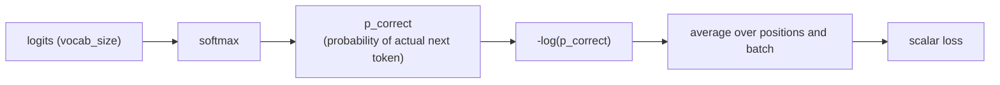

# Leçon 9. Loss d'entropie croisée sur le vocabulaire

**Lien avec la mission :** L'étape 4 ouvre la boucle d'entraînement : la passe avant complète (étapes 1 à 3) produit des logits, et cette leçon transforme ces logits en l'unique nombre scalaire par rapport auquel l'entraînement améliore réellement le modèle.
**Source primaire :** [Doc : "torch.nn.functional.cross_entropy", PyTorch](https://pytorch.org/docs/stable/generated/torch.nn.functional.cross_entropy.html)
**Prérequis :** [Leçon 8](0008-embedding-output-and-weight-tying.md), [Scaled dot-product attention](../GLOSSARY.md)

## Échauffement

1. ▢ Pourquoi l'embedding d'entrée et la couche de sortie peuvent-ils partager une seule matrice de poids (weight tying), au lieu d'en nécessiter deux séparées ?

Vérifier

Leurs formes sont transposées l'une de l'autre (`vocab_size × d_model` contre `d_model × vocab_size`), et les deux couches rattachent un token à la même représentation sous-jacente, l'une comme une recherche, l'autre comme une projection, ce qui fait de la réutilisation d'une seule matrice pour les deux un choix sensé, et pas seulement une coïncidence de forme.

2. ▢ Comment le masquage causal restreint-il ce sur quoi une position de requête peut porter son attention ?

Vérifier

Une requête en position *i* ne peut porter son attention que sur les positions de clé 0 à *i* ; les positions postérieures à *i* sont masquées par un grand score négatif avant le softmax, ce qui ramène leur contribution à pratiquement zéro.

## À savoir

### Des logits à une probabilité, d'une probabilité à une loss

La couche de sortie de la leçon 8 produit à chaque position un vecteur de logits de longueur `vocab_size`, un score brut par token suivant possible. Le softmax transforme ces logits en une vraie distribution de probabilité. L'entraînement a ensuite besoin d'un seul nombre qui mesure à quel point cette distribution s'est trompée, compte tenu de ce que le token suivant réel des données d'entraînement s'est avéré être : la **loss d'entropie croisée** (cross-entropy loss) est ce nombre, calculé comme le logarithme négatif de la probabilité que le modèle a attribuée au bon token réel : `loss = -log(p_correct)`.

### Pourquoi précisément le logarithme négatif de la probabilité

Une prédiction parfaite, de probabilité 1 pour le bon token, donne une loss d'exactement 0. À mesure que la probabilité attribuée au bon token tend vers 0, `-log(p)` croît sans borne, une pénalité qui augmente sans limite pour une prédiction fausse faite avec assurance. Comparez `p = 0.8` pour le bon token, qui donne `-log(0.8) ≈ 0.223`, à `p = 0.1`, qui donne `-log(0.1) ≈ 2.303` : la loss croît brutalement, pas seulement linéairement, à mesure que la confiance du modèle s'éloigne de la vérité. Une alternative d'apparence plus simple comme `1 - p` n'a pas cette propriété : elle sature à 1 quelle que soit l'assurance avec laquelle le modèle se trompe, et ne donne aucun signal supplémentaire pour distinguer « un peu faux » de « catastrophiquement et avec assurance faux ». L'entropie croisée a aussi un gradient propre par rapport aux logits, `softmax_output - one_hot_true_label`, une expression simple et numériquement bien comportée que la rétropropagation (leçon suivante) peut utiliser directement, ce qui explique en partie pourquoi le softmax et l'entropie croisée sont presque toujours associés et souvent implémentés comme une seule opération fusionnée, numériquement stable, qui prend directement les logits bruts, plutôt qu'une étape softmax séparée suivie d'un logarithme.

### Teacher forcing : la loss de chaque position, calculée en une seule passe

Pendant l'entraînement, le modèle prédit le token en position *i+1* en n'utilisant que les positions 0 à *i*, exactement ce que le masquage causal (leçon 3) impose déjà. Comme le masquage causal permet de calculer simultanément la prédiction de chaque position en une seule passe avant, la loss de chaque position de la séquence, qui compare la distribution prédite à cette position avec le token suivant réel des données d'entraînement, peut elle aussi être calculée dans cette même passe unique. C'est le **teacher forcing** : l'entraînement fournit toujours en contexte les vrais tokens précédents, la vérité terrain, et jamais les propres prédictions passées du modèle, possiblement fausses, ce qui diffère de la génération, où le modèle se conditionne nécessairement sur les tokens qu'il a lui-même générés auparavant.

### Un seul scalaire pour tout le batch

Chaque position produit sa propre valeur de loss d'entropie croisée ; elles sont moyennées sur toutes les positions de la séquence et sur toutes les séquences du batch, ce qui se réduit à un unique nombre scalaire. Un seul scalaire est ce dont la passe arrière (leçon suivante) a besoin : la descente de gradient met à jour les poids par rapport à un seul nombre à minimiser, et non à tout un tenseur de valeurs de loss séparées, donc l'étape de moyenne est ce qui transforme « à quel point chaque prédiction d'un batch entier s'est trompée » en l'unique quantité que l'entraînement optimise réellement.

## Pratique

1. ▢ Le modèle attribue la probabilité 0.8 au bon token suivant dans un cas, et 0.1 dans un autre. Calculez la loss d'entropie croisée de chacun, et décrivez comment la loss change quand la probabilité attribuée au bon token baisse.

Indice

`loss = -log(p)`.

Vérifier

`-log(0.8) ≈ 0.223` ; `-log(0.1) ≈ 2.303`. La loss ne croît pas linéairement quand la probabilité du bon token baisse ; elle croît brutalement, plus de dix fois plus grande pour une baisse d'un facteur dix de la probabilité attribuée, ce qui pénalise bien plus sévèrement l'erreur faite avec assurance qu'une prédiction simplement incertaine.

2. ▢ Pourquoi l'entropie croisée utilise-t-elle `-log(p)` comme pénalité plutôt que quelque chose comme `1 - p` ?

Vérifier

`-log(p)` croît sans borne quand `p` tend vers 0, ce qui donne une pénalité qui augmente sans limite pour une prédiction fausse faite avec assurance. `1 - p` sature à 1 quelle que soit la proximité de 0 de la probabilité attribuée, donc elle ne peut pas distinguer une prédiction simplement fausse d'une prédiction catastrophiquement assurée comme le peut `-log(p)`.

3. ▢ Comment le masquage causal (leçon 3) permet-il de calculer la loss d'entraînement de chaque position d'une séquence avec une seule passe avant, plutôt qu'une passe par position ?

Vérifier

Le masquage causal restreint déjà chaque position à ne porter son attention que sur les positions antérieures, ce qui est exactement la contrainte qu'exige la prédiction de la position *i+1* à partir des positions 0 à *i*. Comme le calcul d'attention masquée de chaque position peut s'exécuter simultanément en une passe, la distribution prédite de chaque position, et donc la loss de chaque position par rapport au vrai token suivant, peut aussi être calculée ensemble dans cette même passe unique, au lieu de nécessiter une passe séparée par position.

4. ▢ Pourquoi l'entraînement a-t-il besoin que les loss par position et par batch soient moyennées en un seul scalaire, plutôt que de travailler directement avec le tenseur complet des valeurs de loss individuelles ?

Vérifier

La descente de gradient met à jour les poids du modèle pour minimiser une seule quantité ; la passe arrière a besoin d'un seul scalaire par rapport auquel calculer les gradients, et non d'un tenseur entier de valeurs séparées. La moyenne ramène « à quel point chaque prédiction du batch s'est trompée » à cet unique nombre que l'entraînement optimise réellement.

5. ▢ Quelle affirmation est vraie du teacher forcing pendant l'entraînement ?

    - a) Le modèle conditionne chaque prédiction sur ses propres tokens précédemment générés, comme il le fait à l'inférence
    - b) Le modèle conditionne la prédiction de chaque position sur les vrais tokens précédents des données d'entraînement, la vérité terrain, et non sur ses propres prédictions
    - c) Le teacher forcing exige une passe avant distincte pour chaque position de la séquence
    - d) Le teacher forcing et le masquage causal traitent des problèmes sans rapport, sans aucun lien entre eux

Vérifier

**b)** C'est exactement ce que signifie le teacher forcing, et c'est ce qui distingue l'entraînement de la génération. (a) est faux : cela décrit l'inférence, pas l'entraînement sous teacher forcing. (c) est faux : le masquage causal est précisément ce qui permet de calculer chaque position en une passe. (d) est faux : la restriction par position du masquage causal est ce qui rend possible le calcul en une seule passe de la loss à teacher forcing de chaque position.

## Exercices en situation réelle

- [ ] Implémentez la loss d'entropie croisée à partir d'opérations brutes (softmax, puis logarithme négatif de la probabilité du bon token) pour un petit exemple, et vérifiez qu'elle correspond à `F.cross_entropy` de PyTorch sur les mêmes logits et la même cible.
- [ ] Pour une séquence d'entraînement, calculez à la main la loss de chaque position à partir d'un petit ensemble de logits inventés, puis moyennez-les en un seul scalaire.
- [ ] Demain : lisez la documentation de `cross_entropy` de PyTorch et notez pourquoi elle prend des logits bruts au lieu d'exiger que vous appeliez vous-même le softmax d'abord.

## Pour aller plus loin

- [Doc : "torch.nn.functional.cross_entropy", PyTorch](https://pytorch.org/docs/stable/generated/torch.nn.functional.cross_entropy.html)
- [Dépôt : nanoGPT, Karpathy](https://github.com/karpathy/nanoGPT)
- [Ressources](../RESOURCES.md)

---

Ça ne passe pas ? Relisez la source primaire en haut de page, car cette leçon la condense et c'est dans la condensation que la compréhension s'échappe. Consultez le [glossaire](../GLOSSARY.md) pour tout terme qui vous a paru glissant.

Si c'est la leçon elle-même qui n'est pas claire plutôt que la matière, c'est un défaut : [ouvrez une issue](https://github.com/TokenCemetery/teach/issues).
