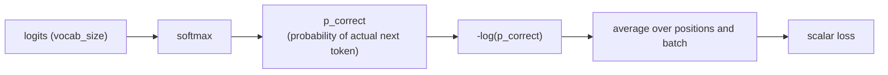

# पाठ 9. Vocabulary पर Cross-Entropy Loss

**मिशन से संबंध:** चरण 4 training loop खोलता है: पूरा forward pass (चरण 1 से 3) logits बनाता है, और यह पाठ उन logits को वह एक scalar संख्या बनाता है जिसके विरुद्ध training असल में model को बेहतर करती है।
**मुख्य स्रोत:** [दस्तावेज़: "torch.nn.functional.cross_entropy", PyTorch](https://pytorch.org/docs/stable/generated/torch.nn.functional.cross_entropy.html)
**पूर्व-आवश्यकताएँ:** [पाठ 8](0008-embedding-output-and-weight-tying.md), [Scaled dot-product attention](../GLOSSARY.md)

## वार्म-अप

1. ▢ Input embedding और output layers दो अलग matrices की ज़रूरत के बजाय एक ही weight matrix (weight tying) क्यों साझा कर सकती हैं?

जाँचें

उनके shapes एक-दूसरे के transpose हैं (`vocab_size × d_model` बनाम `d_model × vocab_size`), और दोनों layers किसी token को एक ही बुनियादी representation से जोड़ती हैं, एक लुकअप के रूप में, दूसरी projection के रूप में, और इसी से दोनों के लिए एक matrix दोबारा इस्तेमाल करना सिर्फ़ shape का संयोग नहीं बल्कि समझदारी भरा चुनाव बनता है।

2. ▢ Causal masking यह कैसे सीमित करती है कि कोई query position किन पर attend कर सकती है?

जाँचें

Position *i* की query सिर्फ़ key positions 0 से *i* तक attend कर सकती है; *i* से बाद की positions को softmax से पहले बड़े ऋणात्मक score से mask किया जाता है, जिससे उनका योगदान असरदार रूप से शून्य हो जाता है।

## यह जानें

### Logits से probability, probability से loss

पाठ 8 की output layer हर position पर `vocab_size` लंबाई का logit vector बनाती है, हर संभव अगले token के लिए एक कच्चा score। Softmax उन logits को उचित probability distribution में बदलता है। फिर training को एक अकेली संख्या चाहिए जो नापे कि वह distribution कितना ग़लत था, यह देखते हुए कि training data में असली अगला token क्या निकला: **cross-entropy loss** वही संख्या है, जो model ने असली सही token को जो probability दी उसके ऋणात्मक log के रूप में compute होती है: `loss = -log(p_correct)`।

### ख़ास तौर पर ऋणात्मक log probability क्यों

सटीक prediction, यानी सही token के लिए probability 1, का loss ठीक 0 होता है। जैसे-जैसे सही token को दी गई probability 0 की ओर सिकुड़ती है, `-log(p)` बिना किसी सीमा के बढ़ता है, यानी आत्मविश्वास से ग़लत prediction के लिए बिना सीमा बढ़ता जुर्माना। सही token के लिए `p = 0.8` की तुलना करें, जो `-log(0.8) ≈ 0.223` देता है, `p = 0.1` से, जो `-log(0.1) ≈ 2.303` देता है: model का आत्मविश्वास सच से जितना दूर जाता है, loss सिर्फ़ linearly नहीं बल्कि तेज़ी से बढ़ता है। `1 - p` जैसा सरल दिखने वाला विकल्प यह गुण नहीं रखता: model आत्मविश्वास से कितना भी ग़लत हो, वह 1 पर saturate हो जाता है, और "कुछ ग़लत" को "विनाशकारी रूप से, आत्मविश्वास से ग़लत" से अलग करने के लिए कोई अतिरिक्त signal नहीं देता। Cross-entropy का logits के प्रति gradient भी साफ़ है, `softmax_output - one_hot_true_label`, एक सरल, संख्यात्मक रूप से सुव्यवहारित व्यंजक जिसे backpropagation (अगला पाठ) सीधे इस्तेमाल कर सकता है, और यही एक वजह है कि softmax और cross-entropy लगभग हमेशा साथ जोड़े जाते हैं और अक्सर एक fused, संख्यात्मक रूप से स्थिर ऑपरेशन के रूप में लागू होते हैं जो सीधे कच्चे logits लेता है, अलग softmax चरण और फिर log की जगह।

### Teacher forcing: हर position का loss, एक ही pass में compute

Training के दौरान model position *i+1* का token सिर्फ़ positions 0 से *i* का इस्तेमाल करके predict करता है, जो ठीक वही है जो causal masking (पाठ 3) पहले से लागू करवाती है। चूँकि causal masking हर position की prediction को एक ही forward pass में एक साथ compute होने देती है, sequence की हर position का loss, जिसमें उस position के predicted distribution की तुलना training data के असली अगले token से होती है, भी उसी एक pass में compute हो सकता है। यही **teacher forcing** है: training हमेशा असली, ground-truth पिछले tokens को context के रूप में देती है, model की अपनी संभवतः ग़लत पिछली predictions को कभी नहीं, जो generation से अलग है, जहाँ model को अनिवार्य रूप से अपने ही पहले generate किए tokens पर निर्भर होना पड़ता है।

### पूरे batch के लिए एक scalar

हर position अपना cross-entropy loss मान बनाती है; इन्हें sequence की हर position और batch की हर sequence पर औसत किया जाता है, जिससे वह एक अकेली scalar संख्या में सिमट जाता है। Backward pass (अगला पाठ) को एक scalar ही चाहिए: gradient descent weights को ऐसी एक संख्या के प्रति update करता है जिसे घटाना है, अलग-अलग loss मानों के पूरे tensor के प्रति नहीं, इसलिए औसत वाला चरण ही "पूरे batch में हर prediction कितनी ग़लत थी" को वह एक मात्रा बनाता है जिसे training असल में optimize करती है।

## अभ्यास

1. ▢ Model एक मामले में सही अगले token को probability 0.8 देता है, और दूसरे में 0.1। हर एक के लिए cross-entropy loss निकालें, और बताएँ कि सही token को दी गई probability गिरने पर loss कैसे बदलता है।

संकेत

`loss = -log(p)`।

जाँचें

`-log(0.8) ≈ 0.223`; `-log(0.1) ≈ 2.303`। सही probability गिरने पर loss linearly नहीं बढ़ता; वह तेज़ी से बढ़ता है, दी गई probability में दस गुना गिरावट पर दस गुना से ज़्यादा, और आत्मविश्वास से ग़लती को सिर्फ़ अनिश्चित prediction से कहीं ज़्यादा कड़ाई से दंडित करता है।

2. ▢ Cross-entropy अपने जुर्माने के लिए `1 - p` जैसी किसी चीज़ की जगह `-log(p)` क्यों इस्तेमाल करता है?

जाँचें

`p` के 0 के क़रीब पहुँचने पर `-log(p)` बिना किसी सीमा के बढ़ता है, यानी आत्मविश्वास से ग़लत prediction के लिए बिना सीमा बढ़ता जुर्माना। `1 - p` दी गई probability के 0 के कितने भी क़रीब पहुँचने पर 1 पर saturate हो जाता है, इसलिए वह सिर्फ़ ग़लत prediction को विनाशकारी रूप से आत्मविश्वासी prediction से उस तरह अलग नहीं कर पाता जैसे `-log(p)` कर सकता है।

3. ▢ Causal masking (पाठ 3) एक sequence की हर position के training loss को प्रति position एक pass की जगह एक ही forward pass में compute करना कैसे संभव बनाती है?

जाँचें

Causal masking पहले से हर position को सिर्फ़ पहले की positions पर attend करने तक सीमित करती है, और positions 0 से *i* से position *i+1* को predict करने के लिए ठीक यही पाबंदी चाहिए। चूँकि हर position की masked attention गणना एक pass में एक साथ चल सकती है, हर position का predicted distribution, और इसलिए असली अगले token के विरुद्ध हर position का loss, भी उसी एक pass में साथ-साथ compute हो सकता है, प्रति position अलग pass की ज़रूरत के बिना।

4. ▢ Training को प्रति-position, प्रति-batch losses को औसत करके एक scalar तक क्यों लाना पड़ता है, अलग-अलग loss मानों के पूरे tensor के साथ सीधे काम करने के बजाय?

जाँचें

Gradient descent model की weights को एक मात्रा घटाने के लिए update करता है; backward pass को gradients निकालने के लिए एक scalar चाहिए, अलग-अलग मानों का पूरा tensor नहीं। औसत "batch में हर prediction कितनी ग़लत थी" को वह एक संख्या बना देता है जिसे training असल में optimize करती है।

5. ▢ Training के दौरान teacher forcing के बारे में कौन-सा दावा सही है?

    - a) Model हर prediction अपने पहले generate किए tokens पर आधारित करता है, जैसा वह inference के दौरान करता है
    - b) Model हर position की prediction training data के असली, ground-truth पिछले tokens पर आधारित करता है, अपनी predictions पर नहीं
    - c) Teacher forcing के लिए sequence की हर position के लिए अलग forward pass चाहिए
    - d) Teacher forcing और causal masking असंबंधित समस्याओं को सँभालते हैं और उनमें एक-दूसरे से कोई जुड़ाव नहीं है

जाँचें

**b)** teacher forcing का ठीक यही मतलब है, और यही training को generation से अलग करता है। (a) ग़लत है: यह inference का वर्णन है, teacher forcing के तहत training का नहीं। (c) ग़लत है: causal masking ही हर position को एक pass में compute होने देती है। (d) ग़लत है: causal masking की प्रति-position पाबंदी ही हर position का teacher-forced loss एक ही pass में compute करना संभव बनाती है।

## असली दुनिया का अभ्यास

- [ ] एक छोटे उदाहरण के लिए cross-entropy loss को कच्चे operations (softmax, फिर सही token की probability का ऋणात्मक log) से लागू करें, और पक्का करें कि वह उन्हीं logits और target पर PyTorch के `F.cross_entropy` से मेल खाता है।
- [ ] किसी training sequence के लिए, मनगढ़ंत logits के छोटे सेट से हर position का प्रति-position loss हाथ से निकालें, फिर उन्हें औसत करके एक scalar बनाएँ।
- [ ] कल: PyTorch के `cross_entropy` के docs पढ़ें और ध्यान दें कि वह कच्चे logits क्यों लेता है, बजाय इसके कि आपको पहले ख़ुद softmax बुलाना पड़े।

## आगे बढ़ने के लिए

- [दस्तावेज़: "torch.nn.functional.cross_entropy", PyTorch](https://pytorch.org/docs/stable/generated/torch.nn.functional.cross_entropy.html)
- [Repo: nanoGPT, Karpathy](https://github.com/karpathy/nanoGPT)
- [संसाधन](../RESOURCES.md)

---

बात नहीं बन रही? ऊपर दिए मुख्य स्रोत को दोबारा पढ़ें, क्योंकि यह पाठ उसे संक्षिप्त करता है और समझ संक्षेप में ही रिसती है। जो शब्द फिसलन भरा लगे, उसके लिए [शब्दावली](../GLOSSARY.md) देखें।

अगर दिक़्क़त सामग्री की नहीं बल्कि पाठ की ही है, तो वह एक खोट है: [issue खोलें](https://github.com/TokenCemetery/teach/issues)।
