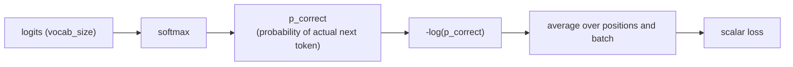

# Lição 9. Loss de cross-entropy sobre o vocabulário

**Ligação com a missão:** A etapa 4 abre o loop de treinamento: o forward pass completo (etapas 1 a 3) produz logits, e esta lição transforma esses logits no único número escalar contra o qual o treinamento de fato melhora o modelo.
**Fonte principal:** [Docs: "torch.nn.functional.cross_entropy", PyTorch](https://pytorch.org/docs/stable/generated/torch.nn.functional.cross_entropy.html)
**Pré-requisitos:** [Lição 8](0008-embedding-output-and-weight-tying.md), [Scaled dot-product attention](../GLOSSARY.md)

## Aquecimento

1. ▢ Por que as camadas de embedding de entrada e de saída podem compartilhar uma única matriz de pesos (weight tying), em vez de precisarem de duas separadas?

Verificação

Os seus formatos são transpostos um do outro (`vocab_size × d_model` contra `d_model × vocab_size`), e as duas camadas relacionam um token com a mesma representação subjacente, uma como busca e a outra como projeção, e é isso que faz reutilizar uma matriz para as duas ser uma escolha sensata, e não só uma coincidência de formato.

2. ▢ Como a máscara causal restringe aquilo a que uma posição de query pode atender?

Verificação

Uma query na posição *i* só pode atender às posições de key de 0 a *i*; as posições posteriores a *i* são mascaradas com um score negativo grande antes do softmax, levando a sua contribuição efetivamente a zero.

## Saiba isto

### Dos logits a uma probabilidade, de uma probabilidade a uma loss

A camada de saída da lição 8 produz um vetor de logits de comprimento `vocab_size` em cada posição, um score bruto por próximo token possível. O softmax transforma esses logits em uma distribuição de probabilidade adequada. O treinamento então precisa de um único número que meça o quão errada essa distribuição estava, dado o que o próximo token real nos dados de treinamento acabou sendo: a **loss de cross-entropy** é esse número, calculado como o log negativo da probabilidade que o modelo atribuiu ao token correto real: `loss = -log(p_correct)`.

### Por que especificamente o log de probabilidade negativo

Uma previsão perfeita, probabilidade 1 para o token correto, dá uma loss de exatamente 0. À medida que a probabilidade atribuída ao token correto encolhe em direção a 0, `-log(p)` cresce sem limite, uma penalidade que aumenta sem limite para uma previsão errada com confiança. Compare `p = 0.8` para o token correto, dando `-log(0.8) ≈ 0.223`, com `p = 0.1`, dando `-log(0.1) ≈ 2.303`: a loss cresce de forma acentuada, e não apenas linear, à medida que a confiança do modelo se afasta da verdade. Uma alternativa de aparência mais simples como `1 - p` não tem essa propriedade: ela satura em 1 não importa quão errado e confiante o modelo esteja, sem dar sinal extra para distinguir "um pouco errado" de "catastroficamente errado com confiança". A cross-entropy também tem um gradiente limpo em relação aos logits, `softmax_output - one_hot_true_label`, uma expressão simples e numericamente bem comportada que a backpropagation (próxima lição) pode usar diretamente, e isso é parte do motivo de softmax e cross-entropy quase sempre andarem juntos e serem muitas vezes implementados como uma única operação fundida e numericamente estável que recebe os logits brutos diretamente, em vez de uma etapa de softmax separada seguida de um log.

### Teacher forcing: a loss de cada posição, calculada em uma só passada

Durante o treinamento, o modelo prevê o token na posição *i+1* usando apenas as posições de 0 a *i*, exatamente o que a máscara causal (lição 3) já impõe. Como a máscara causal permite que a previsão de cada posição seja calculada simultaneamente em um único forward pass, a loss em cada posição da sequência, comparando a distribuição prevista dessa posição com o próximo token real dos dados de treinamento, também pode ser calculada nessa mesma passada única. Isso é o **teacher forcing**: o treinamento sempre alimenta os tokens anteriores verdadeiros, de referência, como contexto, nunca as previsões passadas, possivelmente erradas, do próprio modelo, o que é diferente da geração, em que o modelo necessariamente se condiciona aos tokens que ele mesmo gerou antes.

### Um escalar para o batch inteiro

Cada posição produz o seu próprio valor de loss de cross-entropy; esses valores são tirados em média sobre cada posição da sequência e sobre cada sequência do batch, colapsando em um único número escalar. Um único escalar é o que o backward pass (próxima lição) precisa: o gradient descent atualiza os pesos em relação a um número a minimizar, e não a um tensor inteiro de valores de loss separados, então a etapa de média é o que transforma "o quão errada foi cada previsão ao longo de um batch inteiro" na única quantidade que o treinamento de fato otimiza.

## Prática

1. ▢ O modelo atribui probabilidade 0,8 ao próximo token correto em um caso e 0,1 em outro. Calcule a loss de cross-entropy de cada um e descreva como a loss muda à medida que a probabilidade atribuída ao token correto cai.

Dica

`loss = -log(p)`.

Verificação

`-log(0.8) ≈ 0.223`; `-log(0.1) ≈ 2.303`. A loss não cresce linearmente à medida que a probabilidade correta cai; ela cresce de forma acentuada, mais de dez vezes maior para uma queda de dez vezes na probabilidade atribuída, penalizando o erro confiante de modo muito mais severo do que uma previsão meramente incerta.

2. ▢ Por que a cross-entropy usa `-log(p)` como penalidade em vez de algo como `1 - p`?

Verificação

`-log(p)` cresce sem limite à medida que `p` se aproxima de 0, dando uma penalidade que aumenta sem limite para uma previsão errada com confiança. `1 - p` satura em 1 não importa quão perto de 0 chegue a probabilidade atribuída, então não consegue distinguir uma previsão meramente errada de uma catastroficamente confiante do modo como `-log(p)` consegue.

3. ▢ Como a máscara causal (lição 3) torna possível calcular a loss de treinamento de cada posição de uma sequência com um único forward pass, em vez de uma passada por posição?

Verificação

A máscara causal já restringe cada posição a atender apenas às posições anteriores, que é exatamente a restrição que prever a posição *i+1* a partir das posições de 0 a *i* exige. Como o cálculo de atenção mascarada de cada posição pode rodar simultaneamente em uma passada, a distribuição prevista de cada posição, e portanto a loss de cada posição contra o próximo token verdadeiro, também pode ser calculada em conjunto nessa mesma passada única, em vez de exigir uma passada separada por posição.

4. ▢ Por que o treinamento precisa que as losses por posição e por batch sejam tiradas em média até um único escalar, em vez de trabalhar diretamente com o tensor completo de valores individuais de loss?

Verificação

O gradient descent atualiza os pesos do modelo para minimizar uma quantidade; o backward pass precisa de um único escalar em relação ao qual calcular gradientes, e não de um tensor inteiro de valores separados. A média colapsa "o quão errada foi cada previsão ao longo do batch" naquele único número que o treinamento de fato otimiza.

5. ▢ Qual afirmação é verdadeira sobre o teacher forcing durante o treinamento?

    - a) O modelo condiciona cada previsão aos tokens que ele mesmo gerou antes, do mesmo modo que faz na inferência
    - b) O modelo condiciona a previsão de cada posição aos tokens anteriores verdadeiros, de referência, dos dados de treinamento, e não às suas próprias previsões
    - c) O teacher forcing exige um forward pass separado para cada posição da sequência
    - d) O teacher forcing e a máscara causal tratam de problemas sem relação, sem conexão entre si

Verificação

**b)** É exatamente o que o teacher forcing significa, e é o que distingue o treinamento da geração. (a) é falsa: isso descreve a inferência, e não o treinamento sob teacher forcing. (c) é falsa: a máscara causal é justamente o que permite que cada posição seja calculada em uma passada. (d) é falsa: a restrição por posição da máscara causal é o que torna possível, antes de tudo, calcular a loss com teacher forcing de cada posição em uma única passada.

## Prática no mundo real

- [ ] Implemente a loss de cross-entropy a partir de operações brutas (softmax e depois o log negativo da probabilidade do token correto) para um exemplo pequeno e confirme que ela bate com o `F.cross_entropy` do PyTorch sobre os mesmos logits e o mesmo alvo.
- [ ] Para uma sequência de treinamento, calcule à mão a loss por posição de cada posição a partir de um pequeno conjunto de logits inventados e depois tire a média em um único escalar.
- [ ] Amanhã: leia a documentação do `cross_entropy` do PyTorch e anote por que ela recebe logits brutos em vez de exigir que você chame o softmax antes.

## Para ir além

- [Docs: "torch.nn.functional.cross_entropy", PyTorch](https://pytorch.org/docs/stable/generated/torch.nn.functional.cross_entropy.html)
- [Repositório: nanoGPT, Karpathy](https://github.com/karpathy/nanoGPT)
- [Recursos](../RESOURCES.md)

---

Não ficou claro? Releia a fonte principal no topo, já que esta lição a comprime e é na compressão que o entendimento escapa. Consulte o [glossário](../GLOSSARY.md) para qualquer termo que pareceu escorregadio.

Se o problema é a lição em si, e não o material, isso é um defeito: [abra uma issue](https://github.com/TokenCemetery/teach/issues).
