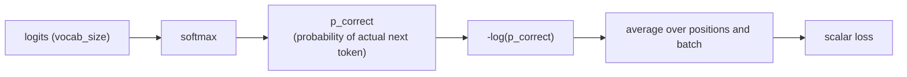

# Урок 9. Кросс-энтропийные потери по словарю

**Связь с целью курса:** Этап 4 открывает цикл обучения: полный прямой проход (этапы 1-3) выдаёт логиты, а этот урок превращает эти логиты в единственное скалярное число, по которому обучение на самом деле улучшает модель.
**Первоисточник:** [Документация: "torch.nn.functional.cross_entropy", PyTorch](https://pytorch.org/docs/stable/generated/torch.nn.functional.cross_entropy.html)
**Предварительные требования:** [Урок 8](0008-embedding-output-and-weight-tying.md), [Масштабированное скалярное внимание](../GLOSSARY.md)

## Разминка

1. ▢ Почему слои входных эмбеддингов и выходной слой могут делить одну матрицу весов (связывание весов), а не требуют двух отдельных?

Проверка

Их формы транспонированы друг относительно друга (`vocab_size × d_model` против `d_model × vocab_size`), и оба слоя связывают токен с одним и тем же базовым представлением, один как поиск, другой как проекция, и именно поэтому повторное использование одной матрицы для обоих разумный выбор, а не просто совпадение форм.

2. ▢ Как каузальное маскирование ограничивает то, на что может обращать внимание позиция запроса?

Проверка

Запрос в позиции *i* может обращать внимание только на позиции ключей от 0 до *i*; позиции позже *i* маскируются большой отрицательной оценкой до softmax, что сводит их вклад практически к нулю.

## Что нужно знать

### От логитов к вероятности, от вероятности к потерям

Выходной слой из урока 8 выдаёт в каждой позиции вектор логитов длины `vocab_size`, по одной «сырой» оценке на каждый возможный следующий токен. Softmax превращает эти логиты в настоящее распределение вероятностей. Затем для обучения нужно одно число, которое измеряет, насколько это распределение ошиблось, с учётом того, каким оказался настоящий следующий токен в обучающих данных: **кросс-энтропийные потери** (cross-entropy loss) и есть это число, вычисляемое как отрицательный логарифм вероятности, которую модель присвоила настоящему верному токену: `loss = -log(p_correct)`.

### Почему именно отрицательный логарифм вероятности

Идеальное предсказание, вероятность 1 для верного токена, даёт потери ровно 0. По мере того как присвоенная верному токену вероятность стремится к 0, `-log(p)` растёт неограниченно: неограниченно возрастающий штраф за уверенно неверное предсказание. Сравните `p = 0.8` для верного токена, что даёт `-log(0.8) ≈ 0.223`, и `p = 0.1`, что даёт `-log(0.1) ≈ 2.303`: потери растут резко, а не просто линейно, по мере того как уверенность модели отдаляется от истины. У более простой на вид альтернативы вроде `1 - p` такого свойства нет: она насыщается на 1, как бы уверенно ни ошибалась модель, и не даёт дополнительного сигнала, который отличал бы «слегка неправа» от «катастрофически, уверенно неправа». У кросс-энтропии также чистый градиент по логитам, `softmax_output - one_hot_true_label`, простое, численно благополучное выражение, которое обратное распространение ошибки (следующий урок) может использовать напрямую, и это отчасти объясняет, почему softmax и кросс-энтропию почти всегда используют вместе и часто реализуют как одну объединённую численно устойчивую операцию, принимающую «сырые» логиты напрямую, а не как отдельный шаг softmax с последующим логарифмом.

### Teacher forcing: потери каждой позиции за один проход

Во время обучения модель предсказывает токен в позиции *i+1*, используя только позиции от 0 до *i*, а это в точности то, что уже обеспечивает каузальное маскирование (урок 3). Поскольку каузальное маскирование позволяет вычислять предсказания всех позиций одновременно за один прямой проход, потери в каждой позиции последовательности, то есть сравнение предсказанного для этой позиции распределения с настоящим следующим токеном из обучающих данных, тоже можно вычислить за этот же один проход. Это и есть **teacher forcing**: при обучении в качестве контекста всегда подаются настоящие, эталонные предыдущие токены, а не собственные, возможно ошибочные, прошлые предсказания модели, и этим оно отличается от генерации, где модель по необходимости опирается на собственные ранее сгенерированные токены.

### Один скаляр на весь батч

Каждая позиция даёт своё значение кросс-энтропийных потерь; их усредняют по всем позициям последовательности и по всем последовательностям в батче, схлопывая в единственное скалярное число. Единственный скаляр это то, что нужно обратному проходу (следующий урок): градиентный спуск обновляет веса по одному числу, которое нужно минимизировать, а не по целому тензору отдельных значений потерь, поэтому шаг усреднения превращает «насколько ошибся каждый прогноз по всему батчу» в одну величину, которую обучение на самом деле оптимизирует.

## Практика

1. ▢ Модель присваивает верному следующему токену вероятность 0.8 в одном случае и 0.1 в другом. Вычислите кросс-энтропийные потери для каждого и опишите, как меняются потери, когда присвоенная верному токену вероятность падает.

Подсказка

`loss = -log(p)`.

Проверка

`-log(0.8) ≈ 0.223`; `-log(0.1) ≈ 2.303`. Потери растут не линейно по мере падения вероятности верного токена, а резко: более чем в десять раз при десятикратном падении присвоенной вероятности, то есть уверенная неправота штрафуется гораздо жёстче, чем просто неуверенное предсказание.

2. ▢ Почему кросс-энтропия использует в качестве штрафа `-log(p)`, а не что-то вроде `1 - p`?

Проверка

`-log(p)` неограниченно растёт, когда `p` приближается к 0, давая неограниченно возрастающий штраф за уверенно неверное предсказание. `1 - p` насыщается на 1 независимо от того, насколько близко к 0 подходит присвоенная вероятность, поэтому не способна отличить просто неверное предсказание от катастрофически уверенного, как это делает `-log(p)`.

3. ▢ Как каузальное маскирование (урок 3) позволяет вычислить потери обучения для каждой позиции последовательности за один прямой проход, а не за один проход на позицию?

Проверка

Каузальное маскирование уже ограничивает каждую позицию вниманием только к более ранним позициям, а это именно то ограничение, которого требует предсказание позиции *i+1* по позициям от 0 до *i*. Поскольку вычисление маскированного внимания каждой позиции можно выполнить одновременно за один проход, предсказанное распределение каждой позиции, а значит, и потери каждой позиции относительно настоящего следующего токена, тоже можно вычислить вместе за этот же один проход, а не отдельным проходом на каждую позицию.

4. ▢ Почему при обучении нужно усреднять потери по позициям и по батчу до единственного скаляра, а не работать напрямую с полным тензором отдельных значений потерь?

Проверка

Градиентный спуск обновляет веса модели, чтобы минимизировать одну величину; обратному проходу нужен единственный скаляр, по которому считать градиенты, а не целый тензор отдельных значений. Усреднение схлопывает «насколько ошибся каждый прогноз по батчу» в то единственное число, которое обучение на самом деле оптимизирует.

5. ▢ Какое утверждение верно о teacher forcing во время обучения?

    - a) Модель опирается при каждом предсказании на собственные ранее сгенерированные токены, так же как при инференсе
    - b) Модель опирается при предсказании каждой позиции на настоящие, эталонные предыдущие токены из обучающих данных, а не на собственные предсказания
    - c) Teacher forcing требует отдельного прямого прохода для каждой позиции последовательности
    - d) Teacher forcing и каузальное маскирование решают несвязанные проблемы, никак не связанные друг с другом

Проверка

**b)** Именно это и означает teacher forcing, и именно этим обучение отличается от генерации. Вариант (a) неверен: это описывает инференс, а не обучение с teacher forcing. Вариант (c) неверен: именно каузальное маскирование позволяет вычислять каждую позицию за один проход. Вариант (d) неверен: ограничение каузального маскирования для каждой позиции как раз и делает возможным вычисление потерь с teacher forcing для каждой позиции за один проход.

## Практика в реальной работе

- [ ] Реализуйте кросс-энтропийные потери из «сырых» операций (softmax, затем отрицательный логарифм вероятности верного токена) для небольшого примера и убедитесь, что они совпадают с `F.cross_entropy` из PyTorch на тех же логитах и целевом токене.
- [ ] Для обучающей последовательности вычислите вручную потери для каждой позиции по небольшому набору выдуманных логитов, а затем усредните их в единый скаляр.
- [ ] Завтра: прочитайте документацию PyTorch по `cross_entropy` и отметьте, почему она принимает «сырые» логиты и не требует вызывать softmax самостоятельно заранее.

## Что почитать дальше

- [Документация: "torch.nn.functional.cross_entropy", PyTorch](https://pytorch.org/docs/stable/generated/torch.nn.functional.cross_entropy.html)
- [Репозиторий: nanoGPT, Karpathy](https://github.com/karpathy/nanoGPT)
- [Ресурсы](../RESOURCES.md)

---

Не доходит? Перечитайте первоисточник в начале: этот урок его сжимает, а при сжатии понимание как раз и теряется. Загляните в [глоссарий](../GLOSSARY.md), если какой-то термин показался скользким.

Если неясен сам урок, а не материал, это дефект: [откройте issue](https://github.com/TokenCemetery/teach/issues).
