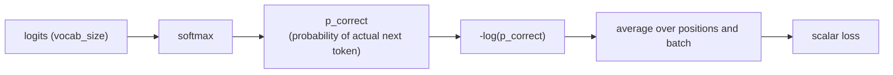

# 第 9 课：词表上的交叉熵损失

**使命关联:** 第 4 阶段开始讲训练循环：完整的前向传播（第 1 至 3 阶段）产生 logits，而本课把这些 logits 变成训练真正用来改进模型的那个单一标量。
**主要来源:** [文档：“torch.nn.functional.cross_entropy”，PyTorch](https://pytorch.org/docs/stable/generated/torch.nn.functional.cross_entropy.html)
**前置知识:** [第 8 课](0008-embedding-output-and-weight-tying.md)、[缩放点积注意力](../GLOSSARY.md)

## 热身

1. ▢ 为什么输入嵌入层和输出层可以共用一个权重矩阵（权重绑定），而不需要两个独立的矩阵？

检查

它们的形状互为转置（`vocab_size × d_model` 对 `d_model × vocab_size`），而且两个层联系的是同一个底层的表示，一个当作查找，另一个当作投影，这才使两者复用一个矩阵成为合理的选择，而不只是形状上的巧合。

2. ▢ 因果掩码如何限制查询位置能关注的范围？

检查

位置 *i* 处的查询只能关注键位置 0 到 *i*；晚于 *i* 的位置在 softmax 之前被加上一个很大的负分数掩码，使它们的贡献实际上为零。

## 要点

### 从 logits 到概率，从概率到损失

第 8 课的输出层在每个位置上产生一个长度为 `vocab_size` 的 logit 向量，每个可能的下一个 token 对应一个原始分数。Softmax 把这些 logits 变成一个正规的概率分布。然后训练需要一个单一的数字，来衡量在训练数据里实际的下一个 token 已经确定的情况下，这个分布错得有多厉害：**交叉熵损失**就是这个数字，计算方式是模型赋给实际正确 token 的概率的负对数：`loss = -log(p_correct)`。

### 为什么偏偏是负对数概率

完美的预测，也就是给正确 token 的概率为 1，损失恰好为 0。随着赋给正确 token 的概率缩小到趋近 0，`-log(p)` 会无界地增长，对一个自信的错误预测给出无界增大的惩罚。比较一下：正确 token 的 `p = 0.8`，得到 `-log(0.8) ≈ 0.223`；而 `p = 0.1`，得到 `-log(0.1) ≈ 2.303`：随着模型的置信度离真相越来越远，损失增长得很急剧，而不只是线性的。像 `1 - p` 这样看起来更简单的替代方案没有这个性质：不论模型错得多自信，它都在 1 处饱和，没有任何额外的信号来区分“有点错”和“错得离谱、还很自信”。交叉熵对 logits 的梯度也很干净，是 `softmax_output - one_hot_true_label`，这是一个简单的、数值上表现良好的表达式，反向传播（下一课）可以直接使用，这也是 softmax 和交叉熵几乎总是搭配在一起、并且常常被实现为一个直接接收原始 logits 的、融合的、数值稳定的运算（而不是先单独做 softmax 再取对数）的部分原因。

### 教师强制：每个位置的损失，一次前向传播里全部算出

训练期间，模型只用位置 0 到 *i* 来预测位置 *i+1* 处的 token，这正是因果掩码（第 3 课）已经强制做到的事。由于因果掩码让每个位置的预测可以在一次前向传播里同时算出，序列中每个位置的损失，也就是把该位置预测的分布与训练数据里实际的下一个 token 相比较，同样可以在这同一次传播里算出。这就是**教师强制**：训练时始终把真实的、基准答案的前面 token 作为上下文送进去，而从不用模型自己可能出错的过往预测，这与生成不同，生成时模型必然要以它自己之前生成的 token 为条件。

### 整个批次一个标量

每个位置都产生它自己的交叉熵损失值；这些值在序列中的每个位置上、以及批次里的每个序列上取平均，最终坍缩成一个单一的标量。反向传播（下一课）需要的正是单个标量：梯度下降是针对一个要最小化的数字来更新权重的，而不是针对一整个张量的各个独立损失值，所以平均这一步，才把“整个批次里每一个预测错得有多厉害”变成训练真正优化的那个量。

## 练习

1. ▢ 模型在一种情形里给正确的下一个 token 赋予概率 0.8，在另一种情形里赋予 0.1。分别计算两者的交叉熵损失，并描述随着赋给正确 token 的概率下降，损失如何变化。

提示

`loss = -log(p)`。

检查

`-log(0.8) ≈ 0.223`；`-log(0.1) ≈ 2.303`。随着正确概率下降，损失并不是线性增长的；它增长得很急剧，赋予的概率下降到十分之一，损失就大了十倍以上，对自信的错误的惩罚，比对仅仅不确定的预测要严厉得多。

2. ▢ 为什么交叉熵用 `-log(p)` 作为它的惩罚，而不是类似 `1 - p` 的东西？

检查

随着 `p` 趋近 0，`-log(p)` 无界地增长，对一个自信的错误预测给出无界增大的惩罚。`1 - p` 不论所赋的概率趋近 0 到什么程度，都在 1 处饱和，所以它无法像 `-log(p)` 那样，区分仅仅是错误的预测与错得离谱又自信的预测。

3. ▢ 因果掩码（第 3 课）如何使得只用一次前向传播，就能算出序列中每个位置的训练损失，而不是每个位置各需一次传播？

检查

因果掩码已经限定每个位置只能关注更早的位置，而这恰好是用位置 0 到 *i* 来预测位置 *i+1* 所需要的约束。由于每个位置的带掩码的注意力计算可以在一次传播里同时运行，每个位置预测的分布，进而每个位置相对于真实下一个 token 的损失，也就可以在这同一次传播里一起算出，而不需要每个位置各自一次传播。

4. ▢ 为什么训练需要把每个位置、每个批次的损失平均成一个单一的标量，而不是直接使用由各个独立损失值构成的完整张量？

检查

梯度下降是为了最小化一个量而更新模型的权重；反向传播需要一个单一的标量来求梯度，而不是一整个张量的各个独立值。平均把“整个批次里每一个预测错得有多厉害”坍缩成训练真正优化的那一个数字。

5. ▢ 关于训练期间的教师强制，下面哪一项说法是对的？

    - a) 模型让每个预测都以它自己之前生成的 token 为条件，与推理时的做法相同
    - b) 模型让每个位置的预测都以训练数据里真实的、基准答案的前面 token 为条件，而不是以它自己的预测为条件
    - c) 教师强制需要对序列中的每个位置各做一次单独的前向传播
    - d) 教师强制和因果掩码处理的是互不相干的问题，彼此没有联系

检查

**b)** 这正是教师强制的含义，也是区分训练与生成的东西。(a) 是错的：那描述的是推理，而不是教师强制下的训练。(c) 是错的：因果掩码恰恰让每个位置可以在一次传播里算出。(d) 是错的：因果掩码逐位置的限制，才使得在一次传播里计算每个位置的教师强制损失成为可能。

## 实战练习

- [ ] 为一个小例子，用原始运算（softmax，再取正确 token 概率的负对数）实现交叉熵损失，并确认它在相同的 logits 和目标上与 PyTorch 的 `F.cross_entropy` 一致。
- [ ] 对一个训练序列，根据一小组自己编的 logits，手算每个位置的逐位置损失，再把它们平均成一个单一的标量。
- [ ] 明天：阅读 PyTorch 的 `cross_entropy` 文档，并记下它为什么接收原始 logits，而不是要求你先自己调用 softmax。

## 延伸阅读

- [文档：“torch.nn.functional.cross_entropy”，PyTorch](https://pytorch.org/docs/stable/generated/torch.nn.functional.cross_entropy.html)
- [仓库：nanoGPT，Karpathy](https://github.com/karpathy/nanoGPT)
- [资源](../RESOURCES.md)

---

没学明白？请重读顶部的主要来源，因为本课是对它的压缩，而理解正是在压缩中流失的。如果有哪个术语觉得含糊，可以查看[术语表](../GLOSSARY.md)。

如果问题出在课程本身，而不是学习材料，那就是一个缺陷：[提交 issue](https://github.com/TokenCemetery/teach/issues)。
