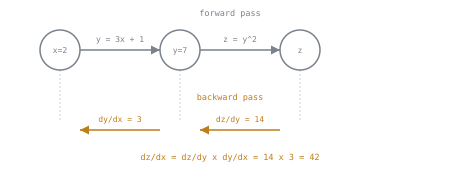

# 第 10 课：反向传播与自动求导

**使命关联:** 第 9 课的标量损失单靠它自己对训练毫无用处；反向传播才把它变成模型里每一个权重的梯度，而这才是优化器（第 11 课）用来改进它们的真正信号。
**主要来源:** [文档：“Autograd mechanics”，PyTorch](https://pytorch.org/docs/stable/notes/autograd.html)
**前置知识:** [第 9 课](0009-cross-entropy-loss.md)、[缩放点积注意力](../GLOSSARY.md)

## 热身

1. ▢ 为什么交叉熵用 `-log(p)`，而不是类似 `1 - p` 的东西，作为对错误预测的惩罚？

检查

随着赋给正确 token 的概率趋近 0，`-log(p)` 无界地增长，对自信的错误的惩罚越来越严厉。不论预测错得多自信，`1 - p` 都在 1 处饱和，没有任何额外的信号来区分仅仅是错误的预测与灾难性的预测。

2. ▢ 为什么残差连接有助于训练一个很深的 Transformer 块堆叠？

检查

它们在每一层通过恒等连接 `+ x` 给梯度一条直接的通路，不论每个子层的变换做了什么，都让一个可用的训练信号能够到达深层堆叠中最靠前的那些层。

## 要点

### 每个前向运算都会记录它是怎么算出来的

前向传播运行时，每一个运算，一次矩阵乘法、一次 softmax、残差连接的一次加法，都会被记录进一个**计算图**：它准确地记录了每个中间张量是由哪个运算、从哪些输入张量产生的。**反向传播**就是沿着这张图倒着走，计算最终的标量损失对每一个对它有贡献的张量的梯度，一直回溯到每一个可训练的权重。

### 链式法则，自动应用

底层的机制不过是微积分里的链式法则，被自动化了：损失对某个张量的梯度，等于图中它下游的每一条路径上的求和，每一项是损失对那个下游张量的梯度，乘以下游张量对这个张量的局部导数。一个具体的数值例子：令 `y = 3x + 1`，`z = y^2`。在 `x = 2` 处，`y = 7`。`dz/dy = 2y = 14`。`dy/dx = 3`。由链式法则，`dz/dx = dz/dy × dy/dx = 14 × 3 = 42`。自动求导做的正是这种乘法和求和，只不过是在一个有数百万乃至数十亿参数的网络里，贯穿每一个运算，而不是只有两个小方程。

### 自动微分，而不是符号微分或数值微分

PyTorch 的 **autograd** 既不是符号微分（手工或借助计算机代数推导出闭式的梯度公式），也不是数值微分（用有限差分近似梯度，这既不精确，又需要对每个参数重新运行很多次前向计算）。相反，每一个基本运算（矩阵乘法、加法、softmax 等）都已经实现了手工推导出的局部反向规则，而 autograd 沿着记录下来的计算图，自动把这些局部规则串联起来，在一次反向遍历中产生精确的梯度。

### 残差连接真正起作用的地方

第 5 课论证了残差连接让梯度能流过深层堆叠；链式法则正是这个论证变成机械过程的地方。对于残差输出 `y = x + Sublayer(x)`，损失对 `x` 的梯度是 `d(loss)/d(y) × 1`（恒等路径的局部导数，恰好是 1），再加上流经 `Sublayer` 自己局部导数的第二项。不论 `Sublayer` 自己的局部导数变得多小、多不规矩，第一项都保证至少有直接的、未经缩放的 `d(loss)/d(y)` 这一份贡献原封不动地传到 `x`。这才是残差连接防止梯度消失的精确的、机械的原因，而不只是对“捷径”的一种非正式直觉。

### 一次调用填满每个参数的梯度

标量损失算出来之后，一次调用 `loss.backward()` 就会遍历整张计算图，并把损失对每个参数的梯度，累加进每个可训练参数的 `.grad` 属性里。梯度默认是**累加**而不是覆盖，会加到 `.grad` 里已有的内容上，这就是训练循环必须在每次新的反向传播之前，显式地把每个参数的梯度清零的原因；否则，每一步的梯度都会被上一步遗留的值污染。

## 练习

1. ▢ 令 `y = 3x + 1`，`z = y^2`。在 `x = 2` 处，用链式法则算出 `y`、`dz/dy`、`dy/dx` 和 `dz/dx`。

提示

`dz/dx = dz/dy × dy/dx`。

检查

`y = 3(2) + 1 = 7`。`dz/dy = 2y = 14`。`dy/dx = 3`。`dz/dx = 14 × 3 = 42`。

2. ▢ 对于残差输出 `y = x + Sublayer(x)`，恒等路径给 `d(loss)/d(x)` 贡献了哪一项？为什么这保证了不论 `Sublayer` 自己的局部导数有多小，都会有一些梯度传到 `x`？

检查

恒等路径贡献的是 `d(loss)/d(y) × 1`，因为恒等连接的局部导数恰好是 1。这一项完全不依赖 `Sublayer` 自己的导数，所以即使 `Sublayer` 对梯度的贡献缩小到趋近于零，直接的、未经缩放的 `d(loss)/d(y)` 仍然通过这条路径传到 `x`。

3. ▢ 为什么训练大型网络时，自动微分（autograd）比数值微分（有限差分）更受青睐？

检查

数值微分通过对每个参数稍微扰动、再重新运行前向传播来近似它的梯度，这既不精确，又需要对每个参数各做一次前向传播，对于有数百万乃至数十亿个权重的网络来说，开销高得毫无希望。Autograd 则是在对记录下来的计算图做一次反向遍历的过程中，利用每个运算已经实现的局部反向规则，为每个参数算出精确的梯度。

4. ▢ 调用 `loss.backward()` 实际上填充了什么？为什么在下一次调用之前，通常必须把梯度清零？

提示

想一想一个已经保存着上一步的值的 `.grad` 属性，会发生什么。

检查

它用损失对每个可训练参数的梯度，填充该参数的 `.grad` 属性，这些梯度是通过遍历记录下来的计算图算出来的。梯度默认是累加而不是覆盖，会加到 `.grad` 里已有的值上；如果在每次新的反向传播之前不显式地把梯度清零，后一步的梯度就会被上一步遗留的值污染。

5. ▢ 关于 autograd 计算梯度的方式，下面哪一项说法是对的？

    - a) 它要求用户为每个运算推导并提供闭式的梯度公式
    - b) 它用有限差分近似梯度，对每个参数稍微做扰动
    - c) 它把前向传播的运算记录进一张计算图，然后利用每个运算已经实现的局部反向规则，自动应用链式法则
    - d) 它只为最后的输出层计算梯度，不为深层堆叠中更靠前的层计算

检查

**c)** 这正是 autograd 的工作方式：不需要手工推导，不需要有限差分近似，只是在一张记录下来的图上自动应用链式法则。(a) 是错的：那描述的是符号微分，而不是 autograd 的方式。(b) 是错的：那描述的是数值微分，autograd 避开了它。(d) 是错的：反向传播的全部意义，就是把梯度一路传回每一层，不论堆叠有多深。

## 实战练习

- [ ] 手工构建一张小的计算图（两三个串联的运算，像例题那样），并验证 PyTorch 的 autograd 产生的梯度与你手算的链式法则结果一致。
- [ ] 运行一次前向传播，中间不清零梯度，连续调用两次 `loss.backward()`，并确认第二次调用后的 `.grad` 值体现的是累加，而不是一个全新的梯度。
- [ ] 明天：阅读主要来源文档里“How autograd encodes the history”一节，并记下在一次全新的前向传播与一次关闭了梯度跟踪的前向传播之间，记录下来的图有什么不同。

## 延伸阅读

- [文档：“Autograd mechanics”，PyTorch](https://pytorch.org/docs/stable/notes/autograd.html)
- [仓库：nanoGPT，Karpathy](https://github.com/karpathy/nanoGPT)
- [资源](../RESOURCES.md)

---

没学明白？请重读顶部的主要来源，因为本课是对它的压缩，而理解正是在压缩中流失的。如果有哪个术语觉得含糊，可以查看[术语表](../GLOSSARY.md)。

如果问题出在课程本身，而不是学习材料，那就是一个缺陷：[提交 issue](https://github.com/TokenCemetery/teach/issues)。
