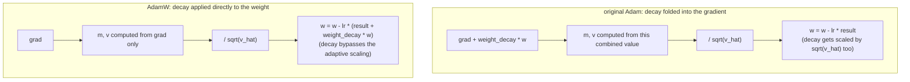

# Lección 11. El paso del optimizador AdamW

**Vínculo con la misión:** Esta es la pieza final de la etapa 4: el backward pass de la lección 10 produce un gradiente para cada peso, y el optimizador es lo que realmente convierte esos gradientes en pesos actualizados, cerrando el círculo que permite que el modelo entrene desde cero.
**Fuente principal:** [Paper: "Decoupled Weight Decay Regularization", Loshchilov and Hutter, 2019](https://arxiv.org/abs/1711.05101)
**Requisitos previos:** [Lección 10](0010-backward-pass-and-autograd.md), [Scaled dot-product attention](../GLOSSARY.md)

## Calentamiento

1. ▢ ¿Qué rellena llamar a `loss.backward()`, y por qué suele haber que poner a cero los gradientes antes de la siguiente llamada?

<details markdown="1"><summary>Comprobación</summary>

Rellena el atributo `.grad` de cada parámetro entrenable con el gradiente de la pérdida respecto de ese parámetro. Los gradientes se acumulan por defecto en lugar de sobrescribirse, así que, sin ponerlos antes a cero, el gradiente de un nuevo backward pass quedaría contaminado por los valores sobrantes del paso anterior.

</details>

2. ▢ ¿Por qué garantiza una conexión residual que algo de gradiente llega a una capa anterior sin importar lo pequeña que sea la derivada local de la subcapa?

<details markdown="1"><summary>Comprobación</summary>

La derivada local del camino identidad es exactamente 1, así que su contribución al gradiente, `d(loss)/d(y) × 1`, no depende en absoluto de la derivada de la subcapa; ese término directo pasa sin escalar sin importar lo que aporte la subcapa.

</details>

## Qué debes saber

### La actualización más simple: el descenso de gradiente simple

El optimizador más básico mueve cada peso un paso pequeño en sentido opuesto a su gradiente: `w = w - lr × grad`, donde `lr` es el **learning rate**. Como el gradiente apunta en la dirección de mayor aumento de la pérdida, restar una versión escalada de él mueve el peso hacia una pérdida menor. Un learning rate demasiado grande se pasa de largo y puede divergir; uno demasiado pequeño hace que el entrenamiento avance a paso de tortuga. El descenso de gradiente simple aplica esta misma regla a cada parámetro, sin memoria de las actualizaciones pasadas y sin distinguir entre parámetros que necesitan pasos grandes o pequeños.

### Momentum: suavizar los gradientes ruidosos por batch

**Adam** mejora esto de dos maneras. Primero, sigue un **primer momento**, `m`, un promedio móvil con decaimiento exponencial de los gradientes pasados: `m = beta1 × m + (1 - beta1) × grad`. En lugar de reaccionar al gradiente de cada batch de forma aislada, que es ruidoso porque distintos batches producen gradientes algo distintos, la actualización sigue este promedio móvil suavizado, lo que permite al optimizador acumular una "velocidad" constante en una dirección hacia la que el gradiente ha apuntado repetidamente, en lugar de temblar con el ruido individual de cada batch.

### Escalado adaptativo: un tamaño de paso por parámetro

Segundo, Adam sigue un **segundo momento**, `v`, un promedio móvil con decaimiento exponencial del gradiente al cuadrado: `v = beta2 × v + (1 - beta2) × grad^2`. Esto estima la magnitud típica del gradiente de cada parámetro. Dividir la actualización por `sqrt(v)` da un paso efectivo relativamente mayor a un parámetro cuyos gradientes suelen ser pequeños, y relativamente menor a uno cuyos gradientes suelen ser grandes, adaptando el tamaño del paso por parámetro en lugar de usar un único learning rate fijo para cada peso del modelo. La actualización completa, con corrección de sesgo (`m_hat`, `v_hat`, que corrige que `m` y `v` empiezan ambos en cero y están sesgados hacia cero al principio del entrenamiento) y una pequeña constante `eps` para evitar dividir por cero, es:

```text
w = w - lr × m_hat / (sqrt(v_hat) + eps)
```

### La corrección de AdamW: desacoplar el weight decay de la actualización adaptativa

El **weight decay** es una técnica de regularización que encoge ligeramente hacia cero cada peso en cada paso, lo que desalienta los pesos demasiado grandes y en general ayuda a la generalización. La manera original de añadirlo a Adam lo incorporaba directamente al gradiente antes de calcular `m` y `v`: en la práctica, sumaba `weight_decay × w` a `grad`. Eso interactúa mal con el escalado adaptativo de Adam: el propio término de decay se divide entonces por `sqrt(v_hat)` junto con el resto del gradiente, así que a un parámetro con gradientes típicos grandes se le encoge su decay, y a uno con gradientes típicos pequeños se le amplifica, y ninguna de las dos cosas es el encogimiento fijo y uniforme que se supone que aplica el weight decay. **AdamW** lo corrige aplicando el weight decay directamente a los pesos, por separado de la actualización de Adam basada en el gradiente:

```text
w = w - lr × (m_hat / (sqrt(v_hat) + eps) + weight_decay × w)
```

El término de decay se suma a la actualización directamente, sin pasar nunca por `m`, `v` ni por el denominador adaptativo, que es exactamente por lo que AdamW ("W" de weight decay), y no Adam simple, es el optimizador estándar para entrenar transformers.



## Práctica

1. ▢ Con descenso de gradiente simple, un peso es `w = 5.0`, su gradiente es `2.0` y el learning rate es `0.1`. Calcula el peso actualizado.

<details markdown="1"><summary>Pista</summary>

`w = w - lr × grad`.

</details>

<details markdown="1"><summary>Comprobación</summary>

`w = 5.0 - 0.1 × 2.0 = 5.0 - 0.2 = 4.8`.

</details>

2. ▢ ¿Por qué ayuda seguir un promedio móvil de los gradientes pasados (el primer momento de Adam, `m`) en comparación con usar directamente el gradiente en bruto de cada batch?

<details markdown="1"><summary>Comprobación</summary>

Cada batch produce gradientes ruidosos que varían algo de un batch a otro. Un promedio móvil suaviza ese ruido, y deja que la actualización siga la dirección hacia la que el gradiente ha apuntado de forma consistente a lo largo de los pasos recientes, en lugar de reaccionar a la fluctuación individual de cada batch.

</details>

3. ▢ ¿Por qué ayuda dividir la actualización por `sqrt(v)`, el segundo momento de Adam, a parámetros que tienen magnitudes de gradiente típicas distintas?

<details markdown="1"><summary>Comprobación</summary>

`v` estima la magnitud típica del gradiente al cuadrado de cada parámetro. Dividir por su raíz cuadrada escala la actualización de forma inversa a esa magnitud, y da un paso efectivo relativamente mayor a un parámetro con gradientes normalmente pequeños y relativamente menor a uno con gradientes normalmente grandes, en lugar de obligar a todos los parámetros a usar el mismo tamaño de paso fijo sin importar lo grandes que suelan ser sus gradientes.

</details>

4. ▢ ¿Qué sale mal al incorporar el weight decay directamente al gradiente en el Adam original, y qué hace distinto AdamW?

<details markdown="1"><summary>Comprobación</summary>

Incorporar el weight decay al gradiente significa que se divide por `sqrt(v_hat)` junto con el resto de la actualización, así que el decay de un parámetro acaba encogido o amplificado según su magnitud de gradiente típica, en lugar de aplicar el mismo encogimiento fraccionario fijo que el weight decay pretende dar. AdamW aplica el weight decay directamente a los pesos, sumado a la actualización por separado del término basado en el gradiente, de modo que nunca pasa por el escalado adaptativo.

</details>

5. ▢ ¿Qué afirmación es cierta de AdamW en comparación con el descenso de gradiente simple y el Adam original?

    - a) AdamW usa el mismo tamaño de paso fijo para cada parámetro, igual que el descenso de gradiente simple
    - b) AdamW añade momentum y escalado adaptativo por parámetro como Adam, pero aplica el weight decay directamente a los pesos en lugar de incorporarlo al gradiente
    - c) AdamW elimina por completo el escalado adaptativo por parámetro y se apoya solo en el momentum
    - d) El weight decay de AdamW se escala por el mismo denominador adaptativo que la actualización basada en el gradiente

<details markdown="1"><summary>Comprobación</summary>

**b)** Ese desacoplamiento es exactamente lo que distingue a AdamW del Adam original, conservando el momentum y el escalado adaptativo de Adam. (a) es falsa: el escalado adaptativo por parámetro es justo lo que le falta al descenso de gradiente simple y lo que añaden Adam y AdamW. (c) es falsa: AdamW conserva tanto el momentum como el escalado adaptativo. (d) es falsa: ese es el problema del Adam original que AdamW corrige específicamente mediante el desacoplamiento.

</details>

## Prácticas en el mundo real

- [ ] Implementa el descenso de gradiente simple, luego Adam y luego AdamW a partir de operaciones en bruto para un pequeño conjunto de parámetros, y confirma que cada versión sucesiva cambia la actualización de la manera que describe esta lección.
- [ ] Ejecuta unos cuantos pasos de entrenamiento con el weight decay incorporado al gradiente (estilo del Adam original) frente a aplicado directamente (estilo AdamW) sobre el mismo modelo pequeño, y compara cómo evolucionan las magnitudes de los pesos.
- [ ] Mañana: comprueba qué optimizador e hiperparámetros (learning rate, weight decay, beta1, beta2) usa realmente un script de entrenamiento real al que tengas acceso (como el de nanoGPT).

## Para profundizar

- [Paper: "Decoupled Weight Decay Regularization", Loshchilov and Hutter, 2019](https://arxiv.org/abs/1711.05101)
- [Paper: "Adam: A Method for Stochastic Optimization", Kingma and Ba, 2015](https://arxiv.org/abs/1412.6980)
- [Recursos](../RESOURCES.md)

---

¿No termina de quedar claro? Vuelve a leer la fuente primaria de arriba, ya que esta lección la comprime y en la compresión es donde se escapa la comprensión. Consulta el [glosario](../GLOSSARY.md) por si algún término te resultó resbaladizo.

Si lo poco claro es la propia lección y no el material, eso es un defecto: [abre un issue](https://github.com/TokenCemetery/teach/issues).
