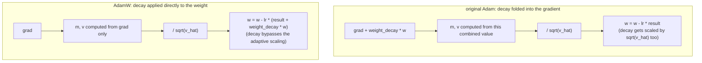

# Leçon 11. Le pas de l'optimiseur AdamW

**Lien avec la mission :** C'est la leçon de clôture de l'étape 4 : la passe arrière de la leçon 10 produit un gradient pour chaque poids, et l'optimiseur est ce qui transforme réellement ces gradients en poids mis à jour, ce qui boucle la boucle permettant au modèle de s'entraîner à partir de zéro.
**Source primaire :** [Article : "Decoupled Weight Decay Regularization", Loshchilov et Hutter, 2019](https://arxiv.org/abs/1711.05101)
**Prérequis :** [Leçon 10](0010-backward-pass-and-autograd.md), [Scaled dot-product attention](../GLOSSARY.md)

## Échauffement

1. ▢ Qu'est-ce qu'un appel à `loss.backward()` remplit, et pourquoi les gradients doivent-ils généralement être remis à zéro avant l'appel suivant ?

<details markdown="1"><summary>Vérifier</summary>

Il remplit l'attribut `.grad` de chaque paramètre entraînable avec le gradient de la loss par rapport à ce paramètre. Les gradients s'accumulent par défaut au lieu d'écraser, donc sans remise à zéro préalable, le gradient d'une nouvelle passe arrière serait contaminé par les valeurs résiduelles du pas précédent.

</details>

2. ▢ Pourquoi une connexion résiduelle garantit-elle qu'un peu de gradient atteint une couche antérieure, quelle que soit la petitesse de la dérivée locale de la sous-couche ?

<details markdown="1"><summary>Vérifier</summary>

La dérivée locale du chemin identité vaut exactement 1, donc sa contribution au gradient, `d(loss)/d(y) × 1`, ne dépend pas du tout de la dérivée de la sous-couche ; ce terme direct passe sans mise à l'échelle quelle que soit la contribution de la sous-couche.

</details>

## À savoir

### La mise à jour la plus simple : la descente de gradient simple

L'optimiseur le plus élémentaire déplace chaque poids d'un petit pas dans le sens opposé à son gradient : `w = w - lr × grad`, où `lr` est le **learning rate**. Comme le gradient pointe dans la direction de la plus forte augmentation de la loss, en soustraire une version mise à l'échelle déplace le poids vers une loss plus basse. Un learning rate trop grand dépasse la cible et peut diverger ; trop petit, il fait ramper l'entraînement. La descente de gradient simple applique cette même règle à chaque paramètre, sans mémoire des mises à jour passées et sans distinguer les paramètres qui ont besoin de grands pas de ceux qui ont besoin de petits pas.

### Le momentum : lisser les gradients bruités de chaque batch

**Adam** améliore cela de deux façons. D'abord, il suit un **premier moment**, `m`, une moyenne mobile à décroissance exponentielle des gradients passés : `m = beta1 × m + (1 - beta1) × grad`. Au lieu de réagir isolément au gradient de chaque batch, qui est bruité puisque des batchs différents produisent des gradients un peu différents, la mise à jour suit cette moyenne mobile lissée, ce qui permet à l'optimiseur de prendre de la « vitesse » de façon cohérente dans une direction vers laquelle le gradient a pointé à plusieurs reprises, au lieu de trembler au gré du bruit propre à chaque batch.

### La mise à l'échelle adaptative : une taille de pas par paramètre

Ensuite, Adam suit un **second moment**, `v`, une moyenne mobile à décroissance exponentielle du carré du gradient : `v = beta2 × v + (1 - beta2) × grad^2`. Il estime l'amplitude typique du gradient de chaque paramètre. Diviser la mise à jour par `sqrt(v)` donne un pas effectif relativement plus grand à un paramètre dont les gradients sont habituellement petits, et relativement plus petit à un paramètre dont les gradients sont habituellement grands, en adaptant la taille du pas par paramètre au lieu d'utiliser un seul learning rate fixe pour chaque poids du modèle. La mise à jour complète, avec la correction de biais (`m_hat`, `v_hat`, qui corrigent le fait que `m` et `v` démarrent à zéro et sont biaisés vers zéro au début de l'entraînement) et une petite constante `eps` pour éviter de diviser par zéro, est :

```text
w = w - lr × m_hat / (sqrt(v_hat) + eps)
```

### La correction d'AdamW : découpler le weight decay de la mise à jour adaptative

Le **weight decay** (décroissance des poids) est une technique de régularisation qui rapproche légèrement chaque poids de zéro à chaque pas, décourageant les poids trop grands et aidant en général la généralisation. La manière d'origine de l'ajouter à Adam l'intégrait directement au gradient avant le calcul de `m` et de `v` : on ajoute en pratique `weight_decay × w` à `grad`. Cela interagit mal avec la mise à l'échelle adaptative d'Adam : le terme de décroissance est alors lui-même divisé par `sqrt(v_hat)` avec le reste du gradient, si bien qu'un paramètre aux gradients typiquement grands voit sa décroissance réduite, et un paramètre aux gradients typiquement petits voit la sienne amplifiée, alors que le weight decay est censé appliquer un rétrécissement fixe et uniforme. **AdamW** corrige cela en appliquant le weight decay directement aux poids, séparément de la mise à jour d'Adam fondée sur le gradient :

```text
w = w - lr × (m_hat / (sqrt(v_hat) + eps) + weight_decay × w)
```

Le terme de décroissance est ajouté directement à la mise à jour, sans jamais passer par `m`, `v` ni le dénominateur adaptatif, ce qui explique précisément pourquoi AdamW (« W » pour weight decay) plutôt qu'Adam simple est l'optimiseur standard pour entraîner les transformers.



## Pratique

1. ▢ Avec la descente de gradient simple, un poids vaut `w = 5.0`, son gradient `2.0` et le learning rate `0.1`. Calculez le poids mis à jour.

<details markdown="1"><summary>Indice</summary>

`w = w - lr × grad`.

</details>

<details markdown="1"><summary>Vérifier</summary>

`w = 5.0 - 0.1 × 2.0 = 5.0 - 0.2 = 4.8`.

</details>

2. ▢ Pourquoi suivre une moyenne mobile des gradients passés (le premier moment `m` d'Adam) aide-t-il par rapport à l'usage direct du gradient brut de chaque batch ?

<details markdown="1"><summary>Vérifier</summary>

Chaque batch produit un gradient bruité qui varie un peu d'un batch à l'autre. Une moyenne mobile lisse ce bruit, ce qui permet à la mise à jour de suivre la direction vers laquelle le gradient a pointé de façon constante sur les pas récents, au lieu de réagir à la fluctuation propre à chaque batch.

</details>

3. ▢ Pourquoi diviser la mise à jour par `sqrt(v)`, le second moment d'Adam, aide-t-il les paramètres dont les amplitudes de gradient typiques diffèrent ?

<details markdown="1"><summary>Vérifier</summary>

`v` estime l'amplitude typique du carré du gradient de chaque paramètre. Diviser par sa racine carrée met la mise à jour à l'échelle de façon inversement proportionnelle à cette amplitude, ce qui donne un pas effectif relativement plus grand à un paramètre dont les gradients sont habituellement petits et relativement plus petit à un paramètre dont les gradients sont habituellement grands, au lieu de forcer chaque paramètre à utiliser la même taille de pas fixe quelle que soit l'ampleur typique de ses gradients.

</details>

4. ▢ Qu'est-ce qui ne va pas quand on intègre directement le weight decay au gradient dans l'Adam d'origine, et que fait AdamW différemment ?

<details markdown="1"><summary>Vérifier</summary>

Intégrer le weight decay au gradient revient à le diviser par `sqrt(v_hat)` avec le reste de la mise à jour, de sorte que la décroissance d'un paramètre est réduite ou amplifiée selon l'amplitude typique de son gradient, au lieu d'appliquer le même rétrécissement fractionnaire fixe que le weight decay est censé fournir. AdamW applique le weight decay directement aux poids, ajouté à la mise à jour séparément du terme fondé sur le gradient, si bien qu'il ne passe jamais par la mise à l'échelle adaptative.

</details>

5. ▢ Quelle affirmation est vraie d'AdamW par rapport à la descente de gradient simple et à l'Adam d'origine ?

    - a) AdamW utilise la même taille de pas fixe pour chaque paramètre, comme la descente de gradient simple
    - b) AdamW ajoute le momentum et la mise à l'échelle adaptative par paramètre comme Adam, mais applique le weight decay directement aux poids au lieu de l'intégrer au gradient
    - c) AdamW supprime entièrement la mise à l'échelle adaptative par paramètre et ne s'appuie que sur le momentum
    - d) Le weight decay d'AdamW est mis à l'échelle par le même dénominateur adaptatif que la mise à jour fondée sur le gradient

<details markdown="1"><summary>Vérifier</summary>

**b)** Ce découplage est exactement ce qui distingue AdamW de l'Adam d'origine, tout en conservant le momentum et la mise à l'échelle adaptative d'Adam. (a) est faux : la mise à l'échelle adaptative par paramètre est précisément ce qui manque à la descente de gradient simple et qu'Adam et AdamW ajoutent. (c) est faux : AdamW conserve à la fois le momentum et la mise à l'échelle adaptative. (d) est faux : c'est le problème de l'Adam d'origine qu'AdamW corrige précisément en découplant.

</details>

## Exercices en situation réelle

- [ ] Implémentez la descente de gradient simple, puis Adam, puis AdamW à partir d'opérations brutes pour un petit ensemble de paramètres, et vérifiez que chaque version successive modifie la mise à jour comme le décrit cette leçon.
- [ ] Exécutez quelques pas d'entraînement avec le weight decay intégré au gradient (style Adam d'origine) puis appliqué directement (style AdamW) sur le même petit modèle, et comparez l'évolution de l'amplitude des poids.
- [ ] Demain : vérifiez quel optimiseur et quels hyperparamètres (learning rate, weight decay, beta1, beta2) utilise réellement un vrai script d'entraînement auquel vous avez accès (comme celui de nanoGPT).

## Pour aller plus loin

- [Article : "Decoupled Weight Decay Regularization", Loshchilov et Hutter, 2019](https://arxiv.org/abs/1711.05101)
- [Article : "Adam: A Method for Stochastic Optimization", Kingma et Ba, 2015](https://arxiv.org/abs/1412.6980)
- [Ressources](../RESOURCES.md)

---

Ça ne passe pas ? Relisez la source primaire en haut de page, car cette leçon la condense et c'est dans la condensation que la compréhension s'échappe. Consultez le [glossaire](../GLOSSARY.md) pour tout terme qui vous a paru glissant.

Si c'est la leçon elle-même qui n'est pas claire plutôt que la matière, c'est un défaut : [ouvrez une issue](https://github.com/TokenCemetery/teach/issues).
