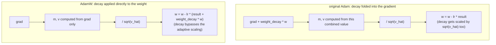

# पाठ 11. AdamW Optimizer Step

**मिशन से संबंध:** यह चरण 4 का समापन है: पाठ 10 का backward pass हर weight के लिए gradient बनाता है, और optimizer ही उन gradients को असल में अपडेट की हुई weights में बदलता है, और वही चक्र पूरा करता है जिससे model शुरू से train हो सकता है।
**मुख्य स्रोत:** [पेपर: "Decoupled Weight Decay Regularization", Loshchilov and Hutter, 2019](https://arxiv.org/abs/1711.05101)
**पूर्व-आवश्यकताएँ:** [पाठ 10](0010-backward-pass-and-autograd.md), [Scaled dot-product attention](../GLOSSARY.md)

## वार्म-अप

1. ▢ `loss.backward()` बुलाने से क्या भरता है, और अगली call से पहले gradients को आम तौर पर शून्य क्यों करना पड़ता है?

<details markdown="1"><summary>जाँचें</summary>

वह हर train हो सकने वाले parameter के `.grad` attribute को उस parameter के प्रति loss के gradient से भरता है। Gradients डिफ़ॉल्ट रूप से overwrite होने के बजाय accumulate होते हैं, इसलिए पहले शून्य किए बिना, नए backward pass का gradient पिछले step के बचे हुए मानों से दूषित हो जाता।

</details>

2. ▢ Residual connection यह गारंटी क्यों देता है कि sublayer का अपना स्थानीय derivative कितना भी छोटा हो, किसी पहले की layer तक कुछ gradient पहुँचता है?

<details markdown="1"><summary>जाँचें</summary>

Identity path का स्थानीय derivative ठीक 1 है, इसलिए gradient में उसका योगदान, `d(loss)/d(y) × 1`, sublayer के derivative पर बिल्कुल निर्भर नहीं करता; वह सीधा पद बिना scale हुए गुज़रता है, sublayer चाहे जो योगदान दे।

</details>

## यह जानें

### सबसे सरल update: सादा gradient descent

सबसे बुनियादी optimizer हर weight को उसके gradient के उलट एक छोटा क़दम चलाता है: `w = w - lr × grad`, जहाँ `lr` **learning rate** है। चूँकि gradient loss में सबसे तेज़ बढ़त की दिशा में इशारा करता है, उसका scale किया हुआ रूप घटाने से weight कम loss की ओर बढ़ती है। Learning rate बहुत बड़ा हो तो क़दम आगे निकल जाता है और diverge हो सकता है; बहुत छोटा हो तो training रेंगती है। सादा gradient descent यही एक नियम हर parameter पर लगाता है, पिछले updates की कोई याद रखे बिना और इस भेद के बिना कि किन parameters को बड़े या छोटे क़दम चाहिए।

### Momentum: शोर वाले प्रति-batch gradients को चिकना करना

**Adam** इसे दो तरीक़ों से सुधारता है। पहला, वह एक **first moment**, `m`, ट्रैक करता है, जो पिछले gradients का exponentially घटता चलता औसत है: `m = beta1 × m + (1 - beta1) × grad`। हर batch के gradient पर अलग-अलग प्रतिक्रिया करने के बजाय, जो शोर वाला होता है क्योंकि अलग-अलग batches कुछ अलग gradients बनाते हैं, update इस चिकने किए चलते औसत का अनुसरण करता है, जिससे optimizer उस दिशा में एकसमान "वेग" बना पाता है जिस ओर gradient बार-बार इशारा करता रहा है, हर batch के अलग शोर के साथ काँपने के बजाय।

### Adaptive scaling: प्रति-parameter क़दम का आकार

दूसरा, Adam एक **second moment**, `v`, ट्रैक करता है, जो gradient के वर्ग का exponentially घटता चलता औसत है: `v = beta2 × v + (1 - beta2) × grad^2`। यह हर parameter के सामान्य gradient परिमाण का अनुमान देता है। Update को `sqrt(v)` से भाग देने पर जिस parameter के gradients आम तौर पर छोटे होते हैं उसे अपेक्षाकृत बड़ा असरदार क़दम मिलता है, और जिसके gradients आम तौर पर बड़े होते हैं उसे अपेक्षाकृत छोटा, यानी model की हर weight के लिए एक ही तय learning rate की जगह क़दम का आकार प्रति parameter ढलता है। पूरा update, bias correction के साथ (`m_hat`, `v_hat`, जो इस बात को सुधारते हैं कि `m` और `v` दोनों शून्य से शुरू होते हैं और training में शुरू में शून्य की ओर झुके होते हैं) और शून्य से भाग से बचने के लिए एक छोटे स्थिरांक `eps` के साथ, यह है:

```text
w = w - lr × m_hat / (sqrt(v_hat) + eps)
```

### AdamW का सुधार: weight decay को adaptive update से अलग करना

**Weight decay** एक regularization तकनीक है जो हर step पर हर weight को थोड़ा शून्य की ओर सिकोड़ती है, बहुत बड़ी weights को हतोत्साहित करती है और आम तौर पर generalization में मदद करती है। इसे Adam में जोड़ने का मूल तरीक़ा उसे `m` और `v` compute करने से पहले सीधे gradient में मिला देता था: असल में `grad` में `weight_decay × w` जोड़ना। यह Adam की adaptive scaling के साथ बुरी तरह टकराता है: decay का पद ख़ुद भी gradient के बाक़ी हिस्से के साथ `sqrt(v_hat)` से भाग खाता है, इसलिए जिस parameter के सामान्य gradients बड़े हैं उसका decay सिकुड़ जाता है, और जिसके छोटे हैं उसका बढ़ जाता है, जबकि weight decay से जो तय, एकसमान सिकुड़न की उम्मीद है उनमें से कोई भी वैसा नहीं है। **AdamW** इसे ठीक करता है: weight decay को सीधे weights पर लगाकर, gradient-आधारित Adam update से अलग:

```text
w = w - lr × (m_hat / (sqrt(v_hat) + eps) + weight_decay × w)
```

Decay का पद update में सीधे जोड़ा जाता है, `m`, `v` या adaptive हर से कभी नहीं गुज़रता, और इसीलिए transformers को train करने का मानक optimizer सादा Adam नहीं बल्कि AdamW ("W" यानी weight decay) है।



## अभ्यास

1. ▢ सादे gradient descent में एक weight `w = 5.0` है, उसका gradient `2.0` है, और learning rate `0.1` है। अपडेट की हुई weight निकालें।

<details markdown="1"><summary>संकेत</summary>

`w = w - lr × grad`।

</details>

<details markdown="1"><summary>जाँचें</summary>

`w = 5.0 - 0.1 × 2.0 = 5.0 - 0.2 = 4.8`।

</details>

2. ▢ हर batch का कच्चा gradient सीधे इस्तेमाल करने की तुलना में पिछले gradients का चलता औसत (Adam का first moment, `m`) ट्रैक करना क्यों मदद करता है?

<details markdown="1"><summary>जाँचें</summary>

अलग-अलग batches शोर वाले gradients बनाते हैं जो batch-दर-batch कुछ बदलते हैं। चलता औसत उस शोर को चिकना कर देता है, और update उस दिशा का अनुसरण कर पाता है जिस ओर gradient हाल के steps में लगातार इशारा करता रहा है, हर batch के अलग उतार-चढ़ाव पर प्रतिक्रिया करने के बजाय।

</details>

3. ▢ Update को `sqrt(v)`, Adam के second moment, से भाग देना उन parameters की मदद क्यों करता है जिनके सामान्य gradient परिमाण अलग-अलग हैं?

<details markdown="1"><summary>जाँचें</summary>

`v` हर parameter के सामान्य gradient-वर्ग परिमाण का अनुमान देता है। उसके वर्गमूल से भाग देने पर update उस परिमाण के विपरीत अनुपात में scale होता है, जिससे आम तौर पर छोटे gradients वाले parameter को अपेक्षाकृत बड़ा असरदार क़दम और आम तौर पर बड़े gradients वाले को अपेक्षाकृत छोटा क़दम मिलता है, बजाय इसके कि हर parameter को एक ही तय क़दम का आकार इस्तेमाल करना पड़े, भले ही उसके gradients आम तौर पर कितने भी बड़े हों।

</details>

4. ▢ मूल Adam में weight decay को सीधे gradient में मिला देने में क्या गड़बड़ होती है, और AdamW अलग क्या करता है?

<details markdown="1"><summary>जाँचें</summary>

Weight decay को gradient में मिला देने का मतलब है कि वह update के बाक़ी हिस्से के साथ `sqrt(v_hat)` से भाग खाता है, इसलिए किसी parameter का decay उसके सामान्य gradient परिमाण के हिसाब से सिकुड़ या बढ़ जाता है, बजाय उस तय अनुपाती सिकुड़न के जो weight decay देने के लिए बना है। AdamW weight decay को सीधे weights पर लगाता है, gradient-आधारित पद से अलग update में जोड़कर, इसलिए वह adaptive scaling से कभी गुज़रता ही नहीं।

</details>

5. ▢ सादे gradient descent और मूल Adam की तुलना में AdamW के बारे में कौन-सा दावा सही है?

    - a) AdamW हर parameter के लिए वही तय क़दम का आकार इस्तेमाल करता है, सादे gradient descent की तरह
    - b) AdamW Adam की तरह momentum और प्रति-parameter adaptive scaling जोड़ता है, पर weight decay को gradient में मिलाने के बजाय सीधे weights पर लगाता है
    - c) AdamW प्रति-parameter adaptive scaling पूरी तरह हटा देता है, सिर्फ़ momentum पर निर्भर करते हुए
    - d) AdamW में weight decay उसी adaptive हर से scale होता है जिससे gradient-आधारित update

<details markdown="1"><summary>जाँचें</summary>

**b)** यही अलगाव AdamW को मूल Adam से अलग करता है, जबकि Adam का momentum और adaptive scaling बना रहता है। (a) ग़लत है: प्रति-parameter adaptive scaling ठीक वही है जो सादे gradient descent में नहीं है और Adam/AdamW जोड़ते हैं। (c) ग़लत है: AdamW momentum और adaptive scaling दोनों रखता है। (d) ग़लत है: यही मूल Adam की समस्या है जिसे AdamW अलग करके ठीक करता है।

</details>

## असली दुनिया का अभ्यास

- [ ] Parameters के छोटे सेट के लिए सादे gradient descent, फिर Adam, फिर AdamW को कच्चे operations से लागू करें, और पक्का करें कि हर अगला संस्करण update को उस तरह बदलता है जैसा यह पाठ बताता है।
- [ ] उसी छोटे model पर कुछ training steps weight decay को gradient में मिलाकर (मूल Adam शैली) बनाम सीधे लगाकर (AdamW शैली) चलाएँ, और तुलना करें कि weights के परिमाण कैसे बदलते हैं।
- [ ] कल: जाँचें कि आपकी पहुँच वाली किसी असली training script (जैसे nanoGPT की) में कौन-सा optimizer और hyperparameters (learning rate, weight decay, beta1, beta2) असल में इस्तेमाल होते हैं।

## आगे बढ़ने के लिए

- [पेपर: "Decoupled Weight Decay Regularization", Loshchilov and Hutter, 2019](https://arxiv.org/abs/1711.05101)
- [पेपर: "Adam: A Method for Stochastic Optimization", Kingma and Ba, 2015](https://arxiv.org/abs/1412.6980)
- [संसाधन](../RESOURCES.md)

---

बात नहीं बन रही? ऊपर दिए मुख्य स्रोत को दोबारा पढ़ें, क्योंकि यह पाठ उसे संक्षिप्त करता है और समझ संक्षेप में ही रिसती है। जो शब्द फिसलन भरा लगे, उसके लिए [शब्दावली](../GLOSSARY.md) देखें।

अगर दिक़्क़त सामग्री की नहीं बल्कि पाठ की ही है, तो वह एक खोट है: [issue खोलें](https://github.com/TokenCemetery/teach/issues)।
