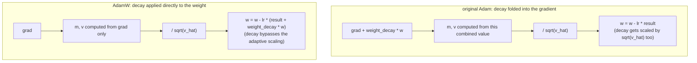

# Lição 11. O passo do otimizador AdamW

**Ligação com a missão:** Esta é a lição de fechamento da etapa 4: o backward pass da lição 10 produz um gradiente para cada peso, e o otimizador é o que de fato transforma esses gradientes em pesos atualizados, fechando o ciclo que permite ao modelo treinar do zero.
**Fonte principal:** [Artigo científico: "Decoupled Weight Decay Regularization", Loshchilov e Hutter, 2019](https://arxiv.org/abs/1711.05101)
**Pré-requisitos:** [Lição 10](0010-backward-pass-and-autograd.md), [Scaled dot-product attention](../GLOSSARY.md)

## Aquecimento

1. ▢ O que chamar `loss.backward()` preenche e por que os gradientes normalmente precisam ser zerados antes da próxima chamada?

<details markdown="1"><summary>Verificação</summary>

Ela preenche o atributo `.grad` de cada parâmetro treinável com o gradiente da loss em relação a esse parâmetro. Os gradientes se acumulam por padrão, em vez de sobrescrever, então, sem zerar antes, o gradiente de um novo backward pass seria contaminado pelos valores remanescentes do passo anterior.

</details>

2. ▢ Por que uma conexão residual garante que algum gradiente chegue a uma camada anterior não importa quão pequena seja a derivada local da própria subcamada?

<details markdown="1"><summary>Verificação</summary>

A derivada local do caminho identidade é exatamente 1, então a sua contribuição para o gradiente, `d(loss)/d(y) × 1`, não depende da derivada da subcamada; esse termo direto passa sem escala, seja qual for o que a subcamada contribua.

</details>

## Saiba isto

### A atualização mais simples: gradient descent simples

O otimizador mais básico move cada peso um pequeno passo no sentido oposto ao do seu gradiente: `w = w - lr × grad`, em que `lr` é a **learning rate**. Como o gradiente aponta na direção do aumento mais acentuado da loss, subtrair uma versão escalada dele move o peso em direção a uma loss menor. Uma learning rate grande demais passa do ponto e pode divergir; pequena demais faz o treinamento se arrastar. O gradient descent simples aplica essa mesma regra a todo parâmetro, sem memória das atualizações passadas e sem distinção entre parâmetros que precisam de passos grandes ou pequenos.

### Momento: suavizando gradientes ruidosos por batch

O **Adam** melhora isso de duas formas. Primeiro, ele acompanha um **primeiro momento**, `m`, uma média móvel exponencialmente decrescente dos gradientes passados: `m = beta1 × m + (1 - beta1) × grad`. Em vez de reagir ao gradiente de cada batch isoladamente, o que é ruidoso, já que batches diferentes produzem gradientes um pouco diferentes, a atualização segue essa média móvel suavizada, permitindo que o otimizador construa uma "velocidade" consistente em uma direção para a qual o gradiente apontou repetidamente, em vez de tremer com o ruído individual de cada batch.

### Escalonamento adaptativo: um tamanho de passo por parâmetro

Segundo, o Adam acompanha um **segundo momento**, `v`, uma média móvel exponencialmente decrescente do gradiente ao quadrado: `v = beta2 × v + (1 - beta2) × grad^2`. Isso estima a magnitude típica do gradiente de cada parâmetro. Dividir a atualização por `sqrt(v)` dá a um parâmetro cujos gradientes costumam ser pequenos um passo efetivo relativamente maior, e a um parâmetro cujos gradientes costumam ser grandes um passo relativamente menor, adaptando o tamanho do passo por parâmetro em vez de usar uma única learning rate fixa para todo peso do modelo. A atualização completa, com correção de viés (`m_hat`, `v_hat`, corrigindo o fato de `m` e `v` começarem em zero e serem enviesados em direção a zero no início do treinamento) e uma pequena constante `eps` para evitar a divisão por zero, é:

```text
w = w - lr × m_hat / (sqrt(v_hat) + eps)
```

### A correção do AdamW: desacoplar o weight decay da atualização adaptativa

O **weight decay** é uma técnica de regularização que encolhe levemente todo peso em direção a zero a cada passo, desencorajando pesos grandes demais e ajudando de modo geral a generalização. A forma original de adicioná-lo ao Adam o embutia diretamente no gradiente antes de calcular `m` e `v`: na prática, somando `weight_decay × w` a `grad`. Isso interage mal com o escalonamento adaptativo do Adam: o próprio termo de decay passa então a ser dividido por `sqrt(v_hat)` junto com o resto do gradiente, de modo que um parâmetro com gradientes típicos grandes tem o seu decay reduzido e um com gradientes típicos pequenos tem o seu decay amplificado, e nenhum dos dois é o encolhimento fixo e uniforme que o weight decay deveria aplicar. O **AdamW** corrige isso aplicando o weight decay diretamente aos pesos, separadamente da atualização do Adam baseada em gradiente:

```text
w = w - lr × (m_hat / (sqrt(v_hat) + eps) + weight_decay × w)
```

O termo de decay é somado diretamente à atualização, sem nunca passar por `m`, `v` nem pelo denominador adaptativo, e é exatamente por isso que o AdamW ("W" de weight decay), e não o Adam simples, é o otimizador padrão para treinar transformers.



## Prática

1. ▢ Usando gradient descent simples, um peso é `w = 5.0`, o seu gradiente é `2.0` e a learning rate é `0.1`. Calcule o peso atualizado.

<details markdown="1"><summary>Dica</summary>

`w = w - lr × grad`.

</details>

<details markdown="1"><summary>Verificação</summary>

`w = 5.0 - 0.1 × 2.0 = 5.0 - 0.2 = 4.8`.

</details>

2. ▢ Por que acompanhar uma média móvel dos gradientes passados (o primeiro momento do Adam, `m`) ajuda em comparação com usar diretamente o gradiente bruto de cada batch?

<details markdown="1"><summary>Verificação</summary>

Batches individuais produzem gradientes ruidosos que variam um pouco de batch para batch. Uma média móvel suaviza esse ruído, permitindo que a atualização siga a direção para a qual o gradiente apontou de forma consistente ao longo dos passos recentes, em vez de reagir à flutuação individual de cada batch.

</details>

3. ▢ Por que dividir a atualização por `sqrt(v)`, o segundo momento do Adam, ajuda parâmetros que têm magnitudes típicas de gradiente diferentes?

<details markdown="1"><summary>Verificação</summary>

`v` estima a magnitude típica do gradiente ao quadrado de cada parâmetro. Dividir pela sua raiz quadrada escala a atualização de forma inversa a essa magnitude, dando a um parâmetro com gradientes normalmente pequenos um passo efetivo relativamente maior e a um parâmetro com gradientes normalmente grandes um passo relativamente menor, em vez de forçar todo parâmetro a usar o mesmo tamanho de passo fixo, não importa quão grandes os seus gradientes costumem ser.

</details>

4. ▢ O que dá errado ao embutir o weight decay diretamente no gradiente no Adam original e o que o AdamW faz de diferente?

<details markdown="1"><summary>Verificação</summary>

Embutir o weight decay no gradiente significa que ele é dividido por `sqrt(v_hat)` junto com o resto da atualização, então o decay de um parâmetro acaba reduzido ou amplificado conforme a sua magnitude típica de gradiente, em vez de aplicar o mesmo encolhimento fracionário fixo que o weight decay deve fornecer. O AdamW aplica o weight decay diretamente aos pesos, somado à atualização separadamente do termo baseado em gradiente, de modo que ele nunca passa pelo escalonamento adaptativo.

</details>

5. ▢ Qual afirmação é verdadeira sobre o AdamW em comparação com o gradient descent simples e o Adam original?

    - a) O AdamW usa o mesmo tamanho de passo fixo para todo parâmetro, como o gradient descent simples
    - b) O AdamW adiciona momento e escalonamento adaptativo por parâmetro como o Adam, mas aplica o weight decay diretamente aos pesos em vez de embuti-lo no gradiente
    - c) O AdamW remove por completo o escalonamento adaptativo por parâmetro, apoiando-se apenas no momento
    - d) O weight decay no AdamW é escalado pelo mesmo denominador adaptativo da atualização baseada em gradiente

<details markdown="1"><summary>Verificação</summary>

**b)** Esse desacoplamento é exatamente o que distingue o AdamW do Adam original, mantendo o momento e o escalonamento adaptativo do Adam. (a) é falsa: o escalonamento adaptativo por parâmetro é justamente o que o gradient descent simples não tem e o Adam/AdamW acrescentam. (c) é falsa: o AdamW mantém tanto o momento quanto o escalonamento adaptativo. (d) é falsa: esse é o problema do Adam original que o AdamW corrige especificamente ao desacoplar.

</details>

## Prática no mundo real

- [ ] Implemente o gradient descent simples, depois o Adam, depois o AdamW a partir de operações brutas para um pequeno conjunto de parâmetros e confirme que cada versão sucessiva muda a atualização do modo que esta lição descreve.
- [ ] Execute alguns passos de treinamento com o weight decay embutido no gradiente (estilo Adam original) versus aplicado diretamente (estilo AdamW) no mesmo modelo pequeno e compare como a magnitude dos pesos evolui.
- [ ] Amanhã: confira que otimizador e hiperparâmetros (learning rate, weight decay, beta1, beta2) um script de treinamento real a que você tenha acesso (como o do nanoGPT) de fato usa.

## Para ir além

- [Artigo científico: "Decoupled Weight Decay Regularization", Loshchilov e Hutter, 2019](https://arxiv.org/abs/1711.05101)
- [Artigo científico: "Adam: A Method for Stochastic Optimization", Kingma e Ba, 2015](https://arxiv.org/abs/1412.6980)
- [Recursos](../RESOURCES.md)

---

Não ficou claro? Releia a fonte principal no topo, já que esta lição a comprime e é na compressão que o entendimento escapa. Consulte o [glossário](../GLOSSARY.md) para qualquer termo que pareceu escorregadio.

Se o problema é a lição em si, e não o material, isso é um defeito: [abra uma issue](https://github.com/TokenCemetery/teach/issues).
