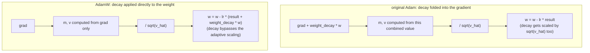

# Урок 11. Шаг оптимизатора AdamW

**Связь с целью курса:** Это итог этапа 4: обратный проход из урока 10 выдаёт градиент для каждого веса, а оптимизатор на самом деле превращает эти градиенты в обновлённые веса, замыкая цикл, благодаря которому модель обучается с нуля.
**Первоисточник:** [Научная статья: "Decoupled Weight Decay Regularization", Loshchilov and Hutter, 2019](https://arxiv.org/abs/1711.05101)
**Предварительные требования:** [Урок 10](0010-backward-pass-and-autograd.md), [Масштабированное скалярное внимание](../GLOSSARY.md)

## Разминка

1. ▢ Что заполняет вызов `loss.backward()` и почему градиенты, как правило, нужно обнулять перед следующим вызовом?

<details markdown="1"><summary>Проверка</summary>

Он заполняет атрибут `.grad` каждого обучаемого параметра градиентом потерь по этому параметру. Градиенты по умолчанию накапливаются, а не перезаписываются, поэтому без предварительного обнуления градиент нового обратного прохода был бы загрязнён остатками значений предыдущего шага.

</details>

2. ▢ Почему остаточная связь гарантирует, что некоторый градиент доходит до более раннего слоя, как бы мала ни была локальная производная самого подслоя?

<details markdown="1"><summary>Проверка</summary>

Локальная производная тождественного пути в точности равна 1, поэтому его вклад в градиент, `d(loss)/d(y) × 1`, вообще не зависит от производной подслоя; это прямое слагаемое проходит без масштабирования, что бы ни вносил подслой.

</details>

## Что нужно знать

### Простейшее обновление: обычный градиентный спуск

Самый базовый оптимизатор сдвигает каждый вес на небольшой шаг против его градиента: `w = w - lr × grad`, где `lr` это **скорость обучения** (learning rate). Поскольку градиент указывает в направлении наибольшего роста потерь, вычитание его масштабированной версии смещает вес в сторону меньших потерь. Слишком большая скорость обучения перескакивает минимум и может привести к расходимости; слишком малая заставляет обучение ползти. Обычный градиентный спуск применяет это одно и то же правило к каждому параметру, без памяти о прошлых обновлениях и без различия между параметрами, которым нужны большие или малые шаги.

### Импульс: сглаживание шумных градиентов по батчам

**Adam** улучшает это двумя способами. Во-первых, он отслеживает **первый момент** `m`, экспоненциально затухающее скользящее среднее прошлых градиентов: `m = beta1 × m + (1 - beta1) × grad`. Вместо того чтобы реагировать на градиент каждого батча по отдельности, а он шумный, так как разные батчи дают несколько разные градиенты, обновление следует за этим сглаженным скользящим средним, и оптимизатор набирает устойчивую «скорость» в направлении, в которое градиент неоднократно указывал, а не дрожит от индивидуального шума каждого батча.

### Адаптивное масштабирование: свой размер шага для каждого параметра

Во-вторых, Adam отслеживает **второй момент** `v`, экспоненциально затухающее скользящее среднее квадрата градиента: `v = beta2 × v + (1 - beta2) × grad^2`. Это оценивает типичную величину градиента каждого параметра. Деление обновления на `sqrt(v)` даёт параметру, градиенты которого обычно малы, относительно больший эффективный шаг, а параметру, градиенты которого обычно велики, относительно меньший, то есть подстраивает размер шага под каждый параметр, а не использует одну фиксированную скорость обучения для каждого веса модели. Полное обновление с поправкой смещения (`m_hat`, `v_hat`, которая учитывает, что `m` и `v` оба начинаются с нуля и в начале обучения смещены к нулю) и малой константой `eps`, чтобы не делить на ноль, выглядит так:

```text
w = w - lr × m_hat / (sqrt(v_hat) + eps)
```

### Исправление AdamW: отделить затухание весов от адаптивного обновления

**Затухание весов** (weight decay) это техника регуляризации, которая на каждом шаге слегка сжимает каждый вес к нулю, не давая весам становиться чрезмерно большими и в целом помогая обобщению. Исходный способ добавить его в Adam включал его прямо в градиент до вычисления `m` и `v`: по сути, прибавлял `weight_decay × w` к `grad`. Это плохо взаимодействует с адаптивным масштабированием Adam: само слагаемое затухания тогда тоже делится на `sqrt(v_hat)` вместе с остальным градиентом, так что у параметра с обычно большими градиентами затухание уменьшается, а у параметра с обычно малыми градиентами усиливается, и ни то ни другое не является тем фиксированным, равномерным сжатием, которое затухание весов должно давать. **AdamW** исправляет это, применяя затухание весов прямо к весам, отдельно от основанного на градиенте обновления Adam:

```text
w = w - lr × (m_hat / (sqrt(v_hat) + eps) + weight_decay × w)
```

Слагаемое затухания добавляется прямо к обновлению и никогда не проходит через `m`, `v` или адаптивный знаменатель, и именно поэтому стандартным оптимизатором для обучения трансформеров служит AdamW («W» от weight decay), а не обычный Adam.



## Практика

1. ▢ При обычном градиентном спуске вес равен `w = 5.0`, его градиент равен `2.0`, а скорость обучения равна `0.1`. Вычислите обновлённый вес.

<details markdown="1"><summary>Подсказка</summary>

`w = w - lr × grad`.

</details>

<details markdown="1"><summary>Проверка</summary>

`w = 5.0 - 0.1 × 2.0 = 5.0 - 0.2 = 4.8`.

</details>

2. ▢ Почему отслеживание скользящего среднего прошлых градиентов (первый момент Adam, `m`) помогает по сравнению с использованием «сырого» градиента каждого батча напрямую?

<details markdown="1"><summary>Проверка</summary>

Отдельные батчи дают шумные градиенты, которые несколько отличаются от батча к батчу. Скользящее среднее сглаживает этот шум, позволяя обновлению следовать направлению, в которое градиент устойчиво указывал на последних шагах, а не реагировать на индивидуальные колебания каждого батча.

</details>

3. ▢ Почему деление обновления на `sqrt(v)`, второй момент Adam, помогает параметрам с разной типичной величиной градиентов?

<details markdown="1"><summary>Проверка</summary>

`v` оценивает типичную величину квадрата градиента каждого параметра. Деление на её квадратный корень масштабирует обновление обратно пропорционально этой величине, давая параметру с обычно малыми градиентами относительно больший эффективный шаг, а параметру с обычно большими градиентами относительно меньший, а не заставляя каждый параметр использовать один и тот же фиксированный размер шага независимо от того, насколько велики его градиенты обычно.

</details>

4. ▢ Что идёт не так, когда затухание весов включают прямо в градиент в исходном Adam, и что делает иначе AdamW?

<details markdown="1"><summary>Проверка</summary>

Если включить затухание весов в градиент, оно делится на `sqrt(v_hat)` вместе с остальным обновлением, поэтому затухание параметра оказывается уменьшенным или усиленным в зависимости от его типичной величины градиента, а не равным тому одинаковому долевому сжатию, которое затухание весов должно обеспечивать. AdamW применяет затухание весов прямо к весам, добавляя его к обновлению отдельно от слагаемого на основе градиента, так что оно вообще не проходит через адаптивное масштабирование.

</details>

5. ▢ Какое утверждение верно об AdamW по сравнению с обычным градиентным спуском и исходным Adam?

    - a) AdamW использует один и тот же фиксированный размер шага для каждого параметра, как обычный градиентный спуск
    - b) AdamW добавляет импульс и адаптивное масштабирование по параметрам, как Adam, но применяет затухание весов прямо к весам, а не включает его в градиент
    - c) AdamW полностью убирает адаптивное масштабирование по параметрам и полагается только на импульс
    - d) Затухание весов в AdamW масштабируется тем же адаптивным знаменателем, что и обновление на основе градиента

<details markdown="1"><summary>Проверка</summary>

**b)** Именно это разделение отличает AdamW от исходного Adam, сохраняя импульс и адаптивное масштабирование Adam. Вариант (a) неверен: адаптивного масштабирования по параметрам как раз не хватает обычному градиентному спуску, а Adam и AdamW его добавляют. Вариант (c) неверен: AdamW сохраняет и импульс, и адаптивное масштабирование. Вариант (d) неверен: это проблема исходного Adam, которую AdamW исправляет именно разделением.

</details>

## Практика в реальной работе

- [ ] Реализуйте из «сырых» операций обычный градиентный спуск, затем Adam, затем AdamW для небольшого набора параметров и убедитесь, что каждая следующая версия меняет обновление так, как описывает этот урок.
- [ ] Выполните несколько шагов обучения с затуханием весов, включённым в градиент (в стиле исходного Adam), и применённым напрямую (в стиле AdamW) на одной и той же небольшой модели и сравните, как развиваются величины весов.
- [ ] Завтра: проверьте, какой оптимизатор и какие гиперпараметры (скорость обучения, затухание весов, beta1, beta2) на самом деле использует реальный обучающий скрипт, к которому у вас есть доступ (например, из nanoGPT).

## Что почитать дальше

- [Научная статья: "Decoupled Weight Decay Regularization", Loshchilov and Hutter, 2019](https://arxiv.org/abs/1711.05101)
- [Научная статья: "Adam: A Method for Stochastic Optimization", Kingma and Ba, 2015](https://arxiv.org/abs/1412.6980)
- [Ресурсы](../RESOURCES.md)

---

Не доходит? Перечитайте первоисточник в начале: этот урок его сжимает, а при сжатии понимание как раз и теряется. Загляните в [глоссарий](../GLOSSARY.md), если какой-то термин показался скользким.

Если неясен сам урок, а не материал, это дефект: [откройте issue](https://github.com/TokenCemetery/teach/issues).
