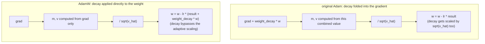

# 第 11 课：AdamW 优化器步骤

**使命关联:** 这是第 4 阶段的收官之课：第 10 课的反向传播为每个权重产生一个梯度，而优化器才真正把这些梯度变成更新后的权重，闭合那个让模型能从零开始训练的回路。
**主要来源:** [论文：“Decoupled Weight Decay Regularization”，Loshchilov 和 Hutter，2019](https://arxiv.org/abs/1711.05101)
**前置知识:** [第 10 课](0010-backward-pass-and-autograd.md)、[缩放点积注意力](../GLOSSARY.md)

## 热身

1. ▢ 调用 `loss.backward()` 会填充什么？为什么在下一次调用之前，通常必须把梯度清零？

<details markdown="1"><summary>检查</summary>

它用损失对每个可训练参数的梯度，填充该参数的 `.grad` 属性。梯度默认是累加而不是覆盖，所以如果不先清零，新一次反向传播的梯度就会被上一步遗留的值污染。

</details>

2. ▢ 为什么不论子层自己的局部导数有多小，残差连接都能保证有一些梯度传到更靠前的层？

<details markdown="1"><summary>检查</summary>

恒等路径的局部导数恰好是 1，所以它对梯度的贡献 `d(loss)/d(y) × 1` 完全不依赖子层的导数；不论子层贡献了什么，这一项直接的贡献都不经缩放地传过去。

</details>

## 要点

### 最简单的更新：朴素梯度下降

最基本的优化器，让每个权重沿它的梯度的反方向走一小步：`w = w - lr × grad`，其中 `lr` 是**学习率**。由于梯度指向损失上升最陡的方向，减去它的缩放版本，就让权重朝损失更低的方向移动。学习率太大会冲过头，甚至发散；太小又会让训练慢如蜗牛。朴素梯度下降对每个参数应用的是同一条规则，既不记得过去的更新，也不区分哪些参数需要大步、哪些需要小步。

### 动量：平滑带噪声的逐批次梯度

**Adam** 从两个方面改进了这一点。第一，它跟踪一个**一阶矩** `m`，即过去梯度的指数衰减滑动平均：`m = beta1 × m + (1 - beta1) × grad`。更新不再孤立地对每个批次的梯度做出反应（不同的批次产生的梯度多少有些不同，所以它带有噪声），而是沿着这个平滑后的滑动平均走，让优化器在梯度反复指向的方向上积累出一致的“速度”，而不是随着每个批次各自的噪声抖动。

### 自适应缩放：每个参数各自的步长

第二，Adam 跟踪一个**二阶矩** `v`，即梯度平方的指数衰减滑动平均：`v = beta2 × v + (1 - beta2) × grad^2`。它估计的是每个参数典型的梯度量级。用 `sqrt(v)` 去除更新量，会让梯度通常较小的参数得到相对更大的有效步长，让梯度通常较大的参数得到相对更小的有效步长，也就是按参数调整步长，而不是对模型里的每个权重使用同一个固定的学习率。完整的更新，加上偏差修正（`m_hat`、`v_hat`，用来修正 `m` 和 `v` 都从零开始、在训练早期偏向零的问题），以及一个防止除以零的小常数 `eps`，是：

```text
w = w - lr × m_hat / (sqrt(v_hat) + eps)
```

### AdamW 的修正：把权重衰减与自适应更新解耦

**权重衰减**是一种正则化技术，每一步都把每个权重朝零稍微收缩一点，抑制过大的权重，通常有助于泛化。最初把它加进 Adam 的办法，是在计算 `m` 和 `v` 之前，把它直接折进梯度里：实际上就是把 `weight_decay × w` 加到 `grad` 上。这与 Adam 的自适应缩放相互作用得很糟：衰减项本身随后也会和梯度的其余部分一起被 `sqrt(v_hat)` 除，于是典型梯度大的参数，它的衰减被压小了，典型梯度小的参数，它的衰减被放大了，这两种情况都不是权重衰减本该施加的那种固定的、均匀的收缩。**AdamW** 的修正办法，是把权重衰减直接施加在权重上，与基于梯度的 Adam 更新分开：

```text
w = w - lr × (m_hat / (sqrt(v_hat) + eps) + weight_decay × w)
```

衰减项直接加进更新里，从不经过 `m`、`v` 或自适应的分母，这正是 AdamW（“W”代表权重衰减）而不是普通的 Adam，成为训练 Transformer 的标准优化器的原因。



## 练习

1. ▢ 使用朴素梯度下降，一个权重是 `w = 5.0`，它的梯度是 `2.0`，学习率是 `0.1`。计算更新后的权重。

<details markdown="1"><summary>提示</summary>

`w = w - lr × grad`。

</details>

<details markdown="1"><summary>检查</summary>

`w = 5.0 - 0.1 × 2.0 = 5.0 - 0.2 = 4.8`。

</details>

2. ▢ 与直接使用每个批次的原始梯度相比，为什么跟踪过去梯度的滑动平均（Adam 的一阶矩 `m`）有帮助？

<details markdown="1"><summary>检查</summary>

单个批次产生的梯度是带噪声的，批次之间多少会有变化。滑动平均把这种噪声平滑掉，让更新沿着梯度在最近几步里一贯指向的方向走，而不是对每个批次各自的波动做出反应。

</details>

3. ▢ 为什么用 `sqrt(v)`（Adam 的二阶矩）去除更新量，对典型梯度量级不同的参数有帮助？

<details markdown="1"><summary>检查</summary>

`v` 估计每个参数典型的梯度平方量级。除以它的平方根，会让更新与这个量级成反比地缩放，让梯度通常较小的参数得到相对更大的有效步长，让梯度通常较大的参数得到相对更小的有效步长，而不是强迫每个参数都使用同一个固定的步长，不管它的梯度通常有多大。

</details>

4. ▢ 在原始的 Adam 里，把权重衰减直接折进梯度会出什么问题？AdamW 又做了什么不同的处理？

<details markdown="1"><summary>检查</summary>

把权重衰减折进梯度，意味着它会和更新的其余部分一起被 `sqrt(v_hat)` 除，所以一个参数的衰减最终会被压小还是放大，取决于它典型的梯度量级，而不是施加权重衰减本该提供的那种相同的固定比例收缩。AdamW 把权重衰减直接施加在权重上，与基于梯度的那一项分开加进更新里，所以它根本不会经过自适应缩放。

</details>

5. ▢ 与朴素梯度下降和原始的 Adam 相比，关于 AdamW，下面哪一项说法是对的？

    - a) AdamW 对每个参数使用相同的固定步长，与朴素梯度下降一样
    - b) AdamW 像 Adam 一样加入了动量和逐参数的自适应缩放，但把权重衰减直接施加在权重上，而不是折进梯度
    - c) AdamW 完全去掉了逐参数的自适应缩放，只依靠动量
    - d) AdamW 里的权重衰减，与基于梯度的更新一样，被同一个自适应分母缩放

<details markdown="1"><summary>检查</summary>

**b)** 这种解耦正是 AdamW 区别于原始 Adam 之处，同时保留了 Adam 的动量和自适应缩放。(a) 是错的：逐参数的自适应缩放，恰恰是朴素梯度下降缺少而 Adam/AdamW 加入的东西。(c) 是错的：AdamW 同时保留了动量和自适应缩放。(d) 是错的：那正是原始 Adam 的问题，AdamW 通过解耦专门修正了它。

</details>

## 实战练习

- [ ] 对一小组参数，用原始运算依次实现朴素梯度下降、Adam、AdamW，并确认每个后续版本都按本课所描述的方式改变了更新。
- [ ] 在同一个小模型上，分别以把权重衰减折进梯度（原始 Adam 的做法）和直接施加（AdamW 的做法）的方式运行几步训练，并比较权重的量级是如何演变的。
- [ ] 明天：查一查你能接触到的某个真实训练脚本（比如 nanoGPT 的）实际使用了什么优化器和超参数（学习率、权重衰减、beta1、beta2）。

## 延伸阅读

- [论文：“Decoupled Weight Decay Regularization”，Loshchilov 和 Hutter，2019](https://arxiv.org/abs/1711.05101)
- [论文：“Adam: A Method for Stochastic Optimization”，Kingma 和 Ba，2015](https://arxiv.org/abs/1412.6980)
- [资源](../RESOURCES.md)

---

没学明白？请重读顶部的主要来源，因为本课是对它的压缩，而理解正是在压缩中流失的。如果有哪个术语觉得含糊，可以查看[术语表](../GLOSSARY.md)。

如果问题出在课程本身，而不是学习材料，那就是一个缺陷：[提交 issue](https://github.com/TokenCemetery/teach/issues)。
