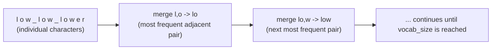
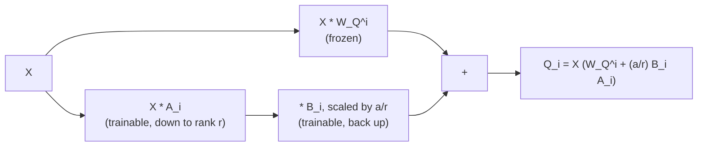

# Lección 13. Tokenizers y adapters de bajo rango

**Vínculo con la misión:** Esta lección cierra la etapa 5: `llm/finetuning` nombra de pasada los tokenizers y la idea de bajo rango, y este espacio de trabajo los deriva, el algoritmo del tokenizer en sí y el lugar exacto donde una actualización de bajo rango se acopla a una matriz de pesos que este espacio de trabajo construyó a partir de tensores en bruto.
**Fuente principal:** [Paper: "Neural Machine Translation of Rare Words with Subword Units", Sennrich, Haddow, and Birch, 2016](https://arxiv.org/abs/1508.07909)
**Requisitos previos:** [Lección 12](0012-reading-real-model-code.md), [Scaled dot-product attention](../GLOSSARY.md)

## Calentamiento

1. ▢ Nombra las tres desviaciones pequeñas y comunes respecto del paper original que se encuentran en la mayoría de las implementaciones reales modernas.

<details markdown="1"><summary>Comprobación</summary>

Embeddings de posición aprendidos o rotatorios en lugar de sinusoidales, GELU en lugar de ReLU en el bloque feed-forward, y colocación pre-norm en lugar de post-norm.

</details>

2. ▢ ¿Por qué debe conservar cada bloque transformer la misma dimensión de entrada y de salida?

<details markdown="1"><summary>Comprobación</summary>

Apilar significa que la salida de un bloque alimenta directamente la entrada del siguiente; un bloque que cambiara la dimensión rompería el apilado uniforme y enchufable que permite repetir el mismo shape de bloque cualquier número de veces.

</details>

## Qué debes saber

### Derivar el tokenizer: byte-pair encoding

`llm/finetuning` trata el tokenizer como algo con lo que un modelo ya viene, y señala solo que los modelos modernos usan tokenización por subpalabras, construida "partiendo de bytes y fusionando repetidamente el par adyacente más frecuente". Aquí está ese algoritmo, completo: el **byte-pair encoding (BPE)** empieza representando cada fragmento de texto de entrenamiento como una secuencia de bytes en bruto (o de caracteres), cada uno su propia entrada de vocabulario. Luego repite un solo paso: contar cada par adyacente de símbolos en todo el corpus, encontrar el par más frecuente y fusionarlo en un nuevo símbolo, que se añade al vocabulario. Esto se repite hasta que el vocabulario alcanza un tamaño objetivo elegido.

Un pequeño ejemplo resuelto: dado el corpus `"low low lower"` (los espacios marcan los límites de palabra, que se mantienen separados), partiendo de caracteres individuales, el par `l, o` podría ser el par adyacente más frecuente del corpus, así que se fusiona en un nuevo símbolo `lo`. La siguiente ronda encuentra el siguiente par más frecuente entre los símbolos actualizados, `lo, w`, y lo fusiona en `low`. Cada ronda de fusión reduce cuántos símbolos representan las subcadenas comunes y hace crecer el vocabulario exactamente en una entrada. Iterar esto las veces suficientes produce un vocabulario donde las palabras frecuentes se comprimen en un solo token y las palabras raras recurren a piezas más pequeñas y más frecuentes, exactamente la propiedad que observó la cobertura de tokenizers de `llm/finetuning`: "los tokens no son palabras".



De aquí sale también el `vocab_size` de la lección 8: es el número de fusiones (más los símbolos iniciales) con que se ejecutó el entrenamiento del tokenizer, fijado una vez que el entrenamiento termina, y el embedding de entrada y las capas de salida que derivó este espacio de trabajo se dimensionan según el número que produjo ese entrenamiento.

### Derivar la idea de bajo rango: dónde se acopla a una matriz de pesos real

La propia cobertura de la idea de bajo rango en `llm/finetuning` ya deriva el mecanismo completo: congelar una matriz de pesos `W₀` y, en lugar de aprender una actualización completa para ella, factorizar la actualización en dos matrices pequeñas, `ΔW = BA`, con `A` proyectando hacia abajo a un rango pequeño `r` y `B` proyectando de vuelta hacia arriba, de modo que `h = W₀x + (α/r) BAx`. Lo que esa cobertura no necesita mostrar, porque su misión es el adapter y no la arquitectura que hay debajo, es exactamente cuál es, en concreto, la matriz `W₀` dentro de un transformer que este espacio de trabajo construyó a partir de tensores en bruto.

Toma la proyección de query por head de la lección 2, `W_Q^i`, una de las matrices aprendidas que producen `Q_i = X W_Q^i`. Aplicarle un adapter de bajo rango significa congelar `W_Q^i` exactamente como estaba tras el preentrenamiento, y calcular:

```text
Q_i = X (W_Q^i + (α / r) B_i A_i)
```

`A_i` y `B_i` son matrices nuevas y pequeñas, dimensionadas por el rango `r`, y solo ellas reciben gradientes durante el entrenamiento del adapter; `W_Q^i` nunca cambia. Todo lo que viene después, el resto de la atención, la layer norm, el bloque feed-forward, el apilado, la capa de salida, corre exactamente como lo derivó este espacio de trabajo, sin enterarse de que `Q_i` salió de una matriz congelada más una pequeña corrección aditiva y no de una única matriz aprendida. Esa es la respuesta concreta a "dónde se acopla un adapter de bajo rango": en la misma multiplicación de matrices exacta que este espacio de trabajo escribió a partir de tensores en bruto en la lección 2, con un término de esa multiplicación dividido en una parte congelada y una parte entrenable de bajo rango.



Como la actualización es aditiva y lineal exactamente igual que la propia proyección de la lección 2 es lineal, `W_Q^i + (α/r) B_i A_i` colapsa en una única matriz ordinaria después del entrenamiento, que es el argumento de `llm/finetuning` sobre la sobrecarga nula en la inferencia: nada del forward pass que construyó este espacio de trabajo tiene que cambiar para servir un adapter fusionado, ya que el resultado fusionado es simplemente otra `W_Q^i`.

## Práctica

1. ▢ Partiendo del corpus `"low low lower"` representado como caracteres individuales, describe en términos generales qué hace el primer paso de fusión del byte-pair encoding.

<details markdown="1"><summary>Comprobación</summary>

Cuenta cada par adyacente de símbolos en el corpus, encuentra el par que ocurre con más frecuencia (por ejemplo, `l` seguida de `o`) y fusiona ese par en un nuevo símbolo, que se añade al vocabulario. Cada futura aparición de ese par adyacente en el corpus se representa ahora con el único símbolo nuevo en lugar de dos separados.

</details>

2. ▢ ¿Cómo determina el entrenamiento del tokenizer el `vocab_size`, y qué fija después ese número dentro de la arquitectura de modelo que derivó este espacio de trabajo?

<details markdown="1"><summary>Comprobación</summary>

`vocab_size` es el número de símbolos iniciales más pasos de fusión con que se ejecutó el entrenamiento BPE del tokenizer, fijado una vez que ese entrenamiento termina. Ese número dimensiona entonces directamente la tabla de embedding de entrada y la capa de proyección de salida de la lección 8, ya que ambas tienen su shape determinado por `vocab_size`.

</details>

3. ▢ Usando la proyección de query por head de la lección 2, `Q_i = X W_Q^i`, escribe el cálculo modificado una vez que se acopla un adapter de bajo rango a `W_Q^i`, y indica qué matrices reciben gradientes durante el entrenamiento del adapter.

<details markdown="1"><summary>Pista</summary>

La matriz congelada y la corrección de bajo rango forman parte de la misma multiplicación.

</details>

<details markdown="1"><summary>Comprobación</summary>

`Q_i = X (W_Q^i + (α/r) B_i A_i)`. Solo `A_i` y `B_i` reciben gradientes; `W_Q^i` permanece congelada durante todo el entrenamiento del adapter.

</details>

4. ▢ ¿Por qué colapsa `W_Q^i + (α/r) B_i A_i` en una única matriz ordinaria después del entrenamiento, y qué significa eso para el forward pass que derivó este espacio de trabajo?

<details markdown="1"><summary>Comprobación</summary>

Tanto la matriz congelada como la corrección de bajo rango son términos lineales y aditivos de la misma multiplicación de matrices, así que su suma es simplemente otra matriz del mismo shape que `W_Q^i`. Nada del forward pass que construyó este espacio de trabajo tiene que cambiar para usarla: el resultado fusionado se enchufa directamente en `Q_i = X W_Q^i` como una matriz de proyección ordinaria, sin cómputo añadido en el momento de la inferencia.

</details>

5. ▢ ¿Qué afirmación es cierta sobre cómo se conectan las derivaciones de este espacio de trabajo con la cobertura de tokenizers y adapters de bajo rango de `llm/finetuning`?

    - a) `llm/finetuning` y este espacio de trabajo enseñan exactamente el mismo contenido, así que uno es redundante
    - b) Este espacio de trabajo deriva los mecanismos (el algoritmo de fusión del BPE, la matriz exacta a la que se acopla una actualización de bajo rango) que `llm/finetuning` nombra de pasada sin derivar
    - c) Un adapter de bajo rango solo puede acoplarse a la capa de salida, nunca a una proyección de atención
    - d) `vocab_size` se elige con independencia del tokenizer y no tiene efecto sobre las capas de embedding ni de salida

<details markdown="1"><summary>Comprobación</summary>

**b)** Ese es precisamente el límite que trazó la misión de este espacio de trabajo desde el principio. (a) es falsa: `llm/finetuning` cubre por qué y cuándo usar estas técnicas; este espacio de trabajo cubre el mecanismo y dónde se acopla. (c) es falsa: esta lección acopló una actualización de bajo rango a una proyección de atención (`W_Q^i`) específicamente, aunque puede acoplarse también a otras matrices de pesos. (d) es falsa: `vocab_size` viene directamente del entrenamiento del tokenizer y fija los shapes tanto de la tabla de embedding como de la capa de salida.

</details>

## Prácticas en el mundo real

- [ ] Ejecuta a mano un paso de fusión del byte-pair encoding sobre un fragmento corto de texto que elijas, siguiendo los conteos de pares y el vocabulario resultante tras dos o tres fusiones.
- [ ] En tu implementación de transformer hecha desde cero, añade un adapter de bajo rango a una matriz de proyección de atención, congelando la original y entrenando solo las nuevas matrices `A` y `B`.
- [ ] Mañana: vuelve a la misión de este espacio de trabajo en `README.md` y confirma, con tus propias palabras, que puedes implementar a partir de tensores en bruto el forward pass y el bucle de entrenamiento de un transformer completo, y localizar cada pieza derivada en código real de modelos.

## Para profundizar

- [Paper: "Neural Machine Translation of Rare Words with Subword Units", Sennrich, Haddow, and Birch, 2016](https://arxiv.org/abs/1508.07909)
- [Adapter](../../finetuning/GLOSSARY.md): el término canónico de `llm/finetuning` para el patrón de base congelada más pequeños pesos entrenables que esta lección acopla a una matriz concreta
- [Recursos](../RESOURCES.md)

---

¿No termina de quedar claro? Vuelve a leer la fuente primaria de arriba, ya que esta lección la comprime y en la compresión es donde se escapa la comprensión. Consulta el [glosario](../GLOSSARY.md) por si algún término te resultó resbaladizo.

Si lo poco claro es la propia lección y no el material, eso es un defecto: [abre un issue](https://github.com/TokenCemetery/teach/issues).
