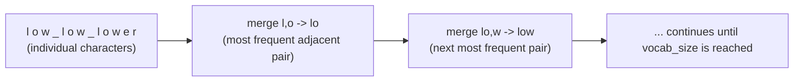
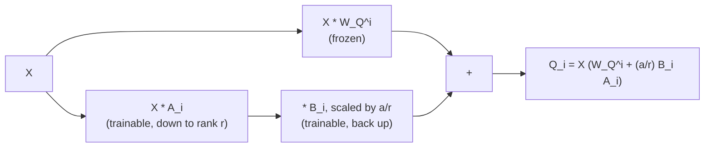

# Leçon 13. Tokenizers et adapters de faible rang

**Lien avec la mission :** Cette leçon clôt l'étape 5 : `llm/finetuning` nomme en passant les tokenizers et l'idée de faible rang, cet espace de travail les dérive, l'algorithme du tokenizer lui-même et l'endroit exact où une mise à jour de faible rang se rattache à une matrice de poids que cet espace de travail a construite à partir de tenseurs bruts.
**Source primaire :** [Article : "Neural Machine Translation of Rare Words with Subword Units", Sennrich, Haddow et Birch, 2016](https://arxiv.org/abs/1508.07909)
**Prérequis :** [Leçon 12](0012-reading-real-model-code.md), [Scaled dot-product attention](../GLOSSARY.md)

## Échauffement

1. ▢ Nommez les trois petits écarts courants par rapport à l'article d'origine que l'on trouve dans la plupart des implémentations réelles modernes.

<details markdown="1"><summary>Vérifier</summary>

Des embeddings de position appris ou rotatifs au lieu de sinusoïdaux, GELU au lieu de ReLU dans le bloc feed-forward, et un placement pre-norm au lieu de post-norm.

</details>

2. ▢ Pourquoi chaque bloc transformer doit-il conserver la même dimension d'entrée et de sortie ?

<details markdown="1"><summary>Vérifier</summary>

Empiler signifie que la sortie d'un bloc alimente directement l'entrée du bloc suivant ; un bloc qui changerait la dimension casserait l'empilement uniforme, interchangeable, qui permet de répéter la même forme de bloc un nombre quelconque de fois.

</details>

## À savoir

### Dériver le tokenizer : le byte-pair encoding

`llm/finetuning` traite le tokenizer comme quelque chose que le modèle apporte déjà, en notant seulement que les modèles modernes utilisent une tokenisation en sous-mots, construite en « partant des octets et en fusionnant à répétition la paire adjacente la plus fréquente ». Voici cet algorithme, en entier : le **byte-pair encoding (BPE)** commence par représenter chaque morceau de texte d'entraînement comme une séquence d'octets bruts (ou de caractères), chacun étant sa propre entrée du vocabulaire. Il répète ensuite une étape : compter chaque paire adjacente de symboles sur tout le corpus, trouver la paire la plus fréquente, et la fusionner en un nouveau symbole, ajouté au vocabulaire. On répète jusqu'à ce que le vocabulaire atteigne une taille cible choisie.

Un minuscule exemple travaillé : avec le corpus `"low low lower"` (les espaces marquent les frontières de mots, conservées à part), en partant de caractères individuels, la paire `l, o` pourrait être la paire adjacente la plus fréquente du corpus, et elle fusionne donc en un nouveau symbole `lo`. Le tour suivant trouve la paire suivante la plus fréquente parmi les symboles mis à jour, `lo, w`, et la fusionne en `low`. Chaque tour de fusion réduit le nombre de symboles qui représentent les sous-chaînes courantes et agrandit le vocabulaire d'exactement une entrée. En itérant assez de fois, on obtient un vocabulaire où les mots fréquents se compressent en un seul token et où les mots rares se replient sur des morceaux plus petits et plus fréquents, exactement la propriété que la couverture des tokenizers de `llm/finetuning` a observée : « les tokens ne sont pas des mots ».



C'est aussi de là que vient réellement le `vocab_size` de la leçon 8 : c'est le nombre de fusions (plus les symboles de départ) pour lequel l'entraînement du tokenizer a été exécuté, fixé une fois cet entraînement terminé, et l'embedding d'entrée et la couche de sortie que cet espace de travail a dérivés sont dimensionnés selon le nombre qu'a produit cet entraînement.

### Dériver l'idée de faible rang : où elle se rattache à une vraie matrice de poids

La couverture propre de `llm/finetuning` sur l'idée de faible rang dérive déjà le mécanisme en entier : geler une matrice de poids `W₀` et, au lieu d'apprendre une mise à jour complète pour elle, factoriser la mise à jour en deux petites matrices, `ΔW = BA`, où `A` projette vers un petit rang `r` et `B` reprojette vers le haut, de sorte que `h = W₀x + (α/r) BAx`. Ce que cette couverture n'a pas besoin de montrer, puisque sa mission est l'adapter et non l'architecture qui se trouve en dessous, c'est exactement quelle matrice est concrètement `W₀` dans un transformer que cet espace de travail a construit à partir de tenseurs bruts.

Prenons la projection de requête par tête de la leçon 2, `W_Q^i`, l'une des matrices apprises qui produisent `Q_i = X W_Q^i`. Lui appliquer un adapter de faible rang signifie geler `W_Q^i` exactement telle qu'elle était après le pré-entraînement, et calculer :

```text
Q_i = X (W_Q^i + (α / r) B_i A_i)
```

`A_i` et `B_i` sont de nouvelles petites matrices, dimensionnées par le rang `r`, et seules elles reçoivent des gradients pendant l'entraînement de l'adapter ; `W_Q^i` ne change jamais. Tout ce qui vient en aval, le reste de l'attention, la layer norm, le bloc feed-forward, l'empilement, la couche de sortie, s'exécute exactement comme cet espace de travail l'a dérivé, sans rien savoir du fait que `Q_i` provient d'une matrice gelée plus une petite correction additive plutôt que d'une seule matrice apprise. C'est la réponse concrète à « où se rattache un adapter de faible rang » : au même produit matriciel exact que cet espace de travail a écrit à partir de tenseurs bruts à la leçon 2, avec un terme de ce produit scindé en une partie gelée et une partie entraînable de faible rang.



Comme la mise à jour est additive et linéaire exactement comme la projection de la leçon 2 est elle-même linéaire, `W_Q^i + (α/r) B_i A_i` se réduit après l'entraînement à une seule matrice ordinaire, ce qui est l'argument de `llm/finetuning` sur le surcoût nul à l'inférence : rien dans la passe avant que cet espace de travail a construite n'a à changer pour servir un adapter fusionné, puisque le résultat fusionné n'est qu'une `W_Q^i` de plus.

## Pratique

1. ▢ En partant du corpus `"low low lower"` représenté en caractères individuels, décrivez en termes généraux ce que fait la première étape de fusion du byte-pair encoding.

<details markdown="1"><summary>Vérifier</summary>

Compter chaque paire adjacente de symboles sur le corpus, trouver la paire la plus fréquente (par exemple `l` suivi de `o`), et la fusionner en un nouveau symbole, ajouté au vocabulaire. Chaque occurrence future de cette paire adjacente dans le corpus est désormais représentée par le nouveau symbole unique au lieu de deux symboles séparés.

</details>

2. ▢ Comment l'entraînement du tokenizer détermine-t-il `vocab_size`, et que fixe ensuite ce nombre dans l'architecture de modèle que cet espace de travail a dérivée ?

<details markdown="1"><summary>Vérifier</summary>

`vocab_size` est le nombre de symboles de départ plus d'étapes de fusion pour lequel l'entraînement BPE du tokenizer a été exécuté, fixé une fois cet entraînement terminé. Ce nombre dimensionne ensuite directement la table d'embedding d'entrée de la leçon 8 et la couche de projection de sortie, puisque les deux ont une forme déterminée par `vocab_size`.

</details>

3. ▢ À partir de la projection de requête par tête de la leçon 2, `Q_i = X W_Q^i`, écrivez le calcul modifié une fois qu'un adapter de faible rang est rattaché à `W_Q^i`, et dites quelles matrices reçoivent des gradients pendant l'entraînement de l'adapter.

<details markdown="1"><summary>Indice</summary>

La matrice gelée et la correction de faible rang font partie du même produit.

</details>

<details markdown="1"><summary>Vérifier</summary>

`Q_i = X (W_Q^i + (α/r) B_i A_i)`. Seules `A_i` et `B_i` reçoivent des gradients ; `W_Q^i` reste gelée pendant tout l'entraînement de l'adapter.

</details>

4. ▢ Pourquoi `W_Q^i + (α/r) B_i A_i` se réduit-elle après l'entraînement à une seule matrice ordinaire, et qu'est-ce que cela signifie pour la passe avant que cet espace de travail a dérivée ?

<details markdown="1"><summary>Vérifier</summary>

La matrice gelée et la correction de faible rang sont toutes deux des termes linéaires, additifs, du même produit matriciel, donc leur somme n'est qu'une matrice de plus, de la même forme que `W_Q^i`. Rien dans la passe avant que cet espace de travail a construite n'a à changer pour l'utiliser : le résultat fusionné s'insère directement dans `Q_i = X W_Q^i` comme une matrice de projection ordinaire, sans aucun calcul ajouté à l'inférence.

</details>

5. ▢ Quelle affirmation est vraie de la façon dont les dérivations de cet espace de travail se rattachent à la couverture des tokenizers et des adapters de faible rang par `llm/finetuning` ?

    - a) `llm/finetuning` et cet espace de travail enseignent exactement le même contenu, donc l'un est redondant
    - b) Cet espace de travail dérive les mécanismes (l'algorithme de fusion du BPE, la matrice exacte à laquelle se rattache une mise à jour de faible rang) que `llm/finetuning` nomme en passant sans les dériver
    - c) Un adapter de faible rang ne peut se rattacher qu'à la couche de sortie, jamais à une projection d'attention
    - d) `vocab_size` est choisi indépendamment du tokenizer et n'a aucun effet sur l'embedding ni sur la couche de sortie

<details markdown="1"><summary>Vérifier</summary>

**b)** C'est précisément la frontière que la mission de cet espace de travail a tracée dès le départ. (a) est faux : `llm/finetuning` couvre pourquoi et quand employer ces techniques ; cet espace de travail couvre le mécanisme et l'endroit où il se rattache. (c) est faux : cette leçon a rattaché une mise à jour de faible rang précisément à une projection d'attention (`W_Q^i`), même si elle peut se rattacher aussi à d'autres matrices de poids. (d) est faux : `vocab_size` vient directement de l'entraînement du tokenizer et fixe les formes de la table d'embedding et de la couche de sortie.

</details>

## Exercices en situation réelle

- [ ] Exécutez à la main une étape de fusion du byte-pair encoding sur un court texte de votre choix, en suivant les comptes de paires et le vocabulaire obtenu après deux ou trois fusions.
- [ ] Dans votre implémentation de transformer à partir de zéro, ajoutez un adapter de faible rang à une matrice de projection d'attention, en gelant l'originale et en n'entraînant que les nouvelles matrices `A` et `B`.
- [ ] Demain : revenez à la mission de cet espace de travail dans `README.md` et confirmez, dans vos propres mots, que vous savez implémenter la passe avant et la boucle d'entraînement d'un transformer complet à partir de tenseurs bruts, et situer chaque pièce dérivée dans du vrai code de modèle.

## Pour aller plus loin

- [Article : "Neural Machine Translation of Rare Words with Subword Units", Sennrich, Haddow et Birch, 2016](https://arxiv.org/abs/1508.07909)
- [Adapter](../../finetuning/GLOSSARY.md) : le terme canonique de `llm/finetuning` pour le schéma base gelée plus petits poids entraînables, que cette leçon rattache à une matrice concrète
- [Ressources](../RESOURCES.md)

---

Ça ne passe pas ? Relisez la source primaire en haut de page, car cette leçon la condense et c'est dans la condensation que la compréhension s'échappe. Consultez le [glossaire](../GLOSSARY.md) pour tout terme qui vous a paru glissant.

Si c'est la leçon elle-même qui n'est pas claire plutôt que la matière, c'est un défaut : [ouvrez une issue](https://github.com/TokenCemetery/teach/issues).
