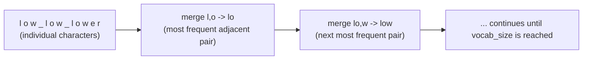
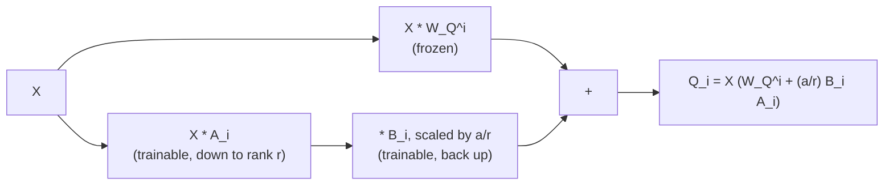

# पाठ 13. Tokenizers और Low-Rank Adapters

**मिशन से संबंध:** यह इस रूपरेखा का अंतिम पाठ है: `llm/finetuning` tokenizers और low-rank विचार का बस नाम लेता है, यह workspace उन्हें निकालता है, यानी tokenizer का अपना algorithm और वह सटीक जगह जहाँ low-rank update, raw tensors से बने weight matrix से जुड़ता है।
**मुख्य स्रोत:** [पेपर: "Neural Machine Translation of Rare Words with Subword Units", Sennrich, Haddow, and Birch, 2016](https://arxiv.org/abs/1508.07909)
**पूर्व-आवश्यकताएँ:** [पाठ 12](0012-reading-real-model-code.md), [Scaled dot-product attention](../GLOSSARY.md)

## वार्म-अप

1. ▢ ज़्यादातर आधुनिक असली implementations में मिलने वाले मूल पेपर से तीन आम छोटे अंतर बताएँ।

<details markdown="1"><summary>जाँचें</summary>

Sinusoidal की जगह सीखे हुए या rotary position embeddings, feed-forward block में ReLU की जगह GELU, और post-norm की जगह pre-norm।

</details>

2. ▢ हर transformer block को एक ही input और output आयाम क्यों बनाए रखना चाहिए?

<details markdown="1"><summary>जाँचें</summary>

Stacking का मतलब है कि एक block का output सीधे अगले block के input में जाता है; आयाम बदलने वाला block उस एकसमान, सीधे जोड़े जाने वाले stacking को तोड़ देता जो एक ही block shape को कितनी भी बार दोहराने देता है।

</details>

## यह जानें

### Tokenizer को निकालना: byte-pair encoding

`llm/finetuning` tokenizer को ऐसी चीज़ मानता है जो model के साथ पहले से आती है, और बस इतना कहता है कि आधुनिक models subword tokenization इस्तेमाल करते हैं, जो "bytes से शुरू करके सबसे आम पास-पास की जोड़ी को बार-बार मिलाकर" बनता है। वह algorithm पूरा यहाँ है: **byte-pair encoding (BPE)** training text के हर टुकड़े को कच्चे bytes (या अक्षरों) की sequence के रूप में दर्शाकर शुरू होता है, हर एक अपनी vocabulary प्रविष्टि। फिर वह एक चरण दोहराता है: पूरे corpus में पास-पास के symbols की हर जोड़ी गिनें, सबसे आम अकेली जोड़ी ढूँढें, और उसे एक नए symbol में मिला दें, जो vocabulary में जुड़ जाता है। यह तब तक दोहराया जाता है जब तक vocabulary चुने हुए लक्ष्य आकार तक न पहुँच जाए।

एक छोटा worked example: corpus `"low low lower"` दिया हो (spaces शब्द की सीमाएँ दिखाते हैं, अलग रखे गए), अलग-अलग अक्षरों से शुरू करते हुए, जोड़ी `l, o` पूरे corpus में सबसे आम पास-पास की जोड़ी हो सकती है, इसलिए वह एक नए symbol `lo` में मिल जाती है। अगला दौर अपडेट किए गए symbols में अगली सबसे आम जोड़ी, `lo, w`, ढूँढता है और उसे `low` में मिला देता है। हर मिलाने वाला दौर आम substrings को दर्शाने वाले symbols की संख्या घटाता है और vocabulary को ठीक एक प्रविष्टि से बढ़ाता है। इसे काफ़ी बार दोहराने पर ऐसी vocabulary बनती है जिसमें आम शब्द एक अकेले token में सिमट जाते हैं और दुर्लभ शब्द छोटे, ज़्यादा आम टुकड़ों में टूट जाते हैं, ठीक वही गुण जो `llm/finetuning` के tokenizer वाले हिस्से ने देखा: "tokens शब्द नहीं हैं।"



पाठ 8 का `vocab_size` भी असल में यहीं से आता है: वह उतनी ही संख्या है जितनी बार tokenizer की training ने मिलाने के चरण चलाए (जमा शुरुआती symbols), और training पूरी होने पर तय हो जाती है, और इस workspace में निकाली गई input embedding और output layers उसी संख्या के आकार की होती हैं जो वह training दे।

### Low-rank विचार को निकालना: वह असली weight matrix पर कहाँ जुड़ता है

`llm/finetuning` का अपना low-rank विचार वाला हिस्सा तंत्र को पूरा निकाल चुका है: एक weight matrix `W₀` को freeze करें, और उसके लिए पूरा update सीखने के बजाय update को दो छोटे matrices में तोड़ दें, `ΔW = BA`, जिसमें `A` छोटे rank `r` तक नीचे project करता है और `B` वापस ऊपर project करता है, इसलिए `h = W₀x + (α/r) BAx`। वह हिस्सा जो वह नहीं दिखाता, क्योंकि उसका मक़सद adapter है, उसके नीचे का architecture नहीं, वह यह है कि raw tensors से बने transformer में `W₀` ठोस रूप से कौन-सा matrix है।

पाठ 2 का प्रति-head query projection `W_Q^i` लें, जो सीखे हुए उन matrices में से एक है जो `Q_i = X W_Q^i` बनाते हैं। उस पर low-rank adapter लगाने का मतलब है `W_Q^i` को ठीक वैसे ही freeze करना जैसा वह pretraining के बाद था, और यह compute करना:

```text
Q_i = X (W_Q^i + (α / r) B_i A_i)
```

`A_i` और `B_i` नए, छोटे matrices हैं, जिनका आकार rank `r` तय करता है, और adapter training के दौरान सिर्फ़ उन्हीं को gradients मिलते हैं; `W_Q^i` कभी नहीं बदलता। इसके बाद का सब कुछ, attention का बाक़ी हिस्सा, layer norm, feed-forward block, stacking, output layer, ठीक वैसे ही चलता है जैसा इस workspace ने निकाला, इस बात से पूरी तरह अनजान कि `Q_i` एक अकेले सीखे हुए matrix की जगह frozen matrix और एक छोटे जोड़ने वाले सुधार से आया है। "low-rank adapter कहाँ जुड़ता है" का यही ठोस जवाब है: ठीक उसी matrix multiply पर जो इस workspace ने पाठ 2 में raw tensors से लिखा था, उस multiply के एक पद को frozen हिस्से और train होने वाले low-rank हिस्से में बाँटकर।



चूँकि update जोड़ने वाला और linear है, ठीक उसी तरह जैसे पाठ 2 का projection ख़ुद linear है, `W_Q^i + (α/r) B_i A_i` training के बाद एक सामान्य matrix में सिमट जाता है, और यही `llm/finetuning` की inference में शून्य अतिरिक्त बोझ वाली बात है: merged adapter को परोसने के लिए इस workspace में बने forward pass में कुछ भी बदलना नहीं पड़ता, क्योंकि merged नतीजा बस एक और `W_Q^i` है।

## अभ्यास

1. ▢ अलग-अलग अक्षरों के रूप में दर्शाए corpus `"low low lower"` से शुरू करते हुए, सामान्य शब्दों में बताएँ कि byte-pair encoding का पहला मिलाने वाला चरण क्या करता है।

<details markdown="1"><summary>जाँचें</summary>

Corpus में पास-पास के symbols की हर जोड़ी गिनें, जो जोड़ी सबसे ज़्यादा बार आती है उसे ढूँढें (उदाहरण के लिए `l` के बाद `o`), और उस जोड़ी को एक नए symbol में मिलाकर vocabulary में जोड़ दें। Corpus में उस पास-पास की जोड़ी की हर आगे की उपस्थिति अब दो अलग symbols की जगह उस एक नए symbol से दर्शाई जाती है।

</details>

2. ▢ Tokenizer की training `vocab_size` कैसे तय करती है, और वह संख्या इस workspace में निकाले model architecture के भीतर क्या तय कर देती है?

<details markdown="1"><summary>जाँचें</summary>

`vocab_size` उतनी ही है जितने शुरुआती symbols और मिलाने वाले चरण tokenizer की BPE training ने चलाए, और वह training पूरी होते ही तय हो जाती है। फिर वह संख्या पाठ 8 की input embedding table और output projection layer का आकार सीधे तय करती है, क्योंकि दोनों का shape `vocab_size` से बनता है।

</details>

3. ▢ पाठ 2 के प्रति-head query projection `Q_i = X W_Q^i` का इस्तेमाल करके, `W_Q^i` पर low-rank adapter जुड़ने के बाद बदली हुई गणना लिखें, और बताएँ कि adapter training के दौरान किन matrices को gradients मिलते हैं।

<details markdown="1"><summary>संकेत</summary>

Frozen matrix और low-rank सुधार दोनों एक ही multiply का हिस्सा हैं।

</details>

<details markdown="1"><summary>जाँचें</summary>

`Q_i = X (W_Q^i + (α/r) B_i A_i)`। सिर्फ़ `A_i` और `B_i` को gradients मिलते हैं; `W_Q^i` पूरी adapter training के दौरान frozen रहता है।

</details>

4. ▢ `W_Q^i + (α/r) B_i A_i` training के बाद एक सामान्य matrix में क्यों सिमट जाता है, और इस workspace में निकाले गए forward pass के लिए इसका क्या मतलब है?

<details markdown="1"><summary>जाँचें</summary>

Frozen matrix और low-rank सुधार दोनों एक ही matrix multiply में linear, जोड़ने वाले पद हैं, इसलिए उनका योग बस `W_Q^i` के ही shape का एक और matrix है। इस workspace में बने forward pass में उसे इस्तेमाल करने के लिए कुछ भी बदलना नहीं पड़ता: merged नतीजा `Q_i = X W_Q^i` में सामान्य projection matrix की तरह सीधे बैठ जाता है, inference के समय शून्य अतिरिक्त computation के साथ।

</details>

5. ▢ इस workspace के निकाले हुए तंत्र `llm/finetuning` के tokenizers और low-rank adapters वाले हिस्से से कैसे जुड़ते हैं, इस बारे में कौन-सा दावा सही है?

    - a) `llm/finetuning` और यह workspace ठीक एक ही सामग्री पढ़ाते हैं, इसलिए एक फ़ालतू है
    - b) यह workspace उन तंत्रों को निकालता है (BPE का मिलाने वाला algorithm, वह सटीक matrix जिस पर low-rank update जुड़ता है) जिनका `llm/finetuning` बिना निकाले बस नाम लेता है
    - c) Low-rank adapter सिर्फ़ output layer पर जुड़ सकता है, attention projection पर कभी नहीं
    - d) `vocab_size` tokenizer से स्वतंत्र चुना जाता है और embedding या output layers पर उसका कोई असर नहीं पड़ता

<details markdown="1"><summary>जाँचें</summary>

**b)** यही वह सीमा है जो इस workspace के मिशन ने शुरू से खींची थी। (a) ग़लत है: `llm/finetuning` बताता है कि इन तकनीकों को क्यों और कब इस्तेमाल करना है; यह workspace तंत्र और उसके जुड़ने की जगह बताता है। (c) ग़लत है: इस पाठ ने low-rank update को ख़ास तौर पर attention projection (`W_Q^i`) पर जोड़ा, हालाँकि वह दूसरे weight matrices पर भी जुड़ सकता है। (d) ग़लत है: `vocab_size` सीधे tokenizer की training से आता है और embedding table तथा output layer, दोनों के shapes तय करता है।

</details>

## असली दुनिया का अभ्यास

- [ ] अपनी चुनी हुई text के छोटे टुकड़े पर byte-pair encoding का मिलाने वाला चरण हाथ से चलाएँ, जोड़ियों की गिनती और दो-तीन बार मिलाने के बाद बनी vocabulary को ट्रैक करते हुए।
- [ ] अपने शुरू से बने transformer implementation में, एक attention projection matrix में low-rank adapter जोड़ें, मूल को freeze करके और सिर्फ़ नए `A` और `B` matrices को train करके।
- [ ] कल: `README.md` में इस workspace का मिशन फिर देखें और अपने शब्दों में पक्का करें कि आप raw tensors से पूरे transformer का forward pass और training loop लागू कर सकते हैं, और हर निकाले हुए हिस्से को असली model code में ढूँढ सकते हैं।

## आगे बढ़ने के लिए

- [पेपर: "Neural Machine Translation of Rare Words with Subword Units", Sennrich, Haddow, and Birch, 2016](https://arxiv.org/abs/1508.07909)
- [Adapter](../../finetuning/GLOSSARY.md): `llm/finetuning` का मानक शब्द उस frozen-base-और-छोटी-trainable-weights वाले pattern के लिए जिसे यह पाठ एक ठोस matrix पर जोड़ता है
- [संसाधन](../RESOURCES.md)

---

बात नहीं बन रही? ऊपर दिए मुख्य स्रोत को दोबारा पढ़ें, क्योंकि यह पाठ उसे संक्षिप्त करता है और समझ संक्षेप में ही रिसती है। जो शब्द फिसलन भरा लगे, उसके लिए [शब्दावली](../GLOSSARY.md) देखें।

अगर दिक़्क़त सामग्री की नहीं बल्कि पाठ की ही है, तो वह एक खोट है: [issue खोलें](https://github.com/TokenCemetery/teach/issues)।
