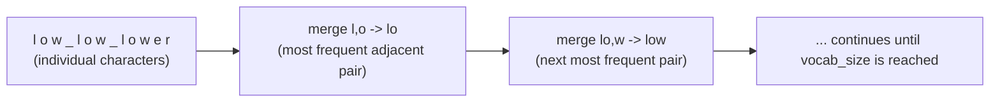
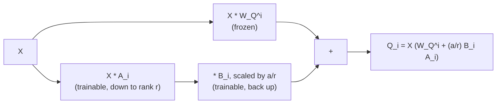

# Lição 13. Tokenizers e adapters de baixo rank

**Ligação com a missão:** Esta lição fecha a etapa 5: `llm/finetuning` menciona de passagem os tokenizers e a ideia de baixo rank, e este workspace os deriva, o algoritmo do próprio tokenizer e o lugar exato em que uma atualização de baixo rank se acopla a uma matriz de pesos que este workspace construiu a partir de tensores brutos.
**Fonte principal:** [Artigo científico: "Neural Machine Translation of Rare Words with Subword Units", Sennrich, Haddow e Birch, 2016](https://arxiv.org/abs/1508.07909)
**Pré-requisitos:** [Lição 12](0012-reading-real-model-code.md), [Scaled dot-product attention](../GLOSSARY.md)

## Aquecimento

1. ▢ Nomeie os três pequenos desvios comuns em relação ao artigo original encontrados na maioria das implementações reais modernas.

<details markdown="1"><summary>Verificação</summary>

Embeddings de posição aprendidos ou rotary em vez de sinusoidais, GELU em vez de ReLU no bloco feed-forward e pre-norm em vez da posição post-norm.

</details>

2. ▢ Por que todo bloco transformer precisa preservar a mesma dimensão de entrada e de saída?

<details markdown="1"><summary>Verificação</summary>

Empilhar significa que a saída de um bloco alimenta diretamente a entrada do bloco seguinte; um bloco que mudasse a dimensão quebraria o empilhamento uniforme e plug-and-play que permite que o mesmo formato de bloco se repita qualquer número de vezes.

</details>

## Saiba isto

### Derivando o tokenizer: byte-pair encoding

`llm/finetuning` trata o tokenizer como algo que um modelo já traz consigo, observando apenas que os modelos modernos usam tokenização em subpalavras, construída "começando pelos bytes e mesclando repetidamente o par adjacente mais frequente". Eis esse algoritmo, por inteiro: o **byte-pair encoding (BPE)** começa representando cada trecho do texto de treinamento como uma sequência de bytes brutos (ou caracteres), cada um uma entrada própria do vocabulário. Depois repete uma etapa: contar todo par adjacente de símbolos em todo o corpus, encontrar o único par mais frequente e mesclá-lo em um novo símbolo, adicionado ao vocabulário. Isso se repete até que o vocabulário atinja um tamanho-alvo escolhido.

Um pequeno exemplo resolvido: dado o corpus `"low low lower"` (os espaços marcam fronteiras de palavras, mantidas separadas), partindo de caracteres individuais, o par `l, o` pode ser o par adjacente mais frequente no corpus, então é mesclado em um novo símbolo `lo`. A rodada seguinte encontra o próximo par mais frequente entre os símbolos atualizados, `lo, w`, e o mescla em `low`. Cada rodada de mesclagem reduz quantos símbolos representam substrings comuns e aumenta o vocabulário em exatamente uma entrada. Iterar isso vezes suficientes produz um vocabulário em que palavras frequentes se comprimem em um único token e palavras raras recorrem a pedaços menores e mais frequentes, exatamente a propriedade que a cobertura de tokenizers de `llm/finetuning` observou: "tokens não são palavras".



É também daqui que vem de fato o `vocab_size` da lição 8: é quantas mesclagens (mais os símbolos iniciais) o treinamento do tokenizer executou, fixado quando o treinamento termina, e as camadas de embedding de entrada e de saída que este workspace derivou têm o tamanho de qualquer número que esse treinamento produziu.

### Derivando a ideia de baixo rank: onde ela se acopla a uma matriz de pesos real

A própria cobertura da ideia de baixo rank em `llm/finetuning` já deriva o mecanismo por inteiro: congelar uma matriz de pesos `W₀` e, em vez de aprender uma atualização completa para ela, fatorar a atualização em duas matrizes pequenas, `ΔW = BA`, com `A` projetando para baixo, até um rank pequeno `r`, e `B` projetando de volta para cima, de modo que `h = W₀x + (α/r) BAx`. O que essa cobertura não precisa mostrar, porque a sua missão é o adapter, e não a arquitetura por baixo dele, é exatamente qual matriz `W₀` é, concretamente, dentro de um transformer que este workspace construiu a partir de tensores brutos.

Tome a projeção de query por head da lição 2, `W_Q^i`, uma das matrizes aprendidas que produzem `Q_i = X W_Q^i`. Aplicar um adapter de baixo rank a ela significa congelar `W_Q^i` exatamente como estava depois do pré-treinamento e calcular:

```text
Q_i = X (W_Q^i + (α / r) B_i A_i)
```

`A_i` e `B_i` são matrizes novas e pequenas, dimensionadas pelo rank `r`, e só elas recebem gradientes durante o treinamento do adapter; `W_Q^i` nunca muda. Tudo a jusante, o resto da atenção, a layer norm, o bloco feed-forward, o empilhamento, a camada de saída, roda exatamente como este workspace derivou, sem nenhuma consciência de que `Q_i` veio de uma matriz congelada mais uma pequena correção aditiva, e não de uma única matriz aprendida. Essa é a resposta concreta para "onde um adapter de baixo rank se acopla": na mesma exata multiplicação de matrizes que este workspace escreveu a partir de tensores brutos na lição 2, com um termo dessa multiplicação dividido em uma parte congelada e uma parte treinável de baixo rank.



Como a atualização é aditiva e linear exatamente do mesmo modo que a própria projeção da lição 2 é linear, `W_Q^i + (α/r) B_i A_i` colapsa em uma única matriz comum depois do treinamento, e esse é o argumento de `llm/finetuning` sobre overhead zero na inferência: nada no forward pass que este workspace construiu precisa mudar para servir um adapter mesclado, já que o resultado mesclado é apenas mais uma `W_Q^i`.

## Prática

1. ▢ Partindo do corpus `"low low lower"` representado como caracteres individuais, descreva, em termos gerais, o que faz a primeira etapa de mesclagem do byte-pair encoding.

<details markdown="1"><summary>Verificação</summary>

Contar todo par adjacente de símbolos no corpus, encontrar o par que ocorre com mais frequência (por exemplo, `l` seguido de `o`) e mesclar esse par em um novo símbolo, adicionando-o ao vocabulário. Toda ocorrência futura desse par adjacente no corpus passa a ser representada pelo único símbolo novo, em vez de dois separados.

</details>

2. ▢ Como o treinamento do tokenizer determina o `vocab_size` e o que esse número fixa, então, dentro da arquitetura de modelo que este workspace derivou?

<details markdown="1"><summary>Verificação</summary>

`vocab_size` é quantos símbolos iniciais mais etapas de mesclagem o treinamento do BPE do tokenizer executou, fixado quando esse treinamento termina. Esse número então dimensiona diretamente a tabela de embeddings de entrada e a camada de projeção de saída da lição 8, já que ambas têm o formato definido por `vocab_size`.

</details>

3. ▢ Usando a projeção de query por head da lição 2, `Q_i = X W_Q^i`, escreva o cálculo modificado quando um adapter de baixo rank é acoplado a `W_Q^i` e diga quais matrizes recebem gradientes durante o treinamento do adapter.

<details markdown="1"><summary>Dica</summary>

A matriz congelada e a correção de baixo rank são ambas parte da mesma multiplicação.

</details>

<details markdown="1"><summary>Verificação</summary>

`Q_i = X (W_Q^i + (α/r) B_i A_i)`. Só `A_i` e `B_i` recebem gradientes; `W_Q^i` permanece congelada durante todo o treinamento do adapter.

</details>

4. ▢ Por que `W_Q^i + (α/r) B_i A_i` colapsa em uma única matriz comum depois do treinamento e o que isso significa para o forward pass que este workspace derivou?

<details markdown="1"><summary>Verificação</summary>

Tanto a matriz congelada quanto a correção de baixo rank são termos lineares e aditivos na mesma multiplicação de matrizes, então a sua soma é apenas mais uma matriz do mesmo formato de `W_Q^i`. Nada no forward pass que este workspace construiu precisa mudar para usá-la: o resultado mesclado se encaixa diretamente em `Q_i = X W_Q^i` como uma matriz de projeção comum, com zero computação adicional na inferência.

</details>

5. ▢ Qual afirmação é verdadeira sobre como as derivações deste workspace se conectam à cobertura de tokenizers e adapters de baixo rank de `llm/finetuning`?

    - a) `llm/finetuning` e este workspace ensinam exatamente o mesmo conteúdo, então um deles é redundante
    - b) Este workspace deriva os mecanismos (o algoritmo de mesclagem do BPE, a matriz exata a que uma atualização de baixo rank se acopla) que `llm/finetuning` menciona de passagem sem derivar
    - c) Um adapter de baixo rank só pode se acoplar à camada de saída, nunca a uma projeção de atenção
    - d) O `vocab_size` é escolhido independentemente do tokenizer e não tem efeito sobre as camadas de embedding ou de saída

<details markdown="1"><summary>Verificação</summary>

**b)** É precisamente a fronteira que a missão deste workspace traçou desde o início. (a) é falsa: `llm/finetuning` cobre por que e quando usar essas técnicas; este workspace cobre o mecanismo e onde ele se acopla. (c) é falsa: esta lição acoplou uma atualização de baixo rank a uma projeção de atenção (`W_Q^i`) especificamente, embora ela possa se acoplar a outras matrizes de pesos também. (d) é falsa: o `vocab_size` vem diretamente do treinamento do tokenizer e fixa os formatos tanto da tabela de embeddings quanto da camada de saída.

</details>

## Prática no mundo real

- [ ] Execute à mão uma etapa de mesclagem do byte-pair encoding sobre um trecho curto de texto que você escolher, acompanhando as contagens de pares e o vocabulário resultante depois de duas ou três mesclagens.
- [ ] Na sua implementação de transformer feita do zero, adicione um adapter de baixo rank a uma matriz de projeção de atenção, congelando a original e treinando apenas as novas matrizes `A` e `B`.
- [ ] Amanhã: revisite a missão deste workspace no `README.md` e confirme, com as suas próprias palavras, que você consegue implementar o forward pass e o loop de treinamento de um transformer completo a partir de tensores brutos e localizar cada peça derivada em código real de modelos.

## Para ir além

- [Artigo científico: "Neural Machine Translation of Rare Words with Subword Units", Sennrich, Haddow e Birch, 2016](https://arxiv.org/abs/1508.07909)
- [Adapter](../../finetuning/GLOSSARY.md): o termo canônico de `llm/finetuning` para o padrão de base congelada mais pequenos pesos treináveis que esta lição acopla a uma matriz concreta
- [Recursos](../RESOURCES.md)

---

Não ficou claro? Releia a fonte principal no topo, já que esta lição a comprime e é na compressão que o entendimento escapa. Consulte o [glossário](../GLOSSARY.md) para qualquer termo que pareceu escorregadio.

Se o problema é a lição em si, e não o material, isso é um defeito: [abra uma issue](https://github.com/TokenCemetery/teach/issues).
