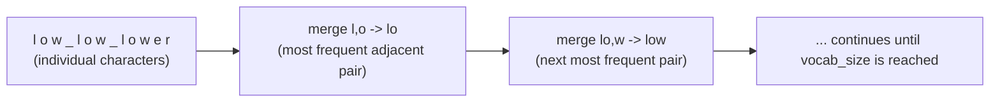
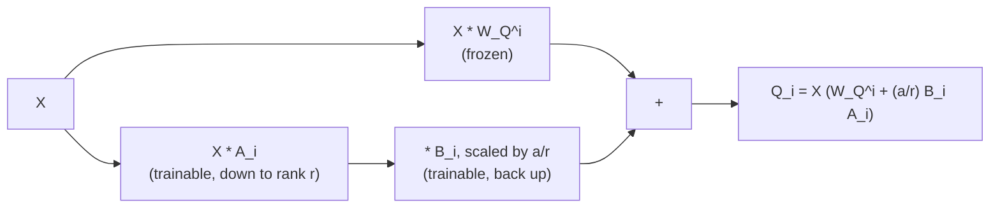

# Урок 13. Токенизаторы и низкоранговые адаптеры

**Связь с целью курса:** Этот урок завершает этап 5: `llm/finetuning` называет токенизаторы и низкоранговую идею мимоходом, а это рабочее пространство их выводит: сам алгоритм токенизатора и точное место, где низкоранговое обновление подключается к матрице весов, построенной здесь из «сырых» тензоров.
**Первоисточник:** [Научная статья: "Neural Machine Translation of Rare Words with Subword Units", Sennrich, Haddow, and Birch, 2016](https://arxiv.org/abs/1508.07909)
**Предварительные требования:** [Урок 12](0012-reading-real-model-code.md), [Масштабированное скалярное внимание](../GLOSSARY.md)

## Разминка

1. ▢ Назовите три распространённых небольших отклонения от исходной статьи, которые встречаются в большинстве современных реальных реализаций.

<details markdown="1"><summary>Проверка</summary>

Обучаемые или ротационные позиционные эмбеддинги вместо синусоидальных, GELU вместо ReLU в feed-forward-блоке и пре-нормализация вместо пост-нормализации.

</details>

2. ▢ Почему каждый блок трансформера должен сохранять одну и ту же размерность на входе и на выходе?

<details markdown="1"><summary>Проверка</summary>

Стек означает, что выход одного блока подаётся прямо на вход следующего; блок, который менял бы размерность, сломал бы единообразный, подключаемый без доработок стек, позволяющий повторять одну и ту же форму блока любое число раз.

</details>

## Что нужно знать

### Вывод токенизатора: кодирование пар байтов

`llm/finetuning` рассматривает токенизатор как нечто, с чем модель уже поставляется, и лишь отмечает, что современные модели используют токенизацию по подсловам, построенную «начиная с байтов и многократно сливая самую частую соседнюю пару». Вот этот алгоритм целиком: **кодирование пар байтов** (byte-pair encoding, BPE) начинается с представления каждого фрагмента обучающего текста как последовательности «сырых» байтов (или символов), каждый из которых это отдельная запись словаря. Затем оно повторяет один шаг: подсчитывает каждую соседнюю пару символов по всему корпусу, находит единственную самую частую пару и сливает её в один новый символ, добавляемый в словарь. Это повторяется, пока словарь не достигнет выбранного целевого размера.

Крошечный разобранный пример: пусть корпус `"low low lower"` (пробелы отмечают границы слов и хранятся отдельно), и мы начинаем с отдельных символов; пара `l, o` может оказаться самой частой соседней парой по корпусу, поэтому она сливается в новый символ `lo`. Следующий раунд находит следующую по частоте пару среди обновлённых символов, `lo, w`, и сливает её в `low`. Каждый раунд слияния сокращает число символов, представляющих распространённые подстроки, и увеличивает словарь ровно на одну запись. Достаточное число итераций даёт словарь, где частые слова сжимаются в один токен, а редкие слова распадаются на более мелкие, более частые кусочки, и это в точности то свойство, которое отметил разбор токенизаторов в `llm/finetuning`: «токены это не слова».



Отсюда же на самом деле берётся `vocab_size` из урока 8: это столько слияний (плюс начальные символы), на сколько запускалось обучение токенизатора, и оно фиксируется, когда обучение завершается, а входной эмбеддинг и выходной слой, выведенные в этом рабочем пространстве, рассчитываются под то число, которое дало это обучение.

### Вывод низкоранговой идеи: куда она подключается к реальной матрице весов

Собственный разбор низкоранговой идеи в `llm/finetuning` уже выводит механизм полностью: заморозить матрицу весов `W₀` и вместо обучения для неё полного обновления разложить обновление на две малые матрицы, `ΔW = BA`, где `A` проецирует вниз в малый ранг `r`, а `B` проецирует обратно вверх, так что `h = W₀x + (α/r) BAx`. Чего этому разбору показывать не нужно, потому что его цель это адаптер, а не архитектура под ним, так это того, какая именно матрица `W₀` конкретно находится внутри трансформера, построенного в этом рабочем пространстве из «сырых» тензоров.

Возьмите поголовную проекцию запроса из урока 2, `W_Q^i`, одну из обучаемых матриц, порождающих `Q_i = X W_Q^i`. Применить к ней низкоранговый адаптер означает заморозить `W_Q^i` ровно такой, какой она была после предобучения, и вычислять:

```text
Q_i = X (W_Q^i + (α / r) B_i A_i)
```

`A_i` и `B_i` это новые малые матрицы, размер которых задаёт ранг `r`, и только они получают градиенты при обучении адаптера; `W_Q^i` никогда не меняется. Всё, что идёт дальше, остальное внимание, нормализация слоя, feed-forward-блок, стек блоков, выходной слой, работает ровно так, как было выведено в этом рабочем пространстве, и совершенно не знает, что `Q_i` пришло из замороженной матрицы плюс небольшой аддитивной поправки, а не из одной обученной матрицы. Это конкретный ответ на вопрос «куда подключается низкоранговый адаптер»: в то же самое умножение матриц, которое это рабочее пространство выписало из «сырых» тензоров в уроке 2, при этом одно слагаемое этого умножения разделено на замороженную часть и обучаемую низкоранговую часть.



Поскольку обновление аддитивно и линейно ровно так же, как линейна сама проекция из урока 2, `W_Q^i + (α/r) B_i A_i` после обучения схлопывается в одну обычную матрицу, и в этом суть замечания из `llm/finetuning` про нулевые накладные расходы на инференсе: ничего в построенном здесь прямом проходе менять не нужно, чтобы обслуживать слитый адаптер, ведь слитый результат это просто ещё одна `W_Q^i`.

## Практика

1. ▢ Начав с корпуса `"low low lower"`, представленного отдельными символами, опишите в общих чертах, что делает первый шаг слияния в кодировании пар байтов.

<details markdown="1"><summary>Проверка</summary>

Подсчитывает каждую соседнюю пару символов по корпусу, находит пару, которая встречается чаще всего (например, `l`, за которой следует `o`), и сливает эту пару в один новый символ, добавляя его в словарь. Теперь каждое будущее вхождение этой соседней пары в корпусе представляется единым новым символом вместо двух отдельных.

</details>

2. ▢ Как обучение токенизатора определяет `vocab_size` и что это число затем фиксирует внутри архитектуры модели, выведенной в этом рабочем пространстве?

<details markdown="1"><summary>Проверка</summary>

`vocab_size` это столько начальных символов плюс шагов слияния, на сколько запускалось обучение BPE токенизатора, и оно фиксируется, когда обучение завершается. Это число затем напрямую задаёт размер таблицы входных эмбеддингов и выходного проекционного слоя из урока 8, поскольку форма обоих определяется `vocab_size`.

</details>

3. ▢ Используя поголовную проекцию запроса из урока 2, `Q_i = X W_Q^i`, запишите изменённое вычисление, когда к `W_Q^i` подключён низкоранговый адаптер, и укажите, какие матрицы получают градиенты при обучении адаптера.

<details markdown="1"><summary>Подсказка</summary>

Замороженная матрица и низкоранговая поправка входят в одно и то же умножение.

</details>

<details markdown="1"><summary>Проверка</summary>

`Q_i = X (W_Q^i + (α/r) B_i A_i)`. Градиенты получают только `A_i` и `B_i`; `W_Q^i` остаётся замороженной на всём протяжении обучения адаптера.

</details>

4. ▢ Почему `W_Q^i + (α/r) B_i A_i` после обучения схлопывается в единую обычную матрицу и что это значит для прямого прохода, выведенного в этом рабочем пространстве?

<details markdown="1"><summary>Проверка</summary>

И замороженная матрица, и низкоранговая поправка это линейные аддитивные слагаемые в одном умножении матриц, поэтому их сумма это просто ещё одна матрица той же формы, что `W_Q^i`. Ничего в построенном здесь прямом проходе менять не нужно, чтобы её использовать: слитый результат встаёт прямо в `Q_i = X W_Q^i` как обычная матрица проекции, без дополнительных вычислений на инференсе.

</details>

5. ▢ Какое утверждение верно о том, как выводы этого рабочего пространства связаны с разбором токенизаторов и низкоранговых адаптеров в `llm/finetuning`?

    - a) `llm/finetuning` и это рабочее пространство учат абсолютно одному и тому же, так что одно из них лишнее
    - b) Это рабочее пространство выводит механизмы (алгоритм слияния в BPE, точную матрицу, к которой подключается низкоранговое обновление), которые `llm/finetuning` называет мимоходом, не выводя
    - c) Низкоранговый адаптер можно подключить только к выходному слою, но никогда к проекции внимания
    - d) `vocab_size` выбирается независимо от токенизатора и не влияет на эмбеддинги и выходной слой

<details markdown="1"><summary>Проверка</summary>

**b)** Это в точности граница, которую цель этого рабочего пространства провела с самого начала. Вариант (a) неверен: `llm/finetuning` охватывает, зачем и когда применять эти техники; это рабочее пространство охватывает механизм и то, куда он подключается. Вариант (c) неверен: в этом уроке низкоранговое обновление было подключено именно к проекции внимания (`W_Q^i`), хотя его можно подключить и к другим матрицам весов. Вариант (d) неверен: `vocab_size` напрямую получается из обучения токенизатора и фиксирует формы и таблицы эмбеддингов, и выходного слоя.

</details>

## Практика в реальной работе

- [ ] Выполните вручную шаг слияния кодирования пар байтов на коротком тексте по вашему выбору, отслеживая счётчики пар и получающийся словарь после двух-трёх слияний.
- [ ] Добавьте в свою реализацию трансформера с нуля низкоранговый адаптер к одной матрице проекции внимания, заморозив исходную и обучая только новые матрицы `A` и `B`.
- [ ] Завтра: вернитесь к цели этого рабочего пространства в `README.md` и убедитесь, своими словами, что вы можете реализовать прямой проход полного трансформера и цикл обучения из «сырых» тензоров и найти каждую выведенную часть в коде реальных моделей.

## Что почитать дальше

- [Научная статья: "Neural Machine Translation of Rare Words with Subword Units", Sennrich, Haddow, and Birch, 2016](https://arxiv.org/abs/1508.07909)
- [Адаптер](../../finetuning/GLOSSARY.md): канонический термин `llm/finetuning` для шаблона «замороженная база плюс небольшие обучаемые веса», который этот урок подключает к конкретной матрице
- [Ресурсы](../RESOURCES.md)

---

Не доходит? Перечитайте первоисточник в начале: этот урок его сжимает, а при сжатии понимание как раз и теряется. Загляните в [глоссарий](../GLOSSARY.md), если какой-то термин показался скользким.

Если неясен сам урок, а не материал, это дефект: [откройте issue](https://github.com/TokenCemetery/teach/issues).
