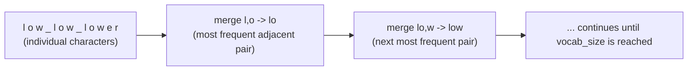
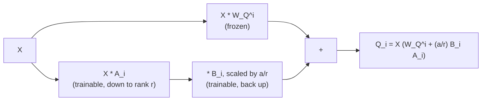

# 第 13 课：分词器与低秩适配器

**使命关联:** 本课结束第 5 阶段：`llm/finetuning` 只是顺带提到了分词器和低秩的思路，本工作区则把它们推导出来，既有分词器算法本身，也有低秩更新附着在这个工作区用原始张量搭建的权重矩阵上的确切位置。
**主要来源:** [论文：“Neural Machine Translation of Rare Words with Subword Units”，Sennrich、Haddow 和 Birch，2016](https://arxiv.org/abs/1508.07909)
**前置知识:** [第 12 课](0012-reading-real-model-code.md)、[缩放点积注意力](../GLOSSARY.md)

## 热身

1. ▢ 说出在大多数现代真实实现中，与原始论文相比常见的三处细小偏离。

<details markdown="1"><summary>检查</summary>

用学习得到的位置嵌入或旋转位置嵌入取代正弦式，前馈块里用 GELU 取代 ReLU，以及用前归一化取代后归一化的放置。

</details>

2. ▢ 为什么每个 Transformer 块都必须保持相同的输入和输出维度？

<details markdown="1"><summary>检查</summary>

堆叠就意味着一个块的输出直接送进下一个块的输入；某个块如果改变了维度，就会破坏那种统一的、即插即用的堆叠方式，而正是这种方式让同一种块的形状可以重复任意多次。

</details>

## 要点

### 推导分词器：字节对编码

`llm/finetuning` 把分词器当作模型本来就自带的东西，只是指出现代模型使用子词分词，其构建方式是“从字节出发，反复合并最常见的相邻对”。下面就是这个算法的完整过程：**字节对编码**（BPE）先把每一段训练文本表示成一串原始字节（或字符），每个都是词表里的独立一项。然后它反复执行同一步：统计整个语料库里每一个相邻的符号对，找出出现最频繁的那一个对，把它合并成一个新的符号，加进词表。这一步一直重复，直到词表达到选定的目标大小。

一个很小的例子：给定语料 `"low low lower"`（空格标记词的边界，单独保留），从单个字符出发，`l, o` 这个对可能是整个语料里最频繁的相邻对，于是它被合并成一个新符号 `lo`。下一轮在更新后的符号中找出下一个最频繁的对，`lo, w`，把它合并成 `low`。每一轮合并，都会减少表示常见子串所需的符号数量，并让词表恰好增加一项。迭代足够多次之后，就得到这样一个词表：常见的词压缩成一个 token，罕见的词则退回成更小、更常见的片段，这正是 `llm/finetuning` 的分词器覆盖范围里观察到的性质：“token 不是词”。



第 8 课的 `vocab_size` 实际上也是从这里来的：它就是分词器的训练运行了多少次合并（再加上起始符号），训练一结束就固定下来，而这个工作区推导出的输入嵌入层和输出层，其大小就取决于那次训练产生的这个数。

### 推导低秩的思路：它附着在真实的权重矩阵的哪个位置

`llm/finetuning` 自己对低秩思路的讲解，已经完整推导了这个机制：冻结一个权重矩阵 `W₀`，不去为它学习完整的更新，而是把更新分解成两个小矩阵，`ΔW = BA`，其中 `A` 向下投影到一个很小的秩 `r`，`B` 再向上投影回来，于是 `h = W₀x + (α/r) BAx`。那份讲解不需要展示的是，`W₀` 在这个工作区用原始张量搭建的 Transformer 里，具体究竟是哪个矩阵，因为它的使命是适配器，而不是适配器底下的架构。

以第 2 课每个头的查询投影 `W_Q^i` 为例，它是产生 `Q_i = X W_Q^i` 的那些学习得到的矩阵之一。对它施加低秩适配器，意味着把 `W_Q^i` 完全冻结在预训练之后的样子，然后计算：

```text
Q_i = X (W_Q^i + (α / r) B_i A_i)
```

`A_i` 和 `B_i` 是新的小矩阵，大小由秩 `r` 决定，适配器训练期间只有它们接收梯度；`W_Q^i` 永远不变。下游的一切，注意力的其余部分、层归一化、前馈块、堆叠、输出层，都完全按这个工作区推导的方式运行，丝毫不知道 `Q_i` 来自一个冻结的矩阵加上一个小的加性修正，而不是一个单一的、学习得到的矩阵。这就是“低秩适配器附着在哪里”的具体答案：就在这个工作区在第 2 课里用原始张量写出的同一次矩阵乘法上，只是把那次乘法的一项拆成了冻结的部分和可训练的低秩部分。



由于这个更新是加性的，而且与第 2 课的投影本身一样是线性的，训练之后 `W_Q^i + (α/r) B_i A_i` 就合并成一个普通的矩阵，这就是 `llm/finetuning` 所说的零推理开销：这个工作区搭建的前向传播，不需要任何改动就能为合并后的适配器服务，因为合并后的结果只是另一个 `W_Q^i`。

## 练习

1. ▢ 从表示成单个字符的语料 `"low low lower"` 出发，大体描述字节对编码的第一步合并做了什么。

<details markdown="1"><summary>检查</summary>

统计整个语料里每一个相邻的符号对，找出出现最频繁的那个对（例如，`l` 后面跟着 `o`），把这个对合并成一个新符号，加进词表。语料里今后每一次出现这个相邻对，都由那一个新符号来表示，而不再是两个独立的符号。

</details>

2. ▢ 分词器的训练如何决定 `vocab_size`？这个数字又固定了这个工作区所推导的模型架构里的什么？

<details markdown="1"><summary>检查</summary>

`vocab_size` 就是分词器的 BPE 训练运行了多少个起始符号加合并步骤，训练一结束就固定下来。这个数随后直接决定第 8 课的输入嵌入表和输出投影层的大小，因为两者的形状都由 `vocab_size` 决定。

</details>

3. ▢ 以第 2 课每个头的查询投影 `Q_i = X W_Q^i` 为例，写出在 `W_Q^i` 上附加低秩适配器之后修改过的计算，并说明适配器训练期间哪些矩阵接收梯度。

<details markdown="1"><summary>提示</summary>

冻结的矩阵和低秩修正都是同一次乘法的一部分。

</details>

<details markdown="1"><summary>检查</summary>

`Q_i = X (W_Q^i + (α/r) B_i A_i)`。只有 `A_i` 和 `B_i` 接收梯度；在整个适配器训练期间，`W_Q^i` 保持冻结。

</details>

4. ▢ 为什么训练之后 `W_Q^i + (α/r) B_i A_i` 会合并成一个单一的普通矩阵？这对这个工作区所推导的前向传播意味着什么？

<details markdown="1"><summary>检查</summary>

冻结的矩阵和低秩修正，都是同一次矩阵乘法里的线性、加性的项，所以它们的和只是另一个与 `W_Q^i` 形状相同的矩阵。这个工作区搭建的前向传播不需要任何改动就能使用它：合并后的结果作为一个普通的投影矩阵，直接代入 `Q_i = X W_Q^i`，推理时没有任何额外的计算。

</details>

5. ▢ 关于这个工作区的推导与 `llm/finetuning` 对分词器和低秩适配器的讲解之间是如何衔接的，下面哪一项说法是对的？

    - a) `llm/finetuning` 和这个工作区教的内容完全相同，所以其中一个是多余的
    - b) 这个工作区推导了 `llm/finetuning` 只是顺带提到而没有推导的那些机制（BPE 的合并算法、低秩更新所附着的那个确切的矩阵）
    - c) 低秩适配器只能附着在输出层上，永远不能附着在注意力投影上
    - d) `vocab_size` 的选择与分词器无关，对嵌入层或输出层没有影响

<details markdown="1"><summary>检查</summary>

**b)** 这正是这个工作区的使命从一开始就划定的边界。(a) 是错的：`llm/finetuning` 讲的是为什么、什么时候使用这些技术；这个工作区讲的是机制以及它附着在哪里。(c) 是错的：本课专门把一个低秩更新附着到了一个注意力投影（`W_Q^i`）上，当然它也可以附着到其他权重矩阵上。(d) 是错的：`vocab_size` 直接来自分词器的训练，并固定了嵌入表和输出层的形状。

</details>

## 实战练习

- [ ] 对你自己选的一小段文本，手工执行字节对编码的合并步骤，跟踪两三次合并之后的对计数和得到的词表。
- [ ] 在你从零搭建的 Transformer 实现里，给一个注意力投影矩阵加上低秩适配器，冻结原来的矩阵，只训练新的 `A` 和 `B` 矩阵。
- [ ] 明天：重温 `README.md` 里这个工作区的使命，并用你自己的话确认，你能从原始张量实现一个完整 Transformer 的前向传播和训练循环，并在真实的模型代码里找到每一个推导出来的部件。

## 延伸阅读

- [论文：“Neural Machine Translation of Rare Words with Subword Units”，Sennrich、Haddow 和 Birch，2016](https://arxiv.org/abs/1508.07909)
- [适配器](../../finetuning/GLOSSARY.md)：`llm/finetuning` 对“冻结的基座加小的可训练权重”这一模式的规范术语，本课把它附着到了一个具体的矩阵上
- [资源](../RESOURCES.md)

---

没学明白？请重读顶部的主要来源，因为本课是对它的压缩，而理解正是在压缩中流失的。如果有哪个术语觉得含糊，可以查看[术语表](../GLOSSARY.md)。

如果问题出在课程本身，而不是学习材料，那就是一个缺陷：[提交 issue](https://github.com/TokenCemetery/teach/issues)。
