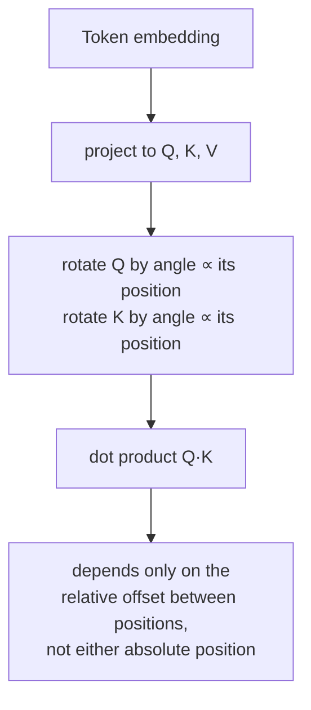

# Lección 14. Rotary Position Embeddings

**Vínculo con la misión:** La lección 4 estableció que la posición tiene que entrar a través de los vectores que producen `Q`, `K` y `V`, ya que la ecuación de la atención no tiene otro canal para ella, y enseñó la única manera en que lo hace el paper original: sumar un vector sinusoidal fijo al embedding del token antes de que la atención corra siquiera. Los **rotary position embeddings (RoPE)** son el mecanismo que casi todos los modelos abiertos actuales usan realmente en su lugar, e inyectan la posición por el mismo canal que identificó la lección 4, pero con una operación genuinamente distinta: rotar `Q` y `K` mismas, dentro del cálculo de atención, en lugar de sumar nada al embedding de antemano.
**Fuente principal:** [Paper: "RoFormer: Enhanced Transformer with Rotary Position Embedding", Su et al., 2021](https://arxiv.org/abs/2104.09864)
**Requisitos previos:** [Lección 4](0004-positional-encoding.md), [Codificación posicional](../GLOSSARY.md)

## Calentamiento

1. ▢ ¿Por qué debe codificarse la posición en los vectores que producen `Q`, `K` y `V`, y no pasarse a la atención como alguna señal separada?

Comprobación

La ecuación de la atención solo opera sobre `Q`, `K` y `V`; no hay ninguna entrada adicional por la que pueda entrar la posición. La única manera de que el cálculo se vuelva sensible a la posición es que la posición ya esté incorporada en los vectores que los producen.

2. ▢ ¿Por qué puede evaluarse la codificación posicional sinusoidal para una longitud de secuencia mayor que cualquiera vista durante el entrenamiento, y una tabla de embeddings posicionales aprendida no?

Comprobación

La codificación sinusoidal es una fórmula, evaluable en cualquier valor de posición. Una tabla de embeddings aprendida solo tiene filas para las posiciones para las que se dimensionó y entrenó, y más allá de ese rango no hay nada que consultar.

## Qué debes saber

### RoPE rota Q y K en lugar de sumar nada al embedding

Mientras que la codificación sinusoidal suma un vector fijo al embedding de un token una sola vez, antes de que se proyecte siquiera en `Q`, `K` o `V`, **RoPE** toma en cambio los vectores de query y key ya proyectados de un token en la posición `pos` y les aplica una **rotación**, por un ángulo proporcional a `pos`. Dividiendo un vector en pares de 2 dimensiones (el mismo emparejamiento que usaba la codificación sinusoidal para sus frecuencias de seno y coseno), cada par se rota por un ángulo que escala con la posición y con la frecuencia propia de ese par, de modo que los pares de índice bajo rotan despacio a lo largo de las posiciones y los de índice alto rotan rápido, lo que replica la estructura de frecuencias que la lección 4 ya presentó.

### Un producto escalar rotado depende solo de la posición relativa, no de ninguna de las posiciones absolutas

Este es el beneficio real de RoPE, y es una propiedad de la rotación misma: rotar un vector query por un ángulo proporcional a la posición `m` y un vector key por un ángulo proporcional a la posición `n`, y luego tomar su producto escalar, produce un valor que depende solo de `m − n`, el desfase relativo entre ellos, y no de `m` ni de `n` por separado. Dos rotaciones se componen sumando sus ángulos, así que comparar un vector rotado por el ángulo de `m` con uno rotado por el ángulo de `n` es matemáticamente equivalente a comparar los vectores originales, sin rotar, después de rotar solo por la *diferencia* `m − n`. El propio planteamiento del paper recoge exactamente esto: RoPE codifica la posición *absoluta* (cada vector se rota según su propia posición) pero el efecto sobre la atención es una dependencia *explícita relativa* de la posición, ya que solo el desfase entre posiciones sobrevive en la puntuación de atención.

### Este es un mecanismo distinto del de la lección 4, no un parche encima

La codificación sinusoidal es aditiva y ocurre una sola vez, antes de la atención, mezclada de forma permanente en el embedding desde ese punto. RoPE es multiplicativa (una rotación) y ocurre dentro del propio cálculo de atención, aplicada de nuevo a `Q` y `K` en cada capa que calcula atención, en lugar de quedar incorporada en el embedding una sola vez a la entrada. Ambas cumplen el requisito de la lección 4 de que la posición entre por los vectores sobre los que realmente opera la atención, pero son dos maneras estructuralmente distintas de hacerlo, y la propiedad de posición relativa de RoPE no es algo que produzca por sí solo el esquema aditivo de la codificación sinusoidal.

### Por qué importa esta propiedad concreta en los modelos reales

Un modelo cuya puntuación de atención depende del desfase relativo y no de la posición absoluta maneja un caso práctico que el propio paper de la codificación sinusoidal solo defendió de manera informal: la relación entre un token y otro situado 5 posiciones antes se ve igual tanto si ese par está al principio de una secuencia corta como en medio de una muy larga. Esta propiedad de posición relativa, derivada directamente de cómo se componen las rotaciones, es una razón importante por la que RoPE desplazó a la codificación sinusoidal en la práctica, junto con la flexibilidad de manejar longitudes de secuencia no fijadas en el momento del entrenamiento, igual que podía hacerlo el enfoque basado en fórmula (y no en tabla) de la lección 4.

## Práctica

1. ▢ RoPE rota un vector query según su posición absoluta y un vector key según su propia posición absoluta. ¿Por qué describe aun así el paper el efecto resultante sobre la atención como una dependencia *relativa* de la posición?

Pista

Considera qué pasa con dos ángulos de rotación cuando comparas los vectores a los que se aplicó cada uno.

Comprobación

Como dos rotaciones se componen sumando sus ángulos, comparar un vector rotado por el ángulo de la posición `m` con uno rotado por el ángulo de la posición `n` equivale a comparar los vectores sin rotar tras una única rotación por la diferencia `m − n`. Aunque cada vector se rotó según su propia posición absoluta, solo el desfase relativo entre las dos posiciones sobrevive en el producto escalar resultante.

2. ▢ ¿En qué se diferencia estructuralmente el mecanismo de RoPE para inyectar la posición del de la codificación sinusoidal, aunque ambos cumplan el requisito de la lección 4 de que la posición entre por Q, K y V?

Comprobación

La codificación sinusoidal suma un vector fijo al embedding del token una sola vez, antes de que ocurra la atención o cualquier proyección, mezclado de forma permanente en la representación desde ese punto en adelante. RoPE, en cambio, rota los vectores `Q` y `K` ya proyectados, aplicada de nuevo dentro del cálculo de atención en cada capa, una operación multiplicativa y no una aditiva hecha de antemano.

3. ▢ Dos tokens están a 5 posiciones de distancia cerca del principio de una secuencia, y otros dos tokens también están a 5 posiciones de distancia mucho más adelante en una secuencia larga. Bajo RoPE, ¿cómo se relacionan sus puntuaciones de atención, todo lo demás igual?

Comprobación

Dependen del mismo desfase relativo (5 posiciones), así que la propiedad de composición de rotaciones de RoPE hace que la puntuación de atención resultante trate ambos pares de manera coherente según ese desfase compartido, en lugar de ser sensible a dónde de la secuencia esté cada par.

4. ▢ ¿Contradice RoPE la afirmación de la lección 4 de que la posición debe codificarse en los vectores que producen Q, K y V, dado que RoPE opera directamente sobre Q y K y no sobre el embedding?

Comprobación

No. RoPE rota los vectores query y key que la ecuación de la atención usa realmente, que siguen siendo los vectores por los que la lección 4 dijo que tiene que entrar la posición; RoPE es un mecanismo distinto para inyectar la posición en esos mismos vectores (rotación multiplicativa, aplicada después de la proyección) y no una excepción al requisito en sí.

5. ▢ ¿Qué afirmación distingue correctamente a RoPE de la codificación posicional sinusoidal?

    - a) RoPE suma un vector fijo al embedding del token, exactamente igual que la codificación sinusoidal, solo que calculado con otra fórmula
    - b) RoPE rota los vectores Q y K proyectados por un ángulo proporcional a la posición, lo que hace que un producto escalar resultante dependa solo de la posición relativa, una propiedad que el esquema aditivo de la codificación sinusoidal no produce
    - c) RoPE y la codificación sinusoidal operan ambas sobre el embedding del token antes de cualquier proyección a Q, K o V
    - d) RoPE requiere que la posición se pase a la atención como una señal separada de Q y K

Comprobación

**b)** Ese es el mecanismo y el beneficio precisos que establece esta lección. (a) es falsa: RoPE es una rotación aplicada a Q y K ya proyectados, no un vector aditivo sobre el embedding. (c) es falsa: la codificación sinusoidal opera sobre el embedding antes de la proyección; RoPE opera sobre Q y K después de la proyección. (d) es falsa: RoPE sigue respetando el requisito de la lección 4, inyectando la posición en Q y K mismas, el mismo canal que usa realmente la ecuación de la atención.

## Prácticas en el mundo real

- [ ] Implementa la rotación de RoPE para una dimensión de vector pequeña y unas cuantas posiciones enteras, y confirma numéricamente que el producto escalar entre una query rotada en la posición `m` y una key rotada en la posición `n` depende solo de `m - n`, y no de `m` ni de `n` por separado.
- [ ] Compara lado a lado tu implementación sinusoidal de la lección 4 y la implementación de RoPE de esta lección: ¿qué vectores modifica cada una y en qué punto del forward pass corre cada una?
- [ ] Mañana: lee la sección de la fuente principal sobre cómo afecta la propiedad de posición relativa de RoPE al comportamiento de la atención a medida que crece la distancia, y anota qué afirma sobre el decaimiento de las puntuaciones con la distancia.

## Para profundizar

- [Paper: "RoFormer: Enhanced Transformer with Rotary Position Embedding", Su et al., 2021](https://arxiv.org/abs/2104.09864)
- [Paper: "Attention Is All You Need", Vaswani et al., 2017](https://arxiv.org/abs/1706.03762)
- [Recursos](../RESOURCES.md)

---

¿No termina de quedar claro? Vuelve a leer la fuente primaria de arriba, ya que esta lección la comprime y en la compresión es donde se escapa la comprensión. Consulta el [glosario](../GLOSSARY.md) por si algún término te resultó resbaladizo.

Si lo poco claro es la propia lección y no el material, eso es un defecto: [abre un issue](https://github.com/TokenCemetery/teach/issues).
