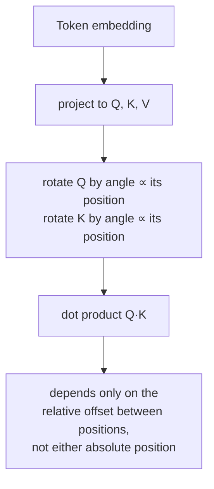

# Leçon 14. Embeddings de position rotatifs

**Lien avec la mission :** La leçon 4 a établi que la position doit entrer par les vecteurs qui produisent `Q`, `K` et `V`, puisque l'équation de l'attention n'a aucun autre canal pour elle, et elle a enseigné la seule façon dont l'article d'origine s'y prend : ajouter un vecteur sinusoïdal fixe à l'embedding du token avant même que l'attention s'exécute. Les **embeddings de position rotatifs (RoPE, rotary position embeddings)** sont le mécanisme que presque tous les modèles ouverts actuels utilisent réellement à la place, et ils injectent la position par le même canal que celui identifié à la leçon 4, mais par une opération réellement différente : faire tourner `Q` et `K` eux-mêmes, à l'intérieur du calcul d'attention, au lieu d'ajouter quoi que ce soit à l'embedding au préalable.
**Source primaire :** [Article : "RoFormer: Enhanced Transformer with Rotary Position Embedding", Su et al., 2021](https://arxiv.org/abs/2104.09864)
**Prérequis :** [Leçon 4](0004-positional-encoding.md)

## Échauffement

1. ▢ Pourquoi la position doit-elle être encodée dans les vecteurs qui produisent `Q`, `K` et `V`, plutôt que transmise à l'attention comme un signal séparé ?

Vérifier

L'équation de l'attention n'opère que sur `Q`, `K` et `V` ; il n'y a aucune entrée supplémentaire par laquelle la position puisse entrer. Le calcul ne devient sensible à la position que si celle-ci est déjà inscrite dans les vecteurs qui les produisent.

2. ▢ Pourquoi l'encodage positionnel sinusoïdal peut-il être évalué pour une longueur de séquence supérieure à tout ce qui a été vu pendant l'entraînement, alors qu'une table d'embeddings de position apprise ne le peut pas ?

Vérifier

L'encodage sinusoïdal est une formule, évaluable à n'importe quelle valeur de position. Une table d'embeddings apprise n'a de lignes que pour les positions pour lesquelles elle a été dimensionnée et entraînée, sans rien à consulter au-delà de cette plage.

## À savoir

### RoPE fait tourner Q et K au lieu d'ajouter quoi que ce soit à l'embedding

Là où l'encodage sinusoïdal ajoute une seule fois un vecteur fixe à l'embedding d'un token, avant qu'il soit projeté en `Q`, `K` ou `V`, **RoPE** prend au contraire les vecteurs de requête et de clé déjà projetés d'un token à la position `pos` et leur applique une **rotation**, d'un angle proportionnel à `pos`. En découpant un vecteur en paires de 2 dimensions (le même appariement que l'encodage sinusoïdal utilisait pour ses fréquences sinus/cosinus), chaque paire est tournée d'un angle qui croît avec la position et avec la fréquence propre à cette paire, les paires d'indice faible tournant lentement d'une position à l'autre, celles d'indice élevé tournant vite, ce qui reproduit la structure de fréquences que la leçon 4 a déjà présentée.

### Un produit scalaire tourné ne dépend que de la position relative, d'aucune des deux positions absolues

C'est le véritable bénéfice de RoPE, et c'est une propriété de la rotation elle-même : faire tourner un vecteur de requête d'un angle proportionnel à la position `m` et un vecteur de clé d'un angle proportionnel à la position `n`, puis prendre leur produit scalaire, produit une valeur qui ne dépend que de `m − n`, le décalage relatif entre elles, et non de `m` ou de `n` individuellement. Deux rotations se composent en additionnant leurs angles, donc comparer un vecteur tourné de l'angle de `m` à un vecteur tourné de l'angle de `n` est mathématiquement équivalent à comparer les vecteurs d'origine, non tournés, après une rotation de la seule *différence* `m − n`. La formulation même de l'article saisit exactement cela : RoPE encode la position *absolue* (chaque vecteur est tourné selon sa propre position) mais l'effet sur l'attention est une dépendance *explicite* à la position relative, puisque seul le décalage entre les positions survit dans le score d'attention.

### C'est un mécanisme différent de celui de la leçon 4, pas un correctif posé par-dessus

L'encodage sinusoïdal est additif et a lieu une seule fois, avant l'attention, mêlé de façon permanente à l'embedding à partir de là. RoPE est multiplicatif (une rotation) et a lieu à l'intérieur du calcul d'attention lui-même, appliqué de nouveau à `Q` et `K` à chaque couche qui calcule l'attention, plutôt qu'inscrit une seule fois dans l'embedding à l'entrée. Les deux satisfont l'exigence de la leçon 4 selon laquelle la position entre par les vecteurs sur lesquels l'attention opère réellement, mais ce sont deux façons structurellement différentes de le faire, et la propriété de position relative de RoPE n'est pas quelque chose que le schéma additif de l'encodage sinusoïdal produit de lui-même.

### Pourquoi cette propriété précise compte pour les vrais modèles

Un modèle dont le score d'attention dépend du décalage relatif plutôt que de la position absolue traite un cas pratique que l'article de l'encodage sinusoïdal n'avait argumenté qu'informellement : la relation entre un token et celui situé 5 positions avant lui est la même, que cette paire se trouve au début d'une séquence courte ou au milieu d'une très longue. Cette propriété de position relative, dérivée directement de la façon dont les rotations se composent, est une raison majeure pour laquelle RoPE a supplanté l'encodage sinusoïdal en pratique, avec la souplesse de gérer des longueurs de séquence non fixées à l'entraînement, comme le permettait déjà l'approche à base de formule (plutôt que de table) de la leçon 4.

## Pratique

1. ▢ RoPE fait tourner un vecteur de requête selon sa position absolue et un vecteur de clé selon sa propre position absolue. Pourquoi l'article décrit-il pourtant l'effet obtenu sur l'attention comme une dépendance à la position *relative* ?

Indice

Réfléchissez à ce qui arrive à deux angles de rotation quand on compare les vecteurs auxquels ils ont chacun été appliqués.

Vérifier

Comme deux rotations se composent en additionnant leurs angles, comparer un vecteur tourné de l'angle de la position `m` à un vecteur tourné de l'angle de la position `n` équivaut à comparer les vecteurs non tournés après une seule rotation de la différence `m − n`. Même si chaque vecteur a été tourné selon sa propre position absolue, seul le décalage relatif entre les deux positions survit dans le produit scalaire obtenu.

2. ▢ En quoi le mécanisme de RoPE pour injecter la position diffère-t-il structurellement de celui de l'encodage sinusoïdal, même si les deux satisfont l'exigence de la leçon 4 selon laquelle la position entre par Q, K et V ?

Vérifier

L'encodage sinusoïdal ajoute une seule fois un vecteur fixe à l'embedding du token, avant l'attention ou toute projection, mêlé de façon permanente à la représentation à partir de là. RoPE fait au contraire tourner les vecteurs `Q` et `K` déjà projetés, appliqué de nouveau à l'intérieur du calcul d'attention à chaque couche, une opération multiplicative plutôt qu'additive réalisée en amont.

3. ▢ Deux tokens sont distants de 5 positions près du début d'une séquence, et deux autres tokens sont aussi distants de 5 positions bien plus loin dans une longue séquence. Sous RoPE, comment leurs scores d'attention se rapportent-ils l'un à l'autre, toutes choses égales par ailleurs ?

Vérifier

Ils dépendent du même décalage relatif (5 positions), donc la propriété de composition des rotations de RoPE fait que le score d'attention obtenu traite les deux paires de façon cohérente d'après ce décalage commun, au lieu d'être sensible à l'endroit de la séquence où se trouve chaque paire.

4. ▢ RoPE contredit-il l'affirmation de la leçon 4 selon laquelle la position doit être encodée dans les vecteurs qui produisent Q, K et V, puisque RoPE opère directement sur Q et K plutôt que sur l'embedding ?

Vérifier

Non. RoPE fait tourner les vecteurs de requête et de clé que l'équation de l'attention utilise réellement, qui sont toujours les vecteurs par lesquels la leçon 4 disait que la position doit entrer ; RoPE est un autre mécanisme pour injecter la position dans ces mêmes vecteurs (rotation multiplicative, appliquée après la projection), et non une exception à l'exigence elle-même.

5. ▢ Quelle affirmation distingue correctement RoPE de l'encodage positionnel sinusoïdal ?

    - a) RoPE ajoute un vecteur fixe à l'embedding du token, exactement comme l'encodage sinusoïdal, simplement calculé avec une autre formule
    - b) RoPE fait tourner les vecteurs Q et K projetés d'un angle proportionnel à la position, ce qui fait qu'un produit scalaire obtenu ne dépend que de la position relative, propriété que le schéma additif de l'encodage sinusoïdal ne produit pas
    - c) RoPE et l'encodage sinusoïdal opèrent tous deux sur l'embedding du token avant toute projection en Q, K ou V
    - d) RoPE exige que la position soit transmise à l'attention comme un signal séparé de Q et K

Vérifier

**b)** C'est le mécanisme précis et le bénéfice que cette leçon établit. (a) est faux : RoPE est une rotation appliquée à Q et K déjà projetés, et non un vecteur additif sur l'embedding. (c) est faux : l'encodage sinusoïdal opère sur l'embedding avant la projection ; RoPE opère sur Q et K après la projection. (d) est faux : RoPE respecte toujours l'exigence de la leçon 4, en injectant la position dans Q et K eux-mêmes, le même canal que l'équation de l'attention utilise réellement.

## Exercices en situation réelle

- [ ] Implémentez la rotation de RoPE pour une petite dimension de vecteur et quelques positions entières, et vérifiez numériquement que le produit scalaire entre une requête tournée à la position `m` et une clé tournée à la position `n` ne dépend que de `m - n`, et non de `m` ou de `n` individuellement.
- [ ] Comparez côte à côte votre implémentation sinusoïdale de la leçon 4 et l'implémentation de RoPE de cette leçon : quels vecteurs chacune modifie-t-elle, et à quel moment de la passe avant chacune s'exécute-t-elle ?
- [ ] Demain : lisez la section de la source primaire sur la façon dont la propriété de position relative de RoPE affecte le comportement de l'attention quand la distance augmente, et notez ce qu'elle affirme sur la décroissance des scores avec la distance.

## Pour aller plus loin

- [Article : "RoFormer: Enhanced Transformer with Rotary Position Embedding", Su et al., 2021](https://arxiv.org/abs/2104.09864)
- [Article : "Attention Is All You Need", Vaswani et al., 2017](https://arxiv.org/abs/1706.03762)
- [Ressources](../RESOURCES.md)

---

Ça ne passe pas ? Relisez la source primaire en haut de page, car cette leçon la condense et c'est dans la condensation que la compréhension s'échappe. Consultez le [glossaire](../GLOSSARY.md) pour tout terme qui vous a paru glissant.

Si c'est la leçon elle-même qui n'est pas claire plutôt que la matière, c'est un défaut : [ouvrez une issue](https://github.com/TokenCemetery/teach/issues).
